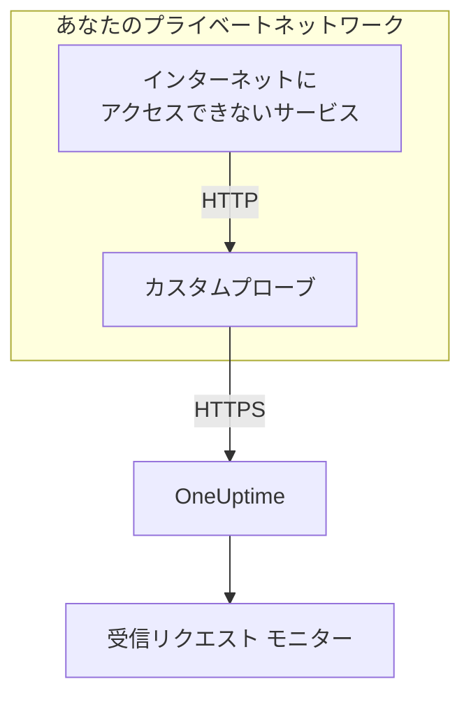

# 受信リクエスト Ingress

インターネットにアクセスできないサービスでも、 [受信リクエスト モニター](/docs/monitor/incoming-request-monitor) にハートビートを送れます。サービスは代わりに同じネットワーク内の [カスタムプローブ](/docs/probe/custom-probe) に送り、プローブがそれを OneUptime に転送します。

:::cards
- [仕組み](#仕組み): サービスからプローブを経て、モニターまで。
- [リスナーをオンにする](#リスナーをオンにする): Docker、Docker Compose、Kubernetes 向けの、プローブの設定 1 つ。
- [プローブにリクエストを送る](#プローブにリクエストを送る): サービスの送信先 URL を変えるだけで、ほかは何も変えません。
- [トラブルシューティング](#トラブルシューティング): リクエストが届かないときにプローブがログに出す内容。
:::

## 仕組み



1. **サービスがプローブにリクエストを送ります。** OneUptime に送るのと同じ `GET` または `POST` を、同じシークレットキー付きで、プローブが待ち受けるポートに送ります。
2. **プローブはすぐに応答します。** リクエストを転送する前に `200` を返すので、サービスが OneUptime を待つことはありません。
3. **プローブがそれを転送します。** メソッド、ヘッダー、ボディとともにリクエストを OneUptime に送り、プローブを示す `OneUptime-Probe-Id` ヘッダーを追加します。
4. **OneUptime はいつもどおりに読みます。** モニターの条件は、サービスが直接送った場合と同じようにリクエストを扱います。

リスナーはプローブのヘルスチェックとは別の専用ポートで動くので、ほかに何も開けずにプライベートネットワークに公開できます。

## 使う場面

次のような場合にリスナーを使います。

- サービスが外向きの HTTPS アクセスのない、隔離されたネットワークセグメントで動いている
- 監視のトラフィックをすべて VPC やオンプレミスのネットワーク内にとどめる必要がある
- OneUptime への到達を許可する出口を、プローブ 1 か所にまとめたい
- すでに [カスタムプローブ](/docs/probe/custom-probe) を導入していて、受信ハートビートにも再利用したい

サービスがすでに `https://oneuptime.com` (またはセルフホストの URL) に直接届くなら、この機能は **不要** です。サービスからハートビート URL を直接呼び出してください。

## 始める前に

- **稼働中のカスタムプローブ。** その **ステータス** が **接続済み** になっていること。インストール方法は [カスタム プローブ](/docs/probe/custom-probe) を参照してください。
- **受信リクエストのモニター。** そのハートビート URL に、サービスが送るシークレットキーが含まれています。 [受信リクエスト モニター](/docs/monitor/incoming-request-monitor) を参照してください。
- **サービスから届く、プローブのホスト上のポート。** 例では `3875` を使います。

## リスナーをオンにする

`PROBE_INGRESS_PORT` に、リスナーが使うポートを設定します。 `0` より大きい値でオンになり、未設定または `0` ならオフのままです。

:::tabs
@tab Docker
```bash
docker run --name oneuptime-probe --network host \
  -e PROBE_KEY=<probe-key> \
  -e PROBE_ID=<probe-id> \
  -e ONEUPTIME_URL=https://oneuptime.com \
  -e PROBE_INGRESS_PORT=3875 \
  -d oneuptime/probe:release
```

`--network host` を使わない場合は、 `-p 3875:3875` でポートを公開します。
@tab Docker Compose
```yaml title="docker-compose.yml"
services:
  oneuptime-probe:
    image: oneuptime/probe:release
    container_name: oneuptime-probe
    environment:
      - PROBE_KEY=<probe-key>
      - PROBE_ID=<probe-id>
      - ONEUPTIME_URL=https://oneuptime.com
      - PROBE_INGRESS_PORT=3875
    network_mode: host
    restart: always
```

`network_mode: host` を使わない場合は、 `ports:` の下に `"3875:3875"` としてポートを公開します。
@tab Kubernetes
```yaml title="oneuptime-probe.yaml"
apiVersion: apps/v1
kind: Deployment
metadata:
  name: oneuptime-probe
spec:
  selector:
    matchLabels:
      app: oneuptime-probe
  template:
    metadata:
      labels:
        app: oneuptime-probe
    spec:
      containers:
        - name: oneuptime-probe
          image: oneuptime/probe:release
          env:
            - name: PROBE_KEY
              value: "<probe-key>"
            - name: PROBE_ID
              value: "<probe-id>"
            - name: ONEUPTIME_URL
              value: "https://oneuptime.com"
            - name: PROBE_INGRESS_PORT
              value: "3875"
          ports:
            - name: ingress
              containerPort: 3875
---
apiVersion: v1
kind: Service
metadata:
  name: oneuptime-probe-ingress
spec:
  selector:
    app: oneuptime-probe
  ports:
    - name: ingress
      port: 3875
      targetPort: 3875
  type: ClusterIP
```

クラスター内のサービスは、 `http://oneuptime-probe-ingress.<namespace>.svc.cluster.local:3875/heartbeat/<secret-key>` に送ります。
:::

リスナーが起動すると、プローブのログに `Probe ingress listener started on port 3875 (heartbeat / incoming-request endpoints)` と出ます。

## プローブにリクエストを送る

サービスは OneUptime の代わりにプローブに送ります。公開されているハートビート URL:

```text
https://oneuptime.com/heartbeat/<secret-key>
```

を、プローブの ingress URL に置き換えます:

```text
http://<probe-host>:<PROBE_INGRESS_PORT>/heartbeat/<secret-key>
```

パス、メソッド、ボディ、ヘッダーはそれ以外は同じなので、既存のクライアントコードはベース URL を変えるだけで済みます。プローブは `/incoming-request/<secret-key>` も受け付け、同じように動作します。

```bash
# GET heartbeat
curl http://probe.internal:3875/heartbeat/YOUR_SECRET_KEY

# POST heartbeat with JSON body
curl -X POST http://probe.internal:3875/heartbeat/YOUR_SECRET_KEY \
  -H "Content-Type: application/json" \
  -d '{"status": "healthy", "version": "1.2.3"}'

# Cron job
*/5 * * * * curl -s http://probe.internal:3875/heartbeat/YOUR_SECRET_KEY > /dev/null
```

## リクエストの転送のしかた

| 項目 | プローブの扱い |
| --- | --- |
| 応答 | 空の JSON オブジェクト (`{}`) 付きの `200` を、リクエストを転送する前に返します。OneUptime と同じく、その後に何が起きても返すので、間違ったシークレットキーでも受け取ります。 |
| メソッド | `POST` は `POST` として転送します。 `GET` と `HEAD` は `GET` として転送します。ほかのメソッドにはプローブが `404` を返します。 |
| ヘッダー | ホップバイホップのヘッダー (`Host`、 `Connection`、 `Content-Length`、 `Transfer-Encoding`、 `Keep-Alive`、 `Proxy-Authenticate`、 `Proxy-Authorization`、 `TE`、 `Trailer`、 `Upgrade`) を除くすべて。プローブは `OneUptime-Probe-Id` を追加します。 |
| ボディ | 最大 50 MB の JSON とフォームのボディ。OneUptime に直接送る場合と同じです。直接送る場合と同様に、それ以外のボディは空としてモニターに届きます。 |
| 再試行 | 転送に失敗すると、プローブは最大 `PROBE_INGRESS_FORWARD_RETRY_LIMIT` 回再試行し、2 秒、4 秒、8 秒と待ちますが、15 秒を超えることはありません。その後、失敗をログに出してリクエストを破棄します。 |
| プロキシ | `HTTP_PROXY_URL` または `HTTPS_PROXY_URL` が設定されていると、転送はプローブのプロキシを経由します。 |
| 転送先 | `ONEUPTIME_URL` に `/incoming-request-ingest/incoming-request/<secret-key>` を続けたもの。 |

## 環境変数

| 変数 | デフォルト | 役割 |
| --- | --- | --- |
| `PROBE_INGRESS_PORT` | 未設定 (オフ) | リスナーが使うポート。 `0` より大きい値でオンになります。 |
| `PROBE_INGRESS_FORWARD_TIMEOUT_MS` | `10000` | OneUptime への各転送にかけられる時間 (ミリ秒)。 `1000` 未満の値はデフォルトに戻ります。 |
| `PROBE_INGRESS_FORWARD_RETRY_LIMIT` | `3` | 失敗した転送を再試行する回数。 `0` で再試行をオフにします。 |

通常のプローブの変数 (`PROBE_KEY`、 `PROBE_ID`、 `ONEUPTIME_URL`、プロキシの変数) もすべて適用されます。全一覧は [カスタム プローブ](/docs/probe/custom-probe) を参照してください。

## セキュリティ上の注意

- **このエンドポイントは意図的に認証なしです** 。URL のパスに含まれるシークレットキー *そのもの* が認証で、公開の `oneuptime.com` エンドポイントと同じです。シークレットキーはパスワードとして扱ってください。
- **リスナーはプライベートネットワーク内にとどめてください。** インターネットから届くべきではありません。ネットワークポリシー、ファイアウォールのルール、 `ClusterIP` のサービスで、届く相手を制限してください。
- **ネットワーク内で暗号化が必要なら、前段に TLS を置いてください。** リスナーは平文の HTTP で話します。その区間で TLS を使うには、内部のロードバランサーやイングレスコントローラーの背後に置きます。プローブから OneUptime への転送は、 `ONEUPTIME_URL` が `https://` で始まる場合 HTTPS を使います。
- **50 MB が大きすぎるなら、ボディのサイズは自分で制限してください。** より低い上限を持つリバースプロキシをリスナーの前に置きます。

## トラブルシューティング

:::details リスナーの起動がプローブのログに出ない
`PROBE_INGRESS_PORT` が未設定か、 `0` か、数値ではありません。ポート番号を設定してプローブを再起動してください。ログの行は `Probe ingress listener started on port <port> (heartbeat / incoming-request endpoints)` です。
:::

:::details プローブが `Probe ingress: failed to forward to <url> after N attempts` をログに出す
プローブは再試行しても OneUptime に届きませんでした。プローブの外向きの接続、プロキシ設定、 `ONEUPTIME_URL` の値を確認してください。プローブが **切断済み** と表示されている場合は、 [カスタム プローブ](/docs/probe/custom-probe) を参照して、リクエストがどこで止まっているかを突き止めてください。
:::

:::details プローブが `Probe ingress: probe ID not available, forwarding without it` をログに出す
プローブはまだ OneUptime への接続を終えていないので、 `OneUptime-Probe-Id` ヘッダーなしでリクエストを転送します。リクエストはそれでもモニターに届きます。
:::

:::details モニターはリクエストを受け取っているが、プローブ経由ではない
サービスはまだ公開 URL に送っています。 `http://<probe-host>:<port>/...` に送っているか確認してください。別の場所を指す DNS 名や `/etc/hosts` のエントリーがよくある原因です。
:::

:::details モニターに何も届かず、プローブも何もログに出さない
リクエストはプローブに届いていません。サービスがそのポートでプローブのホストに届くか確認してください。ファイアウォールのルール、公開されていないポート、プローブの Pod を選択していない Kubernetes の Service などが考えられます。
:::

## 次のステップ

:::cards
- [受信リクエスト モニター](/docs/monitor/incoming-request-monitor): 正常なハートビートとみなす条件を決めます。
- [カスタム プローブ](/docs/probe/custom-probe): プローブをインストールし、プローブが読むすべての設定を確認します。
:::
