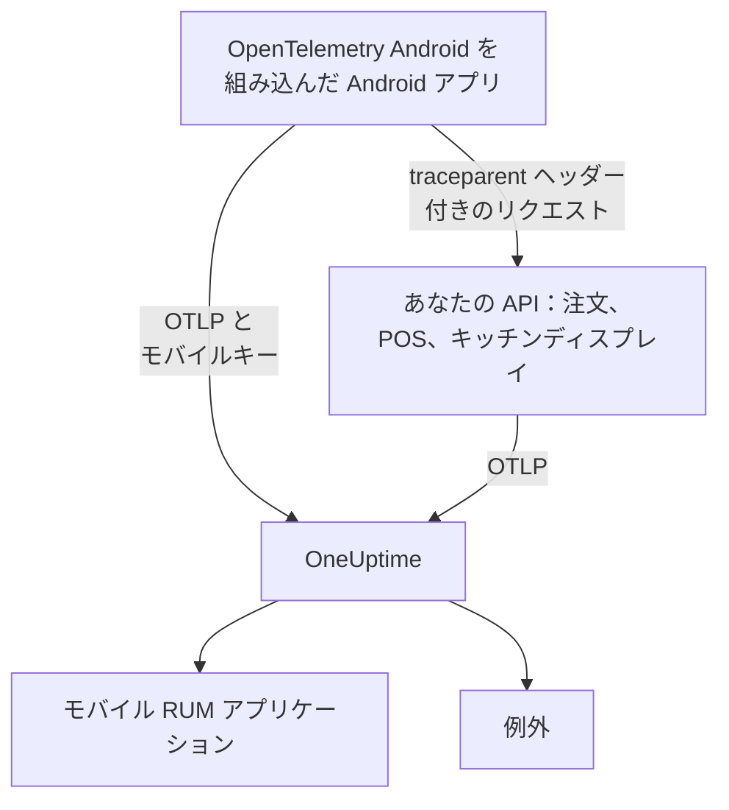

# Android のセットアップ

ネイティブの Android アプリを OpenTelemetry Android でインストルメントし、モバイルの RUM アプリケーションとして OneUptime に報告させます。報告されるのは、クラッシュと ANR、遅いフレームとフリーズしたフレーム、アプリの起動、画面、セッション、そしてバックエンドまで通してトレースされるネットワークリクエストです。

:::cards
- [OpenTelemetry Android を追加する](#opentelemetry-android-を追加する): Gradle の依存関係 1 つと、アプリの起動時に実行する数行のコード。
- [報告される内容](#報告される内容): クラッシュ、ANR、フリーズしたフレーム、起動、セッションと、それぞれの表示先。
- [バックエンドへのリクエストをトレースする](#バックエンドへのリクエストをトレースする): OkHttp の呼び出しごとのスパンと、そこに付く `traceparent` 。
- [独自のワークフローをトレースする](#独自のワークフローをトレースする): メニューからキッチンまでの注文、決済端末、プリンター。
- [キオスクなど自社所有のデバイス](#キオスクなど自社所有のデバイス): デバイスごとに名前を付け、MDM から設定し、オフラインの間もデータを保持します。
:::

## 仕組み

OpenTelemetry Android はアプリの中で動きます。アプリに固定した **モバイル** の取り込みキーを使って、トレース、ログ、メトリクスを OTLP で OneUptime に送り、アプリが行うリクエストに W3C の `traceparent` ヘッダーを付けます。これにより、バックエンドのスパンがアプリのトレースに加わります。



## 始める前に

- `minSdk` が 23 以上で、 `compileSdk` 34 以上でビルドされた Android アプリ。 `minSdk` が 26 未満の場合は、Android Gradle Plugin 8.3.0 以降を使い、 `gradle.properties` に `android.useFullClasspathForDexingTransform=true` を設定したうえで、 [コアライブラリのデシュガリング](https://developer.android.com/studio/write/java8-support#library-desugaring) を有効にしてください。
- **プロジェクト設定 → テレメトリと APM → 取り込みキー** で **取り込みキーを作成** を使って作成し、 **固定されたサービス名** にアプリの `service.name` を設定した **モバイル** の取り込みキー。 **ブラウザー** キーはアプリからは拒否されます。このキーは `Origin` ヘッダーで確認されますが、アプリはこのヘッダーを送らないためです。
- 次の OTLP の設定。OneUptime をセルフホストしている場合は、 `https://oneuptime.com` を自分のホストに置き換えてください。

| 設定 | 値 |
| --- | --- |
| OTLP エンドポイント | `https://oneuptime.com/otlp` |
| ヘッダー | `x-oneuptime-token: YOUR_TELEMETRY_INGESTION_TOKEN` |

> [!WARNING]
> キーはアプリの中に入って配布され、アプリは展開できるため、誰かにコピーされる前提で考えてください。キーのページで **固定されたサービス名** 、 **1 分あたりのリクエスト数の上限** 、 **有効期限** の日付を設定し、リリースごとにキーをローテーションしてください。

## OpenTelemetry Android を追加する

:::steps
### 依存関係を追加する

```kotlin title="app/build.gradle.kts"
dependencies {
    implementation("io.opentelemetry.android:android-agent:1.8.1")
}
```

このエージェントには、クラッシュ、ANR、レンダリングの遅延、アクティビティ、フラグメント、ネットワーク、セッションのインストルメンテーションが含まれています。新しいバージョンがないかは [リリース一覧](https://github.com/open-telemetry/opentelemetry-android/releases) で確認してください。

### アプリの起動時に開始する

```kotlin title="KioskApplication.kt"
import android.app.Application
import io.opentelemetry.android.OpenTelemetryRum
import io.opentelemetry.android.agent.OpenTelemetryRumInitializer

class KioskApplication : Application() {
    lateinit var otelRum: OpenTelemetryRum

    override fun onCreate() {
        super.onCreate()

        otelRum = OpenTelemetryRumInitializer.initialize(this) {
            httpExport {
                baseUrl = "https://oneuptime.com/otlp"
                baseHeaders = mapOf("x-oneuptime-token" to BuildConfig.ONEUPTIME_TOKEN)
            }
            resource {
                put("service.name", "kiosk-ordering")
                put("deployment.environment.name", "production")
            }
        }
    }
}
```

`baseUrl` はシグナルを含まないエンドポイントです。エージェントがそこに `/v1/traces` 、 `/v1/logs` 、 `/v1/metrics` を付けます。 `service.name` を設定してください。設定しないと、アプリはランチャーのラベルで名付けられます。これは OneUptime でのアプリケーションの識別子なので、リリースが変わっても同じ値を保ってください。

このクラスを、マニフェストの `<application>` 要素の `android:name` に指定します。 `BuildConfig.ONEUPTIME_TOKEN` は、ビルドがキーを保管している場所を表しています。 [キオスクなど自社所有のデバイス](#キオスクなど自社所有のデバイス) で示すように、フリートでは代わりに MDM からキーを受け取ることもできます。

### アプリを起動して到着を確認する

```bash
curl -i https://oneuptime.com/otlp/v1/validate \
  -H "x-oneuptime-token: YOUR_TELEMETRY_INGESTION_TOKEN"
```

`200` と `"valid": true` は、キーが受け付けられたことを示します。次にアプリを起動して、少し操作します。アプリは `service.name` の名前で **製品 → リソース → リアルユーザーモニタリング** に表示されます。エージェントはテレメトリを送る前にディスクに書き込むため、最初のバッチが届くまで 1 分ほどかかることがあります。
:::

## 報告される内容

OpenTelemetry Android は、これらをすべて自動で記録します。エージェントが設定するデバイスの属性 `device.model.identifier` 、 `device.model.name` 、 `device.manufacturer` によって、アプリはモバイルの RUM アプリケーションとして分類され、その **クライアント** ページにデータが入ります。さらに `os.name` 、 `os.version` 、インストールごとの `app.installation.id` を設定しますが、 `device.id` は設定しません。

| 内容 | エージェントの送り方 | OneUptime での表示先 |
| --- | --- | --- |
| クラッシュ | 例外の型、メッセージ、スタックトレースを含む `app.crash` イベント | **例外** (未処理として) |
| ANR | アプリが約 5 秒間応答しなくなった時点で送られる、メインスレッドのスタックを含む `device.anr` イベント | **例外** (未処理として、 `ANR` という型で) |
| 遅いフレームとフリーズしたフレーム | `app.jank.frame_count` を含む `app.jank` イベント。これは 16 ms ( `app.jank.threshold` は `0.016` ) または 700 ms ( `0.7` ) より遅かったフレームの数です | **ログ** ( `@event.name:app.jank` で絞り込み) |
| アプリの起動 | `start.type` が `cold` 、 `warm` 、 `hot` のいずれかに設定された `AppStart` スパン | **トレース** |
| 画面 | アクティビティまたはフラグメントのライフサイクルの各段階のスパンと、すべてのスパンとログに付く `app.screen.name` | **トレース** |
| セッション | すべてのスパンとログに付く `session.id` と、 `session.start` および `session.end` イベント | **トレース** と **ログ** ( `@session.id:` で検索) |
| ネットワークの変化 | `network.change` イベントと、すべてのスパンとログに付く `network.connection.type` | **ログ** |

クラッシュと ANR は未処理として **例外** に届き、スタックトレースごとにグループ化され、発生したセッションが添えられます。エージェントはアプリが終了する時点でクラッシュをディスクに保存し、そこから送信するため、オフラインで起きたクラッシュも、アプリがネットワークにつながった状態で再び動いたときに届きます。

アプリケーションの **概要** は、これらを読み取って **セッション** 、 **クラッシュのないセッション** 、 **クラッシュ** 、 **ANR** 、 **アプリの起動** 、 **コールドスタート（p95）** 、 **フリーズしたフレーム** として表示し、それぞれのタイルから、そのタイルが数える例外、スパン、イベントを開けます。アプリがアプリの起動やフレームを送るまでは、それらのグラフに送信を有効にする方法が表示されます。 **推奨事項** では、クラッシュ、ANR、遅いコールドスタート、フリーズしたフレーム、そして報告が止まったアプリやそのデバイスを監視するモニターが提案されます。

**クラッシュのないセッション** の下の行は、同じ割合をインストール単位で示します。使うのは OpenTelemetry Android 1.1 以降がすべてのスパンとログに設定する `app.installation.id` で、アプリがインストールされている間は同じ ID が保たれるため、アプリのユーザーの代わりになります。1 時間に数百のセッションがあり、1 日に 1 回のクラッシュは普通というアプリでは、 **App Crash Rate** と **App ANR Rate** が、クラッシュ 1 件ごとではなく、1 時間のセッションのうちクラッシュまたはフリーズしたセッションの割合が、Android vitals の基準である 1.09% と 0.47% をそれぞれ超えたときにアラートします。 **Daily Crash Rate** と **Daily ANR Rate** は、1 日のインストールが 250 件以上あり、そのうちクラッシュまたはフリーズしたインストールの割合が同じ 1.09% と 0.47% をそれぞれ超えたときにアラートします。これは、Android vitals が評価し、Play Console に表示される、ユーザーが認識した割合です。

セッションは、バックグラウンドで 15 分経つか、4 時間経つと終わります。キオスクのように一度もバックグラウンドに移らないアプリは 1 つのセッションを 4 時間保つため、 [独自のワークフローをトレースする](#独自のワークフローをトレースする) で示すように、顧客の来訪ごとに独自のスパンでトレースしてください。

アプリ自身の `android.util.Log` の呼び出しも、下の OkHttp のモジュールと並べて `android-log-library` と `android-log-agent` を追加するとログになります。各呼び出しのタグは `android.log.tag` に入り、Throwable を渡した呼び出しは **例外** に例外として表示されます。OpenTelemetry Android は Logcat を読みません。

## バックエンドへのリクエストをトレースする

OkHttp のインストルメンテーションと、そのビルドに使う ByteBuddy プラグインを追加します。

```kotlin title="app/build.gradle.kts"
plugins {
    // ...the plugins your app already applies, then:
    id("net.bytebuddy.byte-buddy-gradle-plugin") version "1.18.15"
}

dependencies {
    implementation("io.opentelemetry.android:android-agent:1.8.1")
    implementation("io.opentelemetry.android.instrumentation:okhttp3-library:1.8.1-alpha")
    byteBuddy("io.opentelemetry.android.instrumentation:okhttp3-agent:1.8.1-alpha")
}
```

このプラグインは `OkHttpClient` クラスそのものをインストルメントするため、アプリ内のすべてのクライアントが、ライブラリが作成するものも含めてトレースされます。各リクエストは、メソッド名を名前とし、URL、ステータスコード、所要時間を持つクライアントスパンになり、W3C の `traceparent` ヘッダーを運びます。 [OpenTelemetry](/docs/telemetry/open-telemetry) でインストルメントしたバックエンドはそのヘッダーからトレースを続けるため、注文 API、POS ブリッジ、キッチンディスプレイのサービスが、キオスクでのタップと同じトレースにスパンを加えます。

- `HttpURLConnection` にも同じ組み合わせのモジュールがあります。 `httpurlconnection-library` と `httpurlconnection-agent` です。
- プラグインを使わない場合は、 `io.opentelemetry.instrumentation:opentelemetry-okhttp-3.0` の `OkHttpTelemetry.builder(otelRum.openTelemetry).build().createCallFactory(client)` で、クライアントを自分でラップします。
- 次のセクションのようにコードで開始したスパンは、その中で行われたリクエストの親になります。

## 独自のワークフローをトレースする

エージェントからトレーサーを取得し、顧客 1 人の注文 1 件につきスパンを 1 つ作り、注文の各段階に子スパンを作ります。これで各段階が独自の所要時間とエラーを持ち、注文にはどう終わったかが記録されます。

```kotlin title="OrderTrace.kt"
import io.opentelemetry.api.trace.Span
import io.opentelemetry.api.trace.StatusCode
import io.opentelemetry.api.trace.Tracer
import io.opentelemetry.context.Context

class OrderTrace(private val tracer: Tracer) {
    // order.session: from the first tap to the order reaching the kitchen.
    private val order: Span = tracer.spanBuilder("order.session").startSpan()
    private val parent: Context = Context.current().with(order)

    // One step: menu.browse, cart.customize, payment.process, pos.inject.
    fun <T> step(name: String, block: (Span) -> T): T {
        val span = tracer.spanBuilder(name).setParent(parent).startSpan()
        return try {
            span.makeCurrent().use { block(span) }
        } catch (error: Throwable) {
            span.recordException(error)
            span.setStatus(StatusCode.ERROR)
            throw error
        } finally {
            span.end()
        }
    }

    fun complete() = finish("completed")

    fun abandon(reason: String) {
        order.setAttribute("order.abandon_reason", reason)
        finish("abandoned")
    }

    private fun finish(outcome: String) {
        order.setAttribute("order.outcome", outcome)
        order.end()
    }
}
```

```kotlin title="CheckoutFlow.kt"
val order = OrderTrace(otelRum.openTelemetry.getTracer("kiosk.ordering"))

order.step("cart.customize") { span ->
    span.setAttribute("cart.items", cart.size.toLong())
}
order.step("payment.process") { terminal.charge(cart.total) }
order.step("pos.inject") { posApi.submit(cart) } // its OkHttp span is a child
order.complete()
```

決済端末、プリンター、スキャナー、NFC リーダーの SDK への各呼び出しも同じようにラップし、どのデバイスだったかを記録します。こうすると、遅いデバイスや失敗するデバイスは、遅いスパンや失敗したスパンとして現れます。

```kotlin title="ReceiptPrinter.kt"
order.step("printer.print") { span ->
    span.setAttribute("peripheral.type", "printer")
    span.setAttribute("peripheral.model", printer.model)
    span.setAttribute("peripheral.connection", "usb")
    printer.print(receipt, timeoutMillis = 10_000)
}
```

属性の名前は自由に決められます。すべてのアプリで同じ名前にすれば、1 つのフィルターですべてのプリンターが見つかります。スパンは呼び出しが戻ったときにしか終わらないため、各呼び出しにはタイムアウトを設定してください。メニューの閲覧のように複数の画面にまたがる段階は、画面が開いたときに開始し、閉じたときに終了するスパンにして、親は同じにします。用紙切れのプリンターのように所要時間のない出来事は、 `otelRum.emitEvent("printer.paper_low")` でイベントとして送ります。

**トレース** で段階の名前でフィルターすると、その所要時間と失敗の頻度がわかります。 `@order.outcome:abandoned` でフィルターすると、最後まで終わらなかった注文が見つかります。

## キオスクなど自社所有のデバイス

### デバイスごとに名前を付ける

OneUptime はモバイルアプリをデバイスごとではなく常にアプリケーションごとに分類するため、何千台ものスマートフォンで動くアプリが利用者のスマートフォンを一覧に並べることはありません。自社で所有するデバイスでは、 `host.name` でそれぞれに名前を付けてください。すると各デバイスがホストとして、ほかのマシンと並んで **インベントリ** に表示されます。エージェントが報告するメーカー、モデル、OS のバージョン、下で追加する情報、最後に確認された日時も一緒に表示されます。

```kotlin title="KioskApplication.kt"
resource {
    put("service.name", "kiosk-ordering")
    put("host.name", deviceName)
    put("host.serial_number", serialNumber)
    put("device.type", "kiosk")
    put("device.location", "Store 0412")
}
```

アプリのテレメトリはその RUM アプリケーションに残り、デバイスが **ホスト** にホストとして載ることはありません。アプリはホストのメトリクスを報告しないため、そこに表示するものがないからです。 **インベントリ** にあるデバイスのページには、そのデバイス自身のログ、トレース、例外が表示され、 `@resource.host.name:` を使えば **トレース** と **ログ** でそれらを見つけられます。30 日間何も送らないデバイスは **インベントリ** から外れます。デバイスそのもの (メモリ、ストレージ、再起動、デバイス上のすべてのアプリのクラッシュ) を見るには、 [Android エージェント](/docs/telemetry/android-agent) を追加し、その `device_name` に同じ名前を設定してください。するとデバイスは **ホスト** にもホストとして載り、 **インベントリ** では引き続き 1 つの項目のままです。

### デバイスが静かになったら知らせを受ける

アプリケーションの **推奨事項** では **Device Stopped Reporting** が提案されます。過去 1 週間にスパンを送っていたデバイスが 1 時間スパンを送らないと、デバイスごとにアラートを出します。デバイスは、エージェントが設定する `app.installation.id` で区別されます。各デバイスのアラートでは、デバイスの最後のスパンに付いていた `host.name` （ [デバイスごとに名前を付ける](#デバイスごとに名前を付ける) を参照）とモデルでデバイスが示され、その横にインストールが示されます。 `host.name` を送らないデバイスは、インストールだけで示されます。デバイスの名前を変えても変わるのはアラートの表示だけで、デバイスは 1 台のまま、アラートも 1 つのままで、デバイスが再び報告すると解決します。店舗のネットワークが落ちたときのように、すべてのデバイスが同時に静かになった場合は、どのデバイスもアラートせず、 **App Stopped Reporting** がアプリ全体として 1 回だけ報告します。

1 つの画面のまま置かれたキオスクは、誰かが使うまで何も送りません。アイドル状態のキオスクが静かになったキオスクと見なされないように、アプリの実行中は数分ごとにスパンを送ってください。

```kotlin title="KioskHeartbeat.kt"
import android.os.Handler
import android.os.Looper
import io.opentelemetry.api.trace.Tracer

class KioskHeartbeat(private val tracer: Tracer) {
    private val handler = Handler(Looper.getMainLooper())

    private val beat = object : Runnable {
        override fun run() {
            tracer.spanBuilder("kiosk.heartbeat").startSpan().end()
            handler.postDelayed(this, 5 * 60 * 1000L)
        }
    }

    fun start() = handler.post(beat)

    fun stop() = handler.removeCallbacks(beat)
}
```

エージェントが起動したら、 `KioskHeartbeat(otelRum.openTelemetry.getTracer("kiosk.heartbeat")).start()` で開始します。5 分ごとにスパンを送れば、動作中のキオスクのスパンの間隔は 1 時間を大きく下回ります。

### MDM からフリートを設定する

アプリは Android の管理対象の構成を読み取れます。これは、どのデバイス管理サービスも管理下のデバイスに配信するものです。キーとデバイスの名前は、アプリに組み込む代わりにこの構成から読み取ります。

```kotlin title="KioskApplication.kt"
import android.content.RestrictionsManager

val restrictions = (getSystemService(RESTRICTIONS_SERVICE) as RestrictionsManager)
    .applicationRestrictions
val token = restrictions.getString("oneuptime_token").orEmpty()
val deviceName = restrictions.getString("device_name") ?: android.os.Build.MODEL
val serialNumber = restrictions.getString("device_serial").orEmpty()
```

次に、 `BuildConfig.ONEUPTIME_TOKEN` の代わりに `token` を `baseHeaders` に渡し、 `deviceName` と `serialNumber` を上のリソースに渡します。Esper では、ブループリントでアプリの **Managed Configuration** に下の構成を貼り付けます。Esper Agent 8.00.0764 以降なら、Esper が各デバイスでプレースホルダーを埋めます。

```json title="Managed configuration"
{
  "oneuptime_token": "YOUR_TELEMETRY_INGESTION_TOKEN",
  "device_name": "${esper.deviceName}",
  "device_serial": "${esper.serialNumber}"
}
```

変更後はデバイスに Converge を実行し、新しい値を読み込ませてください。MDM がスキーマを求める場合は、同じキーを `app_restrictions.xml` で宣言します。Esper は v1 署名のない APK を拒否するため、リリースには v2 または v3 に加えて v1 方式でも署名してください。

### Esper からフリートをインポートする

Esper テナントをインベントリに接続すると、Esper に登録されているすべてのデバイスが一覧に表示されます。アプリが一度も起動していないデバイスも含まれ、Esper だけが知っている情報も表示されます。グループ、Android バージョン、セキュリティパッチレベル、シリアル番号、バッテリー、ストレージ、インストール済みのアプリ、最終チェックインです。チェックインが止まったデバイスはオフラインと表示され、最後にチェックインしてからの経過時間もわかります。 [Esper からデバイスをインポートする](/docs/inventory/overview#esper-からデバイスをインポートする) を参照してください。

上のようにアプリが名前を付けたデバイスは、アプリが送るものも含めて 1 つの項目になります。 `host.name` が Esper での名前です。OneUptime はデバイスの項目を `host.name`、次に `host.serial_number` の順に探すため、デバイスから報告するすべてのアプリと、Android Agent の `device_name` と `device_serial` の設定で、各デバイスに同じ名前とシリアル番号を付けてください。

### オフラインの間に記録したものを保持する

エージェントは、すべてのスパン、ログ、メトリクスを送る前にディスクに書き込みます。ネットワークが切れている間はそこに保持し、復旧したら送信します。送信できるのは最大 18 時間後までです。保持する容量は 10 MB です。オフラインになることが多いデバイスでは、これを引き上げてください。

```kotlin title="KioskApplication.kt"
diskBuffering {
    maxCacheSize = 50 * 1024 * 1024
}
```

## トラブルシューティング

:::details アプリがリアルユーザーモニタリングではなくサービスに表示される
OpenTelemetry Android は `device.model.identifier` を自分で設定します。つまり、アプリが別の SDK でセットアップされたか、リソースが `resource(Resource)` で置き換えられてエージェント独自の属性が失われています。属性に追加する `resource { }` ブロックを使ってください。すでに作成されたサービスは RUM アプリケーションには変わらないため、RUM のテレメトリが届いたら **製品 → サービス** で削除してください。
:::

:::details 何も届かない、またはキーが拒否される
[OpenTelemetry Android を追加する](#opentelemetry-android-を追加する) のキーの確認を実行します。 `401` は、キーが不明、取り消し済み、無効化済み、または期限切れであることを示します。 **ブラウザー** キーはアプリからは拒否されるため、 **モバイル** キーを使ってください。 `baseUrl` が `/v1/traces` を含まずに `/otlp` で終わっていることを確認してください。パスはエージェントが自分で付けます。
:::

:::details クラッシュや ANR が例外に表示されない
クラッシュはアプリが終了する時点で保存され、ANR はメインスレッドが約 5 秒間止まった時点で保存されます。どちらもデバイスが送信できるようになるまでディスクで待つため、アプリがネットワークにつながった状態で 1 分ほど動いてから、もう一度確認してください。エージェントは `Application` の `onCreate` の先頭、クラッシュしうる処理より前で開始し、そのクラッシュハンドラーが最初に設定されるようにしてください。
:::

:::details デバイスがインベントリに表示されない
一覧に表示されるのは、アプリが `host.name` を設定しているデバイスだけです。スパンのリソース属性で値を確認してください。空の値はどのデバイスも指さず、同じ名前の 2 台のデバイスは 1 行になります。
:::

## 次のステップ

:::cards
- [モバイルのセットアップ](/docs/rum/mobile-setup): iOS、React Native、そのほかのプラットフォーム。
- [Android エージェント](/docs/telemetry/android-agent): デバイスそのもののヘルス、再起動、インストール済みアプリ、すべてのアプリのクラッシュを監視します。
- [例外](/docs/telemetry/exceptions): アプリが報告するクラッシュと ANR をトリアージします。
- [トレースエクスプローラー](/docs/telemetry/traces-explorer): キオスクからキッチンまで注文を追跡します。
- [アプリケーションの管理](/docs/rum/applications): 名前、ラベル、所有者、保持期間。
:::
