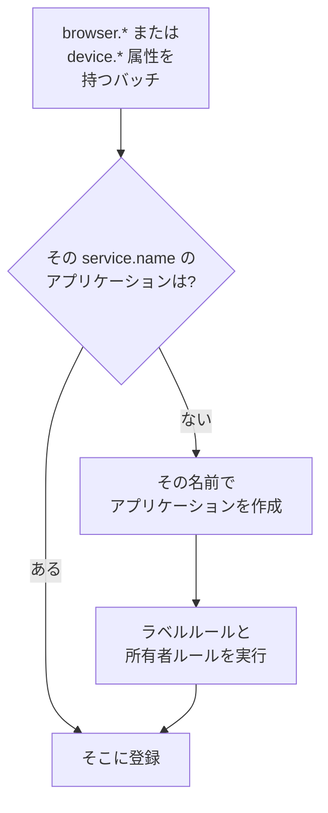

# アプリケーションの管理

OneUptime は、アプリのテレメトリが初めて届いたときに RUM アプリケーションを作成します。このページでは、その後に管理する内容を扱います。アプリケーションの名前、ラベルと所有者、データの保持期間、アーカイブ、閲覧できるユーザー、アラートです。

:::cards
- [アプリケーションが作成される仕組み](#アプリケーションが作成される仕組み): `service.name` で照合され、最初のバッチで作成されます。
- [ラベル](#ラベル): アプリケーションをグループ化し、誰がアクセスできるかを決めます。
- [保持期間](#保持期間): テレメトリと録画が保持される期間。
- [権限](#権限): アプリケーションを閲覧できるユーザーと、録画を視聴できるユーザー。
:::

## アプリケーションが作成される仕組み

RUM アプリケーションを自分で作成する必要はありません。ブラウザーまたはデバイスの属性と `service.name` を持つテレメトリのバッチが届くと、OneUptime はその `service.name` を持つアプリケーションにバッチを登録し、プロジェクトにまだない場合はアプリケーションを作成します。



- `service.name` はアプリケーションの識別子で、大文字と小文字を区別せずに比較されます。 `Storefront-Web` と `storefront-web` はひとつのアプリケーションです。
- 新しい `service.name` は新しいアプリケーションを開始します。古いアプリケーションは履歴を保ったまま **切断済み** になり、新しいアプリケーションは空の状態から始まり、両者が統合されることはありません。
- `service.name` は環境ごとではなく、アプリごとにひとつ使います。環境は `oneuptime.label.env=production` のようなラベルで区別すれば、ひとつのアプリケーションとひとつの履歴を共有できます。

### アプリケーションの名前を変更する

**表示名** は最初は `service.name` と同じです。変更するには、アプリケーションの **設定** ページを開き、 **アプリケーションの詳細** カードの **詳細を編集** をクリックします。説明とラベルもここで編集します。テレメトリはカードに表示される **アプリ名 (service.name)** で照合され、これは変わらないため、名前を変更しても安全です。

### アプリケーションを自分で追加する

最初の訪問者が来る前にラベル、所有者、リプレイのポリシーを用意しておきたい場合は、アプリケーションを自分で作成します。

:::steps
#### アプリケーション一覧を開く

**製品 → リソース → リアルユーザーモニタリング** に移動し、 **RUM アプリケーションを作成** をクリックします。

#### アプリ名を入力する

**アプリ名 (service.name)** に、アプリが報告する `service.name` を、アプリが報告するとおりに正確に入力します。

#### 名前を付けて保存する

アプリケーションには、検出されたアプリケーションと同じく、アプリ名にちなんだ名前が付きます。別の名前を表示するには、 **その他の項目** を開いて **表示名** を入力します。説明とラベルもそこにあります。その後、フォームを保存します。
:::

その `service.name` のアプリケーションが、検出されたもの、以前に追加したもの、アーカイブ済みのものを問わずプロジェクトにすでにある場合、フォームは 2 つ目を作成せずにそのことを知らせます。

## 接続状態

アプリケーションは、テレメトリが届いている間は **接続済み** を、15 分間何も届かないと **切断済み** を表示します。OpenTelemetry のテレメトリとセッションリプレイのトラフィックはどちらも対象になります。

**最終確認** はバッチごとではなく数分おきに更新されるため、実際のトラフィックから最大 5 分ほど遅れることがあり、15 分という時間はその余裕を見込んでいます。OneUptime 自体が停止していた時間や、取り込みキューの処理が追いついていなかった時間は数えません。

**切断済み** はそれだけではエラーではありません。夜間に訪問者のいない社内ツールは、実際に切断されています。アプリが使われている場合は、 [RUM のトラブルシューティング](/docs/rum/troubleshooting) を参照してください。

## ラベル

ラベルは一覧やフィルターでアプリケーションをグループ化します。また、一部のラベルに制限されたメンバーがアクセスできる範囲も決めます。そのようなメンバーには、それらのラベルのいずれかが付いたアプリケーションだけが表示されます。アプリケーションには 3 つの方法でラベルが付きます。

| 方法 | 場所 |
| --- | --- |
| 手動 | 作成フォームの **その他の項目** で、または後からアプリケーションの **設定** ページにある **アプリケーションの詳細** カードの **詳細を編集** で。 複数にまとめて付けるには、一覧で選択し、 **ラベルを追加** を **一括操作** から選びます。 |
| テレメトリから | `oneuptime.label.<name>` という名前のリソース属性が、下の例のようにラベル `<name>:<value>` を追加します。 |
| ラベルルールから | ルールは、一致するすべての新しいアプリケーションにラベルを追加します。 [ラベルルールと所有者ルール](#ラベルルールと所有者ルール) を参照してください。 |

属性は `service.name` と同じリソースに設定します。たとえば [ブラウザーのセットアップ](/docs/rum/browser-setup) の `src/telemetry.ts` ファイルで次のようにします。

```ts
const resource = defaultResource().merge(
  resourceFromAttributes({
    [ATTR_SERVICE_NAME]: "storefront-web",
    "oneuptime.label.team": "payments",
    "oneuptime.label.env": "production",
  }),
);
```

これでラベル `team:payments` と `env:production` が追加され、プロジェクトに存在しない場合は作成されます。ラベルに属性名が含まれるため、 `oneuptime.label.team=prod` と `oneuptime.label.env=prod` は区別されます。100 文字を超えるラベルは 100 文字に切り詰められ、空の値や文字列でない値は何も追加しません。

## ラベルルールと所有者ルール

ルールは、一致するすべての新しいアプリケーションにラベルまたは所有者を追加します。 **リアルユーザーモニタリング → 設定 → ラベルルール** または **所有者ルール** を開き、2 つのステップでルールを作成します。

1. **一致** では、新しいルールの最初の選択である **すべての RUM アプリケーション** が、すべてのアプリケーションに一致します。絞り込むには **条件に一致する RUM アプリケーションのみ** を選び、 **アプリケーションのラベル** (選んだラベルのいずれか、すべて、またはどれも持たない)、 **アプリケーション名** または **アプリケーションの説明** (等しい、含む、で始まる、で終わる、パターンに一致する) の条件を追加します。
2. **ラベル** (所有者ルールでは **所有者** ) で、ルールが追加するものを選びます。新しいルールは少なくとも 1 つのラベルまたは所有者を追加する必要があります。 **名前** は、独自の名前を入力するまで、 _Add team:payments_ や _Add Payments as owners_ のように選択内容から入力されます。 **説明** と、所有者ルールの **所有者に通知** は **その他の項目** にあります。

ルールは、検出されたものも含め、アプリケーションが作成されたときに実行されます。既存のアプリケーションにルールを適用するには、その行の **⋯** メニューを開いて **今すぐ実行** を選びます。 [既存のリソースに対してルールを実行する](/docs/configuration/run-rules-now) を参照してください。編集によって追加するものがなくなったルールは、一覧で **何も追加しない** と表示されます。フォームの詳細は [ラベルルールと所有者ルール](/docs/configuration/label-and-owner-rules) で説明しています。

### 所有者

所有者は、アプリケーションに責任を持つユーザーとチームです。所有者ルールが新しいアプリケーションに所有者を付けます。手動で追加・削除するには、一覧でアプリケーションを選択し、 **所有者を追加** または **所有者を削除** を **一括操作** から選びます。API では `/rum-application-owner-user` と `/rum-application-owner-team` から追加します。 **所有者に通知** がオン (既定) の場合、ルールが追加した各所有者に通知されます。誰にも通知したくない場合は、多数のアプリケーションにルールを実行する前にオフにしてください。

## 保持期間

アプリケーションのテレメトリと録画は、異なる期間保持されます。

| データ | 保持期間 | 設定場所 |
| --- | --- | --- |
| ログ、メトリクス、トレース、プロファイル | アプリケーションが上書きしない限り、プロジェクトの保持期間 | アプリケーションの **設定** ページ |
| セッションリプレイの録画 | 既定で 7 日、または 1、14、30、90 日 | **リプレイポリシー** の **ポリシーを編集 → 制限** |

### テレメトリの保持期間

既定では、アプリケーションのテレメトリは **プロジェクト設定 → テレメトリと APM → データ保持** で設定するプロジェクトの保持期間だけ保持されます。アプリケーションの **設定** ページにある 2 つのカードで、これを上書きできます。

- **テレメトリデータの保持期間** には **テレメトリデータの保持期間（日）** があり、アプリケーションのすべてのテレメトリに 1 つの値を設定します。空のままにすると、プロジェクトの保持期間を使います。
- **テレメトリタイプ別の保持期間** には、ログ、トレース、メトリクス、プロファイルそれぞれの既定値と、重大度別のログとステータス別のトレースの値があります。空のままの値はアプリケーションの値に、次にプロジェクトの値にフォールバックします。

保持期間の上書きは [エンタープライズ版](/docs/self-hosted/enterprise) と、OneUptime Cloud の Scale プラン以上で利用できます。利用できない場合、カードにはプランで追加される内容が表示され、アプリケーションはプロジェクトの保持期間を使います。

下位の Cloud プランでは、試用期間中に設定された上書きが新しいテレメトリに引き続き適用されます。 **設定** ページでは、それが **保持期間の上書き** カードと、どのプランでも使える **上書きを削除** ボタンとともに表示されます。削除すると、それ以降アプリケーションはプロジェクトの保持期間を使い、保存済みのデータは保存時の保持期間を保ちます。上書きを再び設定するには Scale プランが必要です。

### セッションリプレイの保持期間

録画には独自の保持期間があり、アプリケーションの **リプレイポリシー** ページの **ポリシーを編集 → 制限** で設定します。既定は 7 日で、1、14、30、90 日も選べます。録画はスパンよりはるかに機密性が高く、はるかに大きいため、意図的に短くしています。 **設定** ページの **セッションリプレイの保持期間** カードにこれが表示され ( _Session replays are kept for 7 days._ )、カードの **リプレイポリシーで編集** ボタンでポリシーが開きます。

テレメトリの保持期間を長くしても、録画が長く保持されることはありません。セッションの件数、シグナル、デバイスは録画とともに期限切れになります。テレメトリの保持期間に従うのは、セッションのログ、スパン、例外だけです。 [保持と削除](/docs/telemetry/session-replay#保持と削除) を参照してください。

> [!TIP]
> RUM はサーバーではなくユーザーとともに増えるため、プロジェクトで最も量の多いテレメトリになりがちです。ここでは保持期間を短くし、バックエンドのサービスでは長くする構成がよく使われます。

## アーカイブと削除

**アーカイブ** は、テレメトリの収集を続けたまま、アプリケーションを **すべてのアプリケーション** から非表示にします。もう監視していないものの、履歴は残したいアプリをアーカイブします。

- アプリケーションの **設定** ページで **アーカイブ** をクリックするか、一覧で複数のアプリケーションを選んでまとめてアーカイブします。
- アーカイブしたアプリケーションは **リアルユーザーモニタリング → 詳細 → アーカイブ済み** にあります。サイドメニューの **詳細** は最初は折りたたまれているので、クリックして **アーカイブ済み** を表示します。そこで、1 つのアプリケーションまたは複数をまとめて **アーカイブ解除** できます。

アプリケーションのサイドメニューの **詳細** セクションにある **アプリケーションを削除** は、アプリケーションを完全に削除します。アプリがまだテレメトリを送信している場合、次のバッチで設定のないアプリケーションが再び作成されるため、先にインストルメンテーションを止めてください。

アプリケーション全体ではなく 1 人のデータを消去するには、消去リクエストを送信します。 [セッションを消去する](/docs/telemetry/session-replay#セッションを消去する) を参照してください。

## 権限

プロジェクトの Viewer ロールを持つユーザーは誰でも、RUM アプリケーションとそのテレメトリを閲覧できます。セッションリプレイは意図的にこのロールに含まれていません。録画の一覧表示、録画の視聴、誰が視聴したかの閲覧はそれぞれ別の権限です。プロジェクトのオーナーと管理者はすべての権限を持ちます。権限の選択画面では各権限がタイトルで表示されます。ここでは斜体で示しています。

| 権限 | メンバーができること |
| --- | --- |
| `ReadRumApplication` (_Read RUM Application_) | アプリケーションとそのテレメトリのページを閲覧する。 |
| `CreateRumApplication`, `EditRumApplication`, `DeleteRumApplication` | アプリケーションを追加、編集、削除する。 |
| `ReadRumSessionReplay` (_List Session Replays_) | 録画されたセッションとその詳細を一覧表示する。再生したり、ユーザーが誰かを知ったりすることはできない。 |
| `ReadRumSessionReplayPayload` (_Watch Session Replays_) | 録画を再生し、識別されたユーザーの参照と特性を読む。 |
| `ReadRumSessionReplayAudit` (_Read Session Replay Audit_) | **リプレイのアクセスログ** を読む。誰がどの録画を視聴したか。 |
| `DeleteRumSessionReplay` (_Delete Session Replays_) | 録画を削除する。 |
| `CreateRumSessionErasureRequest`, `ReadRumSessionErasureRequest` | 消去リクエストを送信し、その状況を追う。 |
| `ReadRumApplicationLabelRule`, `ReadRumApplicationOwnerRule` (と、その Create、Edit、Delete) | ラベルルールと所有者ルールを管理する。 |
| `ReadRumApplicationOwnerUser`, `ReadRumApplicationOwnerTeam` (と、その Create、Edit、Delete) | API で所有者を追加、削除する。 |

便利な分け方として、サポートエンジニアには `ReadRumApplication` と `ReadRumSessionReplay` を付与します。誰かの画面を視聴したり、ユーザーが誰かを知ったりせずに、どのセッションでエラーが起きたかを確認できます。 `ReadRumSessionReplayPayload` は必要な人にだけ付与します。そうすると、 `ReadRumSessionReplayAudit` を持つメンバーは、アプリケーションの **リプレイのアクセスログ** ページですべての視聴を確認できます。 [録画を視聴できるユーザー](/docs/telemetry/session-replay#録画を視聴できるユーザー) では、各権限でセッション一覧とプレーヤーの何が使えるようになるかを説明しています。

## RUM データのアラート

RUM のテレメトリは通常のログ、メトリクス、トレースなので、RUM 専用のモニターはありません。通常のモニターがそのまま使えます。最も手早く始めるには、アプリケーションの **推奨事項** ページを使います。アプリケーションにスコープ済みのモニターが提案されます。

| グループ | 推奨事項 |
| --- | --- |
| Core Web Vitals | Poor Largest Contentful Paint、Poor Interaction to Next Paint、Poor Cumulative Layout Shift、Slow First Contentful Paint、Slow Time to First Byte。 [Core Web Vitals](/docs/rum/web-vitals) を参照してください。 |
| エラー | Failed User Operations と Unhandled Browser Exceptions。 |
| セッションリプレイ | 四つの [ストレージ予算のアラート](/docs/telemetry/session-replay#ストレージ予算のアラート) で、プロジェクトの日次の上限やアプリケーションの月間予算を使い切る前に警告します。アプリケーションがリプレイを録画すると提案され、月間のペアは月間予算も設定されると提案されます。 |

独自のモニターを作るには、そのシグナルを読むモニターを選びます。

- [メトリクス モニター](/docs/monitor/metrics-monitor): Core Web Vitals の指標や、アプリが送信する任意のメトリクス。
- [トレース モニター](/docs/monitor/traces-monitor): クライアント側のエラー率やレイテンシ。
- [ログ モニター](/docs/monitor/logs-monitor): ブラウザーのログ内のパターン。
- [例外モニター](/docs/monitor/exceptions-monitor): クライアント側の新しい例外や急増した例外。

作成するモニターはアプリケーションにスコープしてください。そうすれば、似たシグネチャを持つバックエンドサービスでトリガーされることはありません。

## 次のステップ

:::cards
- [セッションリプレイ](/docs/telemetry/session-replay): ユーザーが見たものを、独自のポリシーと保持期間で録画します。
- [ラベルルールと所有者ルール](/docs/configuration/label-and-owner-rules): 両方のルールのフォームを順を追って説明します。
- [既存のリソースに対してルールを実行する](/docs/configuration/run-rules-now): 新しいルールを既存のアプリケーションに適用します。
- [RUM のトラブルシューティング](/docs/rum/troubleshooting): アプリケーションが見つからない、空、または切断済みのとき。
:::
