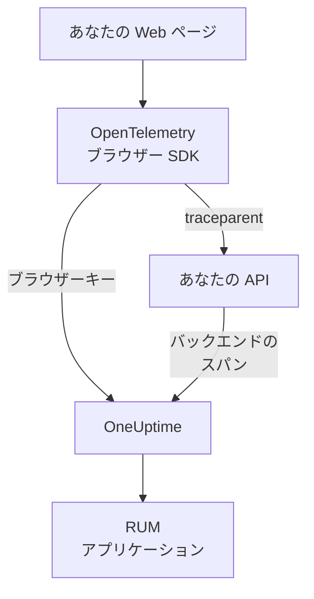

# ブラウザーのセットアップ

OpenTelemetry のブラウザー SDK で Web アプリをインストルメントし、RUM アプリケーションとして OneUptime に報告させます。ページの読み込みとリクエストはトレースとして届き、同じセットアップでエラー、ログ、メトリクス、Core Web Vitals も送れます。

:::cards
- [セットアップ](#セットアップ): ブラウザーキーから最初のページ読み込みまでの 6 つの手順。
- [バックエンドとのリンク](#バックエンドのトレースとのリンク): ブラウザーのスパンを、それが開始したバックエンドのトレースにつなぎます。
- [エラーの報告](#捕捉されないエラーを報告する): 捕捉されないエラーを例外ビューに送ります。
- [トラブルシューティング](#トラブルシューティング): 何も届かないときに確認すること。
:::

## 仕組み

SDK は訪問者のブラウザーで動きます。ページの読み込みとリクエストごとにスパンを記録し、 **ブラウザー** の取り込みキーを使って OneUptime に直接エクスポートします。間に独自のコレクターやプロキシは必要ありません。



## 始める前に

- コードを変更して再デプロイでき、依存関係を npm でインストールしている Web アプリ。
- ページの配信元のオリジン。例: `https://app.example.com` 。ブラウザーキーは、キーに登録したオリジンからのリクエストだけを受け付けます。
- 取り込みキーを作成できるロール。プロジェクトのオーナーと管理者のほか、 **Create Telemetry Ingestion Key** 権限を持つユーザーも作成できます。

## セットアップ

:::steps
### ブラウザーの取り込みキーを作成する

1. **製品 → プロジェクト設定** に移動します。
2. サイドメニューで **テレメトリと APM** を開き、 **取り込みキー** を選びます。
3. **取り込みキーを作成** をクリックし、 **キーの種類** で **ブラウザー** を選びます。
4. **ブラウザー設定** の手順で、 **許可されたオリジン** にオリジンを JSON 配列で指定し (例: `["https://app.example.com"]` )、キーを作成します。OneUptime Cloud の Free プランでは、最後の **請求** の手順でテレメトリの料金が先に表示されます。


新しいキーは専用のページで開きます。その **シークレットキー** をコピーしてください。これが、SDK が `x-oneuptime-token` として送るトークンです。


### パッケージをインストールする

```bash
npm install @opentelemetry/api \
  @opentelemetry/sdk-trace-web \
  @opentelemetry/resources \
  @opentelemetry/semantic-conventions \
  @opentelemetry/opentelemetry-browser-detector \
  @opentelemetry/exporter-trace-otlp-http \
  @opentelemetry/context-zone \
  @opentelemetry/instrumentation \
  @opentelemetry/instrumentation-document-load \
  @opentelemetry/instrumentation-fetch \
  @opentelemetry/instrumentation-xml-http-request
```

### テレメトリファイルを作成する

`src/telemetry.ts` を作成します。 `browserDetector` はテレメトリを RUM として分類させる `browser.*` 属性を追加し、 `service.name` がアプリケーションの名前になります。

```ts title="src/telemetry.ts"
import {
  WebTracerProvider,
  BatchSpanProcessor,
} from "@opentelemetry/sdk-trace-web";
import { OTLPTraceExporter } from "@opentelemetry/exporter-trace-otlp-http";
import { ZoneContextManager } from "@opentelemetry/context-zone";
import { registerInstrumentations } from "@opentelemetry/instrumentation";
import { DocumentLoadInstrumentation } from "@opentelemetry/instrumentation-document-load";
import { FetchInstrumentation } from "@opentelemetry/instrumentation-fetch";
import { XMLHttpRequestInstrumentation } from "@opentelemetry/instrumentation-xml-http-request";
import {
  defaultResource,
  detectResources,
  resourceFromAttributes,
} from "@opentelemetry/resources";
import { browserDetector } from "@opentelemetry/opentelemetry-browser-detector";
import { ATTR_SERVICE_NAME } from "@opentelemetry/semantic-conventions";

const ONEUPTIME_URL = "https://oneuptime.com";
// Public: it ships in your page. It must be a Browser ingestion key.
const ONEUPTIME_TOKEN = "YOUR_TELEMETRY_INGESTION_TOKEN";

/*
 * browserDetector supplies the browser.* attributes. Without them this
 * telemetry is classified as a backend Service, not a RUM application.
 * The attributes set last win, so service.name here overrides the
 * "unknown_service" that defaultResource() provides.
 */
const resource = defaultResource()
  .merge(detectResources({ detectors: [browserDetector] }))
  .merge(
    resourceFromAttributes({
      [ATTR_SERVICE_NAME]: "storefront-web",
    }),
  );

const provider = new WebTracerProvider({
  resource: resource,
  spanProcessors: [
    new BatchSpanProcessor(
      new OTLPTraceExporter({
        url: `${ONEUPTIME_URL}/otlp/v1/traces`,
        headers: { "x-oneuptime-token": ONEUPTIME_TOKEN },
      }),
    ),
  ],
});

provider.register({
  contextManager: new ZoneContextManager(),
});

registerInstrumentations({
  instrumentations: [
    new DocumentLoadInstrumentation(),
    new FetchInstrumentation({
      // See "Linking to your backend traces" before widening this.
      propagateTraceHeaderCorsUrls: [/^https:\/\/api\.example\.com/],
    }),
    new XMLHttpRequestInstrumentation({
      propagateTraceHeaderCorsUrls: [/^https:\/\/api\.example\.com/],
    }),
  ],
});
```

### 最初にインポートする

アプリの最初のインポートにします。インストルメンテーションは `fetch` と `XMLHttpRequest` にパッチを当てるため、パッチより前に行われたリクエストはトレースされません。

```ts
// src/index.tsx (React), src/main.ts (Vue / Angular), etc.
import "./telemetry";
import React from "react";
// ... the rest of your app
```

### キーを確認する

ほかを調べる前に、OneUptime がキーを受け付けるかどうかを確認します。

```bash
curl -i https://oneuptime.com/otlp/v1/validate \
  -H "x-oneuptime-token: YOUR_TELEMETRY_INGESTION_TOKEN"
```

`200` と `"valid": true` は、キーが受け付けられたことを示します。ブラウザーキーの場合は、ブラウザーから、しかも許可されたオリジンのいずれかからしか使えないことがメッセージに添えられます。 `401` は、キーが不明、取り消し済み、無効化済み、または期限切れであることを示します。

### ページを読み込む

サイトを開きます。1 分以内に、アプリケーションが `service.name` の名前で **製品 → リソース → リアルユーザーモニタリング** に表示されます。
:::

## ブラウザーキーで許可されること

スニペットの内容はすべて訪問者に配信されるため、誰でもページからトークンをコピーできます。ブラウザーキーは、そのコピーでできることを制限します。

| 設定 | 役割 |
| --- | --- |
| **許可されたオリジン** | これらのオリジンからのリクエストだけを受け付けます。各オリジンにはスキームと、あればポートを含めます。ホストの先頭には `*.` のワイルドカードを一つだけ使えます。 `https://*.example.com` は `example.com` のすべてのサブドメインに一致しますが、 `example.com` 自体には一致しません。 |
| **1 分あたりのリクエスト数の上限** | キーを使うすべての訪問者で共有するひとつの上限です。独自に設定しない限り、毎分 6000 リクエストです。 |
| **固定されたサービス名** | キーが書き込むすべてのデータに `service.name` を強制し、コピーされたキーのテレメトリがバックエンドサービスを装えないようにします。 |
| **有効期限** | この日付を過ぎると、キーは受け付けられなくなります。 |
| **有効** | オフにすると、漏えいしたキーをすぐに止められます。 |

ブラウザーキーが書き込めるのは OTLP のトレース、ログ、メトリクスとセッションリプレイだけで、ほかの取り込み経路はすべてこのキーを拒否します。これらの設定はキー自体のページで変更します。キーの種類は、キーの作成後には変更できません。

> [!WARNING]
> **サーバー** キーは決してページに入れないでください。サーバーキーはオリジンを確認せずにどこからでもあらゆる種類のテレメトリを書き込めるため、ページを読んだ誰もがプロジェクトに書き込めてしまいます。

## 検出器を使わずに `browser.*` を設定する

`browserDetector` は [UA Client Hints API](https://wicg.github.io/ua-client-hints/) を読み取りますが、この API は Chromium 系のブラウザーにしかありません。Safari と Firefox では `browser.language` と `user_agent.original` は設定されますが、 `browser.platform` 、 `browser.brands` 、 `browser.mobile` は設定されません。

それでも、 `browser.language` だけでバッチがブラウザー RUM としてマークされるため、テレメトリは RUM に分類されます。ただし **クライアント** ページは `browser.platform` からプラットフォームを一覧にするため、Safari と Firefox からの訪問はそこに行を追加しません。

検出器を使わない場合や、すべてのブラウザーにプラットフォームを持たせたい場合は、属性を自分で設定します。

```ts
const resource = defaultResource().merge(
  resourceFromAttributes({
    [ATTR_SERVICE_NAME]: "storefront-web",
    // browser.language or browser.platform marks the telemetry as browser RUM.
    "browser.language": navigator.language,
    "browser.platform":
      (navigator as any).userAgentData?.platform ?? "unknown",
    "browser.mobile": (navigator as any).userAgentData?.mobile ?? false,
    "user_agent.original": navigator.userAgent,
  }),
);
```

`browser.platform` は大まかな値にしてください。異なる値はそれぞれ **クライアント** ページの行になるため、完全な user-agent 文字列やユーザーごとの値を入れると一覧が際限なく増え、プライバシーの問題にもなります。

## ルート変更をトレースする

`DocumentLoadInstrumentation` がトレースするのは最初の読み込みだけです。シングルページアプリでは、ルート変更は記録するまで見えません。記録はルーターに数行加えるだけで済みます。

```ts
import { trace } from "@opentelemetry/api";

const tracer = trace.getTracer("app-router");

function onRouteChange(to: string): void {
  const span = tracer.startSpan("route-change", {
    attributes: { "app.route": to },
  });
  // End it when the route's data has loaded and the view has painted.
  requestAnimationFrame(() => {
    return span.end();
  });
}
```

クリックなどの DOM イベントもトレースするには、 `@opentelemetry/instrumentation-user-interaction` を追加します。ルートごとの INP については [シングルページアプリ](/docs/rum/web-vitals#シングルページアプリ) を参照してください。

## バックエンドのトレースとのリンク

`propagateTraceHeaderCorsUrls` は、W3C の `traceparent` ヘッダーを付けるクロスオリジンのリクエストを決めます。このヘッダーが、ブラウザーのスパンとそれが開始したバックエンドのトレースをつなぎます。ページ自身のオリジンへのリクエストには、設定なしで付きます。

> [!WARNING]
> `/.*/` には設定しないでください。このヘッダーを付けると単純なクロスオリジンリクエストがプリフライト付きのリクエストになるため、 `Access-Control-Allow-Headers` に `traceparent` を含めていないサードパーティの API が失敗し始めます。

自分で管理し、設定済みのオリジンだけを指定します。

```ts
new FetchInstrumentation({
  propagateTraceHeaderCorsUrls: [
    /^https:\/\/api\.example\.com/,
    /^https:\/\/auth\.example\.com/,
  ],
});
```

[セッションリプレイ](/docs/telemetry/session-replay) を導入している場合、自分のオリジンへのリクエストにはリプレイのセッション ID も付き、バックエンドのテレメトリが録画にひも付きます。 [トレースをセッションリプレイにつなぐ](#トレースをセッションリプレイにつなぐ) を参照してください。

## トレースをセッションリプレイにつなぐ

[セッションリプレイ](/docs/telemetry/session-replay) も使っている場合、 **バックエンド** のテレメトリは、ここでコードを書かなくても録画にひも付きます。セッションのアップロード中、レコーダーはページが自身のオリジンに送るリクエストにセッション ID を含む `tracestate` メンバーを追加し、 `traceparent` は `FetchInstrumentation` / `XMLHttpRequestInstrumentation` に任せます。W3C トレースコンテキストを引き継ぐすべてのサービスで、バックエンドのスパンには取り込み時にセッション ID が付き、そのログと例外はトレース ID で録画にひも付きます。仕組み、対象外のもの、無効にするスイッチについては [ほかのテレメトリとの相関](/docs/telemetry/session-replay#correlating-with-your-other-telemetry) を参照してください。

レコーダーは、呼び出しが URL (init オブジェクトの有無を問わず) を渡す場合も `Request` オブジェクトを渡す場合も、インストルメンテーションが設定した `traceparent` を読み戻すため、リプレイのリクエスト行はそれぞれのバックエンドのトレースにリンクします。別のオリジンにある API は、上の `propagateTraceHeaderCorsUrls` に登録してください。そのリクエストにはセッション ID が付かず、トレース ID で録画にひも付きます。この SDK *を使っていない* ページでは、アプリケーションのリプレイポリシーにある **トレース伝播のオリジン** が同じ役割を果たします。

ヘッダーが届かないのは、この SDK 自身のブラウザースパンです。つまりドキュメントの読み込み、ルート変更、報告したエラーです。これらも録画にひも付けるには、各スパンの開始時に `session.id` を設定します。レコーダーは `onSessionChange` で ID を知らせます。これは、セッションがすでにあればすぐに呼ばれ、その後は ID が変わるたびに呼ばれます。訪問者が 30 分の非アクティブ後に戻ったとき、4 時間の上限に達したとき、 `identify()` が別のユーザーを指定したとき、同じ訪問者の別のタブが先に変更したときです。

```ts title="src/replaySession.ts"
import type { Context } from "@opentelemetry/api";
import type {
  ReadableSpan,
  Span,
  SpanProcessor,
} from "@opentelemetry/sdk-trace-web";

declare global {
  interface Window {
    OneUptimeReplayQueue?: Array<Array<unknown>>;
  }
}

let replaySessionId: string | null = null;

// The recorder script loads asynchronously. The queue is applied the
// moment it starts and stays live afterwards, so this works either way.
(window.OneUptimeReplayQueue = window.OneUptimeReplayQueue || []).push([
  "onSessionChange",
  (sessionId: string): void => {
    replaySessionId = sessionId;
  },
]);

export class ReplaySessionSpanProcessor implements SpanProcessor {
  public onStart(span: Span, _parentContext: Context): void {
    if (replaySessionId) {
      span.setAttribute("session.id", replaySessionId);
    }
  }

  public onEnd(_span: ReadableSpan): void {}

  public forceFlush(): Promise<void> {
    return Promise.resolve();
  }

  public shutdown(): Promise<void> {
    return Promise.resolve();
  }
}
```

次に、 `src/telemetry.ts` のプロバイダーのスパンプロセッサーの先頭にこれを置きます。

```ts
import { ReplaySessionSpanProcessor } from "./replaySession";

const provider = new WebTracerProvider({
  resource: resource,
  spanProcessors: [
    new ReplaySessionSpanProcessor(),
    new BatchSpanProcessor(
      new OTLPTraceExporter({
        url: `${ONEUPTIME_URL}/otlp/v1/traces`,
        headers: { "x-oneuptime-token": ONEUPTIME_TOKEN },
      }),
    ),
  ],
});
```

その後に開始したスパンには ID が付き、リプレイプレーヤーの **トレース** タブで録画の時刻に沿って表示され、ダッシュボードの各スパンからリプレイのその瞬間に戻れます。スパンプロセッサーは、各スパンに開始時点の ID を付けます。代わりに `resource.attributes` に ID を書くと、セッションが切り替わったときにエクスポートのバッチで待っていたスパンのラベルまで変わってしまいます。リスナーは同意やキャプチャのトリガーより前、レコーダーの起動直後に ID を受け取るため、それが問題になる場合は、ページが同意を得てから ID を付けてください。

## Content Security Policy

サイトが Content Security Policy を送っている場合、 `connect-src` で OneUptime を許可するまで、ブラウザーはエクスポーターのリクエストをブロックします。目に見えるエラーはなく、ページは何も報告しないだけです。

```text
connect-src 'self' https://oneuptime.com;
```

既存の `connect-src` ディレクティブに統合してください。OneUptime をセルフホストしている場合は、自分のホストを使います。

## 捕捉されないエラーを報告する

OpenTelemetry のブラウザー SDK は、捕捉されないエラーを記録しません。自分で報告すれば、バックエンドのエラーと並んで **例外** に表示されます。

```ts
import { trace, SpanStatusCode } from "@opentelemetry/api";

const tracer = trace.getTracer("app-errors");

window.addEventListener("error", (event: ErrorEvent) => {
  const span = tracer.startSpan("window.onerror");
  span.recordException(event.error ?? new Error(event.message));
  span.setStatus({ code: SpanStatusCode.ERROR });
  span.end();
});

window.addEventListener("unhandledrejection", (event: PromiseRejectionEvent) => {
  const span = tracer.startSpan("unhandledrejection");
  span.recordException(
    event.reason instanceof Error ? event.reason : new Error(String(event.reason)),
  );
  span.setStatus({ code: SpanStatusCode.ERROR });
  span.end();
});
```

[セッションリプレイ](/docs/telemetry/session-replay) を使っている場合は、レコーダーも捕捉されないエラーを記録し、リプレイのタイムラインに印を付けます。例外のページには **ユーザーが見たものを視聴** カードが表示され、エラーの 10 秒前からリプレイを開きます。既定のポリシーでは、エラーの有無にかかわらずすべてのセッションが録画されます。エラーが決めるのは、カードがどこから開くかだけです。

## ログとメトリクスを追加する

概要を埋めるにはトレースだけで十分です。ブラウザーのログを OneUptime で見たい場合や、 [Core Web Vitals](/docs/rum/web-vitals) を送りたい場合は、ログとメトリクスのパイプラインを追加します。

```bash
npm install @opentelemetry/api-logs @opentelemetry/sdk-logs \
  @opentelemetry/exporter-logs-otlp-http \
  @opentelemetry/sdk-metrics @opentelemetry/exporter-metrics-otlp-http
```

```ts
import { LoggerProvider, BatchLogRecordProcessor } from "@opentelemetry/sdk-logs";
import { OTLPLogExporter } from "@opentelemetry/exporter-logs-otlp-http";
import { MeterProvider, PeriodicExportingMetricReader } from "@opentelemetry/sdk-metrics";
import { OTLPMetricExporter } from "@opentelemetry/exporter-metrics-otlp-http";
import { logs } from "@opentelemetry/api-logs";
import { metrics } from "@opentelemetry/api";

const headers = { "x-oneuptime-token": ONEUPTIME_TOKEN };

logs.setGlobalLoggerProvider(
  new LoggerProvider({
    resource: resource,
    processors: [
      new BatchLogRecordProcessor({
        exporter: new OTLPLogExporter({
          url: `${ONEUPTIME_URL}/otlp/v1/logs`,
          headers,
        }),
      }),
    ],
  }),
);

metrics.setGlobalMeterProvider(
  new MeterProvider({
    resource: resource,
    readers: [
      new PeriodicExportingMetricReader({
        exporter: new OTLPMetricExporter({
          url: `${ONEUPTIME_URL}/otlp/v1/metrics`,
          headers,
        }),
        exportIntervalMillis: 30000,
      }),
    ],
  }),
);
```

同じ `resource` オブジェクトで作成してください。リソースに `browser.*` がないログやメトリクスのパイプラインは、別のバックエンドサービスとして分類されます。

## エンドポイントのリファレンス

| シグナル | エンドポイント | ヘッダー |
| --- | --- | --- |
| トレース | `POST {host}/otlp/v1/traces` | `x-oneuptime-token: <token>` |
| メトリクス | `POST {host}/otlp/v1/metrics` | `x-oneuptime-token: <token>` |
| ログ | `POST {host}/otlp/v1/logs` | `x-oneuptime-token: <token>` |

`{host}` は `https://oneuptime.com` 、または OneUptime をセルフホストしている場合は自分のホストです。OTLP の URL と Content Security Policy のエントリで置き換えてください。OneUptime は OTLP/JSON と OTLP/protobuf を受け付けます。エンドポイントはあらゆるオリジンからのクロスオリジンリクエストに応答し、 `x-oneuptime-token` ヘッダーを許可するため、ブラウザーから直接エクスポートできます。

## トラブルシューティング

:::details ネットワークタブに OneUptime へのリクエストがない
ブラウザーの開発者ツールを開き、ネットワークタブで `otlp` でフィルターします。探すのは `POST /otlp/v1/traces` です。リクエストがまったくない場合、SDK は起動していません。

- `telemetry.ts` が最初のインポートになっていないか、バンドラーに取り除かれています。
- バッチプロセッサーがまだエクスポートしていません。バッチを満たすために数秒待つので、何も送られていないと判断する前に、少し待つか別のページに移動してください。
- ビルド時の環境変数が `undefined` になり、エクスポーターの URL が壊れています。起動時に URL を一度ログに出力してください。
:::

:::details ブラウザーがリクエストをブロックする
- コンソールに Content Security Policy のエラーが出る場合は、 `connect-src` がまだ OneUptime を許可していません。 [Content Security Policy](#content-security-policy) を参照してください。
- CORS エラーは、ほとんどの場合リクエストが OneUptime に届いていないことを意味します。OneUptime のエンドポイントはあらゆるオリジンを許可しているからです。社内プロキシ、広告ブロッカー、ホスト名の入力ミスを確認してください。
:::

:::details OneUptime がリクエストを拒否する
- `422` と `Origin https://app.example.com is not allowed for this browser ingestion key.` は、ページの正確なオリジン (スキーム、ホスト、ポート) がキーの **許可されたオリジン** にないことを示します。
- `422` と `This telemetry ingestion key has been disabled.` は、誰かがキーをオフにしたことを示します。オンに戻すか、別のキーを使ってください。
- `401` は、キーが不明、取り消し済み、または期限切れであることを示します。 [セットアップ](#セットアップ) のキーの確認を実行してから、有効なブラウザーキーを作成してください。
- `404` は URL の誤りです。トレースのエクスポーターには完全なパス `/otlp/v1/traces` が必要です。
:::

:::details アプリがリアルユーザーモニタリングではなくサービスに表示される
リソースに `browser.*` 属性がないため、テレメトリがバックエンドサービスに分類されました。 `browserDetector` を追加するか、 [検出器を使わずに `browser.*` を設定する](#検出器を使わずに-browser-を設定する) のように属性を設定してください。

送っている内容は、ネットワークタブのリクエストのペイロードで確認できます。判定を決めるのは `resourceSpans[0].resource.attributes` の一覧です。すでに作成されたサービスは RUM アプリケーションには変わらないため、RUM のテレメトリが届いたら **製品 → サービス** で削除してください。
:::

:::details Safari や Firefox でクライアントページが空になる
クライアントの行は `browser.platform` から作られますが、 `browserDetector` がこれを設定するのは Chromium 系のブラウザーだけです。Safari と Firefox からの訪問を一覧に出すには自分で設定してください。 [検出器を使わずに `browser.*` を設定する](#検出器を使わずに-browser-を設定する) を参照してください。
:::

## 次のステップ

:::cards
- [Core Web Vitals](/docs/rum/web-vitals): 同じページから LCP、INP、CLS、FCP、TTFB を送ります。
- [セッションリプレイ](/docs/telemetry/session-replay): ユーザーが見た画面を、これらのトレースと並べて録画します。
- [アプリケーションの管理](/docs/rum/applications): 名前、ラベル、所有者、保持期間。
- [RUM のトラブルシューティング](/docs/rum/troubleshooting): 問題がよく起きる順に並べたすべての確認項目。
:::
