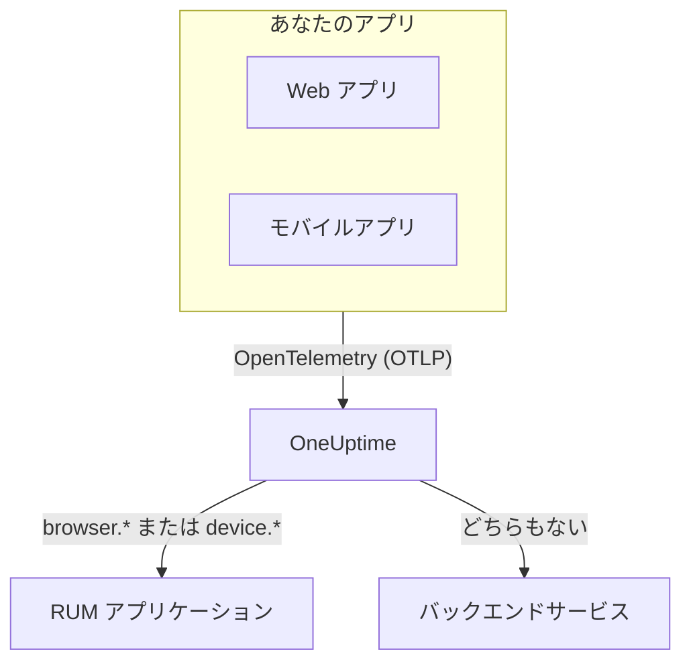

# RUM 概要

リアルユーザーモニタリング (RUM) は、Web アプリやモバイルアプリで実際のユーザーが体験していること、つまりページの読み込み、リクエスト、エラー、Core Web Vitals を、プローブではなくアプリ自身の報告として示します。OneUptime はそのテレメトリを RUM アプリケーションにまとめ、グラフ化、検索、アラートに使えるようにします。

:::cards
- [仕組み](#仕組み): ひとつの OpenTelemetry パイプラインで、到着時に RUM として分類されます。
- [OneUptime が RUM を見分ける方法](#oneuptime-が-rum-を見分ける方法): 判定に使われるリソース属性です。
- [得られるもの](#得られるもの): 概要、Web Vitals、エクスプローラー、リプレイ。
- [はじめに](#はじめに): 取り込みキーの作成から最初のページ読み込みまで。
:::

## 仕組み

RUM は OneUptime のほかの機能と同じ OpenTelemetry パイプラインを使います。RUM 専用のエージェントや独自の転送形式はありません。ブラウザー用またはモバイル用の OpenTelemetry SDK を OneUptime に向けるだけで、届いたテレメトリが RUM として分類されます。

- **アプリごとにひとつのアプリケーション。** その識別子は SDK が報告する `service.name` で、最初のテレメトリのバッチが届いたときに OneUptime がアプリケーションを作成します。
- **二重に数えられることはありません。** クライアントのテレメトリはその RUM アプリケーションだけに属し、バックエンドサービスとしても一覧に出ることはありません。
- **セッションリプレイは独立した任意のレイヤーです。** 専用のスニペットとプライバシー設定があります。詳しくは [セッションリプレイ](/docs/telemetry/session-replay) を参照してください。

## どこにあるか

**製品 → リソース → リアルユーザーモニタリング** を開きます。 **すべてのアプリケーション** には、 **クライアントタイプ** 、 **ステータス** 、 **最終確認** とともにアプリケーションが一覧表示されます。サイドメニューのほかの 2 つのセクションは、最初は折りたたまれています。

- **設定**: **所有者ルール** 、 **ラベルルール** 、プロジェクト全体の **セッションリプレイ** スイッチ。
- **詳細**: **アーカイブ済み** 、アーカイブしたアプリケーション。

アプリケーション自身のサイドメニューは、ページを次のようにまとめています。 **設定** 、 **開発者** 、 **詳細** は最初は折りたたまれています。

| セクション | ページ |
| --- | --- |
| **基本** | **概要**, **推奨事項**, **ドキュメント** |
| **オブザーバビリティ** | **メトリクス**, **ログ**, **トレース**, **クライアント** |
| **セッションリプレイ** | **セッションリプレイ**, **ユーザーフロー**, **リプレイのユーザー**, **ヘルス**, **リプレイポリシー**, **リプレイのアクセスログ**, **ドキュメント** |
| **設定** | **設定** |
| **開発者** | **Terraform**, **API**, **AI アシスタント** |
| **詳細** | **アプリケーションを削除** |

## OneUptime が RUM を見分ける方法

「アプリが表示されない」という質問のほとんどは、ここで解決します。OneUptime は、テレメトリのバッチが届くたびに、そのバッチの **リソース属性** から判断します。

1. リソースに `browser.platform` 、 `browser.language` 、または空でない `browser.brands` があるバッチは **ブラウザー** RUM です。
2. それ以外で、`device.id` または `device.model.identifier` があるバッチは **モバイル** RUM です。
3. それ以外で、`device.manufacturer` があり、ホストの識別子 (`host.name` 、 `host.id` 、 `k8s.node.name` ) がないバッチも **モバイル** RUM です。
4. それ以外はすべてバックエンドサービスです。

バックエンドの SDK が `browser.*` 、 `device.id` 、 `device.model.identifier` を設定することはないため、これらは明確なシグナルです。例外は `device.manufacturer` です。ホストのインベントリもマシンのメーカーをこの属性で報告するため、ホストの識別子がないリソースでのみ判定に使われます。 [インベントリ属性](/docs/telemetry/host-otel-collector#インベントリ属性-ipmacシリアル番号メーカーモデルファームウェア) を参照してください。

| 属性 | 必須 | 役割 |
| --- | --- | --- |
| `service.name` | **はい** | アプリケーションの識別子です。例: `storefront-web` 。これがないと RUM アプリケーションは作成されません。 |
| `browser.platform`, `browser.language`, `browser.brands` | Web ではいずれか一つ | バッチをブラウザー RUM としてマークします。 `browser.platform` は **クライアント** ページにも使われます。 |
| `device.id`, `device.model.identifier` | モバイルではいずれか一つ | バッチをモバイル RUM としてマークします。 `device.model.identifier` は **クライアント** ページにも使われます。 |
| `device.manufacturer` | いいえ | リソースにホストの識別子がない場合に限り、バッチをモバイル RUM としてマークします。 |
| `telemetry.sdk.language` | いいえ | 概要に表示されます。例: `webjs` 、 `swift` 。 |
| `telemetry.sdk.version` | いいえ | SDK のバージョンとして表示されます。ない場合は `oneuptime.agent.version` が使われます。 |
| `oneuptime.label.<name>` | いいえ | プロジェクトのラベル `<name>:<value>` をアプリケーションに付けます。 |

OneUptime は `service.name` で大文字と小文字を区別せずにアプリケーションを探し、プロジェクトにない場合は作成します。新しい `service.name` は新しいアプリケーションになるため、名前は変えずに使い続け、環境の違いは新しい名前ではなくラベルで区別してください。名前、ラベル、所有者、保持期間については [アプリケーションの管理](/docs/rum/applications) で説明しています。

> [!IMPORTANT]
> ブラウザー用の OpenTelemetry SDK は、ブラウザーのリソース検出器を追加するか自分で設定しない限り、 `browser.*` 属性を追加しません。 `service.name` だけでは、テレメトリは RUM アプリケーションではなくバックエンドサービスになります。両方の方法は [ブラウザーのセットアップ](/docs/rum/browser-setup) で紹介しています。

## 得られるもの

| 場所 | 表示内容 |
| --- | --- |
| **概要** | **ページ読み込み** 、 **ページ読み込み時間（p95）** 、 **イベント** 、 **エラー率** 、 **イベントの期間（p95）** 、 **例外** 、 **クライアント** 、 **記録されたセッション** のタイルと、選んだ期間の推移グラフ。 |
| **Core Web Vitals** | 概要にあるカードで、LCP、INP、CLS、FCP、TTFB をそれぞれ Google の基準で評価し、シングルページアプリではルートごとの INP も示します。 [Core Web Vitals](/docs/rum/web-vitals) と [シングルページアプリ](/docs/rum/web-vitals#シングルページアプリ) を参照してください。 |
| **メトリクス**, **ログ**, **トレース** | このアプリケーションに絞り込んだテレメトリのエクスプローラー。 |
| **クライアント** | アプリケーションが使われたブラウザーのプラットフォームとデバイスのモデル。プラットフォーム単位の短い一覧で、ユーザーごとの行にはなりません。 |
| **セッションリプレイ** | 実際のセッションの録画を、そのエラー、トレース、ログと並べて表示します。 [セッションリプレイ](/docs/telemetry/session-replay) を参照してください。 |
| **推奨事項** | アプリケーション用の既製のモニター。Core Web Vitals の悪化、失敗したリクエスト、ブラウザーの例外、そして録画が始まればセッションリプレイの予算。 |

数値は、インストルメンテーションが送るスパンから算出されます。 **ページ読み込み** は、ページ読み込みのインストルメンテーションが完全な読み込みのたびに記録する `documentLoad` スパンを数えるため、シングルページアプリ内のルート変更はページ読み込みには数えられません。

アプリケーションは、テレメトリが届いている間は **接続済み** と表示され、15 分間届かないと **切断済み** になります。OneUptime 自体が停止していた時間や取り込みキューの処理に追われていた時間は、この 15 分には含まれません。

## はじめに

:::steps
### 取り込みキーを作成する

**プロジェクト設定 → テレメトリと APM → 取り込みキー** を開き、 **取り込みキーを作成** をクリックします。Web アプリには、指定したオリジンからのみ使える **ブラウザー** キーが必要です。モバイルアプリには **サーバー** キーが必要です。モバイル SDK は `Origin` ヘッダーを送らないためです。

### アプリをインストルメントする

Web アプリなら [ブラウザーのセットアップ](/docs/rum/browser-setup) 、Android、iOS、React Native などのプラットフォームなら [モバイルのセットアップ](/docs/rum/mobile-setup) に従ってください。

### ページを開く

サイトのページを読み込むか、アプリを起動します。最初のテレメトリのバッチが届くと、アプリケーションが `service.name` の名前で **製品 → リソース → リアルユーザーモニタリング** に表示されます。事前に作成する必要はありません。

### Web Vitals とリプレイを追加する

基本的なデータが届いたら、 [Core Web Vitals](/docs/rum/web-vitals) を送信し、 [セッションリプレイ](/docs/telemetry/session-replay) を追加します。どちらも任意です。
:::

何も表示されない場合は、 [RUM のトラブルシューティング](/docs/rum/troubleshooting) で、よく起きる順に原因を確認できます。

## 次のステップ

:::cards
- [ブラウザーのセットアップ](/docs/rum/browser-setup): OpenTelemetry のブラウザー SDK で Web アプリをインストルメントします。
- [モバイルのセットアップ](/docs/rum/mobile-setup): Android、iOS、React Native、そのほかの OpenTelemetry SDK。
- [Core Web Vitals](/docs/rum/web-vitals): LCP、INP、CLS、FCP、TTFB を送信し、INP をルートごとに確認します。
- [セッションリプレイ](/docs/telemetry/session-replay): ユーザーが見た画面を、エラーやトレースと並べて確認します。
:::
