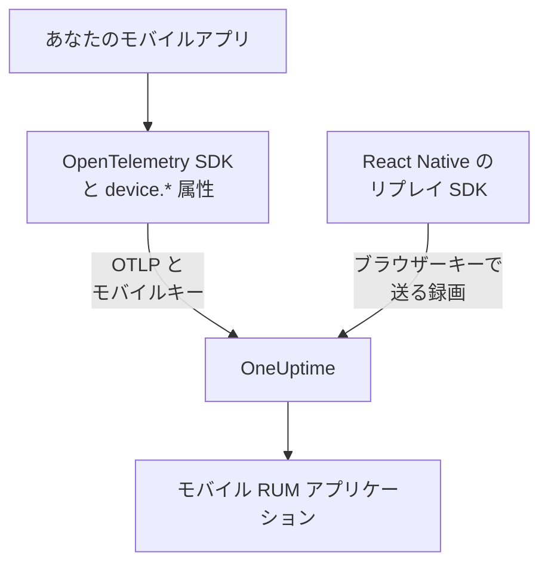

# モバイルのセットアップ

Android、iOS、React Native のアプリを OpenTelemetry でインストルメントし、モバイルの RUM アプリケーションとして OneUptime に報告させます。OpenTelemetry SDK があるほかのプラットフォームも同じ方法で動きます。

:::cards
- [OneUptime に必要なもの](#oneuptime-に必要なもの): モバイルキーで送る 2 つのリソース属性。
- [プラットフォームの設定](#プラットフォームの設定): Android、iOS、React Native、そのほか。
- [iOS のクラッシュとハング](#ios-のクラッシュとハング): 例外に表示される MetricKit と KSCrash のレポート。dSYM で名前が付きます。
- [到着の確認](#到着を確認する): キーを確認してから、アプリを探します。
- [モバイルのセッションリプレイ](#モバイルのセッションリプレイ): React Native アプリの録画。
:::

## 仕組み

アプリは、アプリに固定した **モバイル** の取り込みキーを使って、OTLP を OneUptime に直接エクスポートします。そのため、送ったものはすべてそのモバイル RUM アプリケーションとして分類されます。ほかのキーの場合、バックエンドサービスではなくモバイル RUM として分類させるのは、そのリソースの `device.*` 属性です。



## OneUptime に必要なもの

アプリがエクスポートするすべてのバッチに、2 つのリソース属性が必要です。

| 属性 | 内容 |
| --- | --- |
| `service.name` | アプリケーションの識別子です。例: `storefront-android` 。 |
| `device.id` または `device.model.identifier` | テレメトリをモバイル RUM としてマークします。 `device.model.identifier` は **クライアント** ページにも使われます。 |

ほかのキーで送った場合、デバイスの属性がなくてもテレメトリは届き、クエリもできますが、RUM アプリケーションではなくバックエンドサービスとして分類されます。

`device.manufacturer` もバッチをモバイルとしてマークしますが、ホストの識別子がないリソースに限られます。ホストのインベントリがマシンのメーカーをこの属性で報告するためです。下のどのレシピとも同じように `device.id` か `device.model.identifier` も設定すれば、このことは問題になりません。

`device.id` はインストール単位の識別子にし、広告 ID など個人を特定するものは決して使わないでください。OneUptime がこれを読むのは、モバイルのテレメトリを見分けるためだけです。

## 始める前に

- OpenTelemetry SDK を組み込んだアプリ。OpenTelemetry Java SDK または OpenTelemetry Android、opentelemetry-swift、React Native なら OpenTelemetry JavaScript SDK です。
- **プロジェクト設定 → テレメトリと APM → 取り込みキー** で **取り込みキーを作成** を使って作成し、 **固定されたサービス名** にアプリの `service.name` を設定した **モバイル** の取り込みキー。 **ブラウザー** キーはモバイルアプリからは拒否されます。このキーは `Origin` ヘッダーで確認されますが、モバイル SDK はこのヘッダーを送らないためです。アプリに **サーバー** キーを入れて配布してはいけません。
- 次の OTLP の設定。OneUptime をセルフホストしている場合は、 `https://oneuptime.com` を自分のホストに置き換えてください。

| 設定 | 値 |
| --- | --- |
| OTLP エンドポイント | `https://oneuptime.com/otlp` |
| ヘッダー | `x-oneuptime-token: YOUR_TELEMETRY_INGESTION_TOKEN` |
| トレース | `POST https://oneuptime.com/otlp/v1/traces` |
| メトリクス | `POST https://oneuptime.com/otlp/v1/metrics` |
| ログ | `POST https://oneuptime.com/otlp/v1/logs` |

> [!WARNING]
> キーはアプリの中に入って配布され、アプリは展開できるため、誰かにコピーされる前提で考えてください。モバイルキーのコピーが送れるのは、このアプリのトレース、ログ、メトリクスだけで、すべて **固定されたサービス名** の下に分類され、Web ページからは送れません。それでもキーの **1 分あたりのリクエスト数の上限** までは、このアプリの作り話のデータを送れます。そのため **有効期限** の日付を加え、リリースごとにキーをローテーションしてください。

## プラットフォームの設定

スニペットはセットアップの形を示すものです。モバイル向けの OpenTelemetry SDK はリリースごとに API が変わるため、メソッド名は固定したバージョンと照らし合わせてください。OneUptime に必要なものは変わりません。エンドポイント、ヘッダー、 `service.name` 、そして `device.*` 属性 1 つです。

:::tabs
@tab Android
Android で動く OpenTelemetry Java SDK とその OTLP エクスポーターを使います。

```kotlin title="app/build.gradle.kts"
dependencies {
    implementation(platform("io.opentelemetry:opentelemetry-bom:<latest>"))
    implementation("io.opentelemetry:opentelemetry-sdk")
    implementation("io.opentelemetry:opentelemetry-exporter-otlp")
}
```

```kotlin title="StorefrontApplication.kt"
import android.app.Application
import android.os.Build
import io.opentelemetry.exporter.otlp.http.trace.OtlpHttpSpanExporter
import io.opentelemetry.sdk.OpenTelemetrySdk
import io.opentelemetry.sdk.resources.Resource
import io.opentelemetry.sdk.trace.SdkTracerProvider
import io.opentelemetry.sdk.trace.export.BatchSpanProcessor

class StorefrontApplication : Application() {
    override fun onCreate() {
        super.onCreate()

        val resource = Resource.getDefault().toBuilder()
            .put("service.name", "storefront-android")
            .put("device.manufacturer", Build.MANUFACTURER)
            .put("device.model.identifier", Build.MODEL)
            .build()

        val exporter = OtlpHttpSpanExporter.builder()
            .setEndpoint("https://oneuptime.com/otlp/v1/traces")
            .addHeader("x-oneuptime-token", BuildConfig.ONEUPTIME_TOKEN)
            .build()

        OpenTelemetrySdk.builder()
            .setTracerProvider(
                SdkTracerProvider.builder()
                    .setResource(resource)
                    .addSpanProcessor(BatchSpanProcessor.builder(exporter).build())
                    .build()
            )
            .buildAndRegisterGlobal()
    }
}
```

[OpenTelemetry Android](https://github.com/open-telemetry/opentelemetry-android) エージェントはその上にクラッシュ、ANR、遅いフレームとフリーズしたフレーム、アプリの起動を加え、独自のリソースに `device.model.identifier` と `device.manufacturer` を設定します。 [Android のセットアップ](/docs/rum/android-setup) では、上のコードの代わりにこのエージェントをセットアップします。
@tab iOS
[opentelemetry-swift](https://github.com/open-telemetry/opentelemetry-swift) を使い、デバイスの属性は自分で設定します。各バージョンが自動で追加するリソースは、リリースごとに変わってきたためです。

```swift
let resource = Resource(attributes: [
    "service.name": .string("storefront-ios"),
    "device.model.identifier": .string(UIDevice.current.model),
    "device.manufacturer": .string("Apple"),
    "device.id": .string(UIDevice.current.identifierForVendor?.uuidString ?? ""),
    "telemetry.sdk.language": .string("swift"),
])

let exporter = OtlpHttpTraceExporter(
    endpoint: URL(string: "https://oneuptime.com/otlp/v1/traces")!,
    config: OtlpConfiguration(
        headers: [("x-oneuptime-token", oneUptimeToken)]
    )
)

OpenTelemetry.registerTracerProvider(
    tracerProvider: TracerProviderBuilder()
        .with(resource: resource)
        .add(spanProcessor: BatchSpanProcessor(spanExporter: exporter))
        .build()
)
```

`UIDevice.current.model` は `iPhone` のような短い名前を返すため、 **クライアント** ページはデバイスの種類ごとに 1 行にまとまります。 `identifierForVendor` は、OneUptime がクラッシュのないインストールを数えるときのインストールを表します。詳しくは [セッションを記録する](#セッションを記録する) を参照してください。
@tab React Native
React Native は OpenTelemetry JavaScript SDK で動くため、 [ブラウザーのセットアップ](/docs/rum/browser-setup) と同じようにプロバイダー、OTLP エクスポーター、バッチプロセッサーを作り、3 か所だけ変えます。 **モバイル** キーで送ること、 `browserDetector` と `DocumentLoadInstrumentation` を外すこと、デバイスの属性を自分で設定することです。

```ts
import { Platform } from "react-native";
import * as Device from "expo-device"; // or react-native-device-info
import {
  defaultResource,
  resourceFromAttributes,
} from "@opentelemetry/resources";

const resource = defaultResource().merge(
  resourceFromAttributes({
    "service.name": "storefront-mobile",
    "device.manufacturer": Device.manufacturer ?? Platform.OS,
    "device.model.identifier":
      Device.modelId ?? Device.modelName ?? "unknown",
    "telemetry.sdk.language": "webjs",
  }),
);
```

`Device.modelId` は iOS でしか設定されないため、Android では `Device.modelName` が使われます。
@tab ほかのプラットフォーム
Flutter、Unity、.NET MAUI、組み込みのクライアント、独自の OTLP ライターのいずれも、リソースに `service.name` と `device.*` 属性 1 つがあれば動きます。OpenTelemetry の標準の環境変数を読む SDK は、これらをそのまま使います。

```bash
OTEL_EXPORTER_OTLP_ENDPOINT="https://oneuptime.com/otlp"
OTEL_EXPORTER_OTLP_HEADERS="x-oneuptime-token=YOUR_TELEMETRY_INGESTION_TOKEN"
OTEL_RESOURCE_ATTRIBUTES="service.name=storefront-mobile,device.manufacturer=Acme,device.model.identifier=AC-100"
```

`/v1/traces` 、 `/v1/metrics` 、 `/v1/logs` は SDK がエンドポイントに自動で付けます。
:::

## iOS のクラッシュとハング

opentelemetry-swift 2.3 以降は、MetricKit のインストルメンテーションを通じて iOS アプリのクラッシュとハングを報告します。このインストルメンテーションは、Apple の各診断をログレコードとして OpenTelemetry に渡します。OneUptime はこれらを OpenTelemetry Android のクラッシュや ANR と同じように扱うため、 **例外** とアプリケーションの **概要** に表示されます。

| Apple の診断 | イベント名 | 例外での表示 |
| --- | --- | --- |
| クラッシュ | `metrickit.diagnostic.crash` | 未処理の例外。タイプはアプリを終了させたものから決まります。iOS 17 以降では Objective-C の例外、それがなければ Mach 例外 ( `EXC_BAD_ACCESS` )、それもなければシグナル ( `SIGSEGV` ) です |
| ハング | `metrickit.diagnostic.hang` | タイプが **Hang** の未処理の例外。iOS で ANR に相当するもので、ハングが続いた時間を保持します |

概要の **クラッシュ** タイルはクラッシュを数え、 **ANR** タイルは Android の ANR と合わせてハングを数えます。各スタックトレースはクラッシュレポートのスレッドとして描画され、クラッシュまたはハングしたスレッドが先頭に来ます。アプリのコードのフレームは、そのビルドの dSYM がアップロードされると、 `CartViewController.checkout()` のように関数名で示されます。手順は [dSYM をアップロードする](#dsym-をアップロードする) を参照してください。それ以外のフレームにはバイナリと、その中でのコードの位置が示されます。 **Binary Images** には各バイナリの UUID が一覧表示され、どのビルドの dSYM で名前が付くかがわかります。

クラッシュとハングは、クラッシュまたはハングしたスレッド上のアプリのフレームでグループ化されます。dSYM で名前が付いたフレームは関数でまとめられるため、クラッシュはリリースが変わっても 1 つの例外のままです。名前が付かなかったフレームはバイナリ内のオフセットでまとめられ、オフセットはビルドのたびに変わります。レポートには届いた時点で名前が付くため、ビルドの dSYM は出荷する前にアップロードしてください。dSYM より先に届いたクラッシュは、オフセットのままになります。

:::steps
### スパンに加えてログもエクスポートする

MetricKit は診断をログレコードとして報告するため、トレーサープロバイダーと並べて、同じリソース、エンドポイント、ヘッダーでロガープロバイダーを登録します。

```swift
let logExporter = OtlpHttpLogExporter(
    endpoint: URL(string: "https://oneuptime.com/otlp/v1/logs")!,
    config: OtlpConfiguration(
        headers: [("x-oneuptime-token", oneUptimeToken)]
    )
)

OpenTelemetry.registerLoggerProvider(
    loggerProvider: LoggerProviderBuilder()
        .with(resource: resource)
        .with(processors: [
            BatchLogRecordProcessor(logRecordExporter: logExporter),
        ])
        .build()
)
```

### MetricKit のインストルメンテーションを登録する

opentelemetry-swift の `MetricKitInstrumentation` プロダクトを追加し、ロガープロバイダーを登録したら、MetricKit に登録します。

```swift
import MetricKit
import MetricKitInstrumentation

// MXMetricManager keeps only a weak reference: hold this for the app's lifetime.
let metricKitInstrumentation = MetricKitInstrumentation()
MXMetricManager.shared.add(metricKitInstrumentation)
```

### セッションを記録する

**セッション** と **クラッシュのないセッション** のタイルは、スパンの `session.id` を数えます。これを設定するのは opentelemetry-swift の `Sessions` プロダクトです。トレーサープロバイダーに `SessionSpanProcessor` を追加し、ログプロセッサーを `SessionLogRecordProcessor` で包んで、診断にもセッションが付くようにします。

**クラッシュのないセッション** の下の行は、クラッシュしなかったインストールの割合を示し、 **Daily Crash Rate** と **Daily ANR Rate** はクラッシュしたインストールの割合でアラートします。インストールとは、上のリソースの `device.id` 、つまりアプリのベンダー向け識別子です。この値はデバイスごとに、お使いのすべてのアプリで共通の 1 つで、そのいずれかがインストールされている間は保たれます。そのため、唯一のアプリを再インストールすると新しいインストールになりますが、2 つのうち 1 つを再インストールしても新しいインストールにはなりません。 `app.installation.id` を設定する opentelemetry-swift のリリースでは、代わりにそれで数えます。

### dSYM をアップロードする

Xcode はアプリをアーカイブするときに、アプリの各バイナリの dSYM を書き出します。App Store Connect では **Download dSYMs** から改めて取得できます。アーカイブのたびに、CI または Xcode のビルドフェーズから、 [OneUptime CLI](/docs/cli/index) で、ビルド用のサーバーキーを使ってアップロードします。アプリに組み込んで配布するキーのように **固定されたサービス名** が設定されたキーは拒否されます。dSYM は、そのバイナリを配布するプロジェクト内のすべてのアプリでフレームに名前を付けるためです。

```bash
oneuptime dsym upload "$ARCHIVE_PATH/dSYMs" --app storefront-ios --url https://oneuptime.com --ingestion-key YOUR_TELEMETRY_INGESTION_TOKEN
```

CLI は `.dSYM` バンドル、それを含むフォルダーや zip、そして DWARF ファイルをその場所のまま読み取り、各バイナリの UUID、アーキテクチャ、関数名だけを送ります。大きなアプリの dSYM は数百メガバイトになりますが、名前は数メガバイトです。CLI を使わない場合は、dSYM の DWARF ファイル、または `.dSYM` バンドルの zip を、そのまま 1 ファイル 50 MB まで送ります。

```bash
curl --fail -X POST "https://oneuptime.com/dsyms/v1/upload" \
  -H "x-oneuptime-token: YOUR_TELEMETRY_INGESTION_TOKEN" \
  -F "appName=storefront-ios" \
  -F "dsym=@MyApp.app.dSYM/Contents/Resources/DWARF/MyApp"
```

各バイナリは UUID ごとに 400 日間保持されるため、数か月後もまだ利用者のスマートフォンに残っているリリースにも名前が付きます。ビルドを再度アップロードすると、そのビルドについて保持されていた内容が置き換えられます。dSYM はアプリ単位ではなくプロジェクトに属するため、2 つのアプリに組み込まれたフレームワークは両方のアプリで名前が付きます。
:::

> [!NOTE]
> Apple は MetricKit の診断を次回以降の起動時にアプリへ渡します。iOS 15 以降ではすぐに、それより前では 1 日に 1 回渡すため、クラッシュやハングは発生から数分後、または 1 日後に届くことがあり、届いた時点で数えられます。iOS アプリの概要に「過去 1 時間のクラッシュ 0 件」と表示されていても、まだ良い知らせとは限りません。診断に付くのは、それを報告したセッションであり、それによって終了したセッションではありません。

opentelemetry-swift はアプリの起動時にスパンを記録しないため、 **アプリの起動** と **コールドスタート（p95）** のタイルは、アプリが自分でスパンを記録するまで空のままです。記録するのは `AppStart` という名前のスパンで、 `start.type` を `cold` 、 `warm` 、 `hot` のいずれかに設定し、プロセスの開始から最初の画面の準備ができるまでを表します。

### KSCrash もクラッシュを報告する場合

opentelemetry-swift は KSCrash を通じてクラッシュを報告することもできます。KSCrash は、次にアプリが開かれたときに、アプリがクラッシュした時刻とともにレポートを `device.crash` ログレコードとして送ります。両方を登録したアプリは、各クラッシュを 2 回報告します。KSCrash は次回の起動時に、MetricKit は次回の起動時か最大 1 日後に報告します。OneUptime はこのようなクラッシュを 1 回と数えます。最初に届いたレポートが発生となり、2 つ目は同じクラッシュの証拠として同じ例外の中でその横に保持され、どのタイル、グラフ、モニターでも数えられません。例外の **発生** では、その発生に **2 回報告** と表示されます。

2 つのレポートが 1 つのクラッシュとみなされるのは、次のすべてが成り立つ場合だけです。

- KSCrash と MetricKit という 2 つの報告元から届いていること。どちらも 1 つのクラッシュを 2 回報告することはないため、同じ報告元からの 2 つのレポートは 2 つのクラッシュです。
- 同じインストールから届いていること。つまり、 `app.installation.id` または `device.id` が同じであること。
- 間隔が 26 時間以内であること。MetricKit はクラッシュに報告対象の日の終わりの時刻を付け、KSCrash はクラッシュした瞬間の時刻を付けます。
- シグナル、Mach 例外、Objective-C 例外が、両方に名前があるものについてはすべて一致していること。
- クラッシュしたスレッドが、スレッドの開始点から内側に向かって、バイナリとオフセットでフレームごとに一致していること。対象は、どちらかのレポートが示すアプリのコードのすべてのフレームです。クラッシュがすべて Apple のコード内で起きた場合は、少なくとも 3 つのフレームで、しかもそのすべてで一致する必要があります。

各レポートは、時刻が最も近いレポートと 1 回だけ組み合わされます。そのため、同じインストールで同じバグによるクラッシュが数分の間隔で 2 回起きた場合は 2 つの発生となり、それぞれに 2 つ目のレポートが付きます。OneUptime があるレポートを同じインストールのほかのレポートと比較できない場合は、そのレポートを数えます。そのため、クラッシュが 2 回数えられることはあっても、失われることはありません。

## 到着を確認する

:::steps
### キーを確認する

SDK の設定を調べる前に、OneUptime がキーを受け付けるかどうかを確認します。

```bash
curl -i https://oneuptime.com/otlp/v1/validate \
  -H "x-oneuptime-token: YOUR_TELEMETRY_INGESTION_TOKEN"
```

`200` と `"valid": true` は、キーが受け付けられたことを示します。ブラウザーキーも `200` を返しますが、メッセージにはブラウザーからしか使えないと書かれています。モバイルアプリにはモバイルキーが必要です。 `401` は、キーが不明、取り消し済み、無効化済み、または期限切れであることを示し、SDK の設定では解決できません。

### アプリを起動する

アプリを起動して、少し操作します。最初のテレメトリのバッチが届くと、アプリが `service.name` の名前で **製品 → リソース → リアルユーザーモニタリング** に表示されます。

### クライアントページを開く

アプリケーションの **クライアント** ページを開きます。 `device.model.identifier` のデバイスモデルごとに行があります。 **トレース** にはデータが入るのにこのページが空のままなら、デバイスの属性がリソースに届いていません。
:::

## モバイルのセッションリプレイ

React Native アプリは `@oneuptime/react-native-replay` でセッションを録画できます。ネイティブのビューツリーをワイヤーフレームとして記録し、スクリーンショットや画面上のテキストは決して記録しません。その録画は Web の録画と同じプレーヤーで開きます。送信には **ブラウザー** キーを使い、その **許可されたオリジン** には、アプリを `app://` に続けて Android のアプリケーション ID または iOS のバンドル ID の形で登録します。これは OpenTelemetry SDK が使うモバイルキーとは別のキーです。手順は [React Native へのインストール](/docs/telemetry/session-replay#react-native-へのインストール) で説明しています。

ネイティブの Android アプリと iOS アプリ、そしてほかのプラットフォームにはセッションの録画機能がありません。それらの **セッションリプレイ** ページは空のままですが、トレース、ログ、メトリクス、例外、 **クライアント** ページは通常どおり動きます。

## トラブルシューティング

:::details キーの確認で 401 が返る、またはキーが拒否される
`401` は、キーが不明、取り消し済み、無効化済み、または期限切れであることを示します。モバイルキーを作成し、そのキーでアプリをビルドし直してください。

ブラウザーキーは確認には通りますが、モバイルアプリからのエクスポートはすべて `422` と `This request did not send an Origin header, so it cannot be checked against the allowed origins of this browser ingestion key. Use a mobile ingestion key in a mobile app, and a server ingestion key on a server.` で拒否されます。 **モバイル** キーを使ってください。モバイルキーも、gRPC や Web ページから送ると `422` で拒否されます。OTLP/HTTP でエクスポートしてください。
:::

:::details アプリがリアルユーザーモニタリングではなくサービスに表示される
モバイルキー以外のキーで送られ、リソースに `device.id` も `device.model.identifier` もないため、テレメトリがバックエンドサービスに分類されました。モバイルキーで送るか、 [プラットフォームの設定](#プラットフォームの設定) のように設定してください。

すでに作成されたサービスは RUM アプリケーションには変わらないため、RUM のテレメトリが届いたら **製品 → サービス** で削除してください。
:::

:::details クライアントページが空になる
クライアントの行は `device.model.identifier` だけから作られます。 `device.id` か `device.manufacturer` しか設定しない SDK では、アプリはモバイル RUM に分類されますがクライアントは一覧に出ません。 `device.model.identifier` も設定してください。
:::

:::details 使われているのにステータスが最近のトラフィックなしになる
テレメトリが 15 分間届かないと、ステータスは **最近のトラフィックなし** になります。アプリが使われている場合は、次を確認してください。

- サンプラーがすべてを捨てている可能性があります。always-off のサンプラーや、非常に低い比率がないか確認してください。
- その間に誰も行わなかった操作でしか、アプリがテレメトリを送らない可能性があります。
- リリース後にキーが取り消されたか、期限が切れた可能性があります。 [到着を確認する](#到着を確認する) のようにキーを確認してください。
:::

## 次のステップ

:::cards
- [セッションリプレイ](/docs/telemetry/session-replay): React Native のセッションを、そのトレースと並べて録画します。
- [アプリケーションの管理](/docs/rum/applications): 名前、ラベル、所有者、保持期間。
- [OpenTelemetry](/docs/telemetry/open-telemetry): OTLP のエンドポイント、制限、エラーの詳細。
- [RUM のトラブルシューティング](/docs/rum/troubleshooting): 問題がよく起きる順に並べたすべての確認項目。
:::
