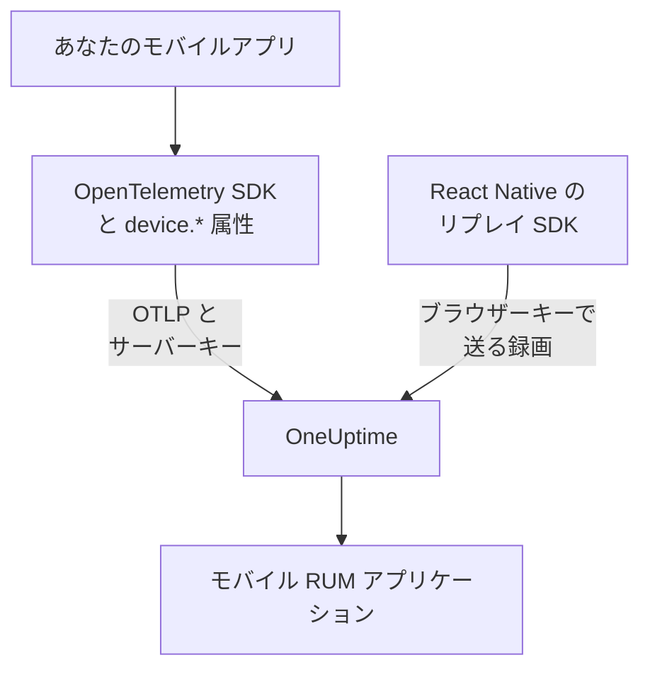

# モバイルのセットアップ

Android、iOS、React Native のアプリを OpenTelemetry でインストルメントし、モバイルの RUM アプリケーションとして OneUptime に報告させます。OpenTelemetry SDK があるほかのプラットフォームも同じ方法で動きます。

:::cards
- [OneUptime に必要なもの](#oneuptime-に必要なもの): サーバーキーで送る 2 つのリソース属性。
- [プラットフォームの設定](#プラットフォームの設定): Android、iOS、React Native、そのほか。
- [到着の確認](#到着を確認する): キーを確認してから、アプリを探します。
- [モバイルのセッションリプレイ](#モバイルのセッションリプレイ): React Native アプリの録画。
:::

## 仕組み

アプリは **サーバー** の取り込みキーを使って、OTLP を OneUptime に直接エクスポートします。バックエンドサービスではなくモバイル RUM として分類させるのは、そのリソースの `device.*` 属性です。



## OneUptime に必要なもの

アプリがエクスポートするすべてのバッチに、2 つのリソース属性が必要です。

| 属性 | 内容 |
| --- | --- |
| `service.name` | アプリケーションの識別子です。例: `storefront-android` 。 |
| `device.id` または `device.model.identifier` | テレメトリをモバイル RUM としてマークします。 `device.model.identifier` は **クライアント** ページにも使われます。 |

デバイスの属性がなくてもテレメトリは届き、クエリもできますが、RUM アプリケーションではなくバックエンドサービスとして分類されます。

`device.manufacturer` もバッチをモバイルとしてマークしますが、ホストの識別子がないリソースに限られます。ホストのインベントリがマシンのメーカーをこの属性で報告するためです。下のどのレシピとも同じように `device.id` か `device.model.identifier` も設定すれば、このことは問題になりません。

`device.id` はインストール単位の識別子にし、広告 ID など個人を特定するものは決して使わないでください。OneUptime がこれを読むのは、モバイルのテレメトリを見分けるためだけです。

## 始める前に

- OpenTelemetry SDK を組み込んだアプリ。OpenTelemetry Java SDK または OpenTelemetry Android、opentelemetry-swift、React Native なら OpenTelemetry JavaScript SDK です。
- **プロジェクト設定 → テレメトリと APM → 取り込みキー** で **取り込みキーを作成** を使って作成した **サーバー** の取り込みキー。 **ブラウザー** キーはモバイルアプリからは拒否されます。このキーは `Origin` ヘッダーで確認されますが、モバイル SDK はこのヘッダーを送らないためです。
- 次の OTLP の設定。OneUptime をセルフホストしている場合は、 `https://oneuptime.com` を自分のホストに置き換えてください。

| 設定 | 値 |
| --- | --- |
| OTLP エンドポイント | `https://oneuptime.com/otlp` |
| ヘッダー | `x-oneuptime-token: YOUR_TELEMETRY_INGESTION_TOKEN` |
| トレース | `POST https://oneuptime.com/otlp/v1/traces` |
| メトリクス | `POST https://oneuptime.com/otlp/v1/metrics` |
| ログ | `POST https://oneuptime.com/otlp/v1/logs` |

> [!WARNING]
> キーはアプリの中に入って配布され、アプリは展開できるため、誰かにコピーされる前提で考えてください。キーのページで **固定されたサービス名** を設定してコピーがバックエンドサービスの名前で書き込めないようにし、 **1 分あたりのリクエスト数の上限** と **有効期限** の日付を加え、リリースごとにキーをローテーションしてください。

## プラットフォームの設定

スニペットはセットアップの形を示すものです。モバイル向けの OpenTelemetry SDK はリリースごとに API が変わるため、メソッド名は固定したバージョンと照らし合わせてください。OneUptime に必要なものは変わりません。エンドポイント、ヘッダー、 `service.name` 、そして `device.*` 属性 1 つです。

:::tabs
@tab Android
Android で動く OpenTelemetry Java SDK とその OTLP エクスポーターを使います。

```kotlin title="app/build.gradle.kts"
dependencies {
    implementation(platform("io.opentelemetry:opentelemetry-bom:<latest>"))
    implementation("io.opentelemetry:opentelemetry-sdk")
    implementation("io.opentelemetry:opentelemetry-exporter-otlp")
}
```

```kotlin title="StorefrontApplication.kt"
import android.app.Application
import android.os.Build
import io.opentelemetry.exporter.otlp.http.trace.OtlpHttpSpanExporter
import io.opentelemetry.sdk.OpenTelemetrySdk
import io.opentelemetry.sdk.resources.Resource
import io.opentelemetry.sdk.trace.SdkTracerProvider
import io.opentelemetry.sdk.trace.export.BatchSpanProcessor

class StorefrontApplication : Application() {
    override fun onCreate() {
        super.onCreate()

        val resource = Resource.getDefault().toBuilder()
            .put("service.name", "storefront-android")
            .put("device.manufacturer", Build.MANUFACTURER)
            .put("device.model.identifier", Build.MODEL)
            .build()

        val exporter = OtlpHttpSpanExporter.builder()
            .setEndpoint("https://oneuptime.com/otlp/v1/traces")
            .addHeader("x-oneuptime-token", BuildConfig.ONEUPTIME_TOKEN)
            .build()

        OpenTelemetrySdk.builder()
            .setTracerProvider(
                SdkTracerProvider.builder()
                    .setResource(resource)
                    .addSpanProcessor(BatchSpanProcessor.builder(exporter).build())
                    .build()
            )
            .buildAndRegisterGlobal()
    }
}
```

[OpenTelemetry Android](https://github.com/open-telemetry/opentelemetry-android) エージェントはその上に自動インストルメンテーションを加え、独自のリソースにデバイスの属性を設定します。使う場合は、そのエクスポーターを同じエンドポイントとヘッダーに向け、お使いのバージョンで `device.model.identifier` がリソースに届くことを確認してください。
@tab iOS
[opentelemetry-swift](https://github.com/open-telemetry/opentelemetry-swift) を使い、デバイスの属性は自分で設定します。各バージョンが自動で追加するリソースは、リリースごとに変わってきたためです。

```swift
let resource = Resource(attributes: [
    "service.name": .string("storefront-ios"),
    "device.model.identifier": .string(UIDevice.current.model),
    "device.manufacturer": .string("Apple"),
    "telemetry.sdk.language": .string("swift"),
])

let exporter = OtlpHttpTraceExporter(
    endpoint: URL(string: "https://oneuptime.com/otlp/v1/traces")!,
    config: OtlpConfiguration(
        headers: [("x-oneuptime-token", oneUptimeToken)]
    )
)

OpenTelemetry.registerTracerProvider(
    tracerProvider: TracerProviderBuilder()
        .with(resource: resource)
        .add(spanProcessor: BatchSpanProcessor(spanExporter: exporter))
        .build()
)
```

`UIDevice.current.model` は `iPhone` のような短い名前を返すため、 **クライアント** ページはデバイスの種類ごとに 1 行にまとまります。
@tab React Native
React Native は OpenTelemetry JavaScript SDK で動くため、 [ブラウザーのセットアップ](/docs/rum/browser-setup) と同じようにプロバイダー、OTLP エクスポーター、バッチプロセッサーを作り、3 か所だけ変えます。 **サーバー** キーで送ること、 `browserDetector` と `DocumentLoadInstrumentation` を外すこと、デバイスの属性を自分で設定することです。

```ts
import { Platform } from "react-native";
import * as Device from "expo-device"; // or react-native-device-info
import {
  defaultResource,
  resourceFromAttributes,
} from "@opentelemetry/resources";

const resource = defaultResource().merge(
  resourceFromAttributes({
    "service.name": "storefront-mobile",
    "device.manufacturer": Device.manufacturer ?? Platform.OS,
    "device.model.identifier":
      Device.modelId ?? Device.modelName ?? "unknown",
    "telemetry.sdk.language": "webjs",
  }),
);
```

`Device.modelId` は iOS でしか設定されないため、Android では `Device.modelName` が使われます。
@tab ほかのプラットフォーム
Flutter、Unity、.NET MAUI、組み込みのクライアント、独自の OTLP ライターのいずれも、リソースに `service.name` と `device.*` 属性 1 つがあれば動きます。OpenTelemetry の標準の環境変数を読む SDK は、これらをそのまま使います。

```bash
OTEL_EXPORTER_OTLP_ENDPOINT="https://oneuptime.com/otlp"
OTEL_EXPORTER_OTLP_HEADERS="x-oneuptime-token=YOUR_TELEMETRY_INGESTION_TOKEN"
OTEL_RESOURCE_ATTRIBUTES="service.name=storefront-mobile,device.manufacturer=Acme,device.model.identifier=AC-100"
```

`/v1/traces` 、 `/v1/metrics` 、 `/v1/logs` は SDK がエンドポイントに自動で付けます。
:::

## 到着を確認する

:::steps
### キーを確認する

SDK の設定を調べる前に、OneUptime がキーを受け付けるかどうかを確認します。

```bash
curl -i https://oneuptime.com/otlp/v1/validate \
  -H "x-oneuptime-token: YOUR_TELEMETRY_INGESTION_TOKEN"
```

`200` と `"valid": true` は、キーが受け付けられたことを示します。ブラウザーキーも `200` を返しますが、メッセージにはブラウザーからしか使えないと書かれています。モバイルアプリにはサーバーキーが必要です。 `401` は、キーが不明、取り消し済み、無効化済み、または期限切れであることを示し、SDK の設定では解決できません。

### アプリを起動する

アプリを起動して、少し操作します。最初のテレメトリのバッチが届くと、アプリが `service.name` の名前で **製品 → リソース → リアルユーザーモニタリング** に表示されます。

### クライアントページを開く

アプリケーションの **クライアント** ページを開きます。 `device.model.identifier` のデバイスモデルごとに行があります。 **トレース** にはデータが入るのにこのページが空のままなら、デバイスの属性がリソースに届いていません。
:::

## モバイルのセッションリプレイ

React Native アプリは `@oneuptime/react-native-replay` でセッションを録画できます。ネイティブのビューツリーをワイヤーフレームとして記録し、スクリーンショットや画面上のテキストは決して記録しません。その録画は Web の録画と同じプレーヤーで開きます。送信には **ブラウザー** キーを使い、その **許可されたオリジン** には、アプリを `app://` に続けて Android のアプリケーション ID または iOS のバンドル ID の形で登録します。これは OpenTelemetry SDK が使うサーバーキーとは別のキーです。手順は [React Native へのインストール](/docs/telemetry/session-replay#install-in-react-native) で説明しています。

ネイティブの Android アプリと iOS アプリ、そしてほかのプラットフォームにはセッションの録画機能がありません。それらの **セッションリプレイ** ページは空のままですが、トレース、ログ、メトリクス、例外、 **クライアント** ページは通常どおり動きます。

## トラブルシューティング

:::details キーの確認で 401 が返る、またはキーが拒否される
`401` は、キーが不明、取り消し済み、無効化済み、または期限切れであることを示します。サーバーキーを作成し、そのキーでアプリをビルドし直してください。

ブラウザーキーは確認には通りますが、モバイルアプリからのエクスポートはすべて `422` と `This request did not send an Origin header, so it cannot be checked against the allowed origins of this browser ingestion key. Use a server ingestion key for requests that are not sent by a browser.` で拒否されます。 **サーバー** キーを使ってください。
:::

:::details アプリがリアルユーザーモニタリングではなくサービスに表示される
リソースに `device.id` も `device.model.identifier` もないため、テレメトリがバックエンドサービスに分類されました。 [プラットフォームの設定](#プラットフォームの設定) のように設定してください。

すでに作成されたサービスは RUM アプリケーションには変わらないため、RUM のテレメトリが届いたら **製品 → サービス** で削除してください。
:::

:::details クライアントページが空になる
クライアントの行は `device.model.identifier` だけから作られます。 `device.id` か `device.manufacturer` しか設定しない SDK では、アプリはモバイル RUM に分類されますがクライアントは一覧に出ません。 `device.model.identifier` も設定してください。
:::

:::details 使われているのにステータスが切断済みになる
テレメトリが 15 分間届かないと、ステータスは **切断済み** になります。アプリが使われている場合は、次を確認してください。

- サンプラーがすべてを捨てている可能性があります。always-off のサンプラーや、非常に低い比率がないか確認してください。
- その間に誰も行わなかった操作でしか、アプリがテレメトリを送らない可能性があります。
- リリース後にキーが取り消されたか、期限が切れた可能性があります。 [到着を確認する](#到着を確認する) のようにキーを確認してください。
:::

## 次のステップ

:::cards
- [セッションリプレイ](/docs/telemetry/session-replay): React Native のセッションを、そのトレースと並べて録画します。
- [アプリケーションの管理](/docs/rum/applications): 名前、ラベル、所有者、保持期間。
- [OpenTelemetry](/docs/telemetry/open-telemetry): OTLP のエンドポイント、制限、エラーの詳細。
- [RUM のトラブルシューティング](/docs/rum/troubleshooting): 問題がよく起きる順に並べたすべての確認項目。
:::
