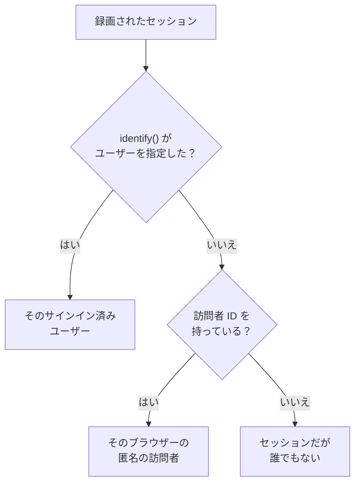

# プロダクト分析

プロダクト分析は、RUM アプリケーションを使う人々と、そのセッションの様子を数えます。アクティブ、新規、リピーター、サインイン済み、休眠のユーザーと、デバイス、ブラウザー、国、ページごとのセッションです。 [セッションリプレイ](/docs/telemetry/session-replay) が録画するセッションを数えるため、専用のスニペットは不要で、数値は録画の期限が切れたあとも 13 か月間保持されます。

:::cards
- [人の数え方](#人の数え方): サインイン済みユーザーも匿名のブラウザーも、一度ずつ。
- [ユーザー](#ユーザー): アクティブ、新規、リピーター、サインイン済み、総数、休眠のユーザー。
- [セッション](#セッション): 件数、長さ、そしてデバイス、ブラウザー、国、ページごとの内訳。
- [プライバシーと保持](#プライバシーと保持): 13 か月、名前は保存せず、依頼に応じて消去。
:::

## 人の数え方

アプリケーションのサイドメニューには **プロダクト分析** セクションがあり、 **ユーザー** と **セッション** のふたつのページがあります。どちらもセッションリプレイが録画するセッションを数えるため、アプリケーションのレコーダーが動き始めたときに数え始め、リプレイポリシーが録画しないセッションは数えません。各セッションの数え先は、ひとりの人か、誰でもないかのどちらかです。

- **サインイン済みユーザーは一度だけ** 数えられます。使うブラウザーやデバイスがいくつあっても同じで、ページが `identify()` に渡した参照の一方向ハッシュで識別されます ( [ユーザーを識別する](/docs/telemetry/session-replay#ユーザーを識別する) を参照)。
- **匿名のブラウザーは一度だけ** 数えられます。 [匿名の訪問者 ID](/docs/telemetry/session-replay#匿名の訪問者) で識別され、ブラウザーがふたつなら訪問者もふたりです。誰かがそのブラウザーでサインインする前のセッションは、その訪問者のものとして残ります。
- **古いレコーダーからのセッション** は、訪問者 ID を送っていないため、セッションとしては数えられますが、人としては数えられません。

日はあなた自身のタイムゾーンで数えられます。

## ユーザー

**ユーザー** は、選んだ期間の人々を次のように数えます。

| タイル | 数えるもの |
| --- | --- |
| **アクティブユーザー** | 期間中に来たすべての人。サインイン済みユーザーはそれぞれ一度、匿名のブラウザーもそれぞれ一度です。 |
| **新規ユーザー** | 初めての訪問が期間中だったアクティブユーザー。 |
| **リピーター** | 期間が始まる前にも来ていたアクティブユーザー。 |
| **サインイン済みユーザー** | アプリが `identify()` でサインインさせたアクティブユーザーと、アクティブユーザー全体に占めるその割合。 |
| **総ユーザー数** | アプリケーションが過去 13 か月に見たすべての人。 |
| **休眠ユーザー** | 以前に来たものの、過去 30 日間、または選んだ 7、14、60、90 日間に来ていない人。 |

最初の三つは、前の期間からの変化も示します。タイルの下では、 **アクティブユーザー** が日ごとに、その日に来た人、その日までの 7 日間に来た人、その日までの 30 日間に来た人を描き、 **新規ユーザーとリピーター** が日ごとの人を二つに分けます。

**ユーザー** は、タイルが数えるすべての人を、ひとりにつき一行、最近見た順に一覧表示し、そのフィルターでひとつのタイルの人、匿名の訪問者、または全員を表示できます。人を開くと、最初と最後の訪問と、過去 13 か月のその人のすべてのセッションが表示され、録画がまだ保持されているものには **視聴** があります。

## セッション

**セッション** は、期間中に始まったセッションを数えます。対象は **セッション** 、 **サインイン済みセッション** 、 **セッションの長さの中央値** 、 **セッションあたりのページ数** 、 **エラーのあるセッション** 、 **フラストレーションのあるセッション** です。タイルの下には次のものがあります。

- **デバイス別セッション** は、日ごとのセッションをデスクトップ、スマートフォン、タブレット別に描きます。短い辺が 600 ポイント以上の画面でのモバイルアプリのセッションは、タブレットのものとして数えられます。
- **セッションの長さ** は、終了したセッションを続いた長さで分けます。10 秒未満から 30 分超までです。まだ録画中のセッションには、まだ長さがありません。
- **内訳** は、ユーザーとセッションを、デバイスの種類、ブラウザー、オペレーティングシステム、国、アプリのバージョン、入口ページ、ページごとに、ユーザーの多い順に並べます。

## プライバシーと保持

- **13 か月** 。ある月の数値は、その月から数えて 13 か月目の初日に削除されるため、直近 12 か月分はいつでも揃っています。録画自体の保持期間 (既定で 7 日) とは関係ありません。
- **名前は保存しません** 。数値が保持するのはサインイン済みユーザーの一方向キーとブラウザーの訪問者 ID だけで、参照、属性、IP アドレスは決して保持しません。行がサインイン済みユーザーの名前を示すのは、その人の録画がまだ保持されている間だけで、しかもユーザーの身元を読めるロールに対してだけです。それ以外では **サインイン済みユーザー** または **匿名訪問者** と ID の先頭が表示されます。
- **依頼に応じて消去** 。消去リクエストは、ここでも一致する数値を削除します ( [セッションを消去する](/docs/telemetry/session-replay#セッションを消去する) を参照)。

## 閲覧できる人

ふたつのページを読むには、セッション一覧を読むのと同じものが必要です。 `ReadRumSessionReplay` (_List Session Replays_) または `ReadRumSessionReplayPayload` (_Watch Session Replays_) で、プロジェクトのオーナーと管理者が持っています。サインイン済みユーザーが誰かを見たり、名前で人を検索したりするには、 [録画を視聴できるユーザー](/docs/telemetry/session-replay#録画を視聴できるユーザー) で説明している身元の権限が必要です。

## 次のステップ

:::cards
- [セッションリプレイ](/docs/telemetry/session-replay): これらのページが数えるセッションを録画し、視聴します。
- [アプリケーションの管理](/docs/rum/applications): 名前、ラベル、オーナー、保持。
- [RUM 概要](/docs/rum/index): RUM アプリケーションがほかに示すもの。
:::
