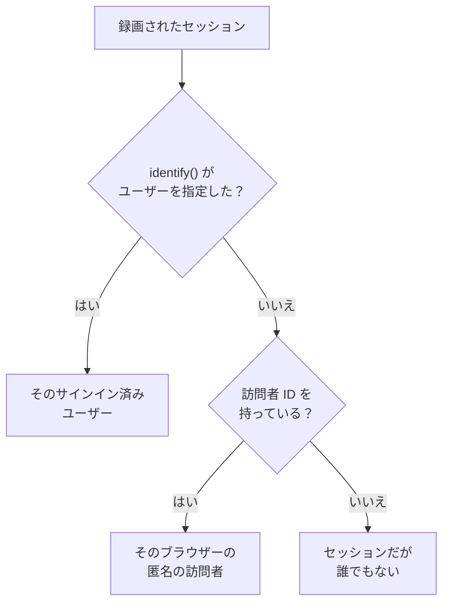

# プロダクト分析

プロダクト分析は、RUM アプリケーションを使う人々と、そのセッションの様子、そして人々の行動を数えます。アクティブ、新規、リピーター、サインイン済み、休眠のユーザー、デバイス、ブラウザー、国、ページごとのセッション、そしてアプリが送るイベントを、推移、ファネル、リテンションとして示します。 [セッションリプレイ](/docs/telemetry/session-replay) が録画するセッションと、そのレコーダーが送るイベントを数えるため、専用のスニペットは不要で、数値は録画の期限が切れたあとも 13 か月間保持されます。

:::cards
- [ユーザー](#ユーザー): アクティブ、新規、リピーター、サインイン済み、総数、休眠のユーザー。
- [セッション](#セッション): 件数、長さ、そしてデバイス、ブラウザー、国、ページごとの内訳。
- [イベントとメトリクスを送信する](#イベントとメトリクスを送信する): 人々の行動と、ページが測定した数値。
- [イベント](#イベント): 何かが起きた頻度、それを行った人、そしてその場所。
- [ファネル](#ファネル): ステップごとに先へ進んだ人と、それにかかった時間。
- [ユーザーリテンション](#ユーザーリテンション): 戻ってきた人を、コホートごとに。
:::

## 人の数え方

アプリケーションのサイドメニューには **プロダクト分析** セクションがあり、 **ユーザー** 、 **セッション** 、 **イベント** 、 **ファネル** 、 **ユーザーリテンション** 、 **ユーザーフロー** 、 **分析の設定** があります。 **ユーザー** と **セッション** はセッションリプレイが録画するセッションを数えるため、アプリケーションのレコーダーが動き始めたときに数え始め、リプレイポリシーが録画しないセッションは数えません。各セッションの数え先は、ひとりの人か、誰でもないかのどちらかです。



- **サインイン済みユーザーは一度だけ** 数えられます。使うブラウザーやデバイスがいくつあっても同じで、ページが `identify()` に渡した参照の一方向ハッシュで識別されます ( [ユーザーを識別する](/docs/telemetry/session-replay#ユーザーを識別する) を参照)。
- **匿名のブラウザーは一度だけ** 数えられます。 [匿名の訪問者 ID](/docs/telemetry/session-replay#匿名の訪問者) で識別され、ブラウザーがふたつなら訪問者もふたりです。誰かがそのブラウザーでサインインする前のセッションは、その訪問者のものとして残ります。
- **古いレコーダーからのセッション** は、訪問者 ID を送っていないため、セッションとしては数えられますが、人としては数えられません。

**イベント** 、 **ファネル** 、 **ユーザーリテンション** も同じように人を数えますが、録画の有無にかかわらず、レコーダーがすべてのセッションから送るイベントをもとにします ( [イベントとメトリクスを送信する](#イベントとメトリクスを送信する) を参照)。

日はあなた自身のタイムゾーンで数えられます。

## ユーザー

**ユーザー** は、選んだ期間の人々を次のように数えます。

| タイル | 数えるもの |
| --- | --- |
| **アクティブユーザー** | 期間中に来たすべての人。サインイン済みユーザーはそれぞれ一度、匿名のブラウザーもそれぞれ一度です。 |
| **新規ユーザー** | 初めての訪問が期間中だったアクティブユーザー。 |
| **リピーター** | 期間が始まる前にも来ていたアクティブユーザー。 |
| **サインイン済みユーザー** | アプリが `identify()` でサインインさせたアクティブユーザーと、アクティブユーザー全体に占めるその割合。 |
| **総ユーザー数** | アプリケーションが過去 13 か月に見たすべての人。 |
| **休眠ユーザー** | 以前に来たものの、過去 30 日間、または選んだ 7、14、60、90 日間に来ていない人。 |

最初の三つは、前の期間からの変化も示します。タイルの下では、 **アクティブユーザー** が日ごとに、その日に来た人、その日までの 7 日間に来た人、その日までの 30 日間に来た人を描き、 **新規ユーザーとリピーター** が日ごとの人を二つに分けます。

**ユーザー** は、タイルが数えるすべての人を、ひとりにつき一行、最近見た順に一覧表示し、そのフィルターでひとつのタイルの人、匿名の訪問者、または全員を表示できます。人を開くと、最初と最後の訪問と、過去 13 か月のその人のすべてのセッションが表示され、録画がまだ保持されているものには **視聴** があります。

## セッション

**セッション** は、期間中に始まったセッションを数えます。対象は **セッション** 、 **サインイン済みセッション** 、 **セッションの長さの中央値** 、 **セッションあたりのページ数** 、 **エラーのあるセッション** 、 **フラストレーションのあるセッション** です。タイルの下には次のものがあります。

- **デバイス別セッション** は、日ごとのセッションをデスクトップ、スマートフォン、タブレット別に描きます。短い辺が 600 ポイント以上の画面でのモバイルアプリのセッションは、タブレットのものとして数えられます。
- **セッションの長さ** は、終了したセッションを続いた長さで分けます。10 秒未満から 30 分超までです。まだ録画中のセッションには、まだ長さがありません。
- **内訳** は、ユーザーとセッションを、デバイスの種類、ブラウザー、オペレーティングシステム、国、アプリのバージョン、入口ページ、ページごとに、ユーザーの多い順に並べます。

## イベントとメトリクスを送信する

イベントは、アプリケーションの **分析の設定** ページで **プロダクト分析イベントを送信** がオンの間に送信されます。新しいアプリケーションでは最初からオンで、この設定ができる前に作成されたアプリケーションではオフなので、そこでオンにしてください。イベントを送るのはセッションリプレイのレコーダーなので、アプリケーションのセッションリプレイもオンにしておく必要があります。React Native のレコーダーはまだイベントを送りません。

ブラウザーレコーダーが動作する各セッションは、その開始と表示した各ページを自動で送信します。シングルページアプリのルート変更も含まれ、リプレイのサンプルとポリシーがそのセッションを録画するかどうかには左右されません。独自のイベントと数値は、ページのコードから送ります。

```js
OneUptimeReplay.track("Signed up", { plan: "pro" });
OneUptimeReplay.metric("cart.value", 42.5, { currency: "EUR" });
```

| 呼び出し | 送信される内容 |
| --- | --- |
| `track(name, properties?)` | **イベント** 、 **ファネル** 、 **ユーザーリテンション** が数えるイベントと、セッションが録画される場合はリプレイのタイムライン上のマーカーです。 `name` は 64 文字以下です。プロパティは値が文字列、数値、ブール値のものを 20 個以下まで、キーは 40 文字以下、値は 200 文字以下です。 |
| `metric(name, value, attributes?)` | ページが測定した数値を、アプリケーションのメトリクスのポイントとして送ります ( [ダッシュボードとアラート](#ダッシュボードとアラート) を参照)。 `name` は英字、数字、 `_` 、 `.` 、 `-` 、 `/` からなる 100 文字以下で、英字で始まり、 `oneuptime.` では始まりません。 `value` は有限の数値、 `attributes` は `track()` のプロパティと同じです。 |

レコーダーの読み込み前は、同じ呼び出しを `["track", name, properties]` と `["metric", name, value, attributes]` の形で `window.OneUptimeReplayQueue` に追加してください ( [JavaScript API](/docs/telemetry/session-replay#javascript-api) を参照)。

- **録画の有無にかかわらず、すべてのセッション** 。リプレイのサンプルとアップロードポリシーが決めるのは、どのセッションを録画するかであって、どれを数えるかではありません。Do Not Track や Global Privacy Control のもとでは何も送信されず、アプリケーションが許可していないオリジンからのものは何も保持されません。ポリシーが同意を求める場合、イベントは `grantConsent()` を待ち (最大 500 件)、 `revokeConsent()` で破棄されます。
- **録画と同じようにマスク** 。 _Mask all text_ では、プロパティと属性の値はページを離れる前にマスクされるため、それらによる内訳にはあなたの値ではなくプレースホルダーが表示されます。イベント名、プロパティのキー、メトリクスの値は書かれたとおりに送信されます。そのモードで読む必要がある値はセッションのタグ ( `setTags()`) に入れてください。タグはマスクされないため、個人データは入れないでください。タグはセッションと、セッション一覧の `tag:key=value` 検索に表示され、これらのページの内訳には表示されません。ページはクエリとフラグメントを除いたパスとして送信されます。
- **小さなバッチで** 、5 秒ごとと、タブが非表示になったときに送信されます。発生から 3 日を過ぎて OneUptime に届いたイベントは破棄されます。プロジェクトは、すべてのアプリケーションを合わせて毎分 60,000 件までイベントとメトリクスのポイントを送信でき、それを超えるとレコーダーは待ってから送り直します。

`metric()` はイベントがオフの間は何も送信しません。オンかどうかは `getDiagnostics().productAnalytics` でわかります ( [`getDiagnostics()`](/docs/telemetry/session-replay#getdiagnostics) を参照)。

### ユーザープロパティ

イベントを行った人で内訳を出したりセグメントに分けたりするには、 **分析の設定** の **分析用のユーザープロパティ** に、 `identify()` の属性のキーを `["plan", "role"]` のように最大 20 個まで指定します。キーは書かれたとおりに照合されます。すると各イベントは、ページが `identify()` に渡したとおりの、サインイン済みユーザーのそれらの属性を持ちます。その他の属性がページから出ることはなく、 **エンドユーザーの身元をキャプチャ** がオフの間はどの属性も出ません。メールアドレスなど、個人データを含む属性は指定しないでください。

## イベント

**イベント** はイベントを一度にひとつ表示します。別のものを選ぶまではアプリで最も多いイベントを、アプリがまだイベントを送っていない間は最も多く表示されたページを表示します。選択肢には **セッション開始** と表示された各ページもあり、下の **すべてのイベント** は期間内のすべてのイベントを、発生回数と行った人数とともに一覧表示します。ひとつ選ぶと上に表示されます。

- タイルは、そのイベントの **イベント** (ひとりあたりの平均回数付き)、 **ユーザー** 、 **セッション** を数えます。
- **イベントとユーザー** は、日ごとにそのイベントの回数と、その日にそれを行った人数を描きます。
- **内訳** は、イベントをデバイスの種類、ブラウザー、オペレーティングシステム、国、アプリのバージョン、ページ、イベントプロパティ、ユーザープロパティごとに、各値のイベント数、ユーザー数、割合とともに並べます。値を選ぶと、その値だけが表示されます。

**セグメント** は、選んだ値をフィールドに持つイベントだけにページを絞り込みます。 **フィルターを追加** を押してフィールドと値を選ぶと、完全一致で照合されます。セグメントのフィルターは最大 5 個で、イベントはそのすべてに一致する必要があります。ページのアドレスにはイベント、期間、セグメント、内訳が残るため、リンクを開くと同じ表示になります。

## ファネル

**ファネル** は、2 から 6 個のステップを順番にたどる人を追います。各ステップは、 **イベント** が一覧表示するイベントです。期間内に最初のステップを行った人のうち、その後 2 番目、続いて 3 番目のステップを行った人の数を、最初のステップから選んだ時間内に限って数えます。時間は **1 時間以内** 、 **1 日以内** 、 **7 日以内** 、 **14 日以内** 、 **30 日以内** から選べます。 **ステップを追加** でステップを追加します。

**コンバージョン** には、すべてのステップを行った人の割合と、ステップごとに、そこまで到達した人数、それが最初のステップの人に占める割合、前のステップから離脱した人数、前のステップからかかった時間の中央値が表示されます。複数回試した人は、最も先まで進んだ試行で一度だけ数えられます。

ファネルのセグメントとリテンション表のセグメントは、すべてのイベントが持つフィールドとユーザープロパティを使い、イベント固有のプロパティは使いません。ステップごとに別のイベントだからです。

## ユーザーリテンション

**ユーザーリテンション** は、あるイベント ( **最初のイベント** ) を初めて行ったのが期間内のどの日、週、月かで人をグループに分け、各グループのうち別のイベント ( **再訪時のイベント** ) を行った人の割合を、その区間とそれ以降の各区間について示します。どちらも、別のものを選ぶまでは **セッション開始** です。

**コホート** で区間を **日別** 、 **週別** 、 **月別** から設定します。期間に含まれる区間が表ひとつに表示できる数 (32 日、26 週、13 か月) を超える場合、ページはコホートを長くし、その旨を表示します。

各行はコホートとその人数で、各セルはその区間に戻ってきた人の割合です。多いほど濃く表示されます。まだ始まっていない区間は空のままです。

**すべてのコホート** は、コホートの上に表示され、コホートをひとつとして数えます。各区間で、戻ってきた人を、その区間に達したコホートの人数で割るため、200 人のコホートは 50 人のコホートの 4 倍の重みを持ちます。誰かがいるコホートが 2 つになると表示されます。

## 保存済みのファネルとリテンションテーブル

**ファネル** ページの **保存済みのファネル** と、 **ユーザーリテンション** の **保存済みのリテンションテーブル** には、チームがアプリケーション用に保存したものが一覧表示され、もう一度開いたり、ダッシュボードに表示したりできます。保存済みのファネルはステップ、完了までの時間、セグメントを保持し、保存済みのリテンションテーブルは 2 つのイベント、区間、セグメントを保持します。どちらも期間は保持しません。ページは自分の期間を保持し、ダッシュボードは自分の期間を読みます。

- **+ ファネルを保存** または **+ リテンションテーブルを保存** で、ページに表示中の内容を名前を付けて保存します。1 つのアプリケーションが保持できるのは、それぞれ最大 100 件です。
- 開くには、ひとつを選びます。ページのアドレスがそれを指すため、リンクを開くと、それを見られる全員に同じものが開きます。表示内容を変えると、名前にそのことが示され、 **更新** で変更を保存します。
- **編集** で名前を変更し、 **削除** で全員から削除します。 **ビューをクリア** は開いているものを閉じ、ページの表示内容はそのまま残します。
- 削除されたもの、または表示を許可されていないものへのリンクを開くと、その旨が表示され、ページはそれなしで開きます。

## ダッシュボードとアラート

各イベントは、アプリケーションのメトリクスとしても毎分数えられます。また `metric()` の各呼び出しは、指定した名前の独立したメトリクスのポイントになります。アプリケーションの **メトリクス** ページでグラフにしたり、ダッシュボードに追加したり、メトリクス モニターでアラートを出したりできます。 **すべてのイベント** の下にある **メトリクスを開く** でそのページが開きます。

| メトリクス | 数えるもの | 分類 |
| --- | --- | --- |
| `oneuptime.rum.product.events` | `track()` のイベント (毎分) | `event.name` |
| `oneuptime.rum.product.sessions` | 開始したセッション (毎分) | `device.type` |
| `oneuptime.rum.product.page.views` | 表示されたページ (毎分) | `device.type` |

この 3 つは課金されません。また `metric()` は `oneuptime.` で始まる名前を拒否するため、ページが送るものがこれらと紛れることはありません。 `metric()` のポイントは、アプリケーションの他のメトリクスと同じように保持され、課金されます。

保存済みのファネルやリテンションテーブルは、ダッシュボードにも置けます。ウィジェット カタログの **プロダクト分析** グループにある **ファネル** と **ユーザーリテンション** のウィジェットは、ダッシュボードの時間範囲でそれを表示し、 **ファネルで開く** または **ユーザーリテンションで開く** でそのページを開きます ( [ダッシュボード ウィジェット](/docs/dashboards/widgets#プロダクト分析) を参照)。

## プライバシーと保持

- **13 か月** 。ある月の数値は、その月から数えて 13 か月目の初日に削除されるため、直近 12 か月分はいつでも揃っています。録画自体の保持期間 (既定で 7 日) とは関係ありません。イベントも同じように保持されます。
- **名前は保存しません** 。数値が保持するのはサインイン済みユーザーの一方向キーとブラウザーの訪問者 ID だけで、参照と IP アドレスは決して保持せず、属性のうち保持するのは指定したユーザープロパティだけです。行がサインイン済みユーザーの名前を示すのは、その人の録画がまだ保持されている間だけで、しかもユーザーの身元を読めるロールに対してだけです。それ以外では **サインイン済みユーザー** または **匿名訪問者** と ID の先頭が表示されます。
- **依頼に応じて消去** 。消去リクエストは、ここでも一致する数値とイベントを削除します ( [セッションを消去する](/docs/telemetry/session-replay#セッションを消去する) を参照)。

## 閲覧できる人

これらのページを読むには、セッション一覧を読むのと同じものが必要です。 `ReadRumSessionReplay` (_List Session Replays_) または `ReadRumSessionReplayPayload` (_Watch Session Replays_) で、プロジェクトのオーナーと管理者が持っています。サインイン済みユーザーが誰かを見たり、名前で人を検索したりするには、 [録画を視聴できるユーザー](/docs/telemetry/session-replay#録画を視聴できるユーザー) で説明しているとおり `ReadRumSessionReplayPayload` (_Watch Session Replays_) が必要です。

保存済みのファネルとリテンションテーブルの保存、名前の変更、削除には、これらのページを読むのと同じ権限が必要です。ダッシュボードのウィジェットは、その権限を持つ閲覧者にだけそれを表示します。

イベントのオン・オフには、 `EditRumApplication` (_Edit RUM Application_) か、プロジェクトのオーナー、管理者、メンバーのロールが必要です。ユーザープロパティの指定には、 `EditRumApplication` か、オーナーまたは管理者のロールが必要です。サインイン済みの人について何を保持するかを決めるためです。

## 次のステップ

:::cards
- [セッションリプレイ](/docs/telemetry/session-replay): これらのページが数えるセッションを録画し、視聴します。
- [アプリケーションの管理](/docs/rum/applications): 名前、ラベル、オーナー、保持。
- [RUM 概要](/docs/rum/index): RUM アプリケーションがほかに示すもの。
:::
