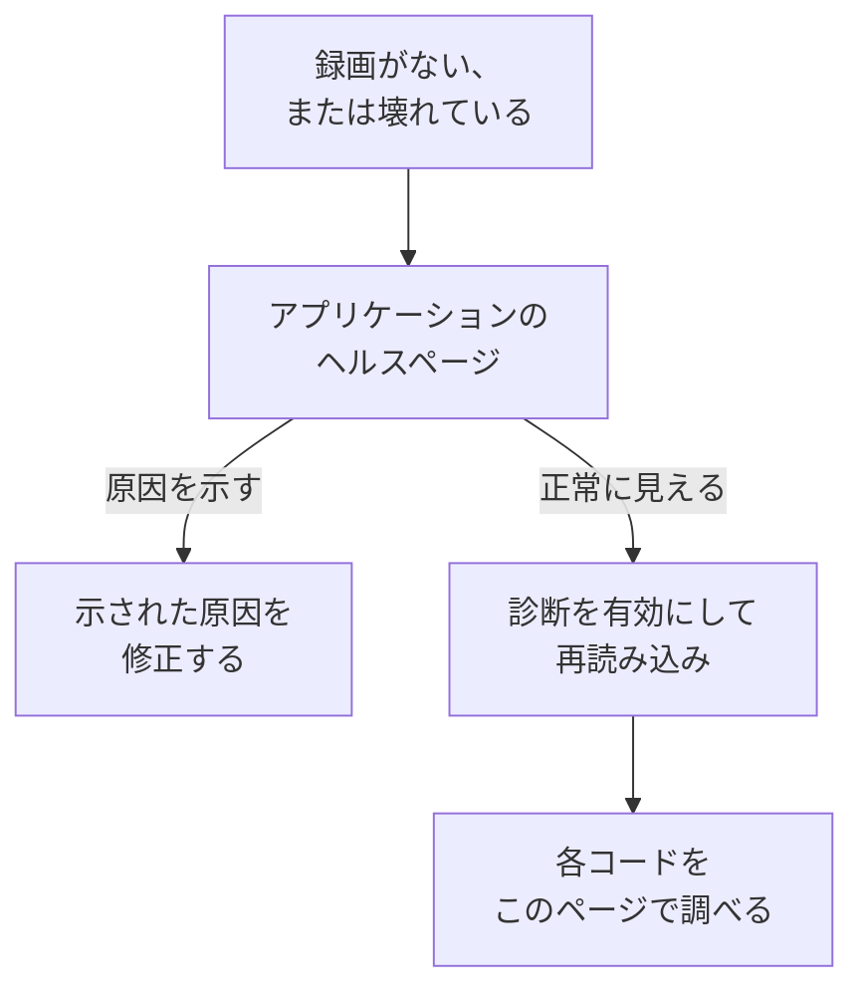

# セッションリプレイのトラブルシューティング

録画が届かない、または壊れた状態で届く場合に、このページで原因を見つけます。セッションリプレイは既定ですべてのセッションを録画し、進行に合わせてアップロードするため、正常なページはユーザーが何か操作している間、およそ 15 秒ごとにチャンクを送信します。アイドル状態のタブはイベントを生まず何も送信しません。また、入力がないまま 5 分たつとレコーダーは完全に一時停止する (`recording-paused-idle`) ので、Network タブでインストールを判断する前にマウスを動かすかクリックしてください。それでも OneUptime へのリクエストがまったく見当たらない場合は、以下のいずれかが原因です。

:::cards
- [診断を有効にする](#診断を有効にする): レコーダーに、すべての判断をコンソールで説明させます。
- [コード](#コード): レコーダーが出力するすべての行と、その対処法。
- [OneUptime の前にあるファイアウォールがチャンクを拒否する](#oneuptime-の前にあるファイアウォールがチャンクを拒否する): 確認すべきルールと、追加すべき除外。
- [リプレイで画像、アイコン、スタイルが欠けている](#リプレイで画像アイコンスタイルが欠けている): 再生はできるが、ユーザーが見たとおりではない録画。
:::



何も届かないのが正常な唯一の設定は、 _On error or frustration_ (`OnErrorOrFrustration`) でのアップロードです。このときレコーダーはメモリー上にローリングバッファーを保持し、何か問題が起きたときにだけアップロードするため、トリガーが発火するまでは壊れたインストールとまったく同じに見えます。ほかの原因を探す前に、どちらの設定かを確認してください。下で説明する `config-accepted` の行に出力されます。

可能であれば、サーバー側から始めてください。アプリケーションのサイドメニューの **セッションリプレイ** セクションにある **ヘルス** ページは、何も届いていないときにその原因を示します。レコーダーが一度も読み込まれていない、読み込まれたが何もアップロードされていない (とその理由)、アップロードが拒否されている (とその理由)、または予算を使い切った、のいずれかです。 [録画の状態](/docs/telemetry/session-replay#録画の状態) を参照してください。ここから先はブラウザー側の手順です。診断を有効にし、一度再読み込みして、コンソールを読みます。

録画は届くのに、壊れた画像、欠けたアイコン、スタイルのない領域とともに再生される場合は、再生の問題です。答えは [リプレイで画像、アイコン、スタイルが欠けている](#リプレイで画像アイコンスタイルが欠けている) にあります。

## 診断を有効にする

手の届くスイッチを選んでください。どれも同じことをします。

:::tabs
@tab ブラウザーで
問題が起きているブラウザーで行います。再デプロイが不要で、本番環境でも動作し、再読み込みしても有効なままです。

```js
localStorage.setItem("oneuptime.sessionReplay.debug", "true");
// then reload the page
```

再びオフにするには次のようにします。

```js
localStorage.removeItem("oneuptime.sessionReplay.debug");
```
@tab リンクで
技術に詳しくない人や、コンソールを開けないページの場合は、URL に `oneuptime_debug=1` を追加します。フラグメントでも動作し、知らないクエリパラメーターを取り除くサーバーでも残ります。

```text
https://your-app.example.com/checkout?oneuptime_debug=1
https://your-app.example.com/checkout#oneuptime_debug=1
```
@tab スクリプトタグで
全員に対して有効にしたいステージング環境の場合です。

```html
<script
  src="https://oneuptime.com/telemetry/session-replay/v1/recorder.js"
  data-oneuptime-token="YOUR_TELEMETRY_INGESTION_KEY"
  data-oneuptime-app-identifier="YOUR_RUM_APP_IDENTIFIER"
  data-oneuptime-debug="true"
  crossorigin="anonymous"
  async
></script>
```
@tab init グローバルで
init グローバルでレコーダーを設定している場合です。

```js
window.__ONEUPTIME_SESSION_REPLAY__ = {
  host: "https://oneuptime.com",
  token: "YOUR_TELEMETRY_INGESTION_KEY",
  appIdentifier: "YOUR_RUM_APP_IDENTIFIER",
  debug: true,
};
```
@tab デプロイメントで
OneUptime のデプロイメントで行います。問題が起きているブラウザーのそばに誰もいなくてよい唯一のスイッチです。 `SESSION_REPLAY_DEBUG=true` を設定して再起動します。するとこのインスタンスが配信するすべてのレコーダーが、動作するすべてのページでログを出すので、有効にして再読み込みを 1 回分集め、オフに戻してください。ポリシーは何も変わりません。サンプリングもマスクも同意も変わりません。デプロイメントのほかの設定については [セルフホストに関する注意](/docs/telemetry/session-replay#セルフホストに関する注意) を参照してください。
@tab 実行時に
レコーダーが読み込まれた後で行います。

```js
OneUptimeReplay.setDebug(true);
```
:::

出力は次のようになります。

```text
[OneUptime Session Replay] loader-start: Loader running.
[OneUptime Session Replay] init-options-read: Init options read. {host: "https://oneuptime.com", appIdentifier: "checkout-web", …}
[OneUptime Session Replay] config-fetch-start: Requesting the policy. {url: "https://oneuptime.com/telemetry/session-replay/v1/config", …}
[OneUptime Session Replay] config-accepted: Policy accepted. {captureTrigger: "Always", samplePercentage: 100, …}
[OneUptime Session Replay] recording: Recording and uploading …
```

## 何も有効にせずにタイムラインを取得する

レコーダーは、診断が有効かどうかにかかわらず、直近 250 件の判断を保持しています。問題がすでに起きているなら、ログを有効にして再現する必要はありません。代わりに次を求めてください。

```js
copy(JSON.stringify(OneUptimeReplay.getDiagnostics(), null, 2));
```

これは、レコーダーのバージョン、セッション ID、その `state` (`recording`、 `uploading`、 `not-sampled`、 `stopped`…)、停止した場合はその理由、 `bootstrapDecision`、 `decisions` 内の各ゲートの回答 (サンプリングされたかどうか、同意の状態、アップロードが許可されているかとそれを妨げているもの、サーバーの最後の指示)、レコーダーの `capabilities`、そして記録の全リストを返します。記録には、レコーダーのアーティファクトが存在する前に動作し、ほとんどの見送りが決まる場所であるローダースタブの記録も含まれます。設計上、ページの内容は含まれません。 [診断に決して含まれないもの](#診断に決して含まれないもの) を参照してください。各フィールドは [`getDiagnostics()`](/docs/telemetry/session-replay#getdiagnostics) で説明しています。

**`OneUptimeReplay is not defined` と表示される場合** 、レコーダーのアーティファクトは読み込まれていません。それ自体が下のコードのかなりの部分に対する答えであり、まさにタイムラインが最も欲しいときです。記録は、アーティファクトが存在する前にローダースタブが書き込むグローバルに残っています。

```js
copy(JSON.stringify(window.__ONEUPTIME_SESSION_REPLAY_DEBUG__.records, null, 2));
```

どちらかをサポートチケットに貼り付けてください。または、アプリケーションの **ヘルス** ページにある **ブラウザーに確認** に貼り付けると、その中の各コードが説明されます。通常はそれだけで十分です。

## 何も届かないのが正常な場合: エラーで起動するポリシー

このセクションは、 `config-accepted` が `captureTrigger: "OnErrorOrFrustration"` を出力した場合にだけ当てはまります。既定の `Always` ポリシーでは、レコーダーは録画しながら送信するため、ユーザーが操作しているページで何も送られないなら本当に何かがおかしいということです。このセクションの先を読み進めてください。

コンソールに次のように表示される場合は、

```text
[OneUptime Session Replay] recording: Recording into memory. Nothing uploads until a trigger fires - call OneUptimeReplay.captureSession() to force one.
```

…レコーダーは動作しています。エラーで起動するポリシーでは、正常なページはページの読み込みごとに OneUptime へのリクエストをちょうど 1 回 (設定の取得) 行い、エラー、5xx、フラストレーションのシグナル、パフォーマンス予算の超過が起きるまでは何も送信しません。

経路全体をエンドツーエンドで確かめるには、アップロードを強制します。

```js
OneUptimeReplay.captureSession("installation test");
```

Network タブにすぐ `POST /telemetry/session-replay/v1/chunk` が、コンソールに `chunk-accepted` の行が表示されるはずです。表示されれば、インストールは正しく、1 分ほどでリプレイがダッシュボードに表示され、指定した理由がタイムラインに印として付きます。

探すべきは `chunk-accepted` を伴う `202` です。 `204` の場合は代わりに `chunk-not-recorded` がログに出ます。リクエストは正常で、サーバーが保存しないことを選んだということです。予算超過、サンプリング対象外、またはアプリケーションがオフになっています。これはポリシーの回答であり、インストールの不具合ではありません。隣の `server-directive` の行がどれかを示します。

すべてのセッションを再び録画するには、アプリケーションの **リプレイポリシー** ページで **録画をアップロードするタイミング** を _Always_ に、 **サンプリング率** を 0 より大きい値に設定します。これは出荷時の既定値です。

## コード

各行には安定した `code` が付いています。ここで調べてください。

### 起動

| コード | 意味 |
| --- | --- |
| `loader-start` | レコーダーのスクリプトが実行されました。診断が有効なのにこれが表示されない場合、スクリプト自体が実行されていません。Network タブの `<script>` リクエストと、CSP の `script-src` を確認してください。 |
| `init-options-read` | オプションが見つかりました。詳細の `host` と `appIdentifier` を確認してください。 `appIdentifier` は RUM アプリケーションと完全に一致する必要があり、 `host` は自分のアプリのオリジンではなく、OneUptime のオリジンである必要があります。 |
| `init-options-incomplete` | 必須のオプションが欠けています。詳細に `hasHost` / `hasToken` / `hasAppIdentifier` のどれが false かが示されます。 `hasHost` が false の場合、スクリプトタグにホストを導き出すための `src` がありません。 `data-oneuptime-host` を追加してください。 |
| `privacy-signal` | ブラウザーが Do Not Track または Global Privacy Control を送信しており、それが尊重されています。ページ (スクリプトタグで別の指定がない) またはサーバーのポリシーによるものです。何も録画されません。 `stage: "before-config-fetch"` の場合は設定のリクエストも行われません。エラーではありません。法的根拠が本当にこのシグナルに依存しない場合にのみ、 `data-oneuptime-respect-do-not-track="false"` を設定してください。 |
| `init-options-missing` | ページに読み取るものがありません。 `script[data-oneuptime-token]` タグも `window.__ONEUPTIME_SESSION_REPLAY__` もありません。マーカー属性のつづりが間違っている、スニペットが別のドキュメントに入っている、またはタグマネージャーが削除しました。 |
| `loader-threw` | 設定ではなく、レコーダー自体のバグです。診断の出力を添えて報告してください。 |

### ポリシー

| コード | 意味 |
| --- | --- |
| `config-fetch-start` | これからポリシーを要求します。詳細の `url` が正確な URL です。ブラウザーから応答があるか確認してください。 |
| `config-fetch-rejected` | エンドポイントが 2xx 以外で応答しました。下の [設定取得のステータス](#設定取得のステータス) を参照してください。 |
| `config-fetch-failed` | リクエストが完了しませんでした。CSP の `connect-src`、広告ブロッカー、DNS、TLS、接続なし、または 5 秒のタイムアウトです。通常はブラウザーもこの横に独自の行を出力します。 |
| `config-body-unparseable` | エンドポイントは 2xx で応答しましたが、ボディがまったく JSON ではありませんでした。 `config-fetch-failed` とは異なり、リクエストは *完了しています* 。経路上の何か (プロキシ、キャプティブポータル、SSO の中間ページ) が OneUptime の代わりに応答しました。 |
| `config-unparseable` | ボディは有効な JSON *でした* が、オブジェクトではありませんでした ( `null`、文字列、配列)。書き換えを行うプロキシ、または別のパスで応答しているサーバーです。 |
| `config-disabled` | サーバーが、ここではリプレイがオフだと伝えています。答えは詳細の `disabledReason` です。下の [disabledReason](#disabledreason) を参照してください。 |
| `config-recorder-version-invalid` | ポリシーが小文字の `latest` を正確に指定しなかったため、アーティファクトの URL を組み立てられませんでした。書き換えを行うプロキシか、改ざんされた応答です。ビルドのないデプロイメントは、代わりに `recorder-not-built` を伴う `config-disabled` を報告します。 |
| `config-accepted` | ポリシーが受け付けられました。詳細はポリシー全体です ( `captureTrigger`、 `samplePercentage`、 `consentMode`、 `maskingMode`)。 |
| `config-field-defaulted` | サーバーがポリシーのフィールド (詳細に記載) の値を送らなかったため、このレコーダーは製品の既定値を使いました。情報提供のみで、通常はサーバーがレコーダーより古いことを示します。ダッシュボードでそのフィールドに別の値が表示されている場合は、OneUptime を更新してください。 |
| `config-value-unrecognised` | このレコーダーのビルドが知らない値をサーバーが送ったため、最も安全な値にフォールバックしました。それはダッシュボードに表示されている値と異なる可能性があります。通常は、以前のデプロイメントのレコーダーがまだ動いているページです。 |
| `directive-stop` | サーバーがこのレコーダーに見送りを指示しました。予算、レート制限、キルスイッチがないか、アプリケーションの録画の状態を確認してください。 |

#### 設定取得のステータス

| ステータス | 対処 |
| --- | --- |
| `401` | 取り込みトークンが間違っている、取り消し済み、期限切れ、または別のプロジェクトのものです。 **プロジェクト設定 → テレメトリと APM → 取り込みキー** で作成し、 `GET /session-replay/v1/validate` で確認してください。レコーダーと同じようにキーを送り、 `x-oneuptime-app-identifier` ヘッダーを追加すると、応答にはそのアプリケーションの `isSessionReplayEnabled`、オンになっていないときにオフのスイッチを示す `sessionReplayDisabledDetail`、 `isIngestEnabledOnThisInstance`、 `keyType` も含まれます。 |
| `400` | `data-oneuptime-app-identifier` がありません。 |
| `403` | ページのオリジンが取り込みキーの **許可されたオリジン** にありません。追加するか、許可リストがこのページを含むキーを使ってください。 |
| `404` | OneUptime のオリジンでパスが見つかりませんでした。ほぼ必ず `data-oneuptime-host` の誤りか、 `/telemetry/*` を転送しない OneUptime の前のリバースプロキシです。 |
| `5xx` | サーバー側のエラーです。OneUptime アプリのログを確認してください。 |

#### disabledReason

| 値 | 対処 |
| --- | --- |
| `not-enabled-for-application` | この RUM アプリケーションでセッションリプレイがオフになっている、識別子が何にも一致しない、またはプロジェクトがリプレイを使えません。 `disabledDetail` がどれかを示します。 `application-not-enabled` (このアプリケーションのスイッチ)、 `project-not-allowed` ( **リアルユーザーモニタリング → 設定 → セッションリプレイ** にあるプロジェクト全体のスイッチ)、 `application-unknown` (この `appIdentifier` を持つアプリケーションがない。アプリケーションの **リプレイポリシー** ページでつづりを確認してください)、または `project-killed` (このデプロイメントでのオペレーターのキルスイッチ) です。 |
| `budget-exhausted` | プロジェクトの日次のバイト予算、またはアプリケーションの月間予算をすでに使い切っているため、拒否されるだけのチャンクをアップロードする代わりに、録画しないようレコーダーに指示しています。 `disabledDetail` は `project-daily-budget-exhausted` または `app-monthly-budget-exhausted` で、 `budgetResetsAt` で解除される時刻がわかります。 **リプレイポリシー** ページで予算を引き上げるか、リセットを待ってください。 |
| `recorder-not-built` | **デプロイメントにレコーダーのアーティファクトがありません。** 顧客側では何も直せません。 `packages/App/FeatureSet/BrowserRecorder/public/dist/manifest.json` を生成するビルドが実行されなかったか、その出力が実行中のイメージに入りませんでした。OneUptime アプリを再ビルドして再デプロイしてください。リプレイが一度も動いたことのないセルフホスト環境では、これが典型的な答えです。 |
| `disabled-by-default` | このデプロイメントでは `SESSION_REPLAY_ENABLED_BY_DEFAULT=false` です。 `true` に設定してください。セルフホストの場合は、リプレイが最も重いテーブルなので、先に `SESSION_REPLAY_MAX_BYTES_PER_PROJECT_PER_DAY` を設定してください。 |
| `ingest-disabled` | このデプロイメントでは `SESSION_REPLAY_INGEST_ENABLED=false` です。 |
| `policy-unavailable` | サーバーがポリシーを決定できませんでした。通常は Redis か Postgres が原因です。意図的にフェイルクローズします。OneUptime アプリのログを確認してください。 |
| `not-reported` | サーバーがこのフィールドより古いバージョンです。代わりに、ダッシュボードの **リプレイポリシー** ページにある **インストールをテスト** パネルを使ってください。 |

### アーティファクト

| コード | 意味 |
| --- | --- |
| `artifact-requested` | 最新のレコーダーバンドルを挿入しています。 `url` が正確な URL です。 |
| `artifact-load-failed` | 読み込まれませんでした。可能性の高い順に、OneUptime のオリジンを許可していない CSP の `script-src`、SRI の不一致 (バンドルを書き換えるプロキシ)、またはこのデプロイメントがレコーダーをビルドしていないための 404 です。 |
| `artifact-url-invalid` | ポリシーが小文字の `latest` を正確に指定しなかったため、URL が組み立てられませんでした。改ざんされた、またはプロキシに変更された設定の応答です。 |
| `artifact-api-missing` | バンドルは読み込まれましたが、 `window.OneUptimeReplay` を公開しませんでした。ページ上の別のスクリプトが上書きしています。 |
| `bootstrap` | レコーダーのアーティファクトが起動しています。 |
| `bootstrap-already-started` | 同じページにスニペットが二つあります。一つを削除してください。 |
| `bootstrap-already-running` | レコーダーがすでに動いているときに `bootstrap()` が再び呼ばれました。無害で、通常は重複した統合です。 |
| `bootstrap-cancelled` | レコーダーの起動前に、 `window.OneUptimeReplayQueue` キュー内の `revokeConsent()` または `stop()` が実行されたため、このセッションは録画されません。バナーがすでに拒否されていたなら正しい動作です。 |
| `prerender-wait` | ブラウザーがこのページを事前レンダリングしました (Chrome が次に開かれると予測したページで行うもの)。まだ誰も開いていません。レコーダーは訪問者がページを開いた時点で起動するため、一度も開かれないページは何も録画しません。その間にページが行った呼び出しは、開かれた時点で適用されます。 |
| `start-stopped` | スタンドアロンバンドルの経路で、 `start()` が使えるポリシーを得られませんでした。正確な理由は、この直前の `config-*` の行にあります。 |
| `rrweb-did-not-start` | DOM レコーダーが起動を拒否しました。報告してください。 |
| `rrweb-error` | このページで DOM レコーダーに内部エラーが発生しました (エラー名は詳細にあり、ログは一度だけ出ます)。録画はその付近で飛んだり止まったりすることがあり、そのようなエラーが三回起きると、セッションにはそれを伝える忠実度の通知が付きます。ページのフレームワークとエラー名を添えて報告してください。 |

### 録画とアップロード

| コード | 意味 |
| --- | --- |
| `not-sampled` | このセッションはサンプリングの抽選に外れたため、まったく録画されません。サンプリングはセッション ID から決定的に決まるので、再読み込みしてもこのセッションは変わりません。サンプリング率を上げてください。 |
| `recording` | 録画中です。詳細を読んでください。既定のトリガー `Always` では `uploading: true` が通常の状態です。 `captureTrigger: "OnErrorOrFrustration"` での `uploading: false` は、リクエストのないもう一つの正常な状態です。 |
| `same-origin-propagation` | レコーダーの起動時に一度ログに出ます。ページ自身のオリジンへのリクエストに、トレースコンテキスト ( `traceparent` と、セッション ID を持つ `tracestate`) を追加するかどうかです。 `reason: "on"` を伴う `enabled: true` が既定です。 `reason: "policy-off"` は、アプリケーションの **リプレイポリシー** ページで **同一オリジンのトレース伝播** がオフであることを意味します。 `reason: "opaque-origin"` は、ページに自身のオリジンがない (サンドボックス化された iframe、 `about:blank`、 `srcdoc`、 `file:`) ため、何も同一オリジンとして扱われないことを意味します。オンの場合でも、ヘッダーが付くのはセッションのアップロード中に行われたリクエストだけで、 `/v1/traces`、 `/v1/logs`、 `/v1/metrics` で終わるパスへの `POST` (ページ自身の OpenTelemetry のエクスポート) には付きません。さらに、エージェントがリクエストをトレースするよう設定されているため、レコーダーがページの読み込み中に初めて同一オリジンのリクエストの `traceparent` をそのエージェントに譲ったとき (Datadog RUM は追跡中のセッションに限る)、 `reason: "agent-stand-down"` と `agent` フィールド ( `DD_RUM`、 `NREUM`、 `elasticApm`) を伴ってもう一度ログに出ます。リクエストにはそれでも `tracestate` のメンバーが付き、エージェントが実際に `traceparent` を送った場合にだけ関連付けられます。Datadog がそうするのは、トレースのサンプリング対象になった追跡中の Datadog セッションだけです。New Relic ( `NREUM`) はメンバーの代わりに独自の `tracestate` を送るため、そのリクエストはトレース ID でしか関連付けられません ( [ログタブとトレースタブが空](#プレーヤーのログタブとトレースタブが空) を参照)。 [ほかのテレメトリとの関連付け](/docs/telemetry/session-replay#ほかのテレメトリとの関連付け) を参照してください。 |
| `same-origin-propagation-tripped` | レコーダーがトレースコンテキストを追加したリクエストがネットワークレベルで失敗しました。通常は、 `traceparent` と `tracestate` を許可しない別のオリジンにリダイレクトされた同一オリジンのリクエストです。レコーダーはこのページ読み込みの残りの間、それらの追加をやめました。 `retried: true` は、それがボディのない `fetch` の `GET` または `HEAD` で、ページが行ったとおりにもう一度送信されたことを意味します。 `false` は、再試行できずに失敗したことを意味します。再試行されるのはボディのない `fetch` の `GET` または `HEAD` だけです (XHR、ほかのメソッド、ボディのあるリクエストは対象外)。ページ自身の中断やタイムアウトでは発生せず、ブラウザーがオフラインだと報告している間の失敗でも発生しません。次のページ読み込みでやり直されます。 [セッションリプレイを有効にした後でダウンロードやリダイレクトが失敗する](#セッションリプレイを有効にした後でダウンロードやリダイレクトが失敗する) を参照してください。 |
| `trigger` | 残しておく価値のあることが起きました。 `reason` は `error`、 `frustration`、 `performance`、 `sampled`、 `manual` のいずれかです。 |
| `upload-started` | バッファーのプレロールを送り出しています。チャンクの POST はここから始まります。 |
| `upload-blocked-consent` | トリガーが発火しましたが、同意が得られていないため何もアップロードされませんでした。同意モード `RequireExplicit` では、バナーが承諾されたときにページで `OneUptimeReplay.grantConsent()` を呼び出す必要があります。 |
| `chunk-discarded-consent` | 同じ原因の一つ下の層です。完成したチャンクが破棄されました。 |
| `chunk-accepted` | チャンクが届き、保存されました。インストールは動作しています。 |
| `chunk-not-recorded` | サーバーはリクエストを受け付け、意図的に録画しないことを選びました。予算超過、サンプリング対象外、アプリケーションの無効化、またはセッションあたりのチャンク上限です。隣の `server-directive` の行が理由を示します。インストールは正しく、ポリシーか予算が期待と異なっています。 |
| `chunk-post-failed` | このページが一度もアップロードに成功しないうちに、POST がサーバーに届きませんでした。CSP の `connect-src`、広告ブロッカー、取り込みオリジンの CORS、または最初のアップロード前に接続を失ったページです。サーキットブレーカーに数えられます。 |
| `chunk-held-offline` | オフラインモードです。デバイスに接続がありません (ブラウザーがオフラインと報告している、または以前は応答していたサーバーにリクエストが届かなかった)。録画は続き、チャンクは待機します。 `queueDepth` は待機中の数、 `retryInMs` は次の試行までの時間です。失敗としては数えられず、何も失われません。 |
| `back-online` | 回線断の後の最初のリクエストがサーバーに届きました。キューのチャンクを古い順にアップロードしています。 |
| `browser-offline` | ブラウザーが `offline` イベントを発行しました。録画は続きます。今閉じられたタブのチャンクが保持されるよう、レコーダーはオフラインストアを開きます。 |
| `browser-online` | ブラウザーが `online` イベントを発行し、 `queuedChunks` は再試行タイマーを待たずに今アップロードされます。 |
| `offline-queue-full` | 回線断がアップロードキューの容量 (240 チャンクまたは 4 MB) を超えて続きました。最新のものを残すため、最も古いチャンク ( `dropped`) が破棄されました。セッションではその場所に空白が表示されます。 |
| `offline-flush-stored` | オフラインのままページが非表示になるか閉じられたため、最後のチャンクは送信されずにブラウザーの IndexedDB に書き込まれました。 `storeOpen: false` は、ストアが開き終わっておらず、閉じるタブではそれらが失われる可能性があることを意味します。アプリの次のページがアップロードします。 |
| `final-flush-deferred` | 最後のリクエストにすべてのチャンクを載せられず、残り ( `kept`) は破棄されずに次のページのために IndexedDB に書き込まれました。 |
| `offline-chunks-restored` | このページは、以前のページがオフラインで録画して送信できなかった `chunks` を見つけ、自分のチャンクより先にアップロードしています。 |
| `offline-chunk-claimed-elsewhere` | このタブが保存したチャンクを、同じアプリの別のタブがすでにアップロードしていたため、このタブはスキップしました。何も欠けていません。 |
| `chunk-post-server-error` | サーバーが 5xx で応答しました。レコーダーは再試行します。詳細の `consecutiveFailures` を `maxFlushFailures` と比べると、あきらめるまでどれだけ近いかがわかります。 |
| `chunk-retry-scheduled` | 再試行可能な失敗 (ネットワーク、5xx、サーバーのスロットリング) により、チャンクが再試行キューに入りました。詳細の `inMs` は次の試行までの待ち時間、 `queueDepth` は待機中のチャンク数です。まだ何も失われていません。 |
| `chunk-retry` | 待ち時間が終わり、キューのチャンクを再送しています。 |
| `chunk-abandoned` | チャンクが何度も失敗したため破棄され、アップロードは次のチャンクから続きます。セッションではその場所に空白が表示されます。原因は直前の `chunk-post-*` の行を見てください。 |
| `final-chunk-carried-queue` | 再試行キューにまだチャンクがある状態でページが非表示になるか閉じられ、それらはページが非表示になるときの一度きりのリクエストに追加のフレームとして同乗しました。 `frames` はリクエストが運んだ数、 `bytes` はその合計サイズです。何も失われていません。収まらなかったものは `final-flush-partial` が報告します。 |
| `final-flush-truncated` | ページがなくなるときに、keepalive リクエストで運べる量より多くのデータがバッファーにあったため、収まるように最後のチャンクの最も古いイベントが破棄されました。 `droppedEvents` がその数です。残るのはセッションの終わり、つまり通常探している部分です。 |
| `final-flush-partial` | 最後のリクエストに、渡されたすべてのチャンクを載せられませんでした。 `sent` 個のフレームは送信され、 `dropped` 個は送信されませんでした。封印するチャンクが最初に選ばれるため、失われるのはキュー内の古いチャンクで、セッションではその場所に空白が表示されます。 |
| `chunk-too-large` | 圧縮後もチャンクがリクエストあたりの上限を超えていました。非常に大きな DOM の、分割できないページ全体のスナップショットです。申告されたサイズだけが送られ、サーバーは 422 で応答し、セッションは失敗する代わりに、そのスナップショットの代わりとなる忠実度の通知を持ちます。 |
| `envelope-trimmed` | チャンクのヘッダー JSON がサーバーの 8 KB のエンベロープ上限を超えていたため、収まるまで次の順に任意のフィールドが削られました。トレース ID、ルート、特性、タグ、忠実度の通知です ( `shed` に削られたものが一覧されます)。録画は影響を受けませんが、セッションの相関データやタグの一部が欠ける可能性があります。通常は、同じセッションに最大長のタグ 20 個と特性 20 個がある場合です。 |
| `final-chunk-too-large` | ページがなくなるときに送られたチャンクが、ページ非表示時のフラッシュでレコーダーが自分に許している 56 KB を超えていました。これはブラウザーの keepalive の合計クォータ 64 KB より意図的に小さい値です。 `sealed: true` の場合は最後のチャンクでした。そのイベントは破棄されるため録画は数秒早く終わり、代わりに空の最後のチャンクが送られて、セッションはタブとともに終わり、チャンクの並びに空白はできません。 `sealed: false` の場合は最後のチャンクではありませんでした。チャンクは丸ごと破棄され、何も封印されず、セッションはチャンクがあった場所に空白を残したまま開いた状態になります。どちらの場合も失われるのはそのチャンクのイベントです。同じリクエストに収まらなかったキューのチャンクは、 `final-flush-partial` が別途報告します。 |
| `upload-blocked-transport` | このページのアップロードがすでにオフになった後でトリガーが発火しました。理由は上の `transport-disabled` の行が示します。 |
| `chunk-rejected-terminal` | アップロードは完全に停止しました。 `status: 401` は間違ったトークン、 `status: 403` はアプリケーションまたはキーの許可リストにないオリジン、 `status: 404` は間違ったホストです。修正して再読み込みしてください。レコーダーが自分で再試行することはありません。まず `answeredBy` を読んでください。 `"not-oneuptime"` は、拒否が OneUptime からではなかったことを意味します。前にある Web アプリケーションファイアウォール、CDN、プロキシが応答したか、ホストが OneUptime ではありません。 [OneUptime の前にあるファイアウォールがチャンクを拒否する](#oneuptime-の前にあるファイアウォールがチャンクを拒否する) を参照してください。 |
| `chunk-refused` | チャンクが拒否され (大きすぎるか読み取れない)、録画はそれなしで続きました。 |
| `chunk-refused-terminal` | サーバーがこのレコーダーのすべてのチャンクを拒否するため、アップロードが停止しました。詳細の `error` がサーバーが常に同じ答えを返すもの ( `unsupported-wire-version` はサーバーがもう受け付けないレコーダー、 `app-identifier-mismatch` または `missing-app-identifier` はポリシーを取得したアプリケーションとは別のアプリケーションを指すチャンク、 `malformed-body` / `malformed-envelope` / `missing-envelope` はリクエストを書き換えるプロキシ) であるか、最近のすべてのチャンクが不正な形式として拒否されたかのどちらかです。公開されるレコーダーがサーバーと一致するように OneUptime を更新し、解決しない場合は診断を添えて報告してください。 |
| `chunk-throttled` | レート制限されています。アップロードは一時停止し、自動的に再開します。 |
| `transport-disabled` | 失敗が繰り返されたため、サーキットブレーカーが作動しました。 `reason` がどれかを示します。 |
| `server-directive` | サーバーがセッションの途中でレコーダーの動作を変更しました。 `reason` は閉じた語彙から取られます。下の [チャンク POST のステータス](#チャンク-post-のステータス) を参照してください。 |
| `recorder-stopped-by-server` | サーバーがレコーダーに停止を指示しました。通常は日次のバイト予算です。 |
| `recorder-throttled-by-server` | サーバーがレコーダーに速度を落とすよう求めました。アップロードは自動的に再開するので、何もする必要はありません。 |
| `recorder-stopped-transport` | アップロードが恒久的に失敗したため、録画が停止し、バッファーが解放されました。 `reason` は `transport-disabled` が報告したものと同じです。 |
| `recorder-stopped` | 録画が終了しました。セッションの合計値 ( `droppedEvents`、 `droppedChunks`、 `flushFailures`) が付きます。正常なセッションではどれも 0 のはずです。 |
| `session-ended-idle` | ページで 30 分間何も起きなかったため、セッションが終了しました。レコーダーが気付いた時刻ではなく、最後のアクティビティの時刻で終了します ( `idleForMs` がどれだけ前かを示します)。ユーザーが戻るまで、何もアップロードされず、自分のオリジンへのリクエストにはセッション ID が付きません。誰もいない開いたタブが半時間ごとに新しいセッションを始めることはありません。 |
| `recording-paused-idle` | 5 分間、誰もキーを押さず、クリックせず、マウスを動かさず、スクロールせず、ページに触れなかったため、録画が一時停止しました ( `idleForMs` が経過時間を示します)。次の入力で同じセッションが再開するまで、何もキャプチャもアップロードもされず、自分のオリジンへのリクエストにはセッション ID が付きません。 [アイドル時間](/docs/telemetry/session-replay#アイドル時間) を参照してください。放置されたタブではどれも通常のことです。 |
| `recording-resumed` | 録画が一時停止している間にユーザーが戻ってきたため、新しいスナップショットから同じセッションで再開しました ( `pausedForMs` が一時停止していた時間を示します)。プレーヤーはその間の区間を飛ばします。 |
| `session-rotated` | 新しいセッションが始まりました (ユーザーが 30 分のアイドルの後に戻った、セッションが 4 時間に達した、 `identify()` がセッションのユーザーとは別のユーザーを指定した ( `rotationReason: "identity-change"`)、または同じ訪問者の別のタブが先に新しいセッションを始めた ( `rotationReason: "adopted"`))。録画は新しい ID で続き、 `onSessionChange` のリスナーに通知され、それ以降、自分のオリジンへのリクエストには新しい ID が付きます。 |
| `command-queue-not-an-array` | `window.OneUptimeReplayQueue` が配列ではないため、キューのすべてのコマンドが無視されました。 `[command, ...arguments]` エントリの配列である必要があります。 |
| `command-queue-unknown-command` | キューのコマンド名が認識されませんでした。 [JavaScript API](/docs/telemetry/session-replay#javascript-api) と照らしてつづりを確認してください。 |
| `command-queue-command-failed` | キューのコマンドが適用時にエラーを投げました。 `command` とエラーの `name` が詳細にあります。キューの残りはそれでも実行されました。通常は形の間違った引数です (特性のオブジェクトが期待される場所に文字列など)。 |

#### チャンク POST のステータス

チャンクの `POST` に対して取り込みエンドポイントが返す応答を、Network タブで見えるとおりに示します。インストールが間違っていることを意味するのは、429 以外の 4xx だけです。

| ステータス | 意味 |
| --- | --- |
| `202` | 受け付けられ、保存のためにキューに入りました。 `session-chunk-cap` という理由の `directive: "stop"` も伴う場合、このリクエストのうちセッションあたりの上限に収まるチャンクは届いており、その後は何も届きません。長時間開いていたタブがセッションに収まる量の終わりに達したということで、エラーではありません。 |
| `204` | 受信され、意図的に保存されませんでした。204 にはボディがないため、指示はヘッダーで伝えられます。レコーダーが見送るべきとき (リプレイがオフ、サンプリング対象外、予算超過、上限到達) は `x-oneuptime-replay-directive` が `stop` に、このリクエストだけが拒否されたときは `continue` になり、 `x-oneuptime-replay-reason` が理由を運びます。 `continue` とともに返るのは `consent-required` です。同意モードが _Require explicit_ で、ページがまだ `grantConsent()` を呼んでいないため、レコーダーは録画を続けて再試行します。理由の語彙は `ingest-disabled`、 `instance-not-offering-replay`、 `policy-unavailable`、 `not-enabled`、 `origin-not-allowed`、 `session-chunk-cap`、 `not-sampled`、 `rate-limited`、 `rate-counter-unavailable`、 `budget-exhausted`、 `budget-counter-unavailable`、 `app-monthly-budget-exhausted`、 `consent-required` で、 **ヘルス** ページはこれらを名前ごとに数えます。 |
| `400` | フレームを処理できず、同じビルドの次のフレームも処理できないため、ボディに `directive: "stop"` と安定した `error` コードが付きます。 `empty-body`、 `missing-envelope`、 `envelope-too-large`、 `malformed-envelope`、 `malformed-body`、 `unsupported-wire-version`、 `truncated-payload`、 `too-many-frames`、 `app-identifier-mismatch`、 `missing-app-identifier`、または `chunk-index-malformed` ( `chunkIndex` がない、負、小数、またはありえない値) です。そのうち六つ ( `unsupported-wire-version`、 `app-identifier-mismatch`、 `missing-app-identifier`、 `malformed-body`、 `malformed-envelope`、 `missing-envelope`) は直ちにアップロードを止めます ( `chunk-refused-terminal`)。ほかの 400 は一度は許され、三回続くとアップロードが止まります。ほぼ必ず、リクエストを書き換えるプロキシか、バージョンの異なるレコーダーとサーバーです。 |
| `401` | 取り込みキーが間違っている、取り消し済み、期限切れ、または別のプロジェクトのものです。 |
| `403` | ページのオリジンが、取り込みキーまたはアプリケーションの許可リストにありません。終端的で、レコーダーは再試行しません。ボディが HTML ページか空の 403 は OneUptime からのものではなく、Web アプリケーションファイアウォールがリクエストを拒否しています。 [OneUptime の前にあるファイアウォールがチャンクを拒否する](#oneuptime-の前にあるファイアウォールがチャンクを拒否する) を参照してください。 |
| `413` | ボディがリクエストあたりの上限を超えていました。レコーダーはチャンクをこの上限より十分小さく分割するので、圧縮されたボディを展開したプロキシがあるということです。そのチャンクは破棄され、セッションは続きます。 |
| `422` | `snapshot-too-large`: フレームが上限を超えるペイロードを申告しました。収まらない、分割できないページ全体のスナップショットです。チャンク単位で、終端的ではありません。セッションはそのスナップショットがないことを示す忠実度の通知とともに残り、再生は次のスナップショットから続きます。DOM を軽くするか、そのページ読み込みに空白ができることを想定してください。 |
| `429` | レート制限されています。 `Retry-After` が待ち時間を示し、アップロードは一時停止して自動的に再開します。 |
| `503` | チャンクストアに到達できませんでした。レコーダーは再試行します。 |

### ページが行った呼び出し

これらは、自分のコードがレコーダーに求めたことを記録します。同意バナーや手動の録画が実際にレコーダーに届いたことと、その時刻を確認するためのものです。

| コード | 意味 |
| --- | --- |
| `api-capture-session` | `captureSession()` が呼ばれました。 `hasReason` は、タイムライン用の理由が付いていたかどうかを示します。 |
| `api-grant-consent` | `grantConsent()` が呼ばれました。 |
| `api-revoke-consent` | `revokeConsent()` が呼ばれました。バッファーの内容はすべて破棄され、アップロードは停止しました。レコーダーはメモリー内でのみ動き続けるため、後の `grantConsent()` は新しいセッションで続きます。 |
| `api-stop` | `stop()` が呼ばれました。最後のチャンクがアップロードされ、セッションは封印されました。ページの残りの存続期間中、何も録画されません。 |
| `api-no-recorder` | 上記の呼び出しの一つが、アクティブなレコーダーがない状態で実行されました。通常は、レコーダーのアーティファクトが読み込まれる前に実行されたためです。代わりに `window.OneUptimeReplayQueue` に `[command, ...arguments]` エントリを追加すれば、アーティファクトが届いた時点で適用されます。 |

## Network タブにリクエストがまったくない

このリストを順に確認してください。原因として多い順に並んでいます。

1. **アプリケーションの識別子ではなく `session-replay` で絞り込む。** 設定のリクエストは `GET` で、トリガーのない正常なセッションが行う唯一のリクエストです。
2. **`GET .../session-replay/v1/config` はあるか?**
   - **なく、コンソールに `loader-start` もない** → スクリプトが実行されていません。 `<script>` 要素が DOM にあるか、そのリクエストが成功したか、CSP の `script-src` を確認してください。
   - **ないが、コンソールに `privacy-signal` がある** → Do Not Track または GPC です。設計どおりの動作です。
   - **あるが 2xx ではない** → [設定取得のステータス](#設定取得のステータス) を参照してください。
3. **チャンクの `POST` がない?** まずページを操作してください。アイドル状態のタブには送るものがありません。次に `recording` の行を読みます。既定のトリガー `Always` では `uploading` が `true` で、操作中はおよそ 15 秒ごとにチャンクが送られるはずです。 `OnErrorOrFrustration` での `uploading: false` は正常です。 `OneUptimeReplay.captureSession()` を呼び出して 1 つ強制的に送り、経路が動くことを確認してください。
4. **`captureSession()` の後もまだ何もない?** `upload-blocked-consent` ( `grantConsent()` を呼び出す)、 `not-sampled`、 `transport-disabled` を探してください。

## OneUptime の前にあるファイアウォールがチャンクを拒否する

レコーダーが自分のエッジを経由して OneUptime に到達する場合 (Azure Front Door や Application Gateway のような Web アプリケーションファイアウォール、Cloudflare、ModSecurity や Coraza のプロキシ)、OneUptime が見る前にそのファイアウォールが各チャンクを検査します。チャンクが拒否されると、次のようになります。

- チャンクの `POST` が、OneUptime の JSON ではなく HTML ページか空のボディとともに `403` (ときには `400` や `406`) で応答される。
- コンソールに `answeredBy: "not-oneuptime"` を伴う `chunk-rejected-terminal` が出て、ページの残りの間アップロードが止まる。
- ファイアウォールのログに、 `920420` ( _Request content type is not allowed by policy_ )、 `921110` ( _HTTP Request Smuggling Attack_ )、続いて `949110` ( _Inbound Anomaly Score Exceeded_ ) のようなルール ID が出る。

最も手早いチェックは、リクエストの送り先です。レコーダーのホストが自分のドメイン (たとえば OneUptime にプロキシされる `https://app.example.com/telemetry/...`) であれば、経路上にファイアウォールがあります。OneUptime のホストから直接レコーダーを読み込めば、ファイアウォールは経路から完全に外れます。

### レコーダーが送信するもの

各除外はこれに合わせて正確に、それより広くならないように書いてください。

| 項目 | 内容 |
| --- | --- |
| リクエスト | `GET /telemetry/session-replay/v1/config`、 `POST /telemetry/session-replay/v1/chunk`、それぞれに対するブラウザーの CORS プリフライト `OPTIONS`。 `/telemetry` プレフィックスのない同じパスも有効です。 |
| `Content-Type` | `application/octet-stream`。この変更より前にビルドされたレコーダーは `application/vnd.oneuptime.session-replay.v1` を送信しており、ルール 920420 がそれを拒否します。 |
| ヘッダー | 両方のリクエストに `x-oneuptime-token` と `x-oneuptime-app-identifier`。ページがユーザーを識別した場合は、設定のリクエストに `x-oneuptime-user-ref`。 `Content-Encoding` はありません。 |
| ボディ | JSON でもフォームでも XML でもありません。 `<envelope JSON>` と、それに続く録画 (通常は gzip 圧縮) からなるフレームが一つ以上です。ファイアウォールはこれを不透明なバイト列として読みます。 |

これとは別に、レコーダーはページ自身のオリジンへのリクエストに `traceparent` と `tracestate` ヘッダーを追加します ( [ほかのテレメトリとの関連付け](/docs/telemetry/session-replay#ほかのテレメトリとの関連付け) を参照)。これらは OneUptime ではなく自分のバックエンドに送られるので、ここで問題になるのは、自分のサイトの前にあるファイアウォールが未知のヘッダーを拒否したり取り除いたりする場合だけです。

### OWASP Core Rule Set 3.3 と Azure の DRS 2.x

設定することは何もありません。 `application/octet-stream` はルールセットの既定の許可コンテンツタイプのリストにあるため 920420 は通し、その種類のボディが引数に分解されることはないため、インジェクション対策のルールがその中のページ URL や属性値を見ることもありません。生のボディを読む唯一のルール 921110 は、HTTP のリクエスト行の形をしたテキスト、つまり `get` のようなメソッド名、空白、続いて改行または `HTTP/1.1` を探します。レコーダーはそのパターンが生じないように各チャンクを書き出します。 `%`、 `&`、 `http/` は JSON のエスケープとして送られるので、ファイアウォールの URL やエンティティのデコードで改行に変わるものは残らず、各フレーム自身の改行の前には空白が置かれます。OneUptime はチャンクを以前とまったく同じように読みます。

Azure Front Door の DRS 2.1 と 2.2 は CRS 3.3.2 と 3.3.4 に基づいているため、これらにも当てはまります。

この変更より前のレコーダーがまだページで動いている場合 (長く開いたままのタブや、更新されていないモバイルアプリのビルド)、そのチャンクは古いコンテンツタイプを持ち、再読み込みまたは更新されるまで拒否されます。その期間を Azure Front Door でカバーするには、 `/session-replay/v1/chunk` を含む `RequestUri` と、 `application/vnd.oneuptime.session-replay.v1` に等しいリクエストヘッダー `Content-Type` に一致し、アクションが _Allow_ のカスタムルールを追加します。それらのクライアントがなくなったら削除してください。

### OWASP Core Rule Set 4

CRS 4 は既定の許可タイプから `application/octet-stream` を外したため、そのタイプを許可するまで 920420 はチャンクを拒否します。サイト全体ではなく、チャンクのパスに限って許可してください。

```apache
# REQUEST-900-EXCLUSION-RULES-BEFORE-CRS.conf
SecRule REQUEST_FILENAME "@endsWith /session-replay/v1/chunk" \
    "id:1000100,phase:1,pass,nolog,ctl:ruleRemoveById=920420"
```

チャンクのボディにはほかに何も必要ありません。CRS 4 でも、同じエンコードによって 921110 は反応しません。

### OpenTelemetry のリクエストもブロックされる

ブラウザー用 OpenTelemetry SDK の OTLP/HTTP エクスポーターは `application/json` を送り、ファイアウォールはこれを解析します。するとすべてのスパン属性がインジェクション対策のルールの引数になります。クエリ文字列付きのスパンの `http.url` があるだけで 1 つが発火します。ファイアウォールのログで `JsonValue:resourceSpans.scopeSpans.spans.attributes.value.stringValue` を指す行は、まさにこのケースです。OneUptime はその SDK が送るものを変えられないため、修正はファイアウォールで行います。OTLP のパス ( `/otlp/v1/traces`、 `/otlp/v1/logs`、 `/otlp/v1/metrics`) に限って、OTLP ペイロードの値を検査対象から除外します。Azure Front Door では、それらのパスを処理するルートに別の WAF ポリシーを関連付け、そこで照合変数 _Request body JSON arg names_、演算子 _Starts with_、セレクター `resourceSpans`、 `resourceLogs`、 `resourceMetrics` を指定したマネージドルールの除外を追加し、ログで発火しているルールまたはルールグループに範囲を限定します。

## セッション一覧に「N chunks missing」と表示される、またはプレーヤーに空白が描かれる

録画は、タブごとに番号付きのチャンクの並びとしてアップロードされます。ファイナライザーは届かなかった各インデックスを欠けたチャンクとして報告し、一覧はセッションを欠けた秒数とともに **部分的** と表示し、プレーヤーは並びが飛ぶ箇所にラベル付きの空白を描いてそこを飛ばします。これは意図的なものです。そうしなければ、穴をまたいで変更を再生し、ユーザーが一度も見なかった DOM を表示することになります。

つまり数字は常に正しいのです。それが何を意味するかは、穴の位置によって異なります。

- **最後にある穴** はよくある無害なケースです。フラッシュの途中でブラウザーが閉じられたか、別のページに移動しました。コンソールで `final-flush-partial` または `final-chunk-carried-queue` を探してください。 `sealed: true` を伴う `final-chunk-too-large` は、チャンクの並びに空白を残さずに最後の数秒を失います。
- **途中にある穴** は、サーバーが拒否したか受け取らなかったチャンクです。コンソールの `chunk-refused`、 `chunk-abandoned`、 `chunk-post-failed`、 `chunk-not-recorded`、 `sealed: false` を伴う `final-chunk-too-large` はそれぞれ原因を示し、隣の `server-directive` の行はサーバーの理由を示します。
- **大きな DOM を持つページで、どのセッションでも同じ場所に同じ空白がある** 場合、古いレコーダーのバグでした。この OneUptime のバージョンが公開するレコーダーで修正されています。それらのビルドは、256 KB のフラッシュしきい値を超える rrweb のページ全体のスナップショットを `snapshotPart` のラベルが付いた断片に分割していましたが、受信側でそれを組み立て直すものがなかったため、スナップショットと、それが占めていたすべてのチャンクインデックスがページを読み込むたびに破棄され、顧客側ではそれを避けられませんでした。現在のレコーダーはスナップショットを分割しません。サーバーは拒否したものを数えているので、古いレコーダーは **ヘルス** ページで、理由が `snapshot-fragment-unsupported` の破棄されたチャンクとして現れます。影響を受けたページを、ブラウザーのキャッシュを使わずに再読み込みして `latest` を取得してください。すでに作られた録画はそのままです。

空白はアイドルの区間とは異なります。アイドルの区間は何も起きなかった録画で、タイムライン上に灰色で描かれ、飛ばすことができます。空白は届かなかった録画で、琥珀色で描かれます。

## プレーヤーに Buffering と表示される、またはセグメントの読み込みに失敗する

プレーヤーは、再生位置が近づくにつれて録画を 15 秒のセグメントごとに取得します。 _Buffering_ は次のセグメントがまだ届いていないことを意味し、8 秒後に **再試行** が提示されます。読み込みが完全に失敗したセグメントには、 **再試行** と **診断情報をコピー** を伴うエラーが表示されます。後者はセッション ID、タブ、セグメント、世代を含んでおり、サポートに必要なのはまさにこれです。録画が期限切れになったセッションでは、ステージの代わりに説明が表示され、ログ、トレース、エラーのタブは引き続きテレメトリに対して動作します。

## リプレイで画像、アイコン、スタイルが欠けている

録画は、各画像と、レコーダーが読み取れなかった各スタイルシートについて、ファイルではなくアドレスを保持し、プレーヤーは視聴中にそのアドレスからブラウザーでそれらを読み込みます。 [再生中の画像、スタイル、フォント](/docs/telemetry/session-replay#再生中の画像スタイルフォント) を参照してください。どれかが読み込まれないと、リプレイはユーザーが見たものと違って見えます。

- 壊れた画像のアイコン。ときには「web」や「close」のような画像の代替テキストが横に表示されます。
- ロゴや商品写真の欠落。
- スタイルを失った領域。プレーンなテキスト、縦に積み重なったレイアウト、ブラウザーの既定の見た目のコントロール。
- サイトが通常は隠しているバナーやダイアログの表示。隠すためのルールが、読み込まれなかったスタイルシートにあるためです。Power Pages ポータルの _You're offline. This is a read only version of the page._ のバーがその一例です。これはポータルのすべてのページにあり、 `content.powerapps.com` のスタイルシートで隠されています。ポータル自身の要素であり、OneUptime の [オフラインモード](/docs/telemetry/session-replay#オフラインモード) ではなく、ユーザーの接続については何も示していません。
- 別のフォントで描かれたテキスト。行の折り返し位置が変わることがあります。
- 空の四角や、それが表す単語として描かれるアイコンフォント。

### まずここを確認する

1. **プレーヤーの下にある録画の注記を読む。** 画像やスタイルシートがブラウザーで読み込めなかった場合、最初の注記がそれを伝え (たとえば _2 images didn't load in this replay_ )、それらの取得元のサイトを示します。注記は、セッションを開いてからプレーヤーが再生したすべてのタブを対象にします。 **セッションの詳細** (`I`) → **忠実度** → **不足しているアセット** には、最初の 200 件まで各アドレスが一覧表示されます。Web フォント、CSS の背景画像、ページがブラウザー内で作成した画像 ( `blob:` アドレス) はこの一覧にないので、DevTools (下記) で探してください。
2. **マスクモードを確認する。** _Mask all text_ で録画されたセッションは、設計上、画像も Web フォントも読み込みません (ページが `data:` URL として持っていた画像は録画の一部なので表示されます)。その録画の注記には _Images and web fonts are not loaded_ と表示されます。マスクモードが報告されなかったセッションや、ダッシュボードが認識しないモードのセッションも同様です。どちらの場合もスタイルシートは読み込まれます。 **セッションの詳細** → **プライバシー** には、セッションが報告するモード、つまり最後のページ読み込みのモードが表示されます。
3. **ユーザー側でも失敗していたかを確認する。** その時点でイベントパネルの **エラー** タブを開きます。同じファイルについて _Resource failed to load_ の行があれば、ユーザーの画面でも壊れていたということで、リプレイはそれを忠実に表示しています。

### DevTools で原因を見つける

ダッシュボードのタブでブラウザーの開発者ツールを開き (F12、Mac では Cmd+Option+I)、 **Network** を選び、ページを再読み込みして、何かが欠けている位置まで再生します。録画の注記に示されたホストか、種類 ( **Img**、 **CSS**、 **Font** ) で絞り込み、失敗したファイルのステータスを読みます。 **Console** には、ブラウザーがそれを拒否した理由が言葉で示されます。以下の文字列は Chrome と Edge が表示するものです。Firefox と Safari では表現が異なります。

| 表示されるもの | ファイルが読み込まれなかった理由 | 変更すること |
| --- | --- | --- |
| `401` または `403` | ファイルにユーザーのサインインが必要か、そのサーバーが拒否しています。IP の許可リスト、ファイアウォールのルール、または自分のサイトからの `Referer` を求めるホットリンク保護です。期限切れの署名付きリンクも通常は `403` を返します。 | ロゴ、アイコン、スタイルシートなどの静的ファイルはサインインなしで配信し、ホットリンク保護では `Referer` のないリクエストと、 `Referer` が OneUptime のオリジンであるリクエストを受け付けるようにします。背景画像やフォントのように CSS が行うリクエストは、Chrome と Edge ではこれを送ります。サインインしたユーザーしか取得できないファイルは、リプレイに表示できません。 |
| `404` または `410` | ファイルがなくなっています。デプロイでハッシュ付きの名前が変わったか、削除されました。リプレイは、ユーザーが見たときのファイルではなく、現在のファイルを要求します。 | 録画を保持する期間は、以前のデプロイのファイルもオンラインに残しておきます。すでになくなったファイルは取り戻せません。 |
| _CORS error_、コンソールには _No 'Access-Control-Allow-Origin' header is present on the requested resource_ | Web フォント、またはページが `crossorigin` 付きで読み込む画像です。ブラウザーはサーバーの許可がある場合にのみ別のサイトでそれらを使い、リプレイは OneUptime のオリジンで動作します。 | それらのファイルとともに `Access-Control-Allow-Origin: *` または OneUptime のオリジンを送ります。 |
| コンソールに `ERR_BLOCKED_BY_RESPONSE.NotSameOrigin` または `ERR_BLOCKED_BY_RESPONSE.NotSameSite`、Network パネルに `(blocked:CORP not "same-origin")` または `(blocked:CORP not "same-site")` | サーバーが `Cross-Origin-Resource-Policy: same-origin` または `same-site` を送っており、ほかのすべてのサイトにファイルを拒否します。 | 静的ファイルには `Cross-Origin-Resource-Policy: cross-origin` を送るか、このヘッダーを付けないでください。 |
| `(blocked:mixed-content)` と、 _This request has been blocked; the content must be served over HTTPS_ で終わるコンソールのエラー | `https` のダッシュボード上での、 `http://` のスタイルシート、フォント、 `srcset` 候補、または `<picture>` 内の画像です。ほかの `http://` の画像 (通常の ``、動画のポスター、CSS の背景) は代わりに `https://` にアップグレードされ、 _Mixed Content_ の警告が出て、ホストに `https` がない場合は失敗します。 | ファイルを `https` で配信します。 |
| `(blocked:csp)` と、ファイルが _violates the following Content Security Policy directive_ と示すコンソールの行 | その行は、拒否したディレクティブを示します。 `img-src data: blob:` または `font-src data:` は、画像と Web フォントなしで再生されるセッション ( _Mask all text_ 、または報告されなかったか認識されないマスクモード) に対するリプレイ自身のポリシーで、 `object-src 'none'` または `media-src 'none'` は、すべての録画の埋め込み、動画、音声に対するリプレイのポリシーです。どちらも意図的なものです。ほかのディレクティブは、リプレイ内にも適用される OneUptime ダッシュボード自体の `Content-Security-Policy` から来ています。セルフホスト環境では、通常リバースプロキシが追加しています。 | リプレイ自身のポリシーについては何もしません。ダッシュボードのポリシーについては、その `img-src`、 `style-src`、 `font-src` で `https:` かページが使うホストを許可します。 |
| `ERR_NAME_NOT_RESOLVED` や `ERR_CONNECTION_TIMED_OUT` のようなネットワークエラー | ブラウザーがホストに到達できません。イントラネットの名前、VPN 経由でしか到達できないホスト、自分が含まれていない IP の許可リストです。 | ホストに到達できるネットワークからリプレイを視聴します。 |
| コンソールに `ERR_BLOCKED_BY_CLIENT`、Network パネルに `(blocked:other)` | 広告ブロッカーやトラッカーブロッカーなど、ブラウザーの拡張機能がファイルを拒否しました。ユーザーには表示されていた可能性が高く、録画の注記もこの原因を示します。 | その拡張機能でサイトを許可するか、拡張機能のないブラウザープロファイルでリプレイを視聴します。サイト側で変えることは何もありません。 |
| スプライトファイルに `(blocked:origin)` (種類は **Other** なので **Img** フィルターでは隠れます)、コンソールに _Unsafe attempt to load URL … Domains, protocols and ports must match._ | アイコンが SVG スプライトファイル ( `<use href="/icons.svg#close">`) から描かれています。ブラウザーは `<use>` がページ自身のオリジンのファイルだけを指すことを許し、リプレイは OneUptime のオリジンで動作するため、自分のドメインからであってもこれらは描画されません。 | スプライトをページにインライン化する ( `<use href="#close">`) か、 `` またはインラインの `<svg>` でアイコンを描きます。 |
| `blob:` アドレスに `(blocked:other)`、コンソールに _Not allowed to load local resource: blob:…_ | ページが `URL.createObjectURL` でブラウザー内に作成した画像です。アップロードのプレビューや、トークン付きで取得した画像です。 `blob:` アドレスは作成したタブの中でしか意味を持たないため、リプレイでは決して読み込まれず、録画の注記にも一覧されません。 | 何もできません。リプレイではこれらを表示できません。 |

### Power Pages ポータル

- オフラインバーのスタイルシートと、そのアイコン `web.png` と `close.png` は、どのサイトにも配信する `content.powerapps.com` から読み込まれるため、プレーヤーはそれらを読み込み、ユーザーのときと同じくバーは隠れたままです。それでも表示される場合、録画の注記に、ブラウザーで読み込まれなかった `content.powerapps.com` のスタイルシートが示されます。自分のネットワーク、またはセルフホストのダッシュボードのポリシーがそのホストへの到達を許しているか確認してください。 `404` は、そのバージョンのファイルがもう配信されていないことを意味します。
- Glyphicons ( `/fonts/glyphicons-halflings-regular.woff2`) のように、ポータルが自身のドメインから配信するアイコンフォントは、ポータルが CORS で OneUptime のオリジンを許可している場合にのみ読み込まれます。Portal Management アプリのサイト設定 `HTTP/Access-Control-Allow-Origin` か、Power Pages のデザインスタジオの **Security** → **Advanced settings** → **CORS** で、それ (たとえば `https://oneuptime.com`) を追加してください。
- ポータルへのサインインが必要なページ、Web ファイル、画像 (ページやテーブルのアクセス許可の背後にあるもの、またはプライベートサイト上のもの) は、ブラウザーにユーザーのポータルのセッションがないため、リプレイでは壊れたままです。

OneUptime が再生中にこれらのファイルを読み込むようになる前に作られたポータルの録画、つまり再生のたびにオフラインバーが表示されていた録画も、参照しているスタイルシートがまだ配信されていれば、今はバーが隠れた状態で再生されます。録画の側で変えることは何もありません。

## RUM アプリケーションに「切断済み」と表示される

アプリケーションのページにあるステータスのピルと **最終確認** は、そのアプリケーションに最後にテレメトリが届いた時刻を示します。セッションリプレイも数えられます。ポリシーを取得するレコーダーと、受け付けられたチャンクのどちらもこれを更新するので、リプレイのスニペットだけでインストルメントしたアプリケーションも「接続済み」のままです。以前のバージョンでは OpenTelemetry の RUM テレメトリだけがこれを更新していたため、リプレイだけのアプリケーションは、レコーダーが完全に動いているのに、何日も前の最終確認とともに「切断済み」と表示されていました。

つまり「接続済み」は、 *何か* が報告していることを意味するだけで、すべてが報告していることを意味しません。ページビュー、エラー率、p95 の所要時間、クライアントは、別途インストールするブラウザー用 OpenTelemetry SDK から来ています。録画は届いているのにそれらがゼロの場合、アプリケーションの概要ページがそのことを直接示します。

## RUM テレメトリは別物

セッションリプレイと RUM のトレースは、2 つの独立した失敗の仕方を持つ、2 つの独立したパイプラインです。レコーダーが動いていても RUM のテレメトリが届いているとは限らず、レコーダーが読み込まれるのに RUM アプリケーションが動いている必要もありません。

Network タブに OTLP のリクエストがない場合、それはこのレコーダーではなく、ページ上のブラウザー用 OpenTelemetry SDK の問題です。SDK 側の原因を順に扱っている [RUM のトラブルシューティング](/docs/rum/troubleshooting) を参照してください。

## プレーヤーのログタブとトレースタブが空

これらのタブには、自分の側でコードを書かずに録画に関連付けられたバックエンドのテレメトリが表示されます。レコーダーがページ自身のオリジンへのリクエストに追加する `tracestate` によって取り込み時にセッション ID が付いたスパンと、同じトレースのログと例外を、トレース ID で結合したものです。 [ほかのテレメトリとの関連付け](/docs/telemetry/session-replay#ほかのテレメトリとの関連付け) を参照してください。空のままの場合は、このリストを順に確認します。

1. **レコーダーはヘッダーを追加したか?** 診断を有効にすると、 `same-origin-propagation` は `enabled: true` を示すはずです。 `reason: "policy-off"` は、アプリケーションで **同一オリジンのトレース伝播** がオフであることを意味します。 `"opaque-origin"` は、ページに自身のオリジンがないことを意味します。 `same-origin-propagation-tripped` の行は、リクエストが失敗し、レコーダーがページ読み込みの残りの間それらの追加をやめたことを意味します ( [下記](#セッションリプレイを有効にした後でダウンロードやリダイレクトが失敗する) を参照)。DevTools では、セッションのアップロード中に行われた同一オリジンの `fetch` に `tracestate: oneuptime=sid:…` が付いています。 _Require explicit_ では同意の前に、 _On error or frustration_ ではトリガーの前に、何も追加されません。
2. **`tracestate` があるのに `traceparent` がない?** DevTools で `tracestate: oneuptime=…` が見えるのに `traceparent` がない同一オリジンのリクエストは、ページ上の別のトレーシングエージェントがレコーダーを譲らせたうえで、自分では `traceparent` を追加しなかったことを意味します。バックエンドはそのヘッダーなしで届いた `tracestate` を破棄するため、何も関連付けられません。診断を有効にして、 `reason: "agent-stand-down"` を伴う `same-origin-propagation` を探してください。その `agent` は Datadog RUM ( `DD_RUM`) または Elastic APM ( `elasticApm`) を示します。Datadog の場合、通常は Datadog がトレースのサンプリング対象にしていないセッションです。 `traceSampleRate` が 100 未満で、既定の `traceContextInjection: "sampled"` のとき、ほかのセッションでは `traceparent` を送りません。追跡するすべてのセッションを関連付けるには `traceSampleRate: 100` を設定します。 `traceContextInjection: "all"` はそれらのセッションでも `traceparent` を送りますが、サンプリング対象外の印が付くため、バックエンドの既定の `ParentBased` サンプラーはいずれにしてもそのトレースを破棄します。Elastic APM の場合は、その `disableInstrumentations` に `fetch` や `xmlhttprequest` が含まれていないか確認してください。それ以外の場合は、そのエージェントが自分のオリジンに W3C の `traceparent` を伝播するように設定します。ブラウザー用 OpenTelemetry SDK の場合は、URL がそのインストルメンテーションの `ignoreUrls` にないか確認してください。New Relic ( `NREUM`) は別の症状を示し、ステップ 5 で扱います。
3. **API が別のオリジンにある?** そのリクエストには、オリジンが **トレース伝播のオリジン** にない限り何も付かず、ある場合でも `traceparent` だけが付き、トレース ID で照合されます。Network タブのそのリクエストの行にもトレースへのリンクがない場合、オリジンが一覧になく、ページも自分で `traceparent` を設定していません。
4. **バックエンドは W3C のトレースコンテキストを引き継いでいるか?** その OpenTelemetry のプロパゲーターには `tracecontext` が含まれている必要があり (Go の SDK は `otel.SetTextMapPropagator(propagation.TraceContext{})` を呼ぶまで何も伝播しません)、前段のプロキシや CDN が `traceparent` と `tracestate` を取り除いてはいけません。ID が Network の行のトレース ID と一致するのに、スパンがタブにないバックエンドのトレースは、ここが原因です。
5. **リクエストがすでに `tracestate` を持っていた?** Datadog RUM、Elastic RUM、一部の OpenTelemetry の構成は独自のものを送ります。レコーダーは別のベンダーのヘッダーに書き込まないため、それらのスパンには印が付かず、トレース ID でしか関連付けられません。分散トレーシングが有効な New Relic ( `agent-stand-down` が `NREUM` を示す) は、追加する各 `traceparent` とともに、メンバーの代わりに独自の `tracestate` を送ります。DevTools には `oneuptime=` のエントリのない `traceparent` と `tracestate` が表示されます。その `XMLHttpRequest` の呼び出しと、 `Request` オブジェクトを使った `fetch` の呼び出しはトレース ID で関連付けられます。URL を渡して呼ばれた `fetch` は、New Relic が先に読み込まれると、まったく関連付けられません。New Relic がリクエストのオプションのコピーを送り、レコーダーはそれを見ることがないからです。メンバーを取り戻す New Relic の設定はありません。分散トレーシングをオフにした場合にだけ戻り、そのときはレコーダーが自分で `traceparent` を作ります。
6. **トレースはあるのにログが空?** ログはトレース ID で結合されるので、バックエンドはアクティブなトレース ID を記録する OpenTelemetry のロギングを使って、リクエストのスパンの中でログを書き出す必要があります。
7. **サンプリングで破棄された?** バックエンドが破棄したトレースは OneUptime に届きません。 [ブラウザーで開始されたトレースのサンプリング](/docs/telemetry/session-replay#ブラウザーで開始されたトレースのサンプリング) を参照してください。

権限を示すロックされたタブは、ロールでログやトレースを読めないことを意味します。React Native の録画は、それだけでは何も関連付けません。SDK はネットワークをインストルメントしないため、 `onSessionChange()` から自分で `session.id` を付けてください。

## セッションリプレイを有効にした後でダウンロードやリダイレクトが失敗する

サーバーが別のオリジンにリダイレクトする自分のオリジンへのリクエスト (S3、GCS、Azure Blob の署名付き URL に送られるダウンロード、CDN から配信されるアバター) は、レコーダーが追加した `traceparent` と `tracestate` のヘッダーを持ったまま転送されます。するとブラウザーは CORS のプリフライトで相手のオリジンに許可を求める必要があり、そのオリジンがこれらのヘッダーを許可していなければ、リクエストはコンソールの CORS エラーとともに失敗します。

レコーダーは、この種の最初の失敗でサーキットブレーカーを作動させます。 `same-origin-propagation-tripped` をログに出し、ページ読み込みの残りの間ヘッダーの追加をやめ、ボディのない `fetch` の `GET` または `HEAD` を、ページが行ったとおりに一度だけ再試行するので (詳細では `retried: true`)、ページは再試行の結果を受け取ります。ボディのない `fetch` の `GET` または `HEAD` 以外 ( `XMLHttpRequest`、ほかのメソッド、ボディのあるリクエスト) は再試行されないため、そのリクエストは失敗し続け、次のページ読み込みでは再びヘッダーが追加されます。恒久的に修正するには、次のいずれかを行います。

- 相手のオリジンの CORS 設定で `traceparent` と `tracestate` を許可する (S3 ではバケットの CORS の `AllowedHeaders`)。または
- アプリケーションの **リプレイポリシー** ページで **同一オリジンのトレース伝播** をオフにし、自分のオリジンを **トレース伝播のオリジン** に追加していた場合はそこからも削除する。そうしないと、そのリクエストには引き続き `traceparent` が付きます。その後、バックエンドのテレメトリが関連付けられるのは、 **トレース伝播のオリジン** にあるオリジンと、ページが自分でトレースするリクエストだけになります。

[別のオリジンへのリダイレクト](/docs/telemetry/session-replay#別のオリジンへのリダイレクト) を参照してください。

## 一覧のどのセッションも Anonymous または Visitor と表示される

ページが教えない限り、レコーダーはユーザーが誰かを知りません。わかった時点で `OneUptimeReplay.identify(userRef, traits)` を呼び出すか、スクリプトの読み込み前に `window.OneUptimeReplayQueue` のキューに入れてください。 [ユーザーを識別する](/docs/telemetry/session-replay#ユーザーを識別する) を参照してください。それまでの間、一覧は 1 つのブラウザーのセッションを _Visitor a1b2c3_ の下にまとめます。これはレコーダーがブラウザーごとに作るランダムな [訪問者 ID](/docs/telemetry/session-replay#匿名の訪問者) で、ブラウザーを追跡し、デバイスをまたいで人を追跡することはありません。 **リプレイのユーザー** ページとプレーヤーのほかのセッションのメニューはこれで動作しますが、 `user:` の検索は動作しません。

行からわかる 5 つのこと:

- **すべての行に _Visitor_** — レコーダーは最新で、ページが `identify()` を呼んでいないか、セッション終了後にしか呼んでいません。特性付きの `identify()` がレコーダーに届くと、 `getDiagnostics()` の `hasTraits` が `true` になります。
- **_Visitor_ ではなく _Anonymous_** — それらのセッションは、訪問者 ID が導入される前にビルドされたレコーダーから来ています。 `getDiagnostics().capabilities` に `visitor-id` があるか確認し、なければページを再読み込みして最新の `latest` レコーダーを取得してください。
- **同じブラウザーからのページ読み込みのたびに新しい _Visitor_ ID** — レコーダーが `localStorage` に書き込めなかった (プライベートブラウズ、サイトデータのブロック) ため、読み込みのたびに新しい ID を作りました。録画は引き続き動作し、失われるのは訪問をまたいだグループ化だけです。
- **ページが `identify()` を呼んでいるのに _Visitor_** — アプリケーションで **エンドユーザーの身元をキャプチャ** がオンになっているか確認してください。オフの場合、参照は意図的にブラウザーから出ないため、セッションは訪問者のセッションのままです。 _Hidden_ と表示される行は別物で、ページは誰かを識別しましたが、ロールがそれが誰かを読むことを許されていません。
- **サインインしたユーザーのセッションの一部が _Visitor_ で、ほかはユーザーを示す** — セッションは、そのいずれかのページが `identify()` を呼んだ時点でユーザーの名前を得て、それ以降はそのセッションのすべてのページとタブが、自分では呼ばないページも含めてユーザーを持ちます ( [ユーザーを識別する](/docs/telemetry/session-replay#ユーザーを識別する) を参照)。 _Visitor_ の行は、どのページも誰も識別しなかったセッションです。通常は、開いたままのサインインページ、ユーザーのサインイン前に終わった訪問、または 30 分のアイドルや 4 時間の上限の後に、自分では `identify()` を呼ばなかったページで始まった新しいセッションです。最後のケースは、サインイン直後だけでなく、アプリがユーザーを知っているすべてのページ読み込みで `identify()` を呼ぶことで解消します。同じブラウザーで 1 人がサインアウトし、別の人がサインインすると、それぞれが自分のセッションを得ます。別の参照で `identify()` を呼ぶと、現在のセッションが終わり、新しいセッションが始まります。

## 診断に決して含まれないもの

診断はページの内容を持ちません。これは約束ではなく、強制されています。

- 各記録の詳細は、型レベルで文字列、数値、真偽値、null に制限されています。型のない JavaScript から渡された DOM ノード、Response、その他のオブジェクトは、出力の前だけでなく、記録が作られる前に `<object omitted>` に置き換えられます。
- 文字列の値は切り詰められます。
- 記録に現れる URL は、OneUptime 自身のエンドポイントか、録画自体が使うのと同じスクラバーでクエリ文字列とフラグメントがすでに取り除かれた URL のどちらかです。

そのため、 `getDiagnostics()` の出力はサポートチケットに安全に貼り付けられます。よくないのは、本番サイトのすべての訪問者に対して診断を有効にしたままにすることです。プライバシーのためではなく、エンドユーザーのコンソールにノイズが出るからです。

## まだ解決しない場合

助けを求める前に、次の情報を集めてください。

- `OneUptimeReplay.getDiagnostics()` の出力。
- `session-replay/v1/config` リクエストのステータス。
- アプリケーションの **ヘルス** ページと、 **リプレイポリシー** の **インストールをテスト** パネルに表示される内容。これらはサーバー側、つまりブラウザーからは見えない半分から答えます。
- 画像、アイコン、スタイルが欠けている場合: 読み込まれなかったファイル 1 つのアドレス ( **不足しているアセット** に一覧されます) と、そのファイルについてブラウザーのコンソールが出力した行。

そのうえで support@oneuptime.com に連絡するか、 [GitHub](https://github.com/OneUptime/oneuptime) で issue を作成してください。

## 次のステップ

:::cards
- [セッションリプレイ](/docs/telemetry/session-replay): このページが触れているインストール、ポリシー、すべての設定。
- [RUM のトラブルシューティング](/docs/rum/troubleshooting): 欠けているのが録画ではなく OpenTelemetry のテレメトリのとき。
- [ブラウザーのセットアップ](/docs/rum/browser-setup): 取り込みキー、許可するオリジン、Content Security Policy。
:::
