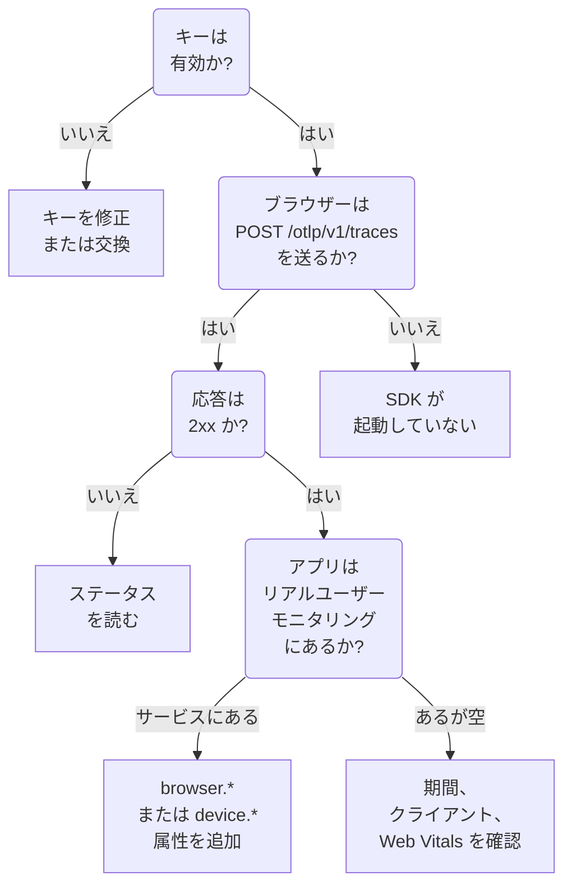

# RUM のトラブルシューティング

RUM アプリケーションが見つからない、空である、または **切断済み** と表示される場合は、このページを順番に確認してください。各チェックは、アプリから OneUptime までの経路の一部分を、これらの問題が起こりやすい順に除外していきます。

:::cards
- [キーを確認する](#キーを確認する): 最も手早いチェックで、以降のすべてがこれに依存します。
- [ブラウザーから送られるものを確認する](#ブラウザーから送られるものを確認する): ブラウザーの開発者ツールでエクスポートのリクエストを見ます。
- [テレメトリの行き先を確認する](#テレメトリの行き先を確認する): RUM アプリケーションか、バックエンドサービスか。
- [セッションリプレイの問題](#セッションリプレイの問題): 独自のページを持つ別のパイプラインです。
:::

## RUM テレメトリが止まる場所

テレメトリは RUM アプリケーションに届くまでに 3 つのチェックを通ります。最初に失敗するものを見つけてください。



## キーを確認する

まずキーを確認します。最も手早いチェックで、OneUptime が受け付けるキーがなければ以降は何も動きません。

```bash
curl -i https://oneuptime.com/otlp/v1/validate \
  -H "x-oneuptime-token: YOUR_TELEMETRY_INGESTION_TOKEN"
```

| 応答 | 意味 |
| --- | --- |
| `200` と `"valid": true` | OneUptime はキーを受け付けます。応答にはキーの `keyType` と `projectId` も含まれます。次のチェックに進んでください。 |
| `401` と `"valid": false` | キーがない、不明、取り消し済み、無効化済み、または期限切れで、 `message` がどれかを示します。 **プロジェクト設定 → テレメトリと APM → 取り込みキー** で有効なキーを作成してください。 |

Web アプリには **ブラウザー** キーが、モバイルアプリには **サーバー** キーが必要です。 [ブラウザーのセットアップ](/docs/rum/browser-setup) と [モバイルのセットアップ](/docs/rum/mobile-setup) を参照してください。エクスポートのエンドポイントも、OTLP の仕様どおりに不正なキーを `401` で拒否するため、行儀のよい SDK は再試行せずに拒否をログに記録します。この行はブラウザーのコンソールで見落としやすいのですが、このチェックならすぐに答えがわかります。

## ブラウザーから送られるものを確認する

アプリのページでブラウザーの開発者ツールを開き、Network タブを選んで `otlp` で絞り込みます。 `2xx` ステータスで応答された `POST /otlp/v1/traces` を探します。

### リクエストがまったくない

SDK が起動していません。ほとんどの場合、次のいずれかです。

- `telemetry.ts` がアプリの最初のインポートになっていない、またはバンドラーがそれを削除した。インストルメンテーションは `fetch` と `XMLHttpRequest` にパッチを当てるため、パッチより前に行われたリクエストはトレースされず、バンドラーが削除したファイルは何も実行しません。
- バッチプロセッサーがまだエクスポートしていない。 `BatchSpanProcessor` はバッチを満たすために数秒待つので、何も送信されていないと判断する前に、待つか別のページに移動してください。
- ビルド時の環境変数が `undefined` になり、エクスポーターの URL が壊れている。起動時に URL を一度ログに出力してください。

### ブラウザーがリクエストをブロックする

- **コンソールの Content Security Policy エラー。** ページのポリシーがまだ OneUptime を許可していません。既存の `connect-src` ディレクティブに追加するか、OneUptime をセルフホストしている場合は自分のホストを使ってください。

  ```text
  connect-src 'self' https://oneuptime.com;
  ```

- **CORS エラー。** OTLP のエンドポイントは任意のオリジンからのリクエストを受け付け、 `x-oneuptime-token` ヘッダーを許可しているため、本当の CORS エラーはほぼ必ず、リクエストが OneUptime に届かなかったことを意味します。企業のプロキシ、広告ブロッカー、ホスト名のタイプミスを探し、Network タブでリクエストの URL を確認してください。

### リクエストがエラーのステータスを受け取る

**`401`.** キーが不明、取り消し済み、または期限切れです。 [キーのチェック](#キーを確認する) を実行してから、有効なキーを使ってください。

**`404`.** URL が間違っています。トレースのエクスポーターには完全なパス `/otlp/v1/traces` が必要です。よくある間違いは、完全な URL を期待するエクスポーターにベースアドレス (`https://oneuptime.com/otlp`) を渡すこと、またはパスを自分で追加するエクスポーターに完全な URL を渡して `/otlp/v1/traces/v1/traces` に行き着くことです。

**`413`.** バッチがプロキシの許容サイズを超えました。OneUptime 自身のイングレスは `/otlp` で最大 4 MB を受け付けますが、OneUptime の前に置いたプロキシはより厳しいことがあります — たとえば ingress-nginx の `proxy-body-size` の既定値は 1 MB です — そのため、プロキシがある場合は `/otlp` の上限も引き上げてください。いずれにしても、 `BatchSpanProcessor` の `maxExportBatchSize` を小さくすると、各エクスポートが小さくなります。

```ts
new BatchSpanProcessor(exporter, { maxExportBatchSize: 100 });
```

スパンがスタックトレース全体やレスポンスボディのような大きな属性を持たない限り、ブラウザーがこれほど大きなバッチを送ることはまれです。それらを削るほうがよい解決策です。

**`422`.** ここで OneUptime がキーを拒否しており、メッセージに理由が示されます。 `Origin https://app.example.com is not allowed for this browser ingestion key.` は、スキームとポート (ある場合) を含むページの正確なオリジンが、キーの **許可されたオリジン** にないことを意味します。 `This telemetry ingestion key has been disabled.` は、誰かがキーを無効にしたことを意味します。

**`429`.** キーの **1 分あたりのリクエスト数の上限** を使い切りました: `Too many telemetry requests for this ingestion key. Please retry later.` Browser キーでは、キーに独自の上限を設定しない限り、すべての訪問者の合計で 1 分あたり 6000 リクエストまで許可されます。

**HTML ページまたは空のボディを伴う `403`。** OneUptime はすべての拒否に JSON で応答するため、この応答は OneUptime の前にある何か、通常は OneUptime をプロキシしている自分のドメインの Web アプリケーションファイアウォールから来ています。ファイアウォールは OTLP/JSON を解析し、すべてのスパン属性をインジェクション対策のルールと照合するため、クエリ文字列付きの URL がスパンにあるだけでブロックされることがあり、ファイアウォールのログにはそのルールが記録されます。OTLP のパスに限って OTLP のペイロードを検査対象から除外してください。方法は [OpenTelemetry のリクエストもブロックされる](/docs/rum/session-replay-troubleshooting#opentelemetry-のリクエストもブロックされる) で説明しており、同じファイアウォールの背後にあるリプレイのレコーダーについても扱っています。

## テレメトリの行き先を確認する

リクエストは成功しているのに、アプリが **製品 → リソース → リアルユーザーモニタリング** ではなく **製品 → サービス** に表示されます。これは最もよくある報告で、原因はほぼ必ず、クライアント属性のないリソースです。OneUptime がバッチを RUM として登録するのは、リソースが次のいずれかを持つ場合だけです。

| 種類 | 属性 |
| --- | --- |
| ブラウザー | `browser.platform`、 `browser.language`、または空でない `browser.brands` |
| モバイル | `device.id` または `device.model.identifier`、あるいはホストの識別子 (`host.name`、 `host.id`、 `k8s.node.name`) のないリソース上の `device.manufacturer` |

`service.name` だけではバックエンドサービスになります。ブラウザー用の OpenTelemetry SDK は、ブラウザーのリソース検出器を追加するか自分で設定しない限り、 `browser.*` 属性を追加しません。 [ブラウザーのセットアップ](/docs/rum/browser-setup) を参照してください。

実際に送っているものを確認するには、Network タブで OTLP のリクエストを開き、ペイロードを見ます。判定に使われるのは `resourceSpans[0].resource.attributes` のリストです。そこに `browser.*` 属性がなければ、ドキュメントに何と書かれていても、SDK はそれを追加していません。

属性を追加すれば、次のバッチで RUM アプリケーションが作成されます。最初に作成されたサービスは別のレコードなので RUM アプリケーションにはならず、RUM のテレメトリが届いたら **製品 → サービス** で削除してください。

> [!NOTE]
> クライアント属性が `device.manufacturer` だけで、ホストの識別子も持つリソースは、ホストのインベントリも同じ属性でメーカーを報告するため、電話ではなくマシンとして扱われます。 `device.id` または `device.model.identifier` を追加すれば、ほかに何を持っていてもバッチはモバイル RUM として登録されます。

## アプリケーションが空

アプリケーションは存在しますが、そのページに何も表示されません。

- **期間を確認する。** 概要は既定で過去 1 時間を表示するため、今朝送ったテスト用のバッチは範囲外です。
- **数分待つ。** 取り込みはキューを経由し、 **最終確認** はバッチごとではなく数分おきに更新されます。
- **プロジェクトを確認する。** キーは自分のプロジェクトに書き込むため、別のプロジェクトのキーで送ったテレメトリはここではなくそちらにあります。

## クライアントページが空

**クライアント** ページには、Web では `browser.platform` が、モバイルでは `device.model.identifier` が一覧表示されます。ほかはすべて動いているのにここが空のままになる理由は 2 つあります。

- **Safari と Firefox。** `browserDetector` は UA Client Hints API を読みますが、これは Chromium 系のブラウザーにしかありません。ほかのブラウザーでは `browser.language` を設定し、テレメトリを RUM として登録するにはそれで十分ですが、 `browser.platform` は設定しません。これらのクライアントを一覧に載せるには、 `browser.platform` を自分で設定してください。
- **`device.manufacturer` だけを設定するモバイル SDK。** テレメトリはモバイル RUM として登録されますが、 **クライアント** ページには `device.model.identifier` が必要です。

## Core Web Vitals に「No web vitals reported yet」と表示される

このカードはアプリが送信するメトリクスからのみ埋まるため、トレースだけでは埋まりません。そもそもメトリクスをエクスポートしているか、メトリクス名が OneUptime の読む名前か、それらがアプリケーションの **メトリクス** ページに表示されているかを確認してください。 [カードに「No web vitals reported yet」と表示される](/docs/rum/web-vitals#トラブルシューティング) で、次のエクスポートの前に訪問者がタブを閉じたときに失われる値も含め、各チェックを説明しています。

## アプリが使われているのにステータスが切断済み

アプリケーションは、テレメトリが 15 分間届かないと **切断済み** になります。アプリが使われている場合は次を確認します。

- **サンプラーがすべてを破棄しているかもしれない。** 常にオフのサンプラーや、非常に低い比率を設定していないか確認してください。
- **アプリが一部の操作のときにしかテレメトリを送らないかもしれない**。その時間に誰もその操作をしなかった可能性があります。
- **デプロイ後にキーが取り消されたか無効化されたかもしれない**。 [キーのチェック](#キーを確認する) をもう一度実行してください。

夜間に訪問者のいない社内アプリやトラフィックの少ないアプリは、実際に切断されています。それは障害ではありません。

## セッションリプレイの問題

セッションリプレイは別のパイプラインで、独自の問題があります。レコーダーのスクリプト、オリジンの許可リスト、同意、Content Security Policy、マスクです。これらは [セッションリプレイのトラブルシューティング](/docs/rum/session-replay-troubleshooting) で扱っています。まずそこから始め、レコーダーの診断を有効にすることから始めてください。レコーダーの失敗の多くは意図的に静かに起こるからです。

```js
localStorage.setItem("oneuptime.sessionReplay.debug", "true");
// then reload the page
```

アプリケーションの **セッションリプレイ** セクションにある **ヘルス** ページと、 **リプレイポリシー** の **インストールをテスト** パネルは、キー、許可リスト、ポリシーをサーバー側から確認し、何も届かない理由を示します。ブラウザーのコンソールは、サーバーからは見えない残り半分を教えてくれます。

既定のポリシーでは、ユーザーがページを操作している間、レコーダーはおよそ 15 秒ごとにチャンクを送信します。アイドル状態のタブには送るものがないので、まずクリックするかマウスを動かしてください。それでもチャンクのリクエストがまったくなければ、何かがおかしいということです。アプリケーションが _On error or frustration_ でしかアップロードしない場合、何か問題が起きるまで静かなのは想定どおりです。 `OneUptimeReplay.captureSession()` を呼び出してアップロードを強制し、どちらにしても経路を確かめてください。

2 つのパイプラインは独立しています。レコーダーが読み込まれるのに RUM アプリケーションが動いている必要はなく、レコーダーが動いていても RUM のテレメトリが届いているとは限りません。どちらも単独で失敗しえます。

## まだ解決しない場合

サポートに問い合わせる前に、次の情報を集めてください。やり取りの往復が 1 回減ります。

- 実際の OTLP リクエストのペイロードにある `resource.attributes` のリスト。
- そのリクエストの HTTP ステータス。
- 送信している正確な `service.name` と、プロジェクトにその名前のアプリケーションまたはサービスがあるかどうか。
- デプロイ済みのビルドのキーに対して、 `/otlp/v1/validate` が `200` を返すかどうか。

そのうえで support@oneuptime.com に連絡するか、 [GitHub](https://github.com/OneUptime/oneuptime) で issue を作成してください。

## 次のステップ

:::cards
- [ブラウザーのセットアップ](/docs/rum/browser-setup): これらのチェックが前提とするセットアップを、順を追って説明します。
- [モバイルのセットアップ](/docs/rum/mobile-setup): モバイルアプリに必要なキーと属性。
- [アプリケーションの管理](/docs/rum/applications): 名前、ラベル、保持期間、ステータス。
- [セッションリプレイのトラブルシューティング](/docs/rum/session-replay-troubleshooting): レコーダーのすべてのコードと、その対処法。
:::
