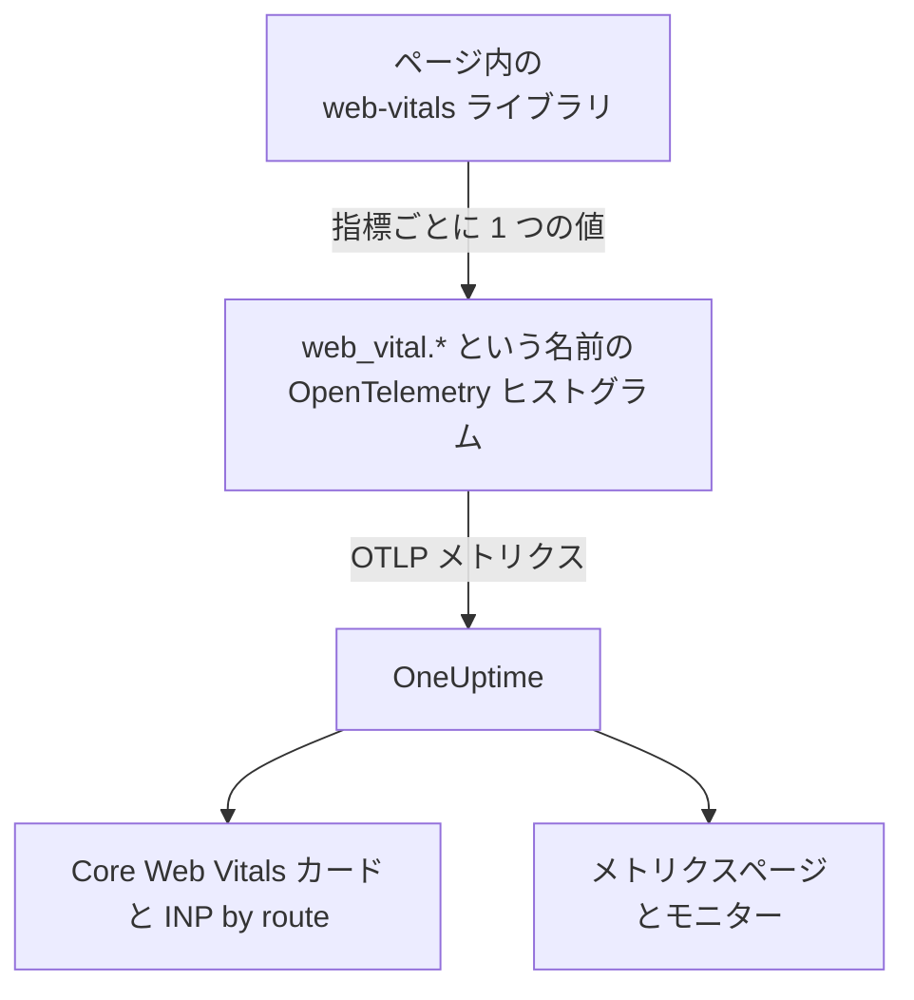
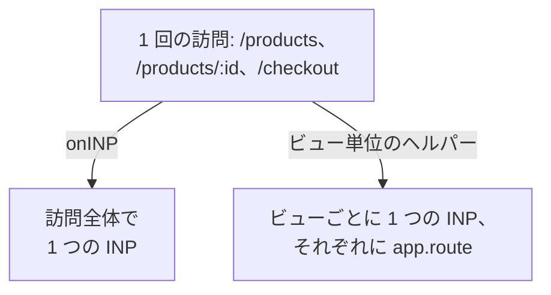

# Core Web Vitals

RUM アプリケーションの概要にある **Core Web Vitals** カードは、LCP、INP、CLS、FCP、TTFB を、それぞれ Google の基準で評価して表示します。OneUptime 自体はどれも測定しません。カードに入るのはブラウザーのインストルメンテーションが報告するメトリクスだけで、このページではその送り方を説明します。

:::cards
- [送信する](#アプリから送信する): web-vitals ライブラリの値を OpenTelemetry のメトリクスとして転送します。
- [OneUptime が読む名前](#oneuptime-が認識するメトリクス名): 各指標が届く可能性のあるメトリクス名。
- [シングルページアプリ](#シングルページアプリ): ページ読み込みごとに 1 つではなく、ビューごとの INP。
- [指標でアラートする](#指標でアラートする): 悪い指標向けの既製のモニター。
:::

## 仕組み

[`web-vitals`](https://github.com/GoogleChrome/web-vitals) ライブラリは、Chrome 自身のツールが使うのと同じライブラリで、ページ内で各指標を測定します。あなたのコードが各値を OpenTelemetry のヒストグラムに記録し、ブラウザーのメトリクスパイプラインがそれを OneUptime にエクスポートします。



OpenTelemetry には web vitals の名前の最終的な規約がまだないため、OneUptime は各指標を複数の名前で探し、データがある最初の名前を使います。新しいインストルメンテーションでは `web_vital.*` の名前を使ってください。

## 始める前に

- [ブラウザーのセットアップ](/docs/rum/browser-setup) のように設定し、メトリクスのパイプラインを持つ Web アプリ。これらの値をエクスポートするのは、 [ログとメトリクスを追加する](/docs/rum/browser-setup#ログとメトリクスを追加する) の `MeterProvider` です。

## アプリから送信する

:::steps
### ライブラリをインストールする

```bash
npm install web-vitals
```

### 各指標をヒストグラムに記録する

`src/web-vitals.ts` を作成します。各指標をヒストグラムにすることで、 **メトリクス** ページで後からパーセンタイルを求められます。バケットの境界は Google の良い値と悪い値の基準に合わせています。

```ts title="src/web-vitals.ts"
// Import after ./telemetry
import { metrics } from "@opentelemetry/api";
import { onCLS, onFCP, onINP, onLCP, onTTFB, type Metric } from "web-vitals";

const meter = metrics.getMeter("web-vitals");

// Histograms, so the Metrics tab can compute percentiles later. The bucket
// edges sit on each vital's good / poor limits: a percentile is read from
// the buckets, and the defaults are far too coarse for these ranges.
const buckets = (...edges: number[]) => ({ advice: { explicitBucketBoundaries: edges } });

const lcp = meter.createHistogram("web_vital.lcp", { unit: "ms", ...buckets(0, 1000, 1500, 2000, 2500, 3000, 3500, 4000, 5000, 7500, 10000) });
const inp = meter.createHistogram("web_vital.inp", { unit: "ms", ...buckets(0, 50, 100, 150, 200, 250, 300, 400, 500, 750, 1000, 2000) });
const fcp = meter.createHistogram("web_vital.fcp", { unit: "ms", ...buckets(0, 600, 1200, 1800, 2400, 3000, 4000, 6000, 10000) });
const ttfb = meter.createHistogram("web_vital.ttfb", { unit: "ms", ...buckets(0, 200, 400, 600, 800, 1200, 1800, 2500, 4000) });
const cls = meter.createHistogram("web_vital.cls", { unit: "1", ...buckets(0, 0.025, 0.05, 0.1, 0.15, 0.2, 0.25, 0.4, 0.6, 1) });

function record(
  histogram: { record: (v: number, a?: Record<string, string>) => void },
) {
  return (metric: Metric): void => {
    histogram.record(metric.value, {
      // Keep attributes low-cardinality. Never put a full URL or a user id here.
      "web_vital.rating": metric.rating,
    });
  };
}

onLCP(record(lcp));
onINP(record(inp));
onCLS(record(cls));
onFCP(record(fcp));
onTTFB(record(ttfb));
```

### テレメトリのセットアップの後にインポートする

```ts
import "./telemetry";
import "./web-vitals";
```

### メトリクスページを確認する

いくつかのページを読み込んでから、アプリケーションの **メトリクス** ページで `web_vital.lcp` を検索します。メトリクスが表示されれば、選んだ期間の **Core Web Vitals** カードにデータが入ります。
:::

## ページが閉じる前に最後の値を送る

`onINP` と `onCLS` は、訪問中ではなくページが非表示になったときに報告します。 [ブラウザーのセットアップ](/docs/rum/browser-setup) の 30 秒のエクスポート間隔では、最後の値の直後にタブを閉じた訪問者は、値がエクスポートされる前に離れてしまうことがあります。漏れなく集めたい場合は、 `exportIntervalMillis` を短くするか、 `telemetry.ts` で作った `MeterProvider` を保持し、ページが非表示になったときにフラッシュします。

```ts
// In telemetry.ts, export the provider you created:
export const meterProvider = new MeterProvider({ /* ... */ });

// Anywhere after setup:
import { meterProvider } from "./telemetry";

document.addEventListener("visibilitychange", () => {
  if (document.visibilityState === "hidden") {
    void meterProvider.forceFlush();
  }
});
```

## OneUptime が認識するメトリクス名

OneUptime はこの順に名前を試し、選んだ期間にデータがある最初の名前を使います。

| 指標 | メトリクス名 (いずれか一つ) | 単位 |
| --- | --- | --- |
| LCP: Largest Contentful Paint | `web_vital.lcp`, `browser.largest_contentful_paint`, `largest_contentful_paint`, `web.vitals.lcp` | ミリ秒 |
| INP: Interaction to Next Paint | `web_vital.inp`, `browser.interaction_to_next_paint`, `interaction_to_next_paint`, `web.vitals.inp` | ミリ秒 |
| CLS: Cumulative Layout Shift | `web_vital.cls`, `browser.cumulative_layout_shift`, `cumulative_layout_shift`, `web.vitals.cls` | スコア |
| FCP: First Contentful Paint | `web_vital.fcp`, `browser.first_contentful_paint`, `first_contentful_paint`, `web.vitals.fcp` | ミリ秒 |
| TTFB: Time to First Byte | `web_vital.ttfb`, `browser.time_to_first_byte`, `time_to_first_byte`, `web.vitals.ttfb` | ミリ秒 |

ほかの名前は、コミュニティの規約ですでに送っているアプリが、変更なしで表示されるようにするためのものです。

## 評価の基準

カードは、Google が公開している Core Web Vitals の基準で各値を評価します。

| 指標 | **Good** | **Needs work** | **Poor** |
| --- | --- | --- | --- |
| LCP | 2500 ミリ秒未満 | 2500〜4000 ミリ秒 | 4000 ミリ秒以上 |
| INP | 200 ミリ秒未満 | 200〜500 ミリ秒 | 500 ミリ秒以上 |
| CLS | 0.1 未満 | 0.1〜0.25 | 0.25 以上 |
| FCP | 1800 ミリ秒未満 | 1800〜3000 ミリ秒 | 3000 ミリ秒以上 |
| TTFB | 800 ミリ秒未満 | 800〜1800 ミリ秒 | 1800 ミリ秒以上 |

カードが示すのは選んだ期間の **平均** で、Google のフィールドツールが報告する 75 パーセンタイルではありません。これは意図的です。OneUptime はヒストグラムのパーセンタイルをバケットから求めるため、パーセンタイルの精度はバケット次第ですが、平均はヒストグラムの正確な合計と件数から求まります。OpenTelemetry の既定のバケット ( `0, 5, 10, 25, 50, …` ) では CLS の値がすべて最初のバケットに入り、ほとんど動かないページでも 75 パーセンタイルが 2.5 と表示されてしまいます。

> [!TIP]
> カードは傾向として読んでください。75 パーセンタイルを見たい場合は、上のバケット境界で記録し、 **メトリクス** ページで **P75** の集計を使ってメトリクスをグラフにします。メトリクスモニターでも同じ選択ができます。

## シングルページアプリ

`onINP` は、ブラウザーの定義どおりに INP を測定します。つまり **ページ読み込みごとに 1 つの値** です。シングルページアプリは一度だけ読み込まれ、その後は `history.pushState` でルートを変えるため、 `/products` 、 `/products/42` 、 `/checkout` を回る訪問でも、訪問全体で INP は 1 つです。すべてのビューの操作がこの 1 つの数値を奪い合い、そこに付くルート属性は、遅かったページではなく、報告された時点で表示されていたページを示します。



ビューごとの INP を見るには、ビューごとに測定します。ルートが変わるたびに現在のビューが終わって新しいビューが始まり、各ビューが自分の INP を報告します。下のヘルパーは、 `onINP` が使うのと同じデータであるブラウザーの Event Timing API でこれを行い、間違えやすい部分も処理します。遷移を **引き起こした** クリックはルートが変わった後に届きますが、クリックされたページに属するという点です。

```ts title="src/inp-per-route.ts"
// INP for each view of a single-page app.
type Report = (inpMs: number, route: string) => void;

interface View {
  route: string;
  path: string; // the URL path it was opened for
  start: number; // performance.now() when the view began
  latencies: Map<number, number>; // interactionId -> its slowest entry
}

// Long enough for the click that navigated to be delivered: its entry
// arrives after the next paint, i.e. after the route has changed.
const SETTLE_MS = 1000;

let views: Array<View> = [];
let report: Report = () => {};

// The path, plus the hash when a hash router keeps the route there.
const currentPath = (): string =>
  location.pathname + (location.hash.startsWith("#/") ? location.hash : "");

function close(view: View): void {
  if (!views.includes(view)) return; // already reported
  views = views.filter((v) => v !== view);

  const sorted = [...view.latencies.values()].sort((a, b) => b - a);
  if (sorted.length === 0) return; // nobody interacted: no INP, not 0

  // web-vitals' p98: skip one outlier for every 50 interactions.
  report(sorted[Math.min(sorted.length - 1, Math.floor(sorted.length / 50))]!, view.route);
}

function record(entries: PerformanceEntryList): void {
  for (const entry of entries as Array<PerformanceEventTiming & { interactionId?: number }>) {
    if (!entry.interactionId) continue; // hovers, scrolls: not interactions

    // The view the interaction STARTED in, so the click that navigated
    // counts towards the page it was clicked on.
    const view = [...views].reverse().find((v) => entry.startTime >= v.start);
    if (!view) continue;

    const slowest = view.latencies.get(entry.interactionId) ?? 0;
    view.latencies.set(entry.interactionId, Math.max(slowest, entry.duration));
  }
}

export function observeInpPerRoute(route: string, onReport: Report): void {
  if (typeof PerformanceObserver === "undefined" || !PerformanceObserver.supportedEntryTypes?.includes("event")) return;

  report = onReport;
  views = [{ route, path: currentPath(), start: 0, latencies: new Map() }];

  const observer = new PerformanceObserver((list) => record(list.getEntries()));
  observer.observe({ type: "event", durationThreshold: 40, buffered: true } as PerformanceObserverInit);

  // The tab may never come back: report every view now, then keep
  // measuring the current route as a fresh view.
  document.addEventListener("visibilitychange", () => {
    if (document.visibilityState !== "hidden") return;
    record(observer.takeRecords());
    const current = views[views.length - 1]?.route ?? route;
    [...views].forEach(close);
    views = [{ route: current, path: currentPath(), start: performance.now(), latencies: new Map() }];
  });
}

// Call after every navigation, with the route PATTERN ("/products/:id").
// Safe to call when nothing changed (a router's initial navigation, a
// query-string update): the view only ends when the path does.
export function startView(route: string): void {
  const closing = views[views.length - 1];
  if (!closing || closing.path === currentPath()) return;

  views.push({ route, path: currentPath(), start: performance.now(), latencies: new Map() });
  setTimeout(() => close(closing), SETTLE_MS);
}
```

どちらの関数も URL ではなくルートの **パターン** を受け取ります。 `/products/42` と `/products/7` は 1 つのルートにする必要があり、そうしないと商品ごとに別の系列になります。ルーターにパターンがあればそれを使い、なければ ID を自分でまとめてください。

```ts
// "/products/42" -> "/products/:id", also for UUIDs.
export const toRoutePattern = (path: string): string =>
  path.replace(/\/(\d+|[0-9a-f]{8}-[0-9a-f-]{27})(?=\/|$)/gi, "/:id");
```

ヘルパーが報告する値は、ルートを `app.route` として同じ `web_vital.inp` ヒストグラムに記録し、上のスニペットからは **`onINP` を外して** ください。両方を残すと、すべての操作が二重に数えられます。

```ts
// src/web-vitals.ts, in place of onINP(record(inp))
import { observeInpPerRoute } from "./inp-per-route";

observeInpPerRoute(toRoutePattern(location.pathname), (inpMs, route) => {
  inp.record(inpMs, {
    "app.route": route,
    "web_vital.rating": inpMs <= 200 ? "good" : inpMs <= 500 ? "needs-improvement" : "poor",
  });
});
```

次に、ルーターが遷移の完了を知らせる場所で `startView` を呼びます。URL のパスが変わっていない呼び出しは無視されるため、最初の読み込みやクエリ文字列の更新も知らせるルーターでも、ビューは分割されません。

:::tabs
@tab Vue Router
```ts
router.afterEach((to) => startView(to.matched[to.matched.length - 1]?.path ?? toRoutePattern(to.path)));
```
@tab React Router
```tsx
// In a component that stays mounted inside the router
const { pathname } = useLocation();
useEffect(() => startView(toRoutePattern(pathname)), [pathname]);
```
:::

得られるもの:

- 概要の **INP by route** 。 `app.route` をもとに、遅い順に並びます。OneUptime は OpenTelemetry の `url.template` も読みます。
- アラート用のルートフィルター。メトリクスモニターで `web_vital.inp` を `app.route` で絞り込むと、 `/checkout` のような 1 つのフローを単独で監視できます。
- **Core Web Vitals** カードのアプリ全体の INP はそのまま使えます。同じメトリクスで、ページ読み込みごとに 1 つではなくビューごとに 1 つの値になっただけです。

これに必要な操作 ID を報告するのは Chromium 系のブラウザーです。Safari は報告しないため、 `onINP` もそこでは何も報告しません。Chrome の実験的な Soft Navigations API はこれをネイティブに行うことを目指していますが、まだ一般提供されていません。このヘルパーは今日から使えます。

> [!NOTE]
> [セッションリプレイ](/docs/telemetry/session-replay) のレコーダーは、コードなしですでにビューごとの INP を測定しています。各録画には、ユーザーが操作したルートごとに INP の行があり、遅かった要素と、その時間が入力遅延、処理、描画にどう分かれたかが表示されます。

## カーディナリティを抑える

メトリクスの属性は掛け算で増えます。 `web_vital.rating` が取る値は 3 つなので問題なく、ルートやページの種類の属性も通常は付ける価値があります。

```ts
histogram.record(metric.value, {
  "web_vital.rating": metric.rating,
  "app.route": routePattern, // "/product/:id" — the PATTERN, not "/product/8842"
});
```

ルートのパターンではなく具体的な URL を記録すると、商品ページごとに時系列が 1 つでき、 **メトリクス** ページが遅くなり、ストレージの費用も膨らみます。ユーザー ID、セッション ID、画面サイズも同様です。

## 指標でアラートする

アプリケーションの **推奨事項** ページでは、指標ごとに既製のモニターを用意しています。それぞれのモニターはメトリクスの 5 分間の平均を読み、Google の悪い値の基準に達すると発火します。

| 推奨事項 | メトリクス | 発火する値 | 重大度 |
| --- | --- | --- | --- |
| **Poor Largest Contentful Paint** | `web_vital.lcp` | 4000 ミリ秒 | **重大** |
| **Poor Interaction to Next Paint** | `web_vital.inp` | 500 ミリ秒 | **重大** |
| **Poor Cumulative Layout Shift** | `web_vital.cls` | 0.25 | **重大** |
| **Slow First Contentful Paint** | `web_vital.fcp` | 3000 ミリ秒 | **警告** |
| **Slow Time to First Byte** | `web_vital.ttfb` | 1800 ミリ秒 | **警告** |

これらのモニターが読むのは `web_vital.*` の名前だけです。アプリが別の名前で指標を送っている場合は、作成されたモニターのメトリクスを編集してください。1 つのルートでアラートするには、モニターに `app.route` のフィルターを追加します。これらのメトリクスのどれでも独自のモニターを作れます。 [メトリクス モニター](/docs/monitor/metrics-monitor) を参照してください。

## トラブルシューティング

:::details カードに「Web Vitals はまだ報告されていません」と表示される
カードに入るのは、アプリが送るメトリクスだけです。次の順に確認してください。

1. そもそもメトリクスのパイプラインがあるか。トレースだけでは、このカードは決して埋まりません。
2. メトリクス名が OneUptime の読む名前か。 [OneUptime が認識するメトリクス名](#oneuptime-が認識するメトリクス名) を参照してください。
3. アプリケーションの **メトリクス** ページにメトリクスがあるか。あればエクスポートは動いており、問題は名前か期間です。
4. INP と CLS はページが非表示になったときに報告されるため、短い訪問は次のエクスポートの前に終わることがあります。 [ページが閉じる前に最後の値を送る](#ページが閉じる前に最後の値を送る) を参照してください。

どれにも当てはまらない場合は、 [RUM のトラブルシューティング](/docs/rum/troubleshooting) でパイプライン全体を確認できます。
:::

:::details INP は報告されるが、ルートごとにならない
**INP by route** カードには、 `web_vital.inp` に `app.route` 属性または `url.template` が必要です。 [シングルページアプリ](#シングルページアプリ) のように、各値とともにルートのパターンを記録してください。
:::

:::details 値が Google のレポートと異なる
カードが示すのは選んだ期間の平均で、Google が報告するのは自分の訪問者の 75 パーセンタイルです。同じ条件で比べるには、 **メトリクス** ページで **P75** をグラフにしてください。
:::

## 次のステップ

:::cards
- [ブラウザーのセットアップ](/docs/rum/browser-setup): これらの指標を運ぶトレース、ログ、メトリクスのパイプライン。
- [メトリクス モニター](/docs/monitor/metrics-monitor): アプリ全体または 1 つのルートで、どの指標でもアラートします。
- [セッションリプレイ](/docs/telemetry/session-replay): コードなしで、録画の中でビューごとの INP を確認します。
- [RUM のトラブルシューティング](/docs/rum/troubleshooting): 問題がよく起きる順に並べたすべての確認項目。
:::
