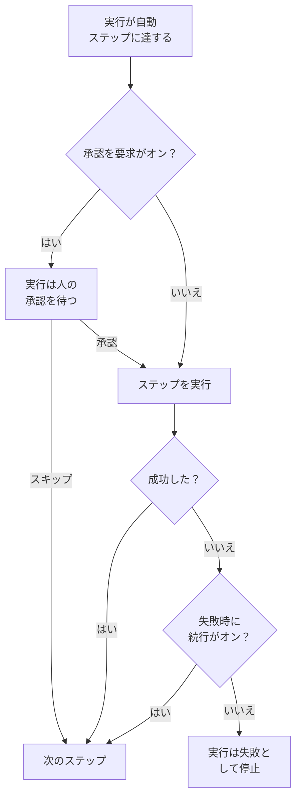

# Runbook を作成する

Runbook は、その **ステップ** ページでステップの順序付きリストとして書きます。このページでは、Runbook の作成方法、7 種類のステップそれぞれの設定方法、失敗と承認が実行の流れをどう変えるかを説明します。

:::cards
- [Runbook の作成](#runbook-の作成): 空の Runbook から保存済みのステップまで。
- [ステップの種類](#ステップの種類): Manual、JavaScript、HTTP request、Bash、SSH、kubectl、AI。
- [失敗時の処理と承認](#失敗時の処理と承認): ステップが失敗したとき、または承認を待つときに何が起きるか。
- [実例](#実例): 5 ステップのデータベースフェイルオーバー。
:::

## 始める前に

- **Runbook を書けるロール。** Project Owner、Project Admin、Runbook Admin は Runbook を作成し、そのステップを保存できます。詳細な権限の場合は **Create Runbook** と **Edit Runbook** が必要です。[権限](/docs/runbooks/configuration#権限) を参照してください。
- **Bash、SSH、kubectl のステップ用の Runner。** これらのステップは自社インフラの [Runner](/docs/runbooks/agents) で実行され、OneUptime Worker では実行されません。先にインストールしてください。Runner を選ばないステップは、設定していれば [プロジェクトのデフォルト Runner](/docs/runbooks/agents#プロジェクトのデフォルト-runner) で実行され、設定していなければ JavaScript のステップは [グローバル Runner](/docs/runbooks/agents#グローバル-runner) で実行されます。
- **SSH と kubectl のステップ用のシークレット変数。** ステップがサインインに使う鍵、パスワード、kubeconfig は、シークレットの [Runbook の変数](/docs/runbooks/variables) です。変数を作成するのは Project Owner と Project Admin で、Runbook Admin は自分が書くステップで変数を選びます。kubectl のステップは、代わりに Runner 自身のアクセスを使うこともできます。
- **AI ステップ用の LLM プロバイダー。** [LLM プロバイダー](/docs/ai/llm-provider) を参照してください。

## Runbook の作成

:::steps
### Runbook を開く

**製品 → Runbook** を開きます。Runbook は **ダッシュボードと自動化** グループにあります。

### 新しい Runbook を作成する

**Runbookを作成** をクリックし、 **名前** と、必要に応じて Runbook の用途を示す **説明** を入力します。 **その他の項目** には、既定でオンの **有効** スイッチと **ラベル** があります。新しい Runbook は **ステップ** ページで開きます。

### ステップを追加する

**Runbook を開始** で最初のステップの種類を選びます。最後のステップの下では、 **ステップをさらに追加** が同じ 7 種類を表示します。各ステップは **タイトル** と、その種類に必要な項目とともに開きます。 **説明** やタイムアウトなどのそれ以外の項目は **その他の項目** にまとめられています。Runbook にステップが 1 つあると、カード上部の **ステップを追加** で Manual ステップが追加されます。

### ステップを並べる

ステップは **順番に** 実行されます。順序を変えるには、ステップの見出しの左にあるハンドルをドラッグします。キーボードでは、ハンドルにフォーカスして Space を押し、矢印キーでステップを移動し、もう一度 Space を押します。

### ステップを保存する

**ステップを保存** をクリックします。保存するまで、エディターには **未保存の変更** と表示されます。保存すると **保存しました** と表示され、Runbook を [実行](/docs/runbooks/running) できる状態になります。
:::

## ステップの構成

各ステップには次の項目があります。自動ステップは **タイトル** とその種類の設定を表示し、それ以外は **その他の項目** にまとめます。そこには設定済みの項目が表示されます。

| 項目 | 目的 |
| --- | --- |
| **タイトル** | ステップ一覧と各実行に表示される短いラベルです。 |
| **説明** | 対応者向けの任意のコンテキストで、Markdown で書き、 **その他の項目** にあります。Manual ステップでは担当者が読んで従う **手順** になり、タイトルの下に表示されます。 |
| **失敗時に続行** | 自動ステップのみ。オンにすると、ステップが失敗しても実行は止まらず、次のステップが実行されます。 |
| **承認を要求** | 自動ステップのみ。オンにすると、誰かが承認するまで実行はこのステップの前で止まり、承認されて初めてこのステップを実行します。スイッチの名前は **このステップを実行する前に承認を要求** で、ステップのヘッダーには **承認が必要** と表示されます。 |
| 種類ごとの設定 | スクリプト、URL、Runner、シークレット変数、プロンプトです。[ステップの種類](#ステップの種類) を参照してください。 |

## ステップの種類

| 種類 | 実行場所 | 必要なもの |
| --- | --- | --- |
| [Manual](#manual) | 人 | なし |
| [JavaScript](#javascript) | Runner | Runner |
| [HTTP request](#http-request) | OneUptime Worker | なし |
| [Bash](#bash) | Runner | Runner |
| [SSH](#ssh) | Runner | Runner と、サインインに使うシークレット変数 |
| [kubectl](#kubectl) | Runner | Runner と、kubeconfig の変数または Runner 自身のアクセス |
| [AI](#ai) | OneUptime Worker | LLM プロバイダー |

以下のどの自動ステップでも、ステップの **その他の項目** には、まず Runner で実行されるステップならその **Runner** 、続いて **承認を要求** と **失敗時に続行** があり、次にそのステップ固有の設定（HTTP request ステップのヘッダー、SSH ステップのポート、鍵のパスフレーズ、ホストキー、AI ステップのプロバイダーとコンテキストのスイッチ）、最後に **説明** とタイムアウトがあります。折りたたむとステップの Runner が表示されるので、開かなくてもステップがどこで実行されるかがわかります。

### Manual

人のためのチェックリスト項目です。その **手順** には、何をするか、何を確認するかを書きます。実行は Manual ステップに達すると一時停止し、誰かが **完了にする** または **スキップ** をクリックするまで `WaitingForManualStep` （ **あなたの対応待ち** ）のままです。人を待っている実行がタイムアウトすることはありません。Manual ステップには承認のスイッチがありません。もともと人のために実行を止めるステップだからです。

人にしか確認や操作ができないことに使います。「ロードバランサーのダッシュボードで、トラフィックがセカンダリリージョンに切り替わったことを確認する。」

### JavaScript

OneUptime Worker ではなく [Runbook エージェント](/docs/runbooks/agents) 上の `isolated-vm` サンドボックスで実行される JavaScript です。自社の Runner で実行されるか、ステップが Runner を選ばない場合は [グローバル Runner](/docs/runbooks/agents#グローバル-runner) で実行されます。

| 項目 | 内容 | 既定値 |
| --- | --- | --- |
| **Runner** | **その他の項目** にあります。ステップを実行する Runner です。 **グローバル Runner** か、自社の Runner のいずれかです。ジョブを取得できるのは選んだ Runner だけですが、 **グローバル Runner** のステップはどのグローバル Runner でも取得できます。 | 設定していれば [プロジェクトのデフォルト Runner](/docs/runbooks/agents#プロジェクトのデフォルト-runner) 、なければ **グローバル Runner** （ある場合） |
| **スクリプト** | 実行する JavaScript です。値を記録するには `return` で返します。`console.log` の各行も記録されます。エラーがスローされるとステップは失敗します。 | — |
| **実行タイムアウト** | Runner がサンドボックスを破棄するまでにスニペットを実行させる時間です。 グローバル Runner では最長 5 分です。 | 30 秒 |
| **取得のタイムアウト** | Worker が Runner によるジョブの取得を待つ時間です。 | 2 分 |

```javascript
const start = Date.now();
// ... your logic ...
console.log("replica lag checked");
return { durationMs: Date.now() - start };
```

サンドボックスのメモリは 128 MB で、ファイルシステムやプロセスにはアクセスできません。`axios` で HTTP リクエストを送れますが、宛先はパブリックアドレスに限られます。プライベートネットワーク、Runner 自身のホスト、クラウドのメタデータエンドポイントへのリクエストは拒否されます。自社ネットワーク内のサービスに到達するには、`curl` を使う [Bash](#bash) ステップを使います。

### HTTP request

OneUptime Worker が行う送信 HTTP 呼び出しです。Runner は不要です。

| 項目 | 内容 | 既定値 |
| --- | --- | --- |
| **メソッド** | `GET`、`POST`、`PUT`、`PATCH`、`DELETE`、`HEAD`。 | `GET` |
| **URL** | 呼び出すエンドポイントです。 | 空 |
| **ヘッダー（JSON）** | **その他の項目** にあります。`{ "Authorization": "Bearer ..." }` のような JSON オブジェクトです。有効な JSON でないヘッダーはステップを失敗させます。 | なし |
| **本文** | `POST`、`PUT`、`PATCH`、`DELETE` のときに表示されます。JSON として解析できれば JSON として、できなければテキストとして送信されます。 | なし |
| **リクエストのタイムアウト** | ステップが失敗するまでエンドポイントの応答を待つ時間です。 | 30 秒 |

ステップは `2xx` または `3xx` の応答で成功し、それ以外ではエラー `HTTP <status>` で失敗します。リダイレクトはたどりません。応答のステータス、ヘッダー、本文は最大 50 KB まで記録されます。

> [!NOTE]
> Worker は、クラウドのメタデータエンドポイントのようなループバックやリンクローカルのアドレスを決して呼び出しません。OneUptime Cloud ではパブリックアドレスだけを呼び出します。セルフホストの OneUptime は、`DATA_SOURCE_BLOCK_PRIVATE_ADDRESSES` が `true` でない限り、プライベートネットワークにも到達します。OneUptime Cloud から自社ネットワーク内のサービスを呼び出すには、`curl` を使う [Bash](#bash) ステップを使います。

用途: PagerDuty のインシデントを開く、Slack の Webhook に投稿する、クラウドプロバイダーや自社の公開 API を呼び出す。

> [!TIP]
> トークンをステップに書かないでください。シークレットの [Runbook の変数](/docs/runbooks/variables) として保存し、URL、ヘッダー、本文の値を入れる場所に `{{global.variables.NAME}}` と書きます。リクエストは OneUptime 自身が送るのでシークレットも埋め込まれ、ステップが記録する応答ではその場所に `[REDACTED]` と表示されます。JSON のヘッダーや本文では値がその文字列の中に入るため、値に引用符や改行があっても JSON は壊れません。

### Bash

自社インフラの [Runbook エージェント](/docs/runbooks/agents) 上で `bash -c <script>` で実行される bash スクリプトです。Bash が OneUptime Worker で実行されることはありません。

| 項目 | 内容 | 既定値 |
| --- | --- | --- |
| **Runner** | **その他の項目** にあります。ステップを実行する Runner です。ジョブを取得できるのはこの Runner だけです。グローバル Runner が実行するのは JavaScript のステップだけです。 | 設定していればプロジェクトのデフォルト Runner |
| **Bash スクリプト** | スクリプトです。出力（stdout と stderr）は最大 50 KB まで記録され、0 以外の終了コードでステップは失敗します。 | — |
| **実行タイムアウト** | Runner が `SIGKILL` で終了させるまでにスクリプトを実行させる時間です。正当な理由で数分かかるステップでは引き上げます。 | 30 秒 |
| **取得のタイムアウト** | Worker が Runner によるジョブの取得を待つ時間です。 | 2 分 |

スクリプトは Runner のコンテナで、そのイメージに含まれるツール（`curl`、`wget`、`ssh` クライアントなど）と、実行中のホストのネットワークアクセスを使って実行されます。たとえば、自社ネットワークからしか到達できないサービスを確認するには次のようにします。

```bash
set -euo pipefail
HTTP_CODE=$(curl -s -o /tmp/resp.txt -w "%{http_code}" "http://payments.internal:8080/health")
echo "HTTP $HTTP_CODE"
cat /tmp/resp.txt
if [[ "$HTTP_CODE" != "200" ]]; then
  echo "Health check failed"
  exit 1
fi
```

実行がこのステップに達したときに選んだ Runner がオフラインだと、ステップは **取得のタイムアウト** （既定では 2 分）まで待ってからタイムアウトで失敗します。Bash ステップに頼る前に、 **Runbook → Runner** でエージェントを追加してください。

> [!TIP]
> パスワードやトークンをスクリプトに書かないでください。シークレットの [Runbook の変数](/docs/runbooks/variables) として保存し、値を入れる場所に `{{global.variables.NAME}}` と書きます。Runner は値が埋め込まれたスクリプトを受け取り、ステップの出力ではその場所に `[REDACTED]` と表示されます。

### SSH

SSH でマシンにサインインし、そこで bash スクリプトを実行します。接続を開くのは Runner なので、マシンには Runner から届けば十分です。ステップがサインインに使う鍵やパスワードはシークレットの [Runbook の変数](/docs/runbooks/variables) で、ステップに書かれることはありません。

| 項目 | 内容 |
| --- | --- |
| **Runner** | **その他の項目** にあります。接続を開く Runner です。ネットワーク経由でマシンに到達できる必要があります。 Runner を選ばないステップは、プロジェクトのデフォルト Runner で実行されます。 |
| **SSH 接続先** | ユーザーとマシンを `ssh` の後に書くとおりに指定します: `deploy@10.0.4.21`。 |
| **サインイン方法** | 秘密鍵またはパスワードを持つシークレット変数です。どちらかは値から判断されます。シークレット変数だけが表示され、選んだ変数をステップの Runner が使えない場合はステップが知らせます。 |
| **Bash スクリプト** | マシン上で、サインインしたユーザーとして `bash` で実行されます。出力は 50 KB まで記録され、終了コードが 0 以外だとステップは失敗します。 |
| **ポート** | **その他の項目** にあります。空欄なら 22 です。 |
| **鍵のパスフレーズ** | **その他の項目** にあります。パスフレーズのある鍵の場合に、そのパスフレーズを持つシークレット変数です。 |
| **ホストキー** | **その他の項目** にあります。マシンの SHA256 フィンガープリント、または `ssh-keyscan` が出力する形式の公開鍵で、1 行に 1 つです。マシンがそのいずれかを提示したときだけ、ステップはサインインします。空のままにすると任意のキーを受け入れ、ステップの出力にマシンが提示したキーが表示されます。 |
| **実行タイムアウト** | 接続、サインイン、スクリプトの実行をまとめて対象とするため、止まったスクリプトがステップを開いたままにすることはありません。既定は 30 秒です。 |
| **取得のタイムアウト** | Worker が Runner によるジョブの取得を待つ時間です。既定値は 2 分です。 |

たとえば、サービスを再起動して復旧したことを表示するには次のようにします。

```bash
sudo systemctl restart nginx
systemctl status nginx --no-pager
```

ステップがそのマシンにだけサインインするよう、マシンのホストキーを指定します。`ssh-keyscan 10.0.4.21` で公開鍵を、マシン上の `ssh-keygen -lf /etc/ssh/ssh_host_ed25519_key.pub` でフィンガープリントを確認できます。ホストキーを指定したステップは、それを確認できない古い Runner では失敗し、Runner を更新するよう表示されます。

### kubectl

クラスターに kubectl コマンドを実行します。スクリプトは `kubectl` を同梱した Runner 上で bash によって実行され、`KUBECONFIG` はクラスターを指します。どんな kubectl コマンドも、その前後の bash も使えます。

| 項目 | 内容 |
| --- | --- |
| **Runner** | **その他の項目** にあります。kubectl を実行する Runner です。クラスターの API サーバーに到達できる必要があります。 Runner を選ばないステップは、プロジェクトのデフォルト Runner で実行されます。 |
| **Kubeconfig** | クラスターの kubeconfig を持つシークレット変数、または **Runner 自身のアクセス** です。後者は Runner 自身の kubeconfig、またはクラスター内で動くときはそのサービスアカウントを使います。Runner は kubeconfig を自分だけが読めるファイルに書き込み、スクリプトの終了時に削除します。 |
| **スクリプト** | kubectl コマンドです。出力は 50 KB まで記録され、終了コードが 0 以外だとステップは失敗します。 |
| **実行タイムアウト** | Runner が `SIGKILL` で止めるまでスクリプトを実行させておく時間です。既定は 30 秒です。 |
| **取得のタイムアウト** | Worker が Runner によるジョブの取得を待つ時間です。既定値は 2 分です。 |

たとえば、Deployment を再起動して新しい Pod の準備ができるまで待つには次のようにします。

```bash
kubectl rollout restart deployment/checkout-api --namespace checkout
kubectl rollout status deployment/checkout-api --namespace checkout --timeout=120s
```

各スクリプトの下の **例 — クリックして挿入** で、このようなよく使うスクリプトを挿入できます。kubeconfig のユーザーには、スクリプトが行うことだけを許可してください。スクリプトが操作する namespace の Role に、使う verb だけを与えます。API サーバーがコマンドを拒否すると、kubectl 自身のメッセージがステップの出力に残るので、権限エラーからどの RoleBinding を広げればよいかがわかります。

### AI

実行の途中で、AI に分析、要約、判断を依頼します。応答は実行におけるステップの出力になります。AI ステップは OneUptime Worker で実行され、Runner は不要です。

| 項目 | 内容 |
| --- | --- |
| **プロンプト** | AI にしてほしいことです。例:「前のステップの出力を確認し、修復を続けても安全かどうかを答えてください。」 |
| **LLM プロバイダー** | 任意です。 **プロジェクトのデフォルト** はプロジェクトの既定のプロバイダーを使います。ネットワーク外に出してはいけないデータ用のセルフホストモデルなど、特定のモデルが必要なステップではプロバイダーを固定します。[LLM プロバイダー](/docs/ai/llm-provider) を参照してください。 |
| **前のステップのコンテキストを含める** | オンにすると、AI はこのステップより前に実行されたステップのすべて（タイトル、種類、ステータス、出力、エラーメッセージ）を参照します。各ステップの出力は最大 4,000 文字まで渡されます。 |
| **トリガーのコンテキストを含める** | オンにすると、AI は実行を開始したもの、つまり関連付けられたインシデント、アラート、定期メンテナンスイベント（説明、重大度、現在の状態、影響を受けるモニター、根本原因、状態のタイムライン、公開メモ）、または Runbook を手動で実行した人を参照します。 |

人をループに残すには、AI ステップの次のステップで **承認を要求** をオンにします。AI が分析し、人がその応答を読み、承認して初めて修復のステップが実行されます。

**AI が決して見ないもの。** AI ステップの応答は実行のステップ出力として保存され、実行は Runbook の閲覧権限を持つ全員が読めます。これはインシデントより広い範囲です。そのため、トリガーのコンテキストには **非公開の内部メモ** と **Slack と Microsoft Teams のチャンネルメッセージ** は含まれません。前のステップの出力はシークレット（トークン、鍵、認証情報）がないかスキャンされ、モデルに送る前にマスクされます。インシデントの説明に貼り付けたスクリーンショットのような埋め込み画像や長いエンコード済みデータも除外され、代わりに短い注記が入ります。

AI ステップはほかの AI 機能と同じように計測され、課金されます。プロンプトがない、プロジェクトで AI 機能がオフになっている、利用できる LLM プロバイダーがない、固定したプロバイダーがプロジェクトで利用できなくなった、のいずれかの場合、ステップは理由を示すメッセージで失敗します。残りの Runbook を引き続き実行したい場合は **失敗時に続行** をオンにします。

## 失敗時の処理と承認



既定では、ステップが失敗すると実行は止まり、そのステップのエラーを理由として `Failed` になります。 **失敗時に続行** をオンにすると、失敗は記録され、次のステップが実行されます。「この 3 つを試してから通知する」タイプの Runbook に向いています。

**承認を要求** は、それより前に何が起きたかに関係なく、ステップが実行される前に適用されます。誰かが **承認して実行** をクリックするとステップが実行され、 **スキップ** をクリックすると実行されることはありません。何かを変更するステップ（再起動、フェイルオーバー、スケールダウン）でオンにして、前のステップが見つけたことを先に人が確認できるようにします。承認はステップに属するため、ステップを移動すると承認も一緒に移動します。

:::note
API と Terraform では、このスイッチはステップの `requireApprovalBeforeRunning` です。承認が保護対象のステップに移る前に Runbook が書き込んでいたステップの `requireApproval` も引き続き機能し、意味も変わりません。つまり、そのステップの後の承認です。OneUptime はこれを次のステップの前の承認として読み、最後のステップの後にある場合は、末尾の Manual ステップ **Approve the result** として読みます。
:::

## 保存と編集

ステップへの変更は **ステップを保存** をクリックしたときに反映されます。各実行は開始時に取ったスナップショットで動くため、進行中の実行は開始時のステップのままで、編集によって過去の実行の履歴が書き換わることはありません。

## 実例

「DB primary unreachable」用の Runbook:

| # | 種類 | 内容 |
| --- | --- | --- |
| 1 | JavaScript | 構成サービスから現在のプライマリホストを取得してログに記録する。 |
| 2 | Manual | 「セカンダリのレプリケーション遅延が 5 秒未満であることを確認する。」 |
| 3 | HTTP request | フェイルオーバーオーケストレーターの API への `POST`。 |
| 4 | Manual | 「書き込みが新しいプライマリに向かっていることを確認する。」 |
| 5 | HTTP request | Slack の Webhook への解除メッセージの `POST`。 |

対応者は、ステップ 1 の実行を見て、ステップ 2 にチェックを入れ、ステップ 3 の実行を見て、ステップ 4 にチェックを入れ、実行はステップ 5 で終わります。各ステップの出力はポストモーテム用に記録されます。

## 次のステップ

:::cards
- [Runbook を実行する](/docs/runbooks/running): 実行を開始し、ステップを完了、承認、スキップします。
- [Runbook ルール](/docs/runbooks/rules): 一致するインシデントでこの Runbook を自動で開始します。
- [Runbook エージェント](/docs/runbooks/agents): スクリプトのステップに必要な Runner をインストールします。
- [Runbook の変数](/docs/runbooks/variables): ホスト、鍵、パスワード、kubeconfig をステップに書かずに済ませます。
:::
