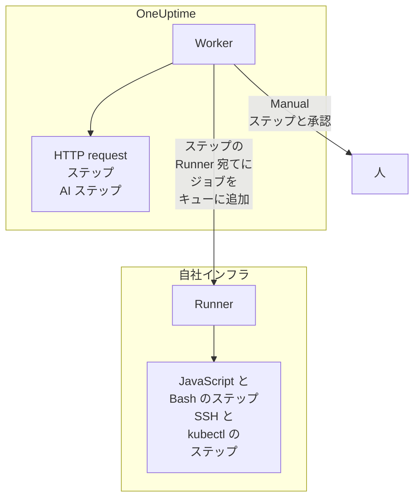

# Runbook の設定と安全性

運用担当者とセキュリティレビュー担当者のためのリファレンスです。各種類のステップがどこで実行されるか、ステップに適用される上限とタイムアウト、誰が何をできるか、Runbook がどのように堅牢化されているかを説明します。

:::cards
- [各ステップの種類の実行場所](#各ステップの種類の実行場所): Worker、Runner、または人。
- [出力の上限とタイムアウト](#出力の上限とタイムアウト): ステップに適用されるすべての上限。
- [権限](#権限): 詳細な権限、3 つの Runbook ロール、ロールが届く Runbook。
- [堅牢化に関する注意](#堅牢化に関する注意): サンドボックス、ネットワークアクセス、Runner の認証。
:::

## 各ステップの種類の実行場所

| ステップの種類 | 実行場所 | 方法 |
| --- | --- | --- |
| Manual | 人 | 誰かがステップを完了またはスキップするまで実行が待ちます。 |
| JavaScript | Runner | `isolated-vm` サンドボックス内。 |
| HTTP request | OneUptime Worker | 送信 HTTP 呼び出し。 |
| Bash | Runner | `bash -c <script>`。 |
| SSH | Runner | シークレットの [変数](/docs/runbooks/variables) でサインインし、マシン上で bash でスクリプトを実行する SSH 接続。 |
| kubectl | Runner | `KUBECONFIG` がクラスターを指す状態での `bash -c <script>`。 |
| AI | OneUptime Worker | プロジェクトの LLM プロバイダーの呼び出し。 |

## Runner のステップが送られる仕組み

JavaScript、Bash、SSH、kubectl のステップは **OneUptime Worker では決して実行されません** 。これらはジョブとして特定の [Runbook エージェント](/docs/runbooks/agents) に送られます。これは自社インフラのホストにインストールする小さなプロセスです。 Runner を選ばないステップは、プロジェクトにあれば [プロジェクトのデフォルト Runner](/docs/runbooks/agents#プロジェクトのデフォルト-runner) に送られます。なければ JavaScript のステップは、OneUptime がすべてのプロジェクトのために動かす [グローバル Runner](/docs/runbooks/agents#グローバル-runner) に送られます。

送信のモデル:

1. Runbook のステップの作成者が、ステップを書くときにドロップダウンから Runner を選びます。
2. ステップが実行されると、Worker は `RunnerJob` に、`targetAgentId` をその Runner の ID（Runner を選ばなかったステップではプロジェクトのデフォルト Runner の ID）に、ステータスを `Pending` にした行を挿入します。 デフォルト Runner がなく、グローバル Runner を使用するプロジェクトで Runner を選ばなかった JavaScript のステップには、代わりに `runsOnGlobalRunner` が設定されます。
3. その Runner（その Runner だけ）がジョブをアトミックに取得し、ローカルで実行して（Bash と kubectl は `bash -c <script>`、JavaScript は `isolated-vm` サンドボックス、SSH はマシンへの接続で、いずれも指定された変数を埋め込んで実行）、結果を返します。 `runsOnGlobalRunner` のジョブは、どのグローバル Runner でも取得できます。
4. Worker はその結果で Runbook を再開します。

`RUNBOOK_BASH_ENABLED` 環境フラグはもうありません。これらのステップがデプロイで動くかどうかは、プロジェクトに **Runbook を実行** がオンの接続済み Runner があるかどうかだけで決まります。 JavaScript のステップはグローバル Runner でも動きます。

## 出力の上限とタイムアウト

| 上限 | 値 | 対象 |
| --- | --- | --- |
| ステップごとの出力 | **50 KB**。それより長い出力はマーカー付きで切り詰められます。 | すべての自動ステップ |
| 実行タイムアウト | 既定で **30 秒** | JavaScript、Bash、SSH、kubectl のステップ |
| リクエストのタイムアウト | 既定で **30 秒** | HTTP request ステップ |
| 取得のタイムアウト | 既定で **2 分**。Worker が、選んだ Runner によるジョブの取得を待ってから失敗にするまでの時間 | JavaScript、Bash、SSH、kubectl のステップ |
| タイムアウトの範囲 | **1 秒から 1 時間** | すべてのタイムアウト |
| 人を待つ時間 | 上限なし | Manual ステップと承認 |

タイムアウトは Runbook の **ステップ** ページで、ステップごとに **その他の項目** で設定します。既定値のままにするには項目を空にします。範囲外の値はステップの実行時に範囲内に収められるため、設定の打ち間違いでタイムアウトが無効になったり、Worker の枠が無期限に占有されたりすることはありません。

## 権限

Runbook の権限は `Runbook` 権限グループにあります。

- `CreateRunbook`、`EditRunbook`、`DeleteRunbook`、`ReadRunbook` — Runbook のテンプレートを管理します。
- `CreateRunbookExecution`、`EditRunbookExecution`、`DeleteRunbookExecution`、`ReadRunbookExecution` — 実行を開始、チェック、削除、閲覧します。
- `CreateRunbookRule`、`EditRunbookRule`、`DeleteRunbookRule`、`ReadRunbookRule` — 自動トリガーのルールを管理します。
- `CreateRunner`、`EditRunner`、`DeleteRunner`、`ReadRunner` — 自社インフラでステップを実行する Runner を管理します。（Runner への名前変更前は `*RunbookAgent` という名前でした。既存の付与は移行済みなので、割り当て直す必要はありません。）
- `RunbookAdmin`、`RunbookMember`、`RunbookViewer`（ロール） — `RunbookAdmin` は Runbook、そのルール、それを実行する Runner を構築し、Runbook を実行します。`RunbookMember` は Runbook とその実行を開いて Runbook を実行します（実行を開始し、ステップを完了またはスキップし、実行をキャンセルします）が、Runbook や Runner の作成、変更、削除はしません。`RunbookViewer` は Runbook とその実行を読むだけで、何も実行しません。`RunbookAdmin` は上記の詳細な権限をすべてまとめたものです。

ロールが実行できるのは、その範囲が届く Runbook です。一部のラベルに限定した `RunbookMember`、`RunbookAdmin`、`ProjectMember` の付与は、それらのラベルを持つ Runbook の実行を開始して進めます。 **Owned** に限定した付与は、そのチームが所有する Runbook の実行を開始して進めます。チームがラベルをブロックすると、それらの Runbook はそのチームの対象から外れます。`CreateRunbookExecution` と `EditRunbookExecution` はラベルを持たない実行に関する権限なので、プロジェクト内のすべての Runbook に届きます。Runbook を開始する修復提案の承認も同じように確認されます。

Runbook のスケジュールと Webhook は人がいなくても実行を開始するため、どちらを設定するにも Runbook を編集する権限と実行する権限が必要です。Webhook URL を表示する場合も同様です。オフにするには編集する権限だけが必要です。[Runbook のトリガー](/docs/runbooks/triggers#トリガーを設定できるユーザー) を参照してください。

Runbook の変数は `RunbookAdmin` の対象外で、このロールは自分が書くステップで選ぶために変数を読むだけです。変数を管理するには `ProjectOwner` か `ProjectAdmin`、または `CreateRunbookSecret`, `EditRunbookSecret`, `DeleteRunbookSecret`、`ReadRunbookSecret` の権限が必要です。これらは Runbook のシークレットの権限で、シークレットが変数になったときも名前が変わりませんでした。[Runbook の変数](/docs/runbooks/variables) を参照してください。

**Runbook → 設定** にある所有者ルールとラベルルールも `RunbookAdmin` の対象外です。それらを管理するには、`ProjectOwner` または `ProjectAdmin`、あるいは `CreateRunbookOwnerRule` と `CreateRunbookLabelRule` の権限と、それぞれの編集、削除、閲覧の権限が必要です。

ロールと詳細な権限の組み合わせ方については、[ユーザー、チーム、権限](/docs/permissions/index) を参照してください。

## キューと Worker

Runbook の実行は `Runbook` BullMQ キューで動きます。各 Worker プロセスは最大 25 件の実行を同時に処理します。この数はコードで固定されており、環境変数では設定しません。

Manual ステップが API でチェックされると、実行は次のステップから続けるために再びキューに入ります。Worker が再び取得するまで `Scheduled` で待ち、キューに入った実行が待機を理由に失敗することはありません。

## 堅牢化に関する注意

- **JavaScript、Bash、SSH、kubectl** は、OneUptime Worker ではなく、自分で管理する Runner のホストで実行されます。JavaScript は 128 MB のメモリを持つ独立した `isolated-vm` のアイソレートで実行され、Runner のファイルシステムやプロセスにはアクセスできません。`axios` で HTTP リクエストを送れますが、プライベートネットワーク、ループバック、リンクローカルのアドレスへのリクエストは拒否されます。Bash は `bash -c` で実行され、タイムアウトは Runner で適用されます。 Runner を選ばない JavaScript のステップは、プロジェクトのデフォルト Runner で、それがなければグローバル Runner で実行されます。
- **SSH ステップ** は、ステップが指定したホストキーのいずれかをマシンが提示したときだけサインインします。何も指定していないステップは任意のキーを受け入れ、出力にマシンが提示したキーを表示するので、それをステップに指定できます。
- **HTTP ステップ** は寛容なステータス検証を使うため、4xx や 5xx の応答は例外として投げられるのではなく失敗したステップとして記録され、記録された出力には相手側が実際に返した内容が反映されます。リダイレクトはたどりません。Worker は、クラウドのメタデータエンドポイントのようなループバックやリンクローカルのアドレスを決して呼び出しません。OneUptime Cloud ではプライベートネットワークのアドレスも拒否し、セルフホストの OneUptime は `DATA_SOURCE_BLOCK_PRIVATE_ADDRESSES=true` のときに拒否します。
- **AI ステップ** は、インシデントの非公開メモや Slack と Microsoft Teams のメッセージを決して参照しません。前のステップの出力はシークレットがないかスキャンされ、モデルに届く前にマスクされます。埋め込み画像と長いエンコード済みデータはプロンプトから除外されます。[AI](/docs/runbooks/authoring#ai) を参照してください。
- **グローバル Runner** は JavaScript のステップだけを実行します。各ステップは、そのステップのために作られて終了後に破棄されるサンドボックスで、公開インターネットのアドレスにだけアクセスでき、最長 5 分、1 つのプロジェクトにつき同時に 3 ステップまで実行されます。渡されるのは、ステップ自身のプロジェクトのシークレット変数のうちグローバル Runner に対してオンになっているものだけです。同梱のグローバル Runner は専用のキーを持ち、サーバーのそれ以外のものは何も持ちません。[グローバル Runner](/docs/runbooks/agents#グローバル-runner) を参照してください。
- **Runner の認証** は ID と秘密キーで行い、それらは Runner コンテナに環境変数として設定します。サーバー側では、Runner の正式な ID は、提示された ID とキーに対応するデータベースの行から得られます。キーが漏洩していても、クライアントが別の Runner になりすますことはできません。
- **シークレット変数** は保存時に暗号化され、API から返されることはなく、それらに指定された Runner が、それらを指定するステップを取得したときにだけ渡されます。シークレット変数は、変数がグローバル Runner に使用を許可している場合、変数自身のプロジェクトのステップを取得したグローバル Runner にも渡されます。Runner はステップに渡した各シークレットをステップの出力で `[REDACTED]` に置き換え、OneUptime も出力を保存する前にもう一度置き換えます。OneUptime 自身が送る HTTP リクエストのステップには、指定した自分のプロジェクトのシークレットがすべて渡され、記録する応答ではそれらが隠されます。

## データベースのテーブル

| テーブル | 内容 |
| --- | --- |
| `Runbook` | テンプレート。名前、slug、説明、`isEnabled`、ラベル、JSON 形式のステップ。 |
| `RunbookExecution` | 実行ごとに 1 行。null 許容の外部キー `incidentId`、`alertId`、`scheduledMaintenanceId` と、ステップと各ステップの状態のスナップショットである JSON 配列 `stepExecutions` を持ちます。 |
| `RunbookRule` | 自動トリガーのルール。判別子 `triggerEntityType`（Incident、Alert、ScheduledMaintenance）、開始する Runbook との多対多の関係、そして一致の対象（JSON 列 `criteria`（条件）と、モニター、インシデントの重大度、アラートの重大度、ラベル、モニターのラベルへの多対多のリンク、タイトル、説明、モニター名、モニターの説明のパターン）を持ちます。 |
| `Runner` | インストールした Runner ごとに 1 行。名前、秘密キー、`lastAlive`、`connectionStatus`、ホスト情報、機能。 グローバル Runner には `isGlobalRunner` が設定され、プロジェクトはありません。プロジェクトのデフォルト Runner には `isProjectDefault` が設定されます。 |
| `RunnerJob` | Runner に送ったステップごとに 1 行。`targetAgentId`（ステップの作成者が選んだ Runner）、ステップの種類、スクリプトまたはペイロード、ステータス（`Pending` → `Claimed` → `Running` → `Succeeded`、`Failed`、`TimedOut`、`Cancelled`）、取得の期限、リース、出力、終了コード。 `runsOnGlobalRunner` は、どのグローバル Runner でも取得できるステップを示します。 |
| `RunbookVariable` | Runbook の変数。プロジェクトのグローバル変数と、`runbookId` で Runbook を指定する Runbook 自身の変数です。シークレットの値は暗号化され、シークレットを受け取れる Runner も保持します。 |

## 運用のヒント

- **ステップで選ぶ Runner が正常であることを確認してください。** 冗長性が必要なら、2 台目の Runner を動かしてステップを分散するか、もう一方の Runner を対象にした予備の Runbook を用意します。
- **大きなデータではなく URL を記録してください。** ステップの出力が数 KB を超える場合は、オブジェクトストレージやログ基盤に書き込み、URL を返します。
- **冪等性が重要です。** HTTP request や AI のステップは、ステップの途中で Worker が再起動して実行が再開されると、もう一度実行されます。Runner のステップは 1 回の実行につき最大 1 回しか送られませんが、失敗前にスクリプトが部分的に実行されていることがあり、Runbook を再実行することもあります。再試行しても安全なステップを設計してください。

## 次のステップ

:::cards
- [Runbook エージェント](/docs/runbooks/agents): Runner のインストール、運用、トラブルシューティング。
- [Runbook の変数](/docs/runbooks/variables): ステップが使う値とシークレット、そしてそれを受け取る Runner。
- [ユーザー、チーム、権限](/docs/permissions/index): ロール、ラベル、チームが誰が何を実行するかをどう決めるか。
:::
