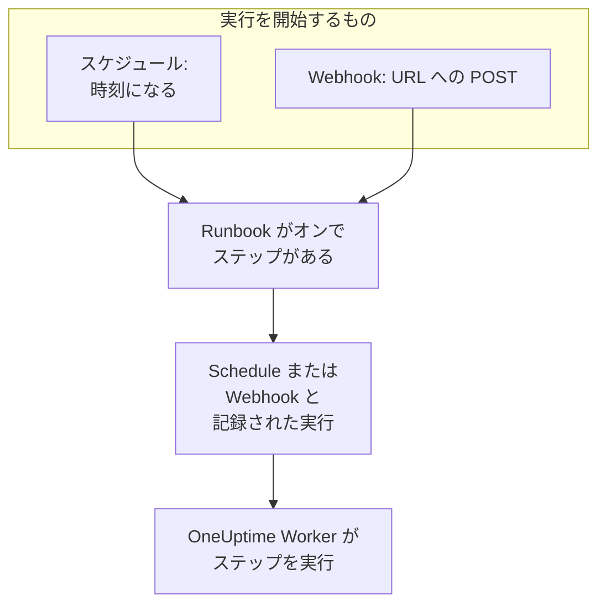

# Runbook のトリガー

Runbook は自動で開始できます。スケジュールに従って、またはほかのツールが Webhook URL を呼び出したときです。夜間のクリーンアップや毎週の証明書チェックといった定型作業にはスケジュールを、アラートシステム、CI パイプライン、スクリプトから Runbook を開始するには Webhook を使います。どちらも Runbook の **トリガー** ページで設定します。

:::cards
- [スケジュールで実行する](#スケジュールで実行する): 数分ごと、毎日、指定した曜日、または cron 式で。
- [Webhook を呼び出す](#webhook-を呼び出す): Runbook の URL への POST リクエストで実行を開始します。
- [Webhook の呼び出しで送る値](#webhook-の呼び出しで送る値): 呼び出し元が送る JSON をステップがどう読み取るか。
- [トラブルシューティング](#トラブルシューティング): 実行されないスケジュール、拒否される呼び出し。
:::

## トリガーが実行を開始するしくみ



トリガーは **今すぐ実行** と同じように実行を開始します。実行は Runbook の現在のステップを対象にし、インシデント、アラート、定期メンテナンスイベントのどれにも関連付けられません。各実行は何が開始したかを記録します。Runbook の **実行** と **Runbook → 実行** は、それを **トリガー元** に表示し、スケジュール実行の予定時刻や Webhook を呼び出したアドレスも示します。どちらの一覧もそれで絞り込めます。

## 始める前に

- ステップが 1 つ以上あり、 **設定** ページの **この Runbook を実行** スイッチがオンになっている Runbook。
- Runbook を編集する権限と実行する権限。[トリガーを設定できるユーザー](#トリガーを設定できるユーザー) を参照してください。

## スケジュールで実行する

:::steps
### Runbook のトリガーページを開く
**Runbook** から Runbook を開き、メニューの **トリガー** をクリックします。

### スケジュールを設定する
**スケジュールを設定** をクリックします。 **実行タイミング** で **繰り返し** を選び、必要な項目を指定します。ダイアログは「平日の毎日 09:00 に実行」のように 1 文でスケジュールを示し、変更に合わせて次回の実行を一覧表示します。

### タイムゾーンを確認する
**タイムゾーン** の初期値はあなたのタイムゾーンです。スケジュールの時刻はこのタイムゾーンの時計で読み取られます。

### 保存する
**スケジュールを保存** をクリックします。スケジュールがオンになり、カードにスケジュールが 1 文で **次回の実行** とともに表示されます。
:::

| **繰り返し** | 選ぶもの | 例 |
| --- | --- | --- |
| **数分ごと** | **間隔**: 1、2、3、4、5、6、10、12、15、20、30 分 | 15 分ごと |
| **数時間ごと** | **間隔**: 1、2、3、4、6、8、12 時間と **毎時の分** | 2 時間ごとの :30 |
| **毎日** | **時刻** | 毎日 09:00 |
| **指定した曜日** | **実行する曜日** (ショートカットは **平日** と **毎日**) と **時刻** | 平日の毎日 09:00 |
| **カスタム (cron 式)** | **cron 式** | `0 2 1 * *`: 毎月 1 日の 02:00 |

cron 式には分、時、日、月、曜日の 5 つのフィールドがあります。Runbook の実行は最大でも 1 分に 1 回なので、秒のフィールドはありません。ダイアログは、読み取れない式や `0 0 31 2 *` のように実行されることのない式を説明し、実行できるようになるまで何も保存しません。

その後カードには、スケジュール、タイムゾーンの時計での次の 3 回の実行、実行がまだ進行中のときや時刻を逃したときの動作、そして **最後にスケジュールで実行された日時** と **実行を表示** が表示されます。 **スケジュールを編集** は同じダイアログを開き、 **このスケジュールで実行** スイッチはスケジュールを失わずに一時停止します。

### 実行がまだ進行中の場合

実行は、キューにある間、実行中の間、または誰かがステップを完了・承認するのを待っている間は、開始方法にかかわらず進行中です。ダイアログの **その他の項目** に折りたたまれているスケジュールの **実行がまだ進行中の場合** 設定が、その間に来た時刻の動作を決めます。

| 設定 | 動作 |
| --- | --- |
| **その時刻をスキップ** (既定) | 何も開始されません。スケジュールは次の時刻を待ちます。 |
| **終了後に実行する** | 1 回の実行が待機し、進行中の実行が終わると開始されます。その間に来たほかの時刻では何も開始されません。 |

### OneUptime が時刻を逃した場合

スケジュールされた時刻に OneUptime が停止していたりアップグレード中だったりした場合、5 分を超えて遅れた時点でその時刻は逃したことになります。 **OneUptime が時刻を逃した場合** は、OneUptime の復旧後の動作を決めます。

| 設定 | 動作 |
| --- | --- |
| **OneUptime の復旧後に 1 回実行する** (既定) | 逃した時刻がいくつあっても 1 回の実行が開始され、「OneUptime が逃した時刻を補うために 1 回実行」と記録されます。 |
| **逃した時刻をスキップ** | 次の時刻まで何も開始されません。 |

スケジュールまたは Runbook がオフの間に過ぎた時刻は、逃したことになりません。どちらかを再びオンにすると、次の時刻から始まります。

### タイムゾーンと夏時間

時刻は一年中タイムゾーンの時計で読み取られます。Europe/London の 09:00 のスケジュールは、冬も夏もロンドン時間の 09:00 に実行されます。時計が進められる夜に、その夜に存在しない時刻は、時計の上で 1 時間遅れて実行されます。時計が戻されて同じ時間帯が 2 回来るとき、毎時実行するスケジュールは両方で実行され、それ以外のスケジュールは 1 回目に 1 度だけ実行されます。

## Webhook を呼び出す

:::steps
### Webhook をオンにする
Runbook の **トリガー** ページで **この URL が呼び出されたときに実行** をオンにします。Runbook に専用の URL が発行されます。

### URL をコピーする
**Webhook URL** はマスクされています。 **表示** をクリックすると表示され、 **URL をコピー** で全体をコピーできます。 **試してみる** には出発点になる `curl` コマンドがあります。

### ツールから呼び出す
本文を JSON オブジェクトにして、または本文なしで、URL に `POST` リクエストを送ります。

```bash
curl -X POST "https://oneuptime.com/runbook/webhook/RUNBOOK_ID/SECRET_KEY" \
  -H "Content-Type: application/json" \
  -d '{"host": "web-1", "reason": "Disk almost full"}'
```

### 実行を確認する
応答は開始した実行を示します: `{"runbookExecutionId": "...", "status": "Scheduled"}`。実行は Runbook の **実行** にあり、 **トリガー元** には **Webhook** と表示されます。実行のページでは、呼び出しが送った内容を **入力** で確認できます。
:::

**テストリクエストを送信** は、ほかのツールと同じように、あなたが書いた本文で URL に `POST` を送り、開始した実行へのリンクを表示します。これは Runbook の実際の実行です。

### 呼び出しへの応答

| 応答 | 条件 |
| --- | --- |
| `200` | 実行が開始されました。本文がその実行を示します。 |
| `400` | 本文が JSON オブジェクトでない、32 階層を超えて入れ子になっている、NUL 文字を含む、または Runbook にステップがありません。 |
| `403` | Webhook または Runbook がオフです。 |
| `404` | この URL に応答する Runbook の Webhook がありません。Runbook の ID かキーが間違っているか、URL がリセットされています。 |
| `405` | リクエストが `GET` です。 `GET` では実行は開始されないため、チャットアプリのリンクプレビューが誤って実行することはありません。 |
| `413` | 本文が 64 KB を超えています。 |
| `429` | Webhook が直近 1 分間に 30 回の実行を開始した、その実行のうち 10 回がまだ進行中である、または 1 つのアドレスが 1 分間に Runbook の Webhook を 120 回を超えて呼び出しました。可能な場合は `Retry-After` ヘッダーが再試行のタイミングを示します。 |
| `503` | OneUptime が現在、呼び出しを数えられません。1 分後に再試行してください。 |

拒否された呼び出しは何も開始せず、本文が理由を 1 文で示します。例: "This runbook is turned off, so it was not started. Turn it on with Run this runbook, under the runbook's Settings."

### URL を非公開にする

URL には Runbook のシークレットキーが含まれます。URL を知っている人は誰でも Runbook を開始できます。キーは 43 文字のランダムな文字列で、定数時間で比較され、間違ったキーにはそのような Runbook が存在しない場合と同じ応答が返ります。

URL が漏れた場合は **URL をリセット** をクリックします。Runbook に新しい URL が発行され、古い URL はすぐに使えなくなるので、呼び出すすべてのツールに新しい URL を渡してください。Webhook をオフにして再びオンにしても URL は変わりません。

## Webhook の呼び出しで送る値

本文の最上位の値が実行の入力になります。入力はスクリプトやコマンドに貼り付けられるテキストとしてではなく、常にデータとしてステップに渡されます。

| ステップの種類 | 入力の読み取り方 |
| --- | --- |
| Bash | 環境変数: 最上位の値ごとに 1 つの `ONEUPTIME_INPUT_<NAME>`、オブジェクト全体を JSON にした `ONEUPTIME_INPUTS`、実行を開始したものを示す `ONEUPTIME_TRIGGER` ( `Webhook` や `Schedule` など)。 |
| JavaScript | 送られたままのオブジェクトである `args.inputs` と `args.trigger`。 |
| AI | **トリガーのコンテキストを含める** がオンのとき、プロンプトの中で、OneUptime の外部からのデータとして示されます。 |
| HTTP request、SSH、Kubernetes | 読み取りません。URL、コマンド、対象は Runbook に書かれたとおりで、呼び出し元が送るものによって変わることはありません。 |

変数名は値の名前を大文字にしたもので、文字と数字以外の文字はすべて `_` になります。 `host-name` は `ONEUPTIME_INPUT_HOST_NAME` になります。テキストはそのまま、数値と `true` または `false` は書かれたとおりに、オブジェクトとリストは JSON で渡されます。ステップが受け取るこれらの変数は最大 100 個で、100 文字を超える名前は変数になりません。どの値も `ONEUPTIME_INPUTS` には含まれます。すべての名前は `ONEUPTIME_` で始まるため、呼び出し元が `PATH` や Runner が読み取るほかの変数を設定することはできません。

これらの値は呼び出し元が決めるので、使う前に確認してください。

```bash
set -euo pipefail
case "$ONEUPTIME_INPUT_HOST" in
  web-1|web-2|web-3) ;;
  *) echo "Unknown host: $ONEUPTIME_INPUT_HOST"; exit 1 ;;
esac
curl -fsS -X POST "http://$ONEUPTIME_INPUT_HOST.internal:8080/restart"
```

```javascript
const host = args.inputs.host;
if (!["web-1", "web-2", "web-3"].includes(host)) {
  throw new Error(`Unknown host: ${host}`);
}
console.log(`Started by ${args.trigger} for ${host}`);
return { host };
```

## トリガーを設定できるユーザー

スケジュールや Webhook は人がいなくても実行を開始するため、設定するには Runbook を編集する権限と実行する権限が必要です。Project Owner、Project Admin、Runbook Admin、または **Edit Runbook** に加えて Project Member、Runbook Member、 **Create Runbook Execution** のいずれかです。 **今すぐ実行** と同じく、ロールが限定されているラベルも考慮されます。Webhook URL の表示やリセットにも同じ権限が必要です。

スケジュールや Webhook をオフにしても何も開始されないため、Runbook を編集する権限だけで行えます。Runbook を編集できても実行できないユーザーには、 **スケジュールを設定** がロックされた **トリガー** ページが表示され、Webhook URL を表示できるのは誰かが案内されます。

## トラブルシューティング

:::details スケジュールで何も実行されない
Runbook がオフになっているか、ステップがありません。どちらかはカードに表示されます。Runbook の **設定** ページで **この Runbook を実行** をオンにするか、 **ステップ** ページでステップを追加してください。カードにスケジュールが一時停止中と表示されている場合は、 **このスケジュールで実行** をオンにします。
:::

:::details スケジュールされた時刻に何も開始されなかった
実行がまだ進行中で、スケジュールがそのような時刻をスキップする設定になっているか、OneUptime がその時刻を逃し、スケジュールが逃した時刻をスキップする設定になっています。[実行がまだ進行中の場合](#実行がまだ進行中の場合) と [OneUptime が時刻を逃した場合](#oneuptime-が時刻を逃した場合) を参照してください。
:::

:::details スケジュールの保存が "You do not have permission to set up this runbook's schedule or webhook." で失敗する
トリガーを設定するには、Runbook を編集する権限に加えて実行する権限が必要です。Runbook Admin を依頼するか、 **Edit Runbook** に加えて Runbook Member または **Create Runbook Execution** を依頼してください。
:::

:::details 呼び出しに "No runbook webhook answers at this URL." と応答される
URL がリセットされたか、正しくコピーされていません。Runbook の **トリガー** ページからもう一度コピーしてください。
:::

:::details 呼び出しに "This runbook's webhook is turned off, so the runbook was not started." と応答される
Runbook の **トリガー** ページで **この URL が呼び出されたときに実行** をオンにします。URL は以前と同じです。
:::

## 次のステップ

:::cards
- [Runbook を実行する](/docs/runbooks/running): 実行に表示される内容と、実行を進める方法。
- [Runbook を作成する](/docs/runbooks/authoring): トリガーが実行するステップを書きます。
- [Runbook の設定と安全性](/docs/runbooks/configuration): 制限、権限、強化。
:::
