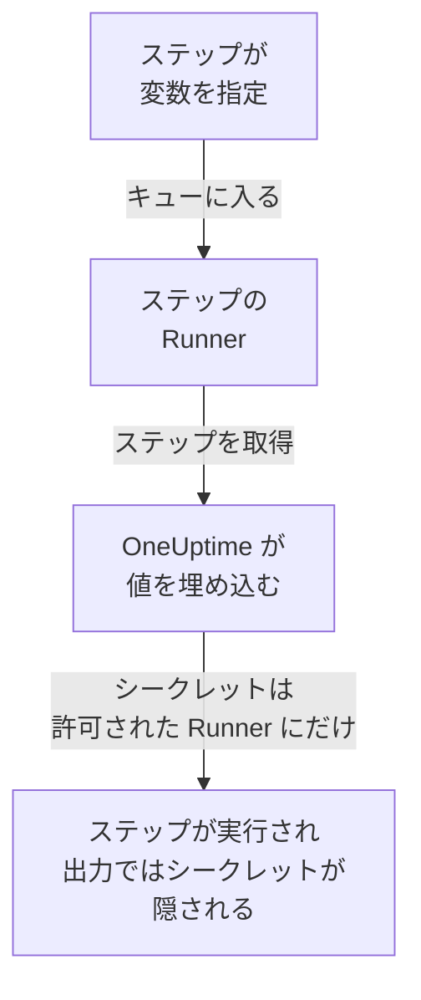

# Runbook の変数

Runbook の変数は、ステップが値そのものを持つ代わりに名前で使う値です。ホスト、namespace、URL のほか、SSH の鍵、パスワード、kubeconfig、API トークンなどのシークレットを入れられます。値を一度変えれば、それを指定しているすべてのステップが次の実行から新しい値を使います。シークレットは暗号化され、二度と表示されず、ステップの出力では隠されます。

:::cards
- [変数を作成する](#変数を作成する): 通常の値、またはシークレットとそれを使える Runner。
- [ステップで変数を使う](#ステップで変数を使う): スクリプトや HTTP リクエストの中で、または SSH ステップのサインインや kubectl ステップの kubeconfig として。
- [シークレットを受け取るもの](#シークレットを受け取るもの): 自社の Runner、許可した場合のグローバル Runner、HTTP リクエストのステップでは OneUptime 自身。
:::

## 変数がステップに届くしくみ



ステップが持つのは変数の名前で、値は持ちません。ステップの Runner がそれを取得すると、OneUptime が値を埋め込み (スクリプト、SSH ステップの接続先とサインイン、kubectl ステップの kubeconfig)、その Runner にだけ渡します。使えない変数を指定したステップは、値の代わりに名前を入れたまま実行されるのではなく、理由を示して失敗します。

変数を使うのは Bash、JavaScript、SSH、kubectl、HTTP リクエストのステップです。AI のステップは変数を埋め込みません。HTTP リクエストのステップは Runner を使わず OneUptime 自身が送るので、指定したすべての変数をシークレットも含めて受け取り、記録する応答ではそれらを隠します。

## グローバル変数と Runbook の変数

| | グローバル変数 | Runbook 自身の変数 |
| --- | --- | --- |
| 管理する場所 | **Runbook → 設定 → グローバル変数** | Runbook の **設定 → 変数** |
| 使うもの | プロジェクトのすべての Runbook | その Runbook のステップだけ |
| ステップでの書き方 | `{{global.variables.NAME}}` | `{{local.variables.NAME}}` |

名前は、大文字と小文字を区別せず、プロジェクトのグローバル変数の中で一度だけ、Runbook 自身の変数の中でも一度だけ使えます。Runbook の変数はグローバル変数と同じ名前にできます。それぞれ書き方が異なるためです。

## 始める前に

- **変数を管理できるロール。** Project Owner と Project Admin、または **Create Runbook Variable** 権限です。Runbook Admin は自分が書くステップで選ぶために変数を読めますが、変更はできません。
- **変数を含むプラン。** OneUptime Cloud では、Runbook の変数には **Growth** 以上のプランが必要です。

## 変数を作成する

:::steps
### 変数を開く

**Runbook → 設定 → グローバル変数** または Runbook の **設定 → 変数** を開き、 **変数を作成** をクリックします。

### 名前を付けて値を入力する

**変数** ステップで **名前** を入力します。使えるのは英字、数字、ハイフン、アンダースコアで、100 文字までです (例: `PROD_DB_SSH_KEY`)。 **シークレット** は最初からオンです。鍵、パスワード、トークン、kubeconfig を **シークレットの値** に貼り付け、 **次へ** をクリックします。ホストのように誰が読んでもよい値の場合は、 **シークレット** をオフにして **値** に入力し、 **変数を作成** をクリックします。任意の **説明** は **その他の項目** にあります。

### シークレットを使えるものを選ぶ

**使用できるもの** ステップで、 **使用できる Runner** から自社の Runner を選びます。[グローバル Runner](/docs/runbooks/agents#グローバル-runner) があるサーバーでは、 **グローバル Runner が使用できる** をオンにすると、このプロジェクトのステップのうちグローバル Runner で実行されるものもシークレットを使えます。プロジェクトがグローバル Runner を使っている間は、最初からオンです。シークレットにはどちらかが必要です。 **変数を作成** をクリックします。
:::

変数がシークレットかどうかは後から変えられません。代わりに削除し、同じ名前で作り直してください。ステップは変数を名前で指定するので、そのまま動き続けます。Kubernetes エージェントのチャートがインストールするクラスター内の Runner には、シークレットは決して渡されません。

## シークレットの値は書き込み専用

シークレットの値は保存時に暗号化され、API は **決して返しません** 。ダッシュボードにも、ワークフローにも、エクスポートにも返しません。一覧では通常の変数が値を表示する場所に **シークレット** と表示され、 **Runner** 列には各シークレットを受け取る Runner が表示されます。変更するには、その行の **値を置き換え** をクリックします。新しい値は暗号化され、古い値は完全に消え、ステップは次の実行から新しい値を受け取ります。

ステップが受け取ったシークレットを出力すると、Runner は出力がホストを離れる前にそれを `[REDACTED]` に置き換え、OneUptime も出力を保存する前にもう一度置き換えます。秘密鍵の 1 行や kubeconfig 内のトークンも隠されます。4 文字未満のシークレットは探されません。

## ステップで変数を使う

:::tabs
@tab スクリプトで
Bash、JavaScript、SSH、kubectl のスクリプトで、値を入れる場所に参照を書きます。

```bash
curl -s -X POST \
  -H "Authorization: Bearer {{global.variables.CDN_API_TOKEN}}" \
  "https://api.cdn.example.com/v1/purge"
```
@tab HTTP リクエストで
[HTTP リクエストのステップ](/docs/runbooks/authoring#http-request) の URL、ヘッダー、本文に参照を書きます。

```json
{ "Authorization": "Bearer {{global.variables.API_TOKEN}}" }
```
@tab SSH のサインイン
[SSH ステップ](/docs/runbooks/authoring#ssh) は、秘密鍵またはパスワードを持つシークレット変数を **サインイン方法** で選び、鍵のパスフレーズを **その他の項目 → 鍵のパスフレーズ** で選びます。鍵かパスワードかは値から判断されます。
@tab Kubeconfig
[kubectl ステップ](/docs/runbooks/authoring#kubectl) は、クラスターの kubeconfig を持つシークレット変数を **Kubeconfig** で選ぶか、Runner のものを使う **Runner 自身のアクセス** を選びます。
:::

Runbook の **ステップ** ページでは、各スクリプトと各 HTTP リクエストの下の **変数 — クリックでコピー** にそのステップが使える変数が並び、ステップが存在しない変数や Runner が使えないシークレットを指定しているとエディターが知らせます。

## シークレットを受け取るもの

| ステップを実行するもの | 通常の変数 | シークレット |
| --- | --- | --- |
| 自社の Runner | 常に | シークレットの **使用できる Runner** にその Runner がある場合 |
| グローバル Runner | 常に | **グローバル Runner が使用できる** がオンで、シークレット自身のプロジェクトのステップの場合 |
| OneUptime 自身 (HTTP リクエストのステップ) | 常に | 常に |

Runner が使えないシークレットを指定したステップは、シークレットの名前と変えるべき点を示して失敗し、何も渡されません。

## Runbook のシークレットと認証情報は変数になりました

Runbook の変数は、Runbook のシークレットと、SSH や Kubernetes のステップが指定していた認証情報に取って代わりました。OneUptime のアップグレード時に各プロジェクトの内容は一度だけ移され、すべての Runbook はこれまでどおりに動きます。

- Runbook のシークレットはそれぞれ、同じ名前、同じ値、同じ Runner、同じグローバル Runner のスイッチを持つシークレットのグローバル変数になりました。
- スクリプト内の `{{runbookSecrets.NAME}}` は `{{global.variables.NAME}}` に書き換えられ、古い書き方でもグローバル変数 `NAME` を読みます。
- ステップが指定していた認証情報はそれぞれ、同じ Runner を持つシークレットのグローバル変数になり、その名前に基づいて `<name>-ssh-key` (パスフレーズのある鍵なら `<name>-ssh-key-passphrase` も)、`<name>-ssh-password`、`<name>-kubeconfig` と名付けられました。
- 認証情報を指定していた SSH ステップはそれらで接続先にサインインし、コマンドをスクリプトとして実行します。Kubernetes ステップはそれぞれ kubectl ステップになり、そのアクションが行っていた `kubectl patch` を実行するので、ステップが持っていた以上のアクセス権は必要ありません。

このリリース (14.0.79) より古い Runner は kubectl のスクリプトを実行できず、kubectl ステップを失敗させて Runner を更新するよう表示します。このように移された Kubernetes ステップは、そのような Runner のために、まずスクリプトの横に認証情報とアクションを保持していました。それらは Runbook の認証情報とともになくなったため、すべての kubectl ステップには 14.0.79 以降の Runner が必要です。

その後 Runbook の認証情報は削除され、まだ認証情報を指定していたステップは先に同じ方法で移されました。認証情報を指定するステップはもう実行されず、そのステップのページには **スクリプトのステップに変換** が表示されます。API や Terraform でステップに認証情報を与える保存は拒否されます。[Runbook の認証情報は削除されました](/docs/installation/upgrading#runbook-の認証情報は削除されました) を参照してください。

## 次のステップ

:::cards
- [Runbook の作成](/docs/runbooks/authoring): 変数を使う SSH と kubectl のステップを書きます。
- [Runbook エージェント](/docs/runbooks/agents): シークレットが渡される Runner をインストールします。
- [Runbook の設定と安全性](/docs/runbooks/configuration): Runbook 全体の権限と強化。
:::
