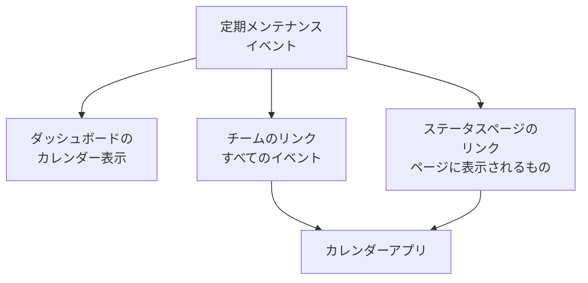

# メンテナンスカレンダー

メンテナンスカレンダーは、定期メンテナンスを日付ごとに表示します。ダッシュボードの専用ページで、秘密のリンクを通じてチームのカレンダーアプリで、そしてステータスページをフォローしている人たちのカレンダーで表示されます。そのページでは、祝日や変更凍結期間など、プロジェクト外のカレンダーをイベントと並べて表示することもできます。このページでは、カレンダーページ、外部カレンダー、チームのカレンダーリンク、ステータスページのカレンダー、そして各カレンダーの予定に含まれる内容を説明します。

:::cards
- [カレンダーページ](#カレンダーページ): すべてのイベントを月、週、日の単位で、状態の色で表示します。
- [外部カレンダー](#外部カレンダー): 祝日、変更凍結期間、他のチームのメンテナンスを、イベントと並べて表示します。
- [チームのカレンダーリンク](#チームのカレンダーリンク): プロジェクトのすべてのイベントを Google カレンダー、Outlook、Apple カレンダーに表示します。
- [ステータスページのカレンダー](#ステータスページのカレンダー): ステータスページに表示される内容を、訪問者のカレンダーに表示します。
- [カレンダーの予定に含まれる内容](#カレンダーの予定に含まれる内容): タイトル、時間枠、状態、元のページへのリンクです。
:::



## カレンダーページ

サイドメニューの **カレンダー** セクションにある **定期メンテナンス → メンテナンスカレンダー** を開きます。 **すべてのイベント** には同じイベントが一覧で表示されます。

- カレンダーは今月で開き、今日に印が付きます。 **月**、 **週**、 **日** で表示する範囲を変え、矢印で移動し、 **今日** で戻ります。時刻はあなた自身のタイムゾーンで表示されます。
- 各イベントは状態の色のブロックで、状態の色の名前はカレンダーの下に表示されます。イベントをクリックすると開きます。
- カレンダーの上のフィルターは一覧と同じように動作します。状態、ラベル、オーナーを選ぶと、そのイベントだけが表示されます。
- まだ来ていない日には、その週にポインターを合わせると **+** が表示されます。これを押すと **定期メンテナンスイベントを作成** が開き、 **開始日時** がその日の、フォームが今日なら選ぶ時刻に設定されます。イベントを作成できる人にだけ表示されます。
- 1 つの表示には最大 500 件のイベントが表示されます。それより多い月はその旨が表示されるので、フィルターで絞り込むか、週を表示してください。

以前の **すべてのイベント** は、一覧とカレンダーを切り替えられました。ブラウザーが最後にカレンダーのままにしていた場合、 **すべてのイベント** は一度だけ **メンテナンスカレンダー** を開き、それ以降は一覧になります。

## 外部カレンダー

カレンダーページには、プロジェクト外のカレンダーのイベントも表示できます。祝日、会社が別のカレンダーで管理している変更凍結期間、他のチームのメンテナンスなどです。OneUptime は各カレンダーを iCalendar（`.ics`）リンクから読み取り、そのイベントをあなたのイベントの横に、薄い色でカレンダー固有の色を使って描画します。読み取り専用で、メンテナンスイベントになることはなく、誰にも通知されず、プロジェクト自身のカレンダーリンクに含まれることもありません。

:::steps
### カレンダーを追加する

カレンダーの **⋯** メニューで **外部カレンダーを追加** を選ぶか、サイドメニューの **設定** セクションにある **定期メンテナンス → カレンダー設定** を開いて **外部カレンダーを追加** をクリックします。 **名前** を入力して **カレンダーリンク** を貼り付けます。 **その他の項目** には **色** と、読み取る頻度の **更新** があります。ほかを選ばない限り **毎時** です。

### 読み取られたことを確認する

OneUptime は新しいカレンダーをすぐに読み取ります。読み取られると **ステータス** に **正常** と表示され、 **最終読み取り** にはいつ読み取り、何件のイベントを保持したかが表示されます。読み取りに失敗すると **異常** と表示され、理由と対処法が示されます。

### 表示と非表示を切り替える

外部カレンダーには、それぞれカレンダーの下に名前付きの切り替えボタンがあります。非表示にしてもあなたにだけ適用され、ブラウザーがプロジェクトごとにその選択を記憶します。
:::

リンクはカレンダー自体の共有設定からコピーします。Google カレンダーなら iCal 形式の非公開アドレス、Outlook なら公開したカレンダーの ICS リンク、その他のアプリなら `.ics` または `webcal://` のリンクです。非公開のリンクでもかまいません。OneUptime は暗号化して保存し、二度と表示せず、 **リンクを変更** で置き換えられます。

| 操作 | 何が起きるか |
| --- | --- |
| **今すぐ読み取る** | 次回の読み取りを待たずに、今すぐカレンダーを読み取ります。 |
| **リンクを変更** | リンクを置き換えます。古いリンクのイベントは破棄され、新しいリンクがすぐに読み取られます。 |
| **オフにする** | 読み取りを止め、 **オンにする** まで全員に対してイベントを非表示にします。 |

各カレンダーは、90 日前から 1 年先までのイベントを、今日に近いものから最大 2,000 件保持します。5 MB を超えるカレンダーは読み取られません。繰り返しのイベント、その例外、タイムゾーンはカレンダーアプリが書いたとおりに読み取られ、終日のイベントはどのタイムゾーンでもその日付のままです。1 つのプロジェクトには最大 20 個の外部カレンダーを追加でき、カレンダーの 1 つのビューにはそれらのイベントが最大 500 件描画されます。

定期メンテナンスイベントを作成、編集、削除できるロールが外部カレンダーを追加、変更、削除でき、イベントを読み取れる人は誰でもカレンダー上でそれらを見られます。OneUptime は自身のサーバー上のアドレスやクラウドのメタデータアドレスを決して読み取らず、OneUptime Cloud はプライベートネットワーク上のアドレスを拒否します。セルフホストのサーバーは、 `DATA_SOURCE_BLOCK_PRIVATE_ADDRESSES` が `true` でない限り、自社ネットワーク上のカレンダーを読み取れます。

## チームのカレンダーリンク

カレンダーの下にある **カレンダーを購読** は、プロジェクトのカレンダーリンクを開きます。これは 1 つの秘密の iCalendar（`.ics`）リンクで、プロジェクトのすべての定期メンテナンスイベントを Google カレンダー、Outlook、Apple カレンダー、または URL でカレンダーを購読できる任意のアプリに表示します。

:::steps
### リンクを公開する

**リンクを公開** をクリックします。リンクはプロジェクトごとにチーム全体で 1 つなので、これは一度だけ必要です。

### カレンダーアプリに追加する

**Google カレンダー** は Google カレンダーを開き、カレンダーを追加するかどうかを尋ねられます。 **Apple カレンダー / Outlook** は、パソコンやスマートフォンのカレンダーアプリでリンクを開きます。 **リンクをコピー** は、ほかのアプリ用にリンクをコピーします。

### 動作を確認する

**ステータス** パネルには、カレンダーアプリが最後にリンクを読み込んだ日時と、そのアプリが表示されます。新しいリンクには、アプリが読み込むまで **初回同期待ち** と表示されます。
:::

リンクは次のような形式です。

```text
https://<your host>/api/scheduled-maintenance-calendar/project/<token>/maintenance.ics
```

> [!WARNING]
> リンクを持っている人は誰でも、サインインせずにプロジェクトのすべての定期メンテナンスイベントを見ることができます。パスワードと同じように扱い、誤って共有された場合は再生成してください。

### リンクを見られる人

リンクにはプロジェクトのすべてのイベントが表示されるため、ダイアログはすべてのイベントを読める人にだけリンクを表示します。ロールによって一部のイベント（ラベル別、または自分がオーナーのイベント）に制限されている人には、代わりにその理由が表示されます。

| 操作 | 実行できる人 |
| --- | --- |
| リンクのコピー | プロジェクトのすべての定期メンテナンスイベントを読める人 |
| **リンクを公開** | さらに定期メンテナンスイベントを作成できる人 |
| **リンクを再生成**、 **リンクを無効にする** | さらに定期メンテナンスイベントを編集できる人 |

### リンクの管理

**リンクを再生成** と **リンクを無効にする** は、ダイアログ上部の **⋯** メニューにあります。

| 操作 | 何が起きるか |
| --- | --- |
| **リンクを再生成** | 新しいリンクを作成します。古いリンクは 30 日間、空のカレンダーを返すので、それを持つアプリはコピーを消去します。その後は見つからなくなります。新しいリンクで購読し直してください。 |
| **リンクを無効にする** | リンクはそのまま残りますが、 **リンクを有効にする** まで空のカレンダーを返します。 |

カレンダーには、90 日前から 1 年先までのすべてのイベントが、最大 1,000 件まで含まれます。

## ステータスページのカレンダー

ステータスページをフォローしている人は、その定期メンテナンスを自分のカレンダーに追加できます。ステータスページの予定イベントのページにある **カレンダーを購読** は、Google カレンダー、デバイスのカレンダーアプリ、またはコピー用のリンクを提供します。リンクはページのアドレスの後に `/maintenance.ics` を付けたもので、たとえば `https://status.example.com/maintenance.ics` です。

- **含まれる内容。** ページに表示されるものとまったく同じです。ページの履歴期間内のイベント、まだ始まっていないすべてのイベント、進行中のすべてのイベントが、 **ステータスページに表示** がオンの間だけ、 **公開日時** を選んだ場合はその時刻から含まれます。各イベントが影響するものは、モニター自体の名前ではなく、ページがリソースに付けた名前で表示されます。
- **非公開ページ。** カレンダーアプリはサインインできないため、非公開ページには **カレンダーを購読** がなく、そのリンクはページが非公開であることを伝える空のカレンダーを返します。
- **1 つのイベント。** イベントのページにある **カレンダーに追加** は、そのイベントだけを追加します。Google カレンダーが入力済みの状態で開くか、デバイスのカレンダーアプリで開けるファイルとしてダウンロードされます。サインインした訪問者なら非公開ページでも使え、イベントが終了すると表示されなくなります。

## カレンダーの予定に含まれる内容

チームのカレンダーもステータスページのカレンダーも、予定を同じ方法で書き込みます。

| 部分 | 含まれる内容 |
| --- | --- |
| タイトル | イベントのタイトル |
| 開始と終了 | 予定された時間枠（UTC）。カレンダーアプリはあなた自身のタイムゾーンで表示します |
| 説明 | プレーンテキストの説明、状態、影響するもの、イベントへのリンク。チームのリンクではステータスページも示されます |
| ステータス | イベントが中止された場合（一度も進行中にならずに完了した場合）は「キャンセル」 |
| 空き時間か予定ありか | 「空き時間」。メンテナンスの時間枠があなたの空き状況をふさぐことはありません |
| カテゴリ | イベントのラベル。ステータスページのカレンダーでは、ページがラベルを表示する場合にのみ表示されます |

OneUptime で編集したイベントは、それを含むすべてのカレンダーでその場で更新され、削除されたイベントやステータスページから外されたイベントは、次の更新時にカレンダーから消えます。

## カレンダーの更新頻度

カレンダーアプリは、購読したリンクを独自のスケジュールで読み込みます。Google カレンダーは数時間ごと、ときには 1 日 1 回だけ、Apple カレンダーと Outlook はたいてい 1 時間ごとです。OneUptime がカレンダーを保持するのは最大 5 分なので、待ち時間はカレンダーアプリによるものです。各アプリの手順は [カレンダーフィード](/docs/on-call/calendar-feeds#カレンダーアプリで購読する) にあり、オンコールのシフトでも同じように動作します。

## トラブルシューティング

:::details カレンダーアプリに新しいイベントが表示されなくなった
リンクが再生成されたか、無効にされています。 **カレンダーを購読** を開いて状態を確認してください。再生成されたリンクは新しいリンクで購読し直す必要があり、無効にされたリンクは **リンクを有効にする** で元に戻ります。
:::

:::details Google カレンダーにリンクを追加できない
Google カレンダーは Google のサーバーからリンクを読み込むため、OneUptime サーバーにインターネットからアクセスできる必要があります。セルフホストのサーバーについては [カレンダーフィード](/docs/on-call/calendar-feeds#トラブルシューティング) を参照してください。
:::

:::details ステータスページのカレンダーにイベントがない
ページのカレンダーには、ページに表示されるものが含まれます。イベントがそのページを指定していること、イベントの **設定** で **ステータスページに表示** がオンになっていること、 **公開日時** があればその時刻を過ぎていること、ページの履歴期間内に始まったことを確認してください。
:::

:::details 外部カレンダーが「異常」と表示される
理由は **ステータス** の **異常** の下に表示されます。リンク先にカレンダーがない、リンクにサインインが必要か共有が解除された、サーバーがエラーを返した、カレンダーが 5 MB を超えている、イベントの繰り返しが多すぎて処理できない、のいずれかです。 **リンクを変更** でリンクを直すか、カレンダーが復旧したら **今すぐ読み取る** を使います。それまでは、最後に読み取れたときのイベントが表示されます。
:::

## 次のステップ

:::cards
- [メンテナンスイベントの作成](/docs/scheduled-maintenance/creating-events): フォームの各フィールドと、その後に起きること。
- [購読者とお知らせ](/docs/status-pages/subscribers#定期メンテナンスのイベント): ステータスページの購読者にメンテナンスについて伝えられる内容。
- [カレンダーフィード](/docs/on-call/calendar-feeds): オンコールのシフト用の同じ種類のリンク。
:::
