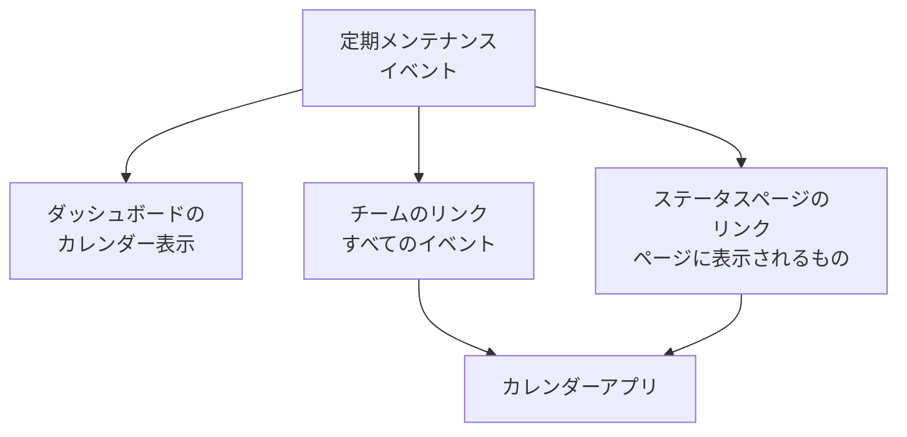

# メンテナンスカレンダー

メンテナンスカレンダーは、定期メンテナンスを日付ごとに表示します。ダッシュボードのカレンダーとして、秘密のリンクを通じてチームのカレンダーアプリで、そしてステータスページをフォローしている人たちのカレンダーで表示されます。このページでは、カレンダー表示、チームのカレンダーリンク、ステータスページのカレンダー、そして各カレンダーの予定に含まれる内容を説明します。

:::cards
- [カレンダー表示](#カレンダー表示): すべてのイベントを月、週、日の単位で、状態の色で表示します。
- [チームのカレンダーリンク](#チームのカレンダーリンク): プロジェクトのすべてのイベントを Google カレンダー、Outlook、Apple カレンダーに表示します。
- [ステータスページのカレンダー](#ステータスページのカレンダー): ステータスページに表示される内容を、訪問者のカレンダーに表示します。
- [カレンダーの予定に含まれる内容](#カレンダーの予定に含まれる内容): タイトル、時間枠、状態、元のページへのリンクです。
:::



## カレンダー表示

**定期メンテナンス → すべてのイベント** を開きます。フィルターバーの右端にある **リスト** と **カレンダー** で、イベントの表とそのカレンダーを切り替えます。ブラウザーが選択を記憶するので、次回はカレンダーでページが開きます。

- カレンダーは今月で開き、今日に印が付きます。 **月**、 **週**、 **日** で表示する範囲を変え、 **戻る**、 **次へ**、 **今日** で移動します。時刻はあなた自身のタイムゾーンで表示されます。
- 各イベントは状態の色のブロックで、状態の色の名前はカレンダーの下に表示されます。イベントをクリックすると開きます。
- カレンダーの上のフィルターは一覧と同じように動作します。状態、ラベル、オーナーを選ぶと、そのイベントだけが表示されます。
- まだ来ていない日には、その週にポインターを合わせると **+** が表示されます。これを押すと **定期メンテナンスイベントを作成** が開き、 **開始日時** がその日の、フォームが今日なら選ぶ時刻に設定されます。イベントを作成できる人にだけ表示されます。
- 1 つの表示には最大 500 件のイベントが表示されます。それより多い月はその旨が表示されるので、フィルターで絞り込むか、週を表示してください。

## チームのカレンダーリンク

カレンダーの下または一覧の **⋯** メニューにある **カレンダーを購読** は、プロジェクトのカレンダーリンクを開きます。これは 1 つの秘密の iCalendar（`.ics`）リンクで、プロジェクトのすべての定期メンテナンスイベントを Google カレンダー、Outlook、Apple カレンダー、または URL でカレンダーを購読できる任意のアプリに表示します。

:::steps
### リンクを公開する

**リンクを公開** をクリックします。リンクはプロジェクトごとにチーム全体で 1 つなので、これは一度だけ必要です。

### カレンダーアプリに追加する

**Google カレンダー** は Google カレンダーを開き、カレンダーを追加するかどうかを尋ねられます。 **Apple カレンダー / Outlook** は、パソコンやスマートフォンのカレンダーアプリでリンクを開きます。 **リンクをコピー** は、ほかのアプリ用にリンクをコピーします。

### 動作を確認する

**ステータス** パネルには、カレンダーアプリが最後にリンクを読み込んだ日時と、そのアプリが表示されます。新しいリンクには、アプリが読み込むまで **初回同期待ち** と表示されます。
:::

リンクは次のような形式です。

```text
https://<your host>/api/scheduled-maintenance-calendar/project/<token>/maintenance.ics
```

> [!WARNING]
> リンクを持っている人は誰でも、サインインせずにプロジェクトのすべての定期メンテナンスイベントを見ることができます。パスワードと同じように扱い、誤って共有された場合は再生成してください。

### リンクを見られる人

リンクにはプロジェクトのすべてのイベントが表示されるため、ダイアログはすべてのイベントを読める人にだけリンクを表示します。ロールによって一部のイベント（ラベル別、または自分がオーナーのイベント）に制限されている人には、代わりにその理由が表示されます。

| 操作 | 実行できる人 |
| --- | --- |
| リンクのコピー | プロジェクトのすべての定期メンテナンスイベントを読める人 |
| **リンクを公開** | さらに定期メンテナンスイベントを作成できる人 |
| **リンクを再生成**、 **リンクをオフにする** | さらに定期メンテナンスイベントを編集できる人 |

### リンクの管理

**リンクを再生成** と **リンクをオフにする** は、ダイアログ上部の **⋯** メニューにあります。

| 操作 | 何が起きるか |
| --- | --- |
| **リンクを再生成** | 新しいリンクを作成します。古いリンクは 30 日間、空のカレンダーを返すので、それを持つアプリはコピーを消去します。その後は見つからなくなります。新しいリンクで購読し直してください。 |
| **リンクをオフにする** | リンクはそのまま残りますが、 **リンクをオンにする** まで空のカレンダーを返します。 |

カレンダーには、90 日前から 1 年先までのすべてのイベントが、最大 1,000 件まで含まれます。

## ステータスページのカレンダー

ステータスページをフォローしている人は、その定期メンテナンスを自分のカレンダーに追加できます。ステータスページの予定イベントのページにある **カレンダーを購読** は、Google カレンダー、デバイスのカレンダーアプリ、またはコピー用のリンクを提供します。リンクはページのアドレスの後に `/maintenance.ics` を付けたもので、たとえば `https://status.example.com/maintenance.ics` です。

- **含まれる内容。** ページに表示されるものとまったく同じです。ページの履歴期間内のイベント、まだ始まっていないすべてのイベント、進行中のすべてのイベントが、 **ステータスページに表示** がオンの間だけ含まれます。各イベントが影響するものは、モニター自体の名前ではなく、ページがリソースに付けた名前で表示されます。
- **非公開ページ。** カレンダーアプリはサインインできないため、非公開ページには **カレンダーを購読** がなく、そのリンクはページが非公開であることを伝える空のカレンダーを返します。
- **1 つのイベント。** イベントのページにある **カレンダーに追加** は、そのイベントだけを追加します。Google カレンダーが入力済みの状態で開くか、デバイスのカレンダーアプリで開けるファイルとしてダウンロードされます。サインインした訪問者なら非公開ページでも使え、イベントが終了すると表示されなくなります。

## カレンダーの予定に含まれる内容

チームのカレンダーもステータスページのカレンダーも、予定を同じ方法で書き込みます。

| 部分 | 含まれる内容 |
| --- | --- |
| タイトル | イベントのタイトル |
| 開始と終了 | 予定された時間枠（UTC）。カレンダーアプリはあなた自身のタイムゾーンで表示します |
| 説明 | プレーンテキストの説明、状態、影響するもの、イベントへのリンク。チームのリンクではステータスページも示されます |
| ステータス | イベントが中止された場合（一度も進行中にならずに完了した場合）は「キャンセル」 |
| 空き時間か予定ありか | 「空き時間」。メンテナンスの時間枠があなたの空き状況をふさぐことはありません |
| カテゴリ | イベントのラベル。ステータスページのカレンダーでは、ページがラベルを表示する場合にのみ表示されます |

OneUptime で編集したイベントは、それを含むすべてのカレンダーでその場で更新され、削除されたイベントやステータスページから外されたイベントは、次の更新時にカレンダーから消えます。

## カレンダーの更新頻度

カレンダーアプリは、購読したリンクを独自のスケジュールで読み込みます。Google カレンダーは数時間ごと、ときには 1 日 1 回だけ、Apple カレンダーと Outlook はたいてい 1 時間ごとです。OneUptime がカレンダーを保持するのは最大 5 分なので、待ち時間はカレンダーアプリによるものです。各アプリの手順は [カレンダーフィード](/docs/on-call/calendar-feeds#カレンダーアプリで購読する) にあり、オンコールのシフトでも同じように動作します。

## トラブルシューティング

:::details カレンダーアプリに新しいイベントが表示されなくなった
リンクが再生成されたか、オフにされています。 **カレンダーを購読** を開いて状態を確認してください。再生成されたリンクは新しいリンクで購読し直す必要があり、オフにされたリンクは **リンクをオンにする** で元に戻ります。
:::

:::details Google カレンダーにリンクを追加できない
Google カレンダーは Google のサーバーからリンクを読み込むため、OneUptime サーバーにインターネットからアクセスできる必要があります。セルフホストのサーバーについては [カレンダーフィード](/docs/on-call/calendar-feeds#トラブルシューティング) を参照してください。
:::

:::details ステータスページのカレンダーにイベントがない
ページのカレンダーには、ページに表示されるものが含まれます。イベントがそのページを指定していること、イベントの **設定** で **ステータスページに表示** がオンになっていること、ページの履歴期間内に始まったことを確認してください。
:::

## 次のステップ

:::cards
- [メンテナンスイベントの作成](/docs/scheduled-maintenance/creating-events): フォームの各フィールドと、その後に起きること。
- [購読者とお知らせ](/docs/status-pages/subscribers#定期メンテナンスのイベント): ステータスページの購読者にメンテナンスについて伝えられる内容。
- [カレンダーフィード](/docs/on-call/calendar-feeds): オンコールのシフト用の同じ種類のリンク。
:::
