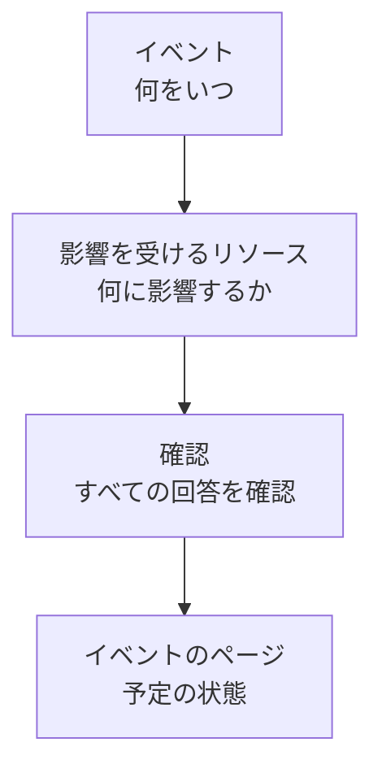

# メンテナンスイベントの作成

メンテナンスは 2 つの短いステップで予定できます。何がいつ起きるかを伝え、次に何に影響し誰に知らせるかを伝えます。入力が必要なのはタイトルだけで、ほかはすべて妥当な既定値で始まります。このページでは、フォーム、イベントを作成した瞬間に起きること、あとから変更する方法、コードからイベントを作成する方法を説明します。

:::cards
- [イベントを作成する](#イベントを作成する): 2 つのステップと確認。
- [作成時に起きること](#作成時に起きること): 番号、ルール、所有者、最初のメッセージ。
- [後で公開する](#後で公開する): 指定した日時まで、ステータスページに表示しないでおきます。
- [あとからイベントを変更する](#あとからイベントを変更する): 期間、リソース、ステータスページ、メモ。
- [コードからイベントを作成する](#コードからイベントを作成する): API、Terraform、ワークフロー、チャット。
:::

## 仕組み

フォームはステップごとに 1 つずつ、2 つの質問をし、イベントを作成する前にすべてを確認画面に表示します。イベントは予定の状態で始まり、そのページが開きます。



## 始める前に

- **ロール。** イベントの作成には **プロジェクト所有者**、 **プロジェクト管理者**、 **プロジェクトメンバー**、 **定期メンテナンス管理者**、 **定期メンテナンスメンバー** のいずれか、または **Create Scheduled Maintenance** を持つカスタムロールが必要です。
- **ステータスページ。** 顧客に知らせるには、定期メンテナンスイベントを表示するステータスページが必要です。 [ステータス ページ 概要](/docs/status-pages/index) を参照してください。

## イベントを作成する

:::steps
### フォームを開く

**定期メンテナンス → すべてのイベント** に移動し、 **定期メンテナンスイベントを作成** をクリックします。フォームは最初のステップ **イベント** で開きます。

### 何がいつ起きるかを伝える

**タイトル** を入力し、役立つなら **説明** を追加します。説明は Markdown で、ステータスページに表示されます。 **開始日時** はすでにあなたの時計の次の正時になっており、 **終了日時** はその 1 時間後です。間違っている場合だけ変更してください。 **開始日時** を動かすと **終了日時** も一緒に動き、期間の長さが保たれます。 **所有者** と **ラベル** は、折りたたまれた **その他の項目** の下にあります。

### 影響するものを選ぶ

**次へ** をクリックして **影響を受けるリソース** に進みます。作業が影響する **モニター** を選びます。1 つ選ぶと、その下に **変更後のモニターステータス** が表示されます。イベント開始時にモニターが変わるステータスです。次に、ホスト、クラスター、データベース、ネットワークサイト、サービスなどの **その他の影響を受けるリソース** があれば選びます。

### 誰に知らせるかを選ぶ

**これらのステータスページにイベントを表示** でステータスページを選びます。折りたたまれた **購読者への通知** は、イベントがいつそれらのページに表示され、誰にいつ通知されるかを 1 行で示します。開くと **ステータスページへの公開** で **日時を指定** を選べるほか、 **イベントの予定作成時**、 **イベントの開始時**、 **イベントの終了時**、 **イベント前のリマインダー** を変更できます。

### 作成する

**次へ** をクリックして確認画面を表示し、内容を確認してから **定期メンテナンスイベントを作成** をクリックします。イベント自身のページが開きます。
:::

ステータスページを選ぶまで何も送信されません。どのステータスページにも表示されないイベントは、どの購読者にも通知しません。

## フォームの項目

| 項目                                 | ステップ           | 初期値                          | 役割                                                                             |
| ------------------------------------ | ------------------ | ------------------------------- | -------------------------------------------------------------------------------- |
| **タイトル**                         | **イベント**       | 空、必須                        | ステータスページを含め、あらゆる場所でイベントの名前になります。                 |
| **説明**                             | **イベント**       | 空                              | 作業内容を顧客に Markdown で説明します。                                         |
| **開始日時**                         | **イベント**       | 次の正時                        | イベントが自動で開始する時刻です。                                               |
| **終了日時**                         | **イベント**       | **開始日時** の一時間後         | イベントが自動で終了する時刻です。 **開始日時** より後である必要があります。      |
| **所有者**                           | **イベント**       | なし                            | イベントを所有し、通知を受けるユーザーとチームです。                             |
| **ラベル**                           | **イベント**       | なし                            | ルールとフィルターが照合できるラベルです。                                       |
| **モニター**                         | **影響を受けるリソース** | なし                      | イベントの実施中にチェックされないモニターです。                                 |
| **変更後のモニターステータス**       | **影響を受けるリソース** | 変更なし                  | イベント中にそれらのモニターが表示するステータスです。モニターを選ぶと尋ねられます。 |
| **その他の影響を受けるリソース**     | **影響を受けるリソース** | なし                      | ホスト、クラスター、データベース、ネットワークサイト、サービスなどです。         |
| **これらのステータスページにイベントを表示** | **影響を受けるリソース** | なし              | イベントを表示し、購読者に通知するステータスページです。                         |
| **購読者への通知**                   | **影響を受けるリソース** | すぐに公開、すべてのタイミングがオン、リマインダーなし | イベントがそれらのページに表示されるタイミングと、その購読者に通知するタイミングです。 |

入力を進めると、次の 2 つがフォームを自動で埋めます。

- **リンクされたリソース。** モニターを選ぶと、そのモニターにリンクされたホスト、クラスター、サービスなどのリソースが **その他の影響を受けるリソース** に追加され、項目の下の 1 行にその名前が表示されます。不要なものは削除してください。クラウド リソースは追加されません。メンテナンスイベントはクラウド リソースを持たないためです。
- **提案されるステータスページ。** **これらのステータスページにイベントを表示** の下に、モニターを表示しているページが提案されます。ページ名をクリックして追加するか、 **すべて追加** をクリックします。自動では何も選ばれません。 [定期メンテナンスのイベント](/docs/status-pages/subscribers#定期メンテナンスのイベント) を参照してください。

## リソースまたはテンプレートから始める

ホスト、Kubernetes・Proxmox・Ceph・Docker Swarm のクラスター、Docker または Podman のホスト、vCenter、ストレージアレイ、IoT フリート、データベース、サービス、ネットワークサイトの **定期メンテナンス** タブでは、 **定期メンテナンスイベントを作成** が同じフォームを開き、そのリソースが **その他の影響を受けるリソース** に選択済みになります。タブには、そのリソースに影響するイベントが一覧表示されます。インベントリ項目のタブでは、その項目が指すホスト、サービス、Kubernetes クラスターが選択されます。

作成ボタンの横の **テンプレートから作成** は **定期メンテナンステンプレートを選択** を求め、テンプレートから埋めたフォームを開きます。 [テンプレートと繰り返しイベント](/docs/scheduled-maintenance/templates) を参照してください。

## 作成時に起きること

**定期メンテナンスイベントを作成** をクリックした瞬間、OneUptime は次のステップをこの順序で実行します。

1. **番号と状態が付きます。** 番号はプロジェクトごとのカウンターから採番され、プレフィックス付きで表示されます（`SM-42`）。リクエストでどの状態を指定しても、イベントは予定の状態で始まります。
2. **チャットツールに知らされます。** **ワークスペース** の Slack と Microsoft Teams のルールがイベントをチャンネルに投稿し、ルールによってはイベント用のチャンネルを作成できます。フィードには作成されたことが記録されます。
3. **状態タイムラインが始まります。** **状態タイムライン** の最初の行は予定の状態です。
4. **所有者とラベルが追加されます**。選んだもの、次に一致した所有者ルールとラベルルールのものです。
5. **Runbook ルールが開始します**。イベントに一致する Runbook を開始します。
6. **リマインダーが予定されます**。リマインダールールが一致した場合に、所有者向けに予定されます。

公開から 1 分以内に（ **公開日時** を選んでいなければ公開はすぐです）、 **イベントの予定作成時** をオフにしていない限り、ステータスページの購読者にイベントが予定されたことが通知されます。ワークフロートリガー **On Create Scheduled Maintenance Event** はそれを使って作られたワークフローを開始し、所有者はその通知をオンにしていればイベントについて知らされます。 [通知設定](/docs/notifications/notification-settings) を参照してください。

## 後で公開する

作業は好きなだけ早く計画し、顧客に知らせるべき時までチーム内にとどめておけます。フォームか、イベントの **編集** の **ステータスページ** ステップで、 **ステータスページへの公開** の **日時を指定** を選び、 **開始日時** より前の **公開日時** を指定します。それまでイベントはどのステータスページにも表示されません。一覧にも、稼働率履歴にも、RSS と Atom のフィードにも、メンテナンスカレンダーにも、API にも、イベント自体のリンクにも出ません。その時刻になると近日予定として表示され、購読者に予定されたことが一度だけ通知されます。

| タイミング               | 起きること                                                   | ステータスページでの表示 |
| ------------------------ | ------------------------------------------------------------ | ------------------------ |
| 作成時                   | **開始日時** より前の **公開日時** を選びます                | 表示されない             |
| **公開日時** になったとき | 公開され、購読者に予定されたことが通知されます              | 近日予定                 |
| **開始日時** になったとき | ほかのイベントと同じように開始します                        | 進行中                   |
| **終了日時** になったとき | 終了します                                                  | 終了済み                 |

- **それまで購読者には何も届きません。** イベントが待っている間、イベント前のリマインダー、状態の変更、公開ノートは購読者に送られません。
- **イベントのページに表示されます。** ヘッダーに **まだステータスページに表示されていません** と、表示が始まる時刻が示され、 **今すぐ公開** を押すと確認のうえすぐに公開されます。 **設定** にも同じことが示され、イベントの一覧ではステータスページの下に時刻が表示されます。
- **変更する、またはすぐに公開する。** **編集** の **ステータスページ** ステップで **公開日時** を動かすか、 **すぐに** を選びます。 **設定** で **ステータスページに表示** をオフにすると、時刻にかかわらずステータスページに表示されなくなります。

## あとからイベントを変更する

フォームの内容はすべてイベント自身のページで変更できます。ただし、購読者への 3 つのタイミングは、イベントの作成時に一度だけ設定されます。

| 変更するもの                                | 場所                                                                           |
| ------------------------------------------- | ------------------------------------------------------------------------------ |
| タイトル、期間、ラベル                      | **概要** の **メンテナンスの詳細** カードの **編集**、ステップ **イベント**      |
| ステータスページ、公開のタイミング、またはリマインダー | 同じ **編集**、ステップ **ステータスページ**                       |
| モニター、そのステータス、その他のリソース  | **影響を受けるリソース** カードの **編集**                                     |
| 説明                                        | サイドメニューの **説明**                                                      |
| 所有者                                      | サイドメニューの **所有者**                                                    |

**変更後のモニターステータス** は、イベントが始まるまで変更できます。始まった後は、モニターがすでにそのステータスになっているため、カードには読み取り専用で表示されます。編集すると、変更内容を示すエントリーが **定期メンテナンスのフィード** に追加されます。何も変更せずに保存した場合は追加されません。

## 作業の進行に合わせてメモを投稿する

- **公開メモ** は顧客向けの更新情報です。イベントのステータスページに表示され、それぞれ **ステータスページの購読者に通知** で購読者に通知できます。
- **非公開メモ** はチーム専用です。

イベントの **公開メモ** または **非公開メモ** ページで書くか、 **定期メンテナンスのフィード** の **アクション** メニューから **公開メモを追加** または **非公開メモを追加** で書きます。同じメニューの **Runbook を実行** で Runbook を実行できます。メモテンプレートは、チームがよく書くテキストを埋めます。 [メンテナンスのルールと設定](/docs/scheduled-maintenance/settings#メモテンプレート) を参照してください。

## コードからイベントを作成する

イベントのモデルには標準の API があるので、 `POST /api/scheduled-maintenance` でイベントを作成できます。 **プロジェクト設定 → 詳細 → API キー** の API キーを `apikey` ヘッダーで送って認証します。キーによってプロジェクトが決まります。

```bash
curl -X POST https://oneuptime.com/api/scheduled-maintenance \
  -H "apikey: $ONEUPTIME_API_KEY" \
  -H "Content-Type: application/json" \
  -d '{
    "data": {
      "title": "Database upgrade",
      "description": "Writes pause for a few minutes while the primary restarts.",
      "startsAt": "2030-06-01T02:00:00Z",
      "endsAt": "2030-06-01T04:00:00Z"
    }
  }'
```

| フィールド                                            | 注記                                                                                      |
| ----------------------------------------------------- | ----------------------------------------------------------------------------------------- |
| `title`, `startsAt`, `endsAt`                          | フォームと同じく必須です。                                                                |
| `monitors`, `statusPages`, `labels`                   | イベントのモニター、ステータスページ、ラベル。いずれも API キーのプロジェクトのものです。 |
| `changeMonitorStatusToId`                             | イベント開始時にモニターが変わるモニターステータスです。                                  |
| `currentScheduledMaintenanceStateId`                  | 無視されます。すべてのイベントは予定の状態で始まります。                                  |
| `shouldStatusPageSubscribersBeNotifiedOnEventCreated` | **イベントの予定作成時** のスイッチです。ほかの二つのタイミングにはそれぞれ専用のフィールドがあります。 |
| `publishOnStatusPageAt`                               | イベントがステータスページに公開され、購読者に予定されたことが通知される日時です。省略するとすぐに公開されます。 |

コードとしての同じイベントは Terraform リソース `oneuptime_scheduled_maintenance_event` です。 [例](/docs/terraform/examples#予定メンテナンス) を参照してください。ワークフローは **Create One Scheduled Maintenance Event** ステップでイベントを作成し、 `/oneuptime maintenance` は Slack でフォームを開きます。 [Slack](/docs/workspace-connections/slack#slack-からインシデントとメンテナンスを作成する) を参照してください。

## トラブルシューティング

:::details 終了日時は開始日時より後である必要があると表示される
期間は順序どおりである必要があります。イベントは開始した後に終了します。 **終了日時** は **開始日時** に連動するので、先に **開始日時** を動かしてから **終了日時** を設定してください。
:::

:::details フォームに変更後のモニターステータスがない
イベントにモニターがある場合にだけ尋ねられます。 **モニター** で 1 つ選ぶと、そのすぐ下に表示されます。
:::

:::details 変更後のモニターステータスをもう変更できない
イベントはすでに始まっており、モニターはすでにそのステータスになっています。このステータスは、イベントの開始から終了まで適用されます。
:::

:::details 公開日時は開始日時より前である必要があると表示される
イベントを公開するのは、作業が始まる前に顧客に知らせるためです。 **開始日時** より前の **公開日時** を選ぶか、 **すぐに** を選んでください。
:::

## 次のステップ

:::cards
- [メンテナンスの状態](/docs/scheduled-maintenance/states): イベントを開始・終了させるものと、手動で進める方法。
- [テンプレートと繰り返しイベント](/docs/scheduled-maintenance/templates): フォームの回答を次回のために保存します。
- [購読者とお知らせ](/docs/status-pages/subscribers#定期メンテナンスのイベント): 誰にいつ通知されるのか、正確に。
- [メンテナンスのルールと設定](/docs/scheduled-maintenance/settings): 所有者、ラベル、リマインダーを自動で追加します。
:::
