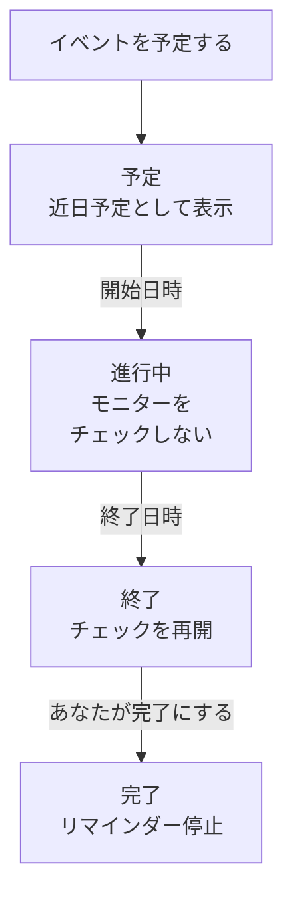

# 定期メンテナンスの概要

定期メンテナンスイベントは、計画された作業を実施前に全員へ知らせます。データベースのアップグレード、ネットワークの変更、新しいサーバーへの移行などです。OneUptime はイベントを予定どおりに開始・終了し、作業中は影響を受けるモニターのチェックを止め、イベントをステータスページに表示するので、計画的なダウンタイムが障害に見えることはありません。このページでは、イベントの進み方、ダッシュボードでの各機能の場所、イベントが OneUptime のほかの部分に与える変化を説明します。

:::cards
- [イベントの進み方](#イベントの進み方): 予定から完了まで、ほとんど自動で進みます。
- [イベントの作成元](#イベントの作成元): 作成フォーム、テンプレート、スケジュール、フォーム機能、チャット、コード。
- [イベントが影響するもの](#イベントが影響するもの): モニター、ステータスページ、購読者、アラート。
- [イベント固有のページ](#イベント固有のページ): 概要、タイムライン、メモ、設定。
:::

## イベントの進み方

各イベントには計画された期間、つまり **開始日時** と **終了日時** があり、メンテナンスの状態の一覧を上から下へ進みます。毎分実行されるジョブが期間の両端でイベントを次へ進めるので、作業を一度予定すれば、あとは OneUptime が処理します。

新しいイベントは **予定** から始まります。 **開始日時** になると **進行中** に移ります。OneUptime はそのモニターのチェックを止め、モニター用のステータスを選んでいればそのステータスで表示します。 **終了日時** になると **終了** に移ります。チェックが再開され、各モニターは稼働中に戻ります。 **完了** は最後のステップで、自動では進みません。担当者、チャットのボタン、または API が作業を承認済みにし、それによって所有者へのリマインダーも止まります。

イベントを早めに開始または終了したり、この 4 つの間に独自の状態を追加したりできます。 [メンテナンスの状態](/docs/scheduled-maintenance/states) を参照してください。

## メンテナンスとお知らせ

どちらもステータスページの訪問者に何かを伝えます。開始と終了がある作業にはメンテナンスイベントを、それ以外に読んでほしいことにはお知らせを使います。

|                              | 定期メンテナンス                                                        | お知らせ                                       |
| ---------------------------- | ----------------------------------------------------------------------- | ---------------------------------------------- |
| **内容**                     | 期間を伴う計画された作業                                                | ステータスページの訪問者へのメッセージ         |
| **モニター**                 | 実施中はチェックされず、選んだステータスで表示される                    | 変わらない                                     |
| **進み方**                   | メンテナンスの状態を予定どおりに進む                                    | 開始時刻から終了時刻まで表示される（終了時刻がある場合） |
| **購読者に通知されるタイミング** | 予定作成時、開始時、終了時。希望すれば開始前にも                    | 表示が始まったときに一度だけ                   |
| **新しいプロジェクトでの番号** | `SM-42`                                                               | なし                                           |

お知らせについては [購読者とお知らせ](/docs/status-pages/subscribers#お知らせ) で説明しています。

## イベントの作成元

- **作成フォーム。** イベントの一覧、またはホスト、クラスター、サービス、ネットワークサイトなどのリソースの **定期メンテナンス** タブで **定期メンテナンスイベントを作成** をクリックします。リソースのタブからなら、そのリソースが選択された状態になります。 [メンテナンスイベントの作成](/docs/scheduled-maintenance/creating-events) を参照してください。
- **テンプレート。** **テンプレートから作成** は、よく行う作業用に保存したテンプレートからフォームを埋めます。 [テンプレートと繰り返しイベント](/docs/scheduled-maintenance/templates) を参照してください。
- **スケジュール。** 繰り返しテンプレートは、毎週や毎月などのスケジュールで、誰もフォームを開かずに新しいイベントを作成します。
- **フォーム機能。** 送信によってメンテナンスイベントを作成するフォームは、変更リクエストをイベントに変えます。 [送信で作成されるもの](/docs/forms/on-submit#送信が定期メンテナンスイベントになるまで) を参照してください。
- **チャット。** Slack の `/oneuptime maintenance`、または Microsoft Teams で OneUptime ボットに送った `maintenance` で、チャットツール内にフォームが開きます。 [Slack](/docs/workspace-connections/slack#slack-からインシデントとメンテナンスを作成する) を参照してください。
- **コード。** `/api/scheduled-maintenance` の API、Terraform リソース `oneuptime_scheduled_maintenance_event`、ワークフローの **Create One Scheduled Maintenance Event** ステップです。

## ダッシュボードでのメンテナンスの場所

上部バーの **製品** メニューから **定期メンテナンス** を開きます。イベントの一覧は `/dashboard/{projectId}/scheduled-maintenance-events` にあり、そのサイドメニューにメンテナンスに関するすべてがあります。

| セクション    | できること                                                                                                                 |
| ------------- | -------------------------------------------------------------------------------------------------------------------------- |
| **概要**      | **すべてのイベント** と **進行中のイベント**。バッジには現在進行中のイベントの数が表示されます。                             |
| **カレンダー** | **メンテナンスカレンダー**。すべてのイベントを月、週、日の単位で、追加したプロジェクト外のカレンダーと並べて表示します。 |
| **ワークスペース** | プロジェクトが接続しているほうの **Slack** と **Microsoft Teams**、どちらもない場合は **Slack または Teams を接続**。   |
| **ルール**    | **所有者ルール**、 **Runbook ルール**、 **ラベルルール**、 **リマインダールール**。                                         |
| **設定**      | **イベントの状態**、 **イベントテンプレート**、 **メモテンプレート**、 **カスタムフィールド**、 **測定値**、 **カレンダー設定**、 **採番**。 |

**概要** と **カレンダー** は開いた状態です。 **ワークスペース**、 **ルール**、 **設定**、 **開発者** は折りたたまれた状態で始まり、そのセクションのページを開いているときは自動で開きます。 **開発者** には、コードからメンテナンスを管理するための **Terraform**、 **API**、 **AI アシスタント** があります。メンテナンスに関するものはすべてここにあり、 **プロジェクト設定** にはありません。

一覧には **定期メンテナンス番号**、 **タイトル**、 **現在の状態**、 **影響を受けるリソース**、 **ステータスページに表示**、 **開始日時**、 **期間**、 **終了日時**、 **ラベル**、 **所有者** が表示されます。イベントを選択すると、複数をまとめて操作できます。 **「{{state}}」にする**、 **状態を変更**、 **自分に割り当て**、 **所有者を追加**、 **所有者を削除**、 **ラベルを追加**、 **ラベルを削除**、 **削除** です。各イベントの行末にある **⋯** メニューでは、そのイベントだけに同じ操作ができます。イベントが進めるあいだは **「{{state}}」にする** の各段階、そして **状態を変更**、まだ所有者でなければ **自分に割り当て**、さらに **所有者を追加** です。

**カレンダー** セクションの **メンテナンスカレンダー** は、同じイベントを月、週、日の単位で表示し、プロジェクト外のカレンダーを並べて表示することもできます。 [メンテナンスカレンダー](/docs/scheduled-maintenance/calendar) を参照してください。

## イベントが影響するもの

イベントの実施中、OneUptime はイベントが計画する停止を想定内として扱います。

- **モニターはチェックされません。** **モニター** の各モニターはチェックされなくなり、各モニターのページには **このモニターは無効です** と表示されます。 **変更後のモニターステータス** を選んだ場合、モニターはステータスページでもそのステータスを表示します。イベントが終了するか削除されると、チェックが再開され、各モニターは稼働中に戻ります。ただし、実施中の別のイベントがまだそのモニターを押さえている場合は除きます。
- **ほかのリソースも静かなままです。** 多数のホスト、クラスター、データベース、サービスをそれぞれ 1 系列ずつ監視するテレメトリモニターは、イベントが対象とするリソースの系列についてインシデントもアラートも作成せず、ほかの系列は引き続きアラートを出します。
- **ネットワークサイトと SLO も抑えられます。** イベントが対象とするネットワークサイトは、計画的な停止を上位のサイトに対して数えなくなり、SLO のバーンレートルールは、そのモニターのいずれかがメンテナンス中である間は何も作成しません。 [ネットワークサイト](/docs/monitor/network-sites#ネットワークサイトの定期メンテナンス) と [バーンレートアラートとインシデント](/docs/slo/burn-rate-alerts#定期メンテナンス) を参照してください。
- **ステータスページに表示されます。** イベントは選んだステータスページに、まず近日予定として、次に進行中として、最後に終了済みとして表示されます。ただし、イベントの **設定** で **ステータスページに表示** がオンになっている間だけで、 **公開日時** を選んだ場合はその時刻からです。開始後は、それらのページで、そのモニターがある各リソースの稼働率履歴の、期間がかかる各日にも表示され、進行中はそれらのリソースに「メンテナンス中」と表示されます。ダッシュボードのモニターの稼働率履歴にも同じように表示されます。[稼働率と履歴チャート](/docs/status-pages/resources-and-groups#稼働率と履歴チャート) を参照してください。
- **購読者に知らされます。** 既定では、それらのページの購読者は、イベントが予定されたとき、開始したとき、終了したときに通知を受け、リマインダーを設定していれば開始前にもリマインドされます。 [定期メンテナンスのイベント](/docs/status-pages/subscribers#定期メンテナンスのイベント) を参照してください。
- **チームに知らされます。** 所有者は各自の [通知設定](/docs/notifications/notification-settings) どおりに通知を受け、 **ワークスペース** の Slack と Microsoft Teams のルールがイベントをチャンネルに投稿します。

## イベント固有のページ

一覧からイベントを開くと、そのページが表示されます。サイドメニューには次のものがあります。

| サイドメニューのセクション | ページ                                                                              |
| ----------------- | --------------------------------------------------------------------------------------------- |
| **概要** | **概要**、 **状態タイムライン**、 **説明**、 **Runbook** |
| **チーム** | **所有者** |
| **通知**          | **通知ログ** と **AI ログ**。イベントについて送信されたすべてのメッセージと、AI がイベントのために行ったこと |
| **メモ**          | **非公開メモ** と **公開メモ**                                                                 |
| **開発者**        | **Terraform**、 **API**、 **AI アシスタント**。コードから管理するイベント                      |
| **詳細**          | **カスタムフィールド**、 **設定**、 **監査ログ**、 **イベントを削除**                          |

**概要**、**チーム**、**メモ** は開いた状態です。ほかのセクションはクリックするまで折りたたまれています。

- **概要** — ヘッダーには、イベントの番号、タイトル、状態、開始までの時間または実施中の経過時間、所有者、表示されるステータスページ、作成者、そしてイベントを次へ進めるボタンが表示されます。その下の **開始**、 **終了**、 **期間** は、計画された期間をあなたのタイムゾーンで表示します。 **定期メンテナンスのフィード** はイベントに起きたことをすべて記録し、その横に **メンテナンスの詳細** と **影響を受けるリソース** のカード、さらにプロジェクトにある場合は **測定値** と **カスタムフィールド** のカードが並びます。
- **状態タイムライン** — イベントがこれまでにあったすべての状態と、その時刻と長さ。 [メンテナンスの状態](/docs/scheduled-maintenance/states#状態タイムライン) を参照してください。
- **公開メモ** — ステータスページとその購読者向けの更新情報です。 **非公開メモ** はチーム専用です。
- **設定** — ステータスページでのイベントの表示・非表示を切り替える **ステータスページに表示** と、完了するまで所有者にリマインドする **リマインダーを送信**。どちらのスイッチも切り替えた時点で保存されます。

## トラブルシューティング

:::details イベントが開始日時に開始しなかった
イベントを開始するジョブは毎分実行されるので、1 分待ってください。ヘッダーに **開始予定を過ぎています** と表示されている場合、イベントは開始を 2 分以上過ぎています。ジョブと同じ処理をすべて行うヘッダーのボタンで開始し、 **状態タイムライン** を開いてどの状態にあったかを確認してください。
:::

:::details メンテナンス中もモニターがチェックされた
チェックが止まるのは、イベントが **モニター** に挙げたモニターだけで、しかもイベントの実施中だけです。イベントが **その他の影響を受けるリソース** に挙げたホストやサービスのモニターは、引き続きチェックされます。モニターを追加するには、イベントの **影響を受けるリソース** カードを編集してください。
:::

:::details イベントがステータスページに表示されない
イベントが **これらのステータスページにイベントを表示** でそのページを指定していること、イベントの **設定** で **ステータスページに表示** がオンになっていることを確認してください。ヘッダーに **まだステータスページに表示されていません** とあれば、 **公開日時** から表示されます。 [後で公開する](/docs/scheduled-maintenance/creating-events#後で公開する) を参照してください。次にステータスページ自体を確認します。定期メンテナンスイベントを表示する設定である必要があり、ページの履歴期間（変更していなければ 14 日）より前に始まったイベントは表示されなくなります。
:::

## 次のステップ

:::cards
- [メンテナンスイベントの作成](/docs/scheduled-maintenance/creating-events): フォームの各項目と、その後に起きること。
- [メンテナンスの状態](/docs/scheduled-maintenance/states): イベントを開始・終了させるものと、独自の状態。
- [テンプレートと繰り返しイベント](/docs/scheduled-maintenance/templates): イベントを再利用するか、毎週予定します。
- [メンテナンスのルールと設定](/docs/scheduled-maintenance/settings): 所有者、ラベル、Runbook、リマインダーを自動で。
:::
