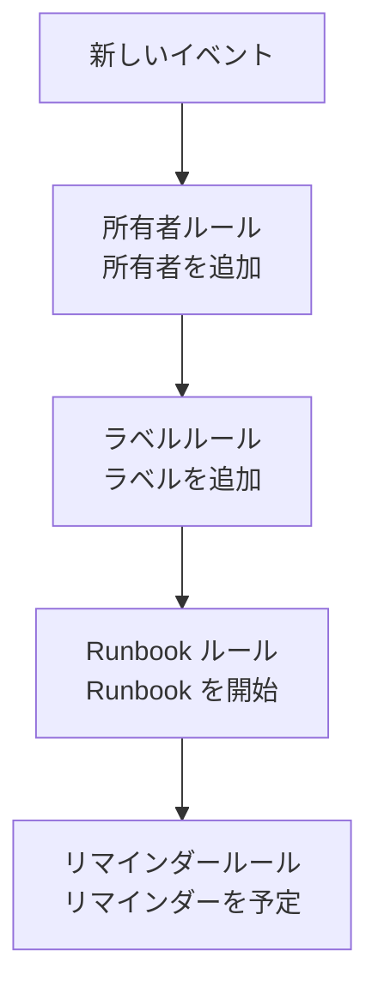

# メンテナンスのルールと設定

メンテナンスの構成は **プロジェクト設定** ではなく **定期メンテナンス** の中にあります。新しいイベントすべてに作用するルールと、プロジェクト内のすべてのイベントを形作る設定です。このページは、それぞれの設定と、それを変更できる人についてのリファレンスです。

:::cards
- [新しいイベントが通過するルール](#新しいイベントが通過するルール): 順序と、それぞれの働き。
- [リマインダールール](#リマインダールール): イベントが完了するまで所有者にリマインドします。
- [設定](#設定): メモテンプレート、カスタムフィールド、測定値、採番。
- [変更できる人](#変更できる人): メンテナンスのロールとプラン。
:::

## メンテナンスの設定の場所

上部バーの **製品** メニューから **定期メンテナンス** を開きます。サイドメニューの **ルール** と **設定** のセクションは最初は折りたたまれているので、まず展開してください。ここにあるページはすべてプロジェクト全体に適用され、アドレスは `/dashboard/{projectId}/scheduled-maintenance-events/settings/` で始まります。

| ルールのページ     | 働き                                                                |
| ------------------ | ------------------------------------------------------------------- |
| **所有者ルール**   | 一致したイベントに所有者を追加します。                              |
| **Runbook ルール** | 一致したイベントの Runbook を開始します。                           |
| **ラベルルール**   | 一致したイベントにラベルを追加します。                              |
| **リマインダールール** | イベントが完了するまで、一定の間隔で所有者にリマインドします。  |

**設定** セクションには、 [メンテナンスの状態](/docs/scheduled-maintenance/states) で説明する **イベントの状態**、 [テンプレートと繰り返しイベント](/docs/scheduled-maintenance/templates) で説明する **イベントテンプレート**、そして **メモテンプレート**、 **カスタムフィールド**、 **測定値**、 **カレンダー設定**、 **採番** があります。 **カレンダー設定** は [メンテナンスカレンダー](/docs/scheduled-maintenance/calendar#外部カレンダー) で、残りは以下で説明します。

**ワークスペース** セクションには、イベントをチャンネルに投稿する Slack と Microsoft Teams のルールがあります。 [Slack](/docs/workspace-connections/slack#通知ルール) と [Microsoft Teams](/docs/workspace-connections/microsoft-teams#通知ルール) を参照してください。

## 新しいイベントが通過するルール

複数のルールが一致したときの扱いはルールによって異なります。

- **所有者ルール**、 **ラベルルール**、 **Runbook ルール** は、一致したものがすべて作用します。複数のルールが追加する所有者とラベルは、一度だけ追加されます。
- **リマインダールール** は一覧の上から順に確認され、最初に一致したものが使われます。ルールをドラッグすると順番を変えられます。新しいルールは末尾に追加されます。

新しいルールは有効な状態で作成されます。一時停止するには編集フォームで **有効** をオフにします。一覧には各ルールに緑の **有効** または赤の **無効** が表示されます。所有者ルール、ラベルルール、Runbook ルールは、保存後に作成されたイベントに作用します。既存のイベントに所有者ルールやラベルルールを適用するには **今すぐ実行** を使います。 [既存のリソースに対してルールを実行する](/docs/configuration/run-rules-now) を参照してください。

## 所有者ルールとラベルルール

**所有者ルール** は一致した新しいイベントに所有者のユーザーとチームを追加し、 **ラベルルール** はラベルを追加します。作成は 2 ステップです。条件を指定する **一致** と、ルールが追加するものを指定する **所有者** または **ラベル** です。

| 条件                                                            | 一致するもの                                                               |
| --------------------------------------------------------------- | -------------------------------------------------------------------------- |
| **モニター**、 **イベントラベル**、 **モニターラベル**          | 選んだモニターまたはラベルのいずれかを持つイベント。                       |
| **イベントのタイトル**、 **イベントの説明**、 **モニター名**、 **モニターの説明** | 大文字と小文字を区別しない、正規表現としてのパターン。     |

ルールが一致するのは、入力したすべての条件が成り立つときだけです。空の条件はスキップされます。

- **ルールは継承できます。** 折りたたまれた **所有者を継承** または **ラベルを継承** の下にある 6 つのスイッチで、イベントのモニター、ホスト、Kubernetes クラスター、Docker ホスト、Podman ホスト、サービスの所有者またはラベルを引き継ぎます。
- **新しいルールは何かを追加する必要があります**。所有者かラベルを少なくとも 1 つ選ぶか、スイッチをオンにしてください。
- 所有者ルールの **その他の項目** の下にある **所有者に通知** で、追加された人に通知するかどうかを決めます。

[ラベルルールと所有者ルール](/docs/configuration/label-and-owner-rules) では、すべての種類のリソースについてフォームを順に説明しています。

## Runbook ルール

**Runbook ルール** は、新しいイベントが一致したときに Runbook を開始します。たとえば、データベースのアップグレードごとの事前チェックリストです。照合対象は所有者ルールやラベルルールと同じです。イベントには重大度がないので、メンテナンスの Runbook ルールでは重大度を指定できません。実行はイベントの **Runbook** ページでイベントに紐づけられます。 [Runbook ルール](/docs/runbooks/rules) を参照してください。

## リマインダールール

**定期メンテナンス → ルール → リマインダールール** は、作業が承認されるまでイベントの所有者にリマインドします。各イベントには、一覧の上から見て最初に一致したルールが適用されます。

:::steps
### リマインドするイベントを選ぶ

**定期メンテナンスのリマインダールールを作成** をクリックします。**一致** で **すべての定期メンテナンスイベント** を選んだままにすると、すべてのイベントについてリマインドします。 **条件に一致する定期メンテナンスイベントのみ** を選ぶと、対象とする **ラベル** を選べます。

### 間隔を設定する

**リマインダー** で、所有者にリマインドする頻度である **リマインダーの間隔（分）** を設定し、**所有者へのリマインド** でリマインドする期間を選びます。独自の名前を入力するまで、**名前** は「進行中は 30 分ごとにリマインド」のようにそれに合わせて変わり、**説明** は **その他の項目** にあります。そのあとルールを作成します。
:::

| 回答 | 所有者にリマインドする期間 |
| --- | --- |
| **進行中** | イベントの開始から終了まで。新しいルールはこの回答から始まります。 |
| **開始前** | イベントが予定されてから開始するまで。 |
| **開始前と進行中** | イベントが予定されてから終了するまで。 |

API や Terraform で保存された、イベントの開始を待ち、開始と同時に停止するルールは、リマインダーを一切送信しません。一覧ではそのルールに **リマインドしない** と表示され、フォームで回答を選ぶよう求められます。

所有者は各リマインダーを **メンテナンスのリマインダー** として受け取ります。これは新しいメンバー全員に対してメールでオンになっています。リマインダールールを保存、変更、削除すると、完了していないすべてのイベントが改めて照合されます。1 つのイベントのリマインダーを止めるには、そのイベントの **設定** ページで **リマインダーを送信** をオフにします。切り替えた時点で保存されます。

これらのリマインダーはチーム向けです。ステータスページの購読者がイベント開始前に受け取るリマインダーは、イベント自体の **イベント前のリマインダー** で設定します。

## 設定

### メモテンプレート

**定期メンテナンス → 設定 → メモテンプレート** には、メンテナンスの更新情報用の定型文があります。 **定期メンテナンスイベント用の公開メモテンプレートまたは非公開メモテンプレート** カードに一覧があり、 **定期メンテナンスのメモテンプレートを作成** で **テンプレート名**、 **テンプレートの説明**、 **メモ** を入力します。テンプレートは、誰かがイベントに公開メモや非公開メモを書くときと、状態を変更するときに提示され、テキストは投稿前に編集できます。インシデントのメモテンプレートと違って、メンテナンスのメモテンプレートは変数を埋めません。

### カスタムフィールド

**定期メンテナンス → 設定 → カスタムフィールド** は、変更チケットや顧客ランクなど、独自のフィールドをすべてのイベントに追加します。イベントの **カスタムフィールド** ページで入力するか、API で `customFields` として入力します。フィールドは、入力する代わりにモニターのカスタムフィールドから値をコピーすることもできます。 [モニターからコピーするフィールド](/docs/incidents/settings#モニターからコピーするフィールド) を参照してください。イベントでも同じように動作します。

### 測定値

**定期メンテナンス → 設定 → 測定値** は、すべてのイベントで物事にかかる時間を計測します。予定の開始からイベントの開始までの **開始の遅れ**、予定の終了から実際の終了までの **時間超過**、開始から終了までの **メンテナンスの所要時間** を選ぶか、 **その他** で任意の 2 つの時点を選びます。各測定値はイベントのページに表示され、 `oneuptime.scheduled-maintenance.measurement.<key>` としてグラフ化されます。 [測定値](/docs/incidents/settings#測定値) を参照してください。イベントでも同じように動作します。

### 採番

**定期メンテナンス → 設定 → 採番** は、イベント番号の前に付く文字列を設定します。新しいプロジェクトでは `SM-` で、なしにすると `#` です。 **更新** で **定期メンテナンス番号のプレフィックス** を入力でき、入力中に番号のプレビューが表示されます。新しいプレフィックスが付くのはその後に作成されたイベントだけで、既存のイベントは番号を保ちます。プレフィックスの規則は [番号プレフィックス](/docs/incidents/settings#番号プレフィックス) にあります。

その下の **次の番号** カードでは、別のツールの番号を引き継ぐために、次のイベントに付く番号を設定します。 **更新** で **次の定期メンテナンス番号** が開き、これまでの最大より大きくする必要があります。 [次の番号](/docs/incidents/settings#次の番号) を参照してください。

> [!NOTE]
> OneUptime Cloud では、カスタムフィールドには **Growth** 以上のプランが必要です。メンテナンスの状態とテンプレートの追加・変更も同様です。

## ワークフロー

メンテナンスの各モデルには、その名前を冠したワークフローのトリガーとアクションがあります。 **On Create Scheduled Maintenance Event**、 **On Update Scheduled Maintenance Event**、 **On Create or Update Scheduled Maintenance Event**、 **On Delete Scheduled Maintenance Event**、同様に **Scheduled Maintenance State Timeline** などのもの、そして **Create One Scheduled Maintenance Event** や **Update One Scheduled Maintenance Event** などのアクションです。例外はカスタムフィールドの定義と測定値の値で、ワークフローのステップはありません。 [ワークフロー 概要](/docs/workflows/index) を参照してください。

## 変更できる人

| ロール                            | できること                                                                                           |
| --------------------------------- | ---------------------------------------------------------------------------------------------------- |
| **定期メンテナンス閲覧者**  | イベントを閲覧し、何も変更しません。                                                                 |
| **定期メンテナンスメンバー**  | メモ、状態タイムライン、所有者を含むイベントと、両方の種類のテンプレートを作成、変更、削除します。   |
| **定期メンテナンス管理者**   | メンバーができることすべてに加え、メンテナンスの状態を作成、変更、削除します。                       |

ルール、カスタムフィールド、測定値には **プロジェクト所有者** または **プロジェクト管理者**、あるいは **Create Scheduled Maintenance Owner Rule** のような、そのページ固有の権限を持つカスタムロールが必要です。 Runbook ルールは **Runbook 管理者** でも変更できます。 **プロジェクトメンバー** は **定期メンテナンスメンバー** と同じく、イベントとテンプレートを扱えます。 [ユーザー、チーム、権限](/docs/permissions/index) を参照してください。

## トラブルシューティング

:::details 所有者ルールが新しいイベントに誰も追加しなかった
ルールを開いて条件を確認してください。入力したすべての条件が成り立つ必要があります。タイトルのパターンは正規表現なので、 `db upgrade` は "DB-Upgrade" に一致しません。 `db.upgrade` と書いてください。また、ルールは保存後に作成されたイベントにしか作用しません。既存のイベントには **今すぐ実行** を使います。
:::

:::details 所有者にリマインダーが届かなかった
リマインダールールがイベントのラベルに一致していること、イベントの **リマインダーを送信** がオンであること、所有者の通知設定で **メンテナンスのリマインダー** がオンであることを確認してください。**進行中** のルールは、イベントの開始前には何も送信しません。
:::

## 次のステップ

:::cards
- [メンテナンスの状態](/docs/scheduled-maintenance/states): イベントの状態ページと、各状態の働き。
- [テンプレートと繰り返しイベント](/docs/scheduled-maintenance/templates): イベントテンプレートページの詳細。
- [ラベルルールと所有者ルール](/docs/configuration/label-and-owner-rules): ルールのフォームを順に。
- [通知設定](/docs/notifications/notification-settings): 各所有者が受け取る内容を選ぶ方法。
:::
