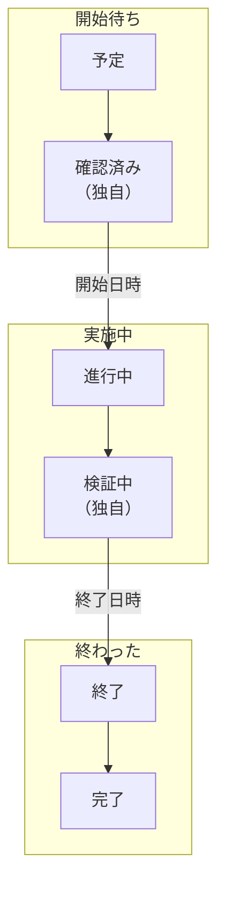

# メンテナンスの状態

すべての定期メンテナンスイベントは 1 つの **状態** にあります。作業が計画から承認までのどこにあるかです。状態は、OneUptime がイベントをどう扱うかを決めます。モニターのチェックがいつ止まるか、ステータスページに何が表示されるか、リマインダーがいつ止まるかです。このページでは、すべてのプロジェクトが最初に持つ 4 つの状態、イベントをその間で動かすもの、独自のステップを追加する方法を説明します。

:::cards
- [初期状態](#初期状態): 予定、進行中、終了、完了。
- [イベントを動かすもの](#イベントを動かすもの): 時計、ヘッダー、タイムライン、チャット、API。
- [独自の状態](#独自の状態): 作業開始前のステップや、作業後の確認。
- [状態タイムライン](#状態タイムライン): イベントがこれまでにあったすべての状態と、その修正方法。
:::

## 仕組み

プロジェクトのメンテナンスの状態は 1 つの順序付きリストで、イベントはその中を下にしか動きません。状態がどこにあるかによって、その状態にあるイベントの扱いが決まります。開始待ち、実施中、終わった、のいずれかです。

`ScheduledMaintenanceState` モデルには `name`、 `description`、 `color`、 `order` と、4 つのフラグ `isScheduledState`、 `isOngoingState`、 `isEndedState`、 `isResolvedState` があります。OneUptime が読むのはフラグと順序で、名前は読まないので、 **完了** を「承認済み」に名前変更しても何も壊れません。

> [!TIP]
> 一覧は **定期メンテナンス → 設定 → イベントの状態** にあります。サイドメニューの **設定** は最初は折りたたまれているので、まず展開してください。

## 初期状態

新しいプロジェクトはすべて、次の順序の 4 つのメンテナンスの状態で始まります。

| 状態          | `order` | フラグ             | 色        | 意味                                                           |
| ------------- | ------- | ------------------ | --------- | -------------------------------------------------------------- |
| **予定**      | `1`     | `isScheduledState` | `#000000` | 新しいイベントはすべてここから始まり、開始時刻を待ちます。     |
| **進行中**    | `2`     | `isOngoingState`   | `#ffbf53` | 作業が進行中で、イベントのモニターはチェックされません。       |
| **終了**      | `3`     | `isEndedState`     | `#4a4a4a` | 期間が終わり、チェックが再開されます。                         |
| **完了**      | `4`     | `isResolvedState`  | `#2ab57d` | 誰かが作業を承認し、所有者へのリマインダーが止まります。       |

フラグ付きの 4 つの状態には、設定ページで **組み込み** タグが付きます。名前や色を変えたり、ドラッグしたりはできますが、順序は保たれ、削除はできません。 **削除** はロックされたままで、その理由が表示されます。

**終了** と **完了** はどちらも終わった状態です。違いはイベントを動かすのが誰かです。OneUptime は **終了日時** にイベントを **終了** へ動かし、作業の確認後に担当者、チャットのボタン、または API が **完了** へ動かします。

## イベントを動かすもの

| 方法             | 場所                                                                                        | 尋ねること                                                                                                      |
| ---------------- | ------------------------------------------------------------------------------------------- | --------------------------------------------------------------------------------------------------------------- |
| **時計**         | 毎分実行されるジョブ                                                                        | 何も尋ねません。 **開始日時** に待機中のイベントを **進行中** へ、 **終了日時** に実施中のイベントを **終了** へ動かします。 |
| **ヘッダー**     | イベントの **概要**。 **「{{state}}」にする** ボタンと、 **⋯** メニューの **変更後の状態**    | 短いダイアログ **定期メンテナンスを「{{state}}」にする** で、 **ステータスページの購読者に通知** と、 **公開メモを追加** の下の任意のメモを尋ねます。 |
| **タイムライン** | イベントのサイドメニューの **状態タイムライン**                                             | 手動で追加する行で、 **定期メンテナンスのステータス** と **開始日時** を尋ねます。                              |
| **一括変更**     | イベント一覧で選択したものに対する **状態を変更**                                           | 状態と、各イベントに追加される一つの公開メモ。すでにその状態以降にあるイベントはスキップされます。              |
| **チャット**     | Slack と Microsoft Teams のイベントのメッセージにあるボタン                                 | 同じ変更を、あなたとして行います。 [Slack](/docs/workspace-connections/slack#slack-からインシデントアラートイベントを操作する) を参照してください。 |
| **API**          | `/api/scheduled-maintenance-state-timeline` で作成する行                                    | 状態と、購読者に通知するかどうか。                                                                              |

ヘッダーのボタンには、あなたの状態の名前が付きます。イベントが待機中のときは 2 つあります。開始するボタンは進行中の状態の名前、終了するボタンは終了の状態の名前です。イベントの実施中は 2 つ目だけです。 **⋯** メニューには、現在の状態より後のほかのすべての状態が並びます。ロールでイベントの状態を変更できない人には、ボタンがロックされた状態で表示され、ほかの状態のメニューは表示されません。ボタンにポインターを合わせると、それを許可する権限が表示されます。

## 開始と終了で起きること

イベントは、待機中の状態から **進行中** へ、または **進行中** と **終了** の間に置いた独自の状態へ直接移ったときに開始します。そのとき、

- **モニターのチェックが止まり**、イベントに **変更後のモニターステータス** があればそのステータスに変わります。実施中にイベントに追加したモニターも変わります。
- **ステータスページにイベントが実施中として表示され**、購読者に通知されます。 **イベントの開始時** がオンなら予定どおりに、手動ならダイアログの **ステータスページの購読者に通知** のとおりに通知されます。
- **所有者に通知されます**。状態変更の通知をオンにしている場合です。また、イベントが **進行中のイベント** に表示されます。

イベントは、実施中の状態から **終了**、 **完了**、または **終了** の後に置いた独自の状態へ移ったときに終了します。そのとき、モニターは再びチェックされ、実施中の別のイベントがまだ押さえていない限り稼働中に戻ります。購読者にも同じように通知されます。 **イベントの終了時** がオンなら予定どおりに、手動ならダイアログのとおりに通知されます。

**進行中** から「検証中」へ、または **終了** から **完了** へ進んでも、何かが再び開始・終了することはありません。イベントはすでに開始、または終了しています。

## ヘッダーの時計

開始前は、ヘッダーが開始までをカウントダウンします。実施中は経過時間を数え、終わった後はかかった時間を示します。イベントが境界を 2 分以上過ぎると、黄色の通知がそれを伝えます。

- **開始予定を過ぎています**: **開始日時** を過ぎてもイベントがまだ待機中です。
- **予定超過**: **終了日時** を過ぎてもイベントがまだ実施中です。

通知には、予定時刻と、イベントがまだ達していない状態が示されます。境界の直後は、イベントを動かすジョブがまだ実行されていないことがあるため、その後数分間はヘッダーが自動で再確認し、再読み込みなしで新しい状態を表示します。

## 順序は強制される

状態の変更は、誰が行ってもリストと照合されます。ダッシュボード、Slack、Microsoft Teams、API、Terraform、ワークフロー、OneUptime 自身のいずれでもです。

- **後ろへの移動は拒否され**、両方の状態を示すメッセージが表示されます: "Scheduled Maintenance cannot transition to Scheduled state from Ongoing state because Scheduled is before Ongoing in the order of scheduled maintenance states."
- **すでにある状態への移動は拒否されます**: "Scheduled Maintenance state cannot be same as previous state."
- **選択肢には現在より後の状態だけが表示される**ので、拒否される移動を提示されることはありません。

誤って設定した状態を直すには、イベントの **状態タイムライン** ページでその行を削除します。イベントはその前の行の状態に戻ります。

## 独自の状態

追加する状態は、初期の 4 つが名前を持たない、チームが通るステップです。作業開始前の「確認済み」、作業後の「検証中」などです。

:::steps
### 状態の一覧を開く

**定期メンテナンス → 設定 → イベントの状態** に移動します。 **定期メンテナンスの状態** カードに、状態が順番に並びます。各行には色と名前、その状態にあるイベントの扱い（ **扱い** 列）、説明が表示されます。

### 状態を作成する

**定期メンテナンスの状態を作成** をクリックし、 **名前**、 **説明**、 **色** を入力します。新しい状態は、完了の状態のすぐ上に追加されます。

### ドラッグして配置する

行をグリップでドラッグして移動します。ドロップした時点で新しい順序が保存されます。 **扱い** 列は、ドロップした位置に合わせて変わります。
:::

追加した状態にはフラグがないので、置いた位置がその意味になります。

| 置く位置                                | その状態にあるイベント                                                                                           |
| --------------------------------------- | ---------------------------------------------------------------------------------------------------------------- |
| **予定** と **進行中** の間             | **予定** と同じく **開始日時** を待ち、そこから予定どおりに開始します。                                         |
| **進行中** と **終了** の間             | **進行中** と同じく実施中です。モニターはチェックされないままで、 **終了日時** に終了します。                    |
| **終了** と **完了** の間               | 終わっていますが、まだ完了していません。完了まで続くリマインダーは続きます。                                     |
| **完了** の下                           | **完了** と同じく完了です。                                                                                       |

独自の状態は **予定** より下に置いてください。新しいイベントはすべてそこから始まり、イベントがリストを上に戻ることはないので、その上の状態には決して到達しません。イベントを独自の状態に移すには、ヘッダーの **⋯** メニューの **変更後の状態** を使います。

> [!NOTE]
> OneUptime Cloud では、メンテナンスの状態の追加と変更には **Growth** 以上のプランが必要です。どのプランでも、状態の参照、使用、追加した状態の削除はできます。

## 状態のアーカイブ

自分で追加した状態のうち、チームで使わなくなったものは、削除する代わりにアーカイブします。アーカイブしてもイベントは何も変わりません。その状態のイベントはそのまま通常どおり進み、状態タイムラインにも表示されます。

- **アーカイブ** は行の **⋯** メニューにあります。最初に確認を求め、その状態を使うように設定されている測定とワークフローを一覧表示します。
- **誰も再び選択できません。** イベントのヘッダー、**状態を変更**、Slack、Microsoft Teams はその状態を表示せず、API、Terraform、MCP は拒否します。引き続きイベントのフィルターには使えます。
- **アーカイブされた状態は別に表示されます。** 表の下の折りたたまれたセクション **アーカイブ済みの定期メンテナンスの状態** に表示されます。**アーカイブ解除** で元の状態に戻せます。
- **4 つの組み込み状態はアーカイブできません。** OneUptime がイベントをこれらの状態に移すためです。これらの **アーカイブ** は理由とともにロックされています。

## 状態タイムライン

イベントの **状態タイムライン** ページは、イベントがこれまでにあったすべての状態の記録です。そのカード **ステータスタイムライン** は、状態をタイムラインとして描きます。各状態が続いた長さの帯と、その下に新しい順のすべての変更です。カードのヘッダーにある **テーブル** を使うと、 **定期メンテナンスのステータス**、 **開始日時**、 **終了日時**、 **期間**、購読者に通知する予定だったか、通知がどうなったかを行として一覧表示します。

ダッシュボードでは、行は追加と削除はできますが編集はできず、イベントには常に少なくとも 1 行が残ります。API では行の `startsAt` を修正でき、タイムラインから算出されるすべての測定値がそれに従います。最新の行を削除すると、イベントはその前の行の状態に戻ります。

> [!WARNING]
> 行を削除すると、イベントの履歴と、そこから算出されたすべての測定値が書き換わります。ミスの修正に使い、整理のためには使わないでください。

## トラブルシューティング

:::details ヘッダーに開始予定を過ぎていますと表示される
イベントは **開始日時** から 2 分以上たってもまだ待機中で、イベントを開始するジョブがまだ動かしていません。ヘッダーのボタンで自分で開始してください。手動の開始は、モニターの扱いも含め、ジョブが行うことをすべて行います。
:::

:::details 以前の状態にイベントを戻せない
状態はリストを下にしか動きません。イベントの **状態タイムライン** ページで、戻したい状態より後の行を新しいものから削除してください。
:::

:::details ヘッダーのボタンに完了の状態がない
ヘッダーのボタンはイベントの開始と終了を行います。完了にするには **⋯** メニューの **変更後の状態** を使います。
:::

## 次のステップ

:::cards
- [定期メンテナンスの概要](/docs/scheduled-maintenance/index): 各機能の場所と、イベントが影響するもの。
- [メンテナンスイベントの作成](/docs/scheduled-maintenance/creating-events): フォームの各項目。
- [メンテナンスのルールと設定](/docs/scheduled-maintenance/settings): イベントが完了するまで所有者にリマインドします。
- [インシデントの状態と重大度](/docs/incidents/states-and-severities): インシデント版の同じ順序付きリスト。
:::
