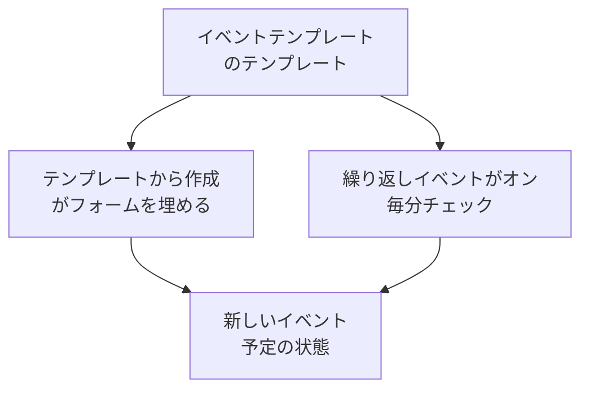

# テンプレートと繰り返しイベント

定期メンテナンステンプレートは、よく予定するイベントを保存します。タイトルと説明、一時停止するモニター、表示するステータスページ、通知する相手です。テンプレートを使えばワンクリックでフォームを埋められます。繰り返しにすれば、毎週、毎月、または選んだ任意の間隔で、OneUptime がイベントを予定します。

:::cards
- [テンプレートを作成する](#テンプレートを作成する): 最初に名前、最後にスケジュールがあるフォームのステップ。
- [テンプレートを使う](#テンプレートを使う): テンプレートから新しいイベントを埋めます。
- [繰り返しイベント](#繰り返しイベント): OneUptime にイベントを自動で予定させます。
- [テンプレートを変更または停止する](#テンプレートを変更または停止する): 編集、スケジュールの一時停止、削除。
:::

## 仕組み

テンプレートは出発点です。テンプレートから作成したイベントは独自の値を持つコピーなので、あとでテンプレートを変更しても、変わるのはその後に作成されるイベントだけです。

## 始める前に

- **プラン。** OneUptime Cloud では、テンプレートには **Growth** 以上のプランが必要です。
- **ロール。** テンプレートの作成には **プロジェクト所有者**、 **プロジェクト管理者**、 **プロジェクトメンバー**、 **定期メンテナンス管理者**、 **定期メンテナンスメンバー** のいずれか、または定期メンテナンスのテンプレートを作成できるカスタムロールが必要です。

## テンプレートを作成する

:::steps
### テンプレートを開く

**定期メンテナンス → 設定 → イベントテンプレート** に移動します。サイドメニューの **設定** は最初は折りたたまれているので、まず展開してください。 **定期メンテナンステンプレートを作成** をクリックします。

### テンプレートに名前を付ける

**テンプレート情報** で **テンプレート名** と **テンプレートの説明** を入力し、チームがいつ使えばよいか分かるようにします。どちらも必須です。

### イベントを記述する

**イベント** で、テンプレートから作る各イベントの最初の **タイトル** と **説明** を入力します。 **所有者** と **ラベル** は **その他の項目** の下にあります。

### 影響するものを選ぶ

**影響を受けるリソース** で、 **モニター**、それらの **変更後のモニターステータス**、必要なら **その他の影響を受けるリソース**、 **これらのステータスページにイベントを表示** のステータスページ、 **購読者への通知** を選びます。

### 繰り返すかどうかを決める

**繰り返し** で、手動で使うテンプレートなら **繰り返しイベント** をオフのままにし、繰り返すならオンにしてスケジュールを入力します。 **次へ** をクリックして確認画面を見てから、テンプレートを作成します。
:::

テンプレートは、モニターを指定していなくても **変更後のモニターステータス** を尋ねます。このステータスは、テンプレートからイベントを予定するときに追加するモニターにも適用されます。 **その他の影響を受けるリソース** に指定できるのは、ホスト、Kubernetes クラスター、Docker ホスト、Podman ホスト、サービスです。

## テンプレートが埋めるもの

| イベントの部分                                    | テンプレートから作成                 | 繰り返しイベント                |
| ------------------------------------------------- | ------------------------------------ | ------------------------------- |
| **タイトル** と **説明**                          | 埋められ、変更できる                 | コピーされる                    |
| **モニター** と **変更後のモニターステータス**    | 埋められる                           | コピーされる                    |
| **その他の影響を受けるリソース**                  | 埋められる                           | コピーされる                    |
| ステータスページと **購読者への通知**             | 埋められる                           | コピーされる                    |
| **所有者** と **ラベル**                          | 埋められる                           | コピーされる                    |
| **開始日時** と **終了日時**                      | 次の正時から一時間                   | スケジュールから算出される      |

## テンプレートを使う

:::steps
### テンプレートを選ぶ

**定期メンテナンス → すべてのイベント** で **テンプレートから作成** をクリックし、 **定期メンテナンステンプレートを選択** でテンプレートを選びます。

### フォームを確認する

**テンプレートから作成** をクリックします。テンプレートの回答が埋められた状態で作成フォームが開きます。期間を設定し、このイベントに必要な変更を加えます。

### イベントを作成する

**次へ** でステップを進め、確認画面で **定期メンテナンスイベントを作成** をクリックします。
:::

プロジェクトにまだテンプレートがない場合、 **テンプレートから作成** はそのことを伝え、 **イベントテンプレート** へのリンクを示します。

## 繰り返しイベント

繰り返しテンプレートは、スケジュールに従ってイベントを作成します。最初のイベントがいつ作成され、いつ開始し、いつ終了するかを設定します。以降の各イベントは同じ間隔を保ち、1 間隔ずつ後になります。

| 項目                                                     | 意味                                                                                               |
| -------------------------------------------------------- | -------------------------------------------------------------------------------------------------- |
| **繰り返しイベント**                                     | スケジュールをオンにします。                                                                       |
| **最初のイベント予定日時**                               | OneUptime が最初のイベントを作成する日時で、購読者に予定が通知される日時でもあります。             |
| **最初のイベント開始日時**                               | 最初のイベントが開始する日時です。                                                                 |
| **最初のイベント終了日時**                               | 最初のイベントが終了する日時です。                                                                 |
| **このイベントをどのくらいの頻度で繰り返しますか？**     | 数値と単位。単位は時間、日、週、月、年です。                                                       |

たとえば、月曜日に最初のイベントを作成し、その後の土曜日に実施する毎週の期間は次のようになります。

| イベント     | 作成               | 開始               | 終了               |
| ------------ | ------------------ | ------------------ | ------------------ |
| 最初         | `2030-06-03 09:00` | `2030-06-08 02:00` | `2030-06-08 04:00` |
| その次       | `2030-06-10 09:00` | `2030-06-15 02:00` | `2030-06-15 04:00` |

**最初のイベント予定日時** は、顧客に作業を知らせたい分だけ開始より前に設定します。テンプレートの作成時には 3 つの日時がすべて未来である必要があり、イベントは開始と終了より前に作成され、終了より前に開始する必要があります。どの規則に反しているかはフォームが示します。

ジョブが毎分、繰り返しテンプレートを確認します。テンプレートの次の日時が来ると、その日時を 1 間隔進めてから、イベントを作成します。テンプレートの一覧では、その日時が **繰り返しイベント** 列に表示され、繰り返さないテンプレートには **いいえ** と表示されます。スケジュールから作成されたイベントもほかと同じで、ルールが実行され、所有者が追加され、購読者に予定が通知されます。

## テンプレートを変更または停止する

一覧からテンプレートを開くと、そのページが表示されます。

- **定期メンテナンステンプレートの詳細** は、新しいイベントの初期内容を示します。その **編集** は **テンプレート情報**、 **イベント**、 **ステータスページ**、 **繰り返し** を順に進みます。
- **影響を受けるリソース** には **モニター**、その **変更後のモニターステータス**、 **その他の影響を受けるリソース** があり、専用の **編集** があります。
- **所有者** には、テンプレートから予定されるすべてのイベントを所有するユーザーとチームが並びます。

変更は保存後に作成されるイベントに適用され、作成済みのイベントは自身の値を保ちます。スケジュールを止めるには、 **編集** で **繰り返しイベント** をオフにするか、テンプレートを削除します。オフにしたテンプレートはスケジュールを保ちます。もう一度オンにすると、スケジュールの次の日時から再開し、オフだった間の日時は飛ばします。テンプレートを削除しても、それが作成したイベントは残ります。

## トラブルシューティング

:::details 繰り返しテンプレートの作成時に、日時は未来である必要があると表示される
作成時には、最初の 3 つの日時がすべて現在より後である必要があります。日時を先に動かしてください。スケジュールはその後、最初のイベントから続きます。
:::

:::details 繰り返しテンプレートがイベントを作成しなかった
**繰り返しイベント** がまだオンかどうかを確認し、一覧の **繰り返しイベント** 列の日時を見てください。イベントはその日時に作成され、開始時ではありません。ジョブは毎分実行されるので、1 分待ってください。
:::

:::details テンプレートからのイベントに、選んだリソースがない
テンプレートの **その他の影響を受けるリソース** に指定できるのは、ホスト、Kubernetes クラスター、Docker ホスト、Podman ホスト、サービスです。ほかの種類のリソースは、イベントの **影響を受けるリソース** カードの **編集** でイベント自体に追加してください。
:::

## 次のステップ

:::cards
- [メンテナンスイベントの作成](/docs/scheduled-maintenance/creating-events): テンプレートが埋めるフォーム。
- [メンテナンスの状態](/docs/scheduled-maintenance/states): 作成後に各イベントがどう進むか。
- [メンテナンスのルールと設定](/docs/scheduled-maintenance/settings): 新しいイベントすべてに所有者とラベルを自動で追加します。
- [定期メンテナンスの概要](/docs/scheduled-maintenance/index): メンテナンス全体の中でのテンプレートの位置付け。
:::
