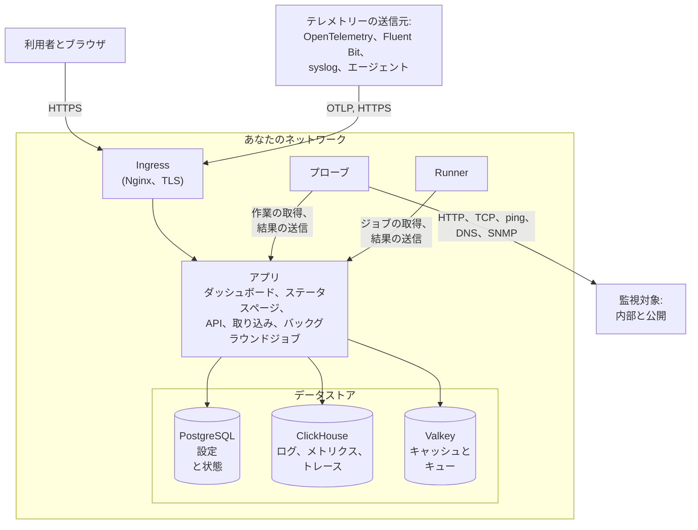

# アーキテクチャ

セルフホストの OneUptime は、いくつかのコンテナで構成されます。すべてのリクエストが入ってくる ingress が 1 つ、処理を担うアプリのイメージが 1 つ、モニターのチェックを実行するプローブ、そして 3 つのデータストアです。このページでは、それらがどう組み合わさるか、それぞれが何をするか、どの接続がネットワークの境界を越えるかを説明します。

## この図が示すこと

- 利用者は **ingress** を通じて OneUptime にアクセスします。ingress は TLS を終端し、各リクエストをアプリに振り分けます。対象は Dashboard、ステータスページ、API、そしてテレメトリーの送信先となるすべての取り込みエンドポイントです。
- **アプリ** は状態を PostgreSQL に読み書きし、テレメトリーを ClickHouse に保存し、キャッシュとバックグラウンドジョブが処理するキューに Valkey (Redis 7.2 の BSD ライセンスのフォーク) を使います。
- **プローブ** はクラスター内 (推奨) やネットワーク内の別の場所で実行できます。プローブで監視できるのは次のものです。
  - ファイアウォールの内側にある内部/プライベートのサービス。
  - インターネット上の外部/公開リソース。
- プローブの結果はアプリに送られ、Valkey のキューに入り、バックグラウンドジョブによってデータストアに書き込まれます。ネットワーク内の別の場所にあるプローブは、ingress を経由して OneUptime の URL でアプリに到達します。
- テレメトリー (メトリクス、トレース、ログなど) は同じアプリが取り込み、ClickHouse に保存します。

> [!NOTE]
> 同梱のものではなく外部の PostgreSQL、Valkey (または Redis)、ClickHouse を使う場合、アプリは代わりに外部のエンドポイントに接続します。論理的な流れは変わりません。

## コンポーネント

| コンポーネント | Docker Compose のサービス | Helm チャート | 役割 |
| --- | --- | --- | --- |
| Ingress | `ingress` | `nginx` | TLS を終端し、ホスト名とステータスページのドメインを提供し、すべてのリクエストをアプリに振り分けます。 |
| アプリ | `app` | `app` | Dashboard、ステータスページ、API と取り込みのエンドポイント、そして分離しない限りバックグラウンドジョブも担います。 |
| Worker | `app` の一部 | `worker` (既定ではオフ) | バックグラウンドジョブを専用の Pod で実行し、重いキュー処理が API リクエストと競合しないようにします。 |
| Telemetry writer | `app` の一部 | `telemetryWriter` (既定ではオフ) | ClickHouse へのすべての挿入を行う固定サイズの層で、ワーカーがどれだけスケールしても挿入数を一定の範囲に保ちます。 |
| プローブ | `probe-1` | `probes` | モニターのチェックを実行し、結果を送り返します。同梱のプローブはすべて、全プロジェクトが使えるグローバルプローブです。 |
| Runner | `runner` | `runner` | インスタンス自身の Runner で、すべてのプロジェクトの AI によるコード修正を実行できます。Runbook のステップは、実行すべき場所にインストールした [Runner](/docs/runbooks/agents) で実行されます。 |
| PostgreSQL | `postgres` | `postgresql`、または `postgresOperator.cnpg` | プロジェクト、モニター、インシデント、ユーザー、その他すべての設定と状態。 |
| ClickHouse | `clickhouse` | `clickhouse`、または `clickhouseOperator.altinity` | ログ、メトリクス、トレース、例外、プロファイル、モニターのログ。 |
| Valkey | `valkey` | `valkey` | キャッシュ、ジョブのキュー、保留中のプッシュの受領確認のような短期間の状態。 |

アプリの役割はすべて同じイメージです。Docker Compose はそれらを 1 つの `app` コンテナで実行し、Helm チャートでは worker と telemetry writer をそれぞれ独立したデプロイメントとして実行できます。各層のサイズの決め方は [サイジングとキャパシティプランニング](/docs/installation/sizing) を参照してください。

## ネットワークの外への接続

アプリが外部に接続するのは、有効にした機能のためだけです。いずれも任意で、それぞれに許可すべき正確なアドレスを示したページがあります。

| 外向きの接続 | 用途 | 詳細 |
| --- | --- | --- |
| メール (SMTP、または SendGrid の API) | 通知と招待 | [SMTP](/docs/emails/smtp) |
| Twilio | SMS と電話 | [Twilio 連携](/docs/self-hosted/twilio-integration) |
| OneUptime のプッシュリレー、または Expo | モバイルのプッシュ通知 | [プッシュ通知](/docs/self-hosted/push-notifications) |
| Slack と Microsoft Teams | ワークスペースへの通知と操作 | [Slack 連携](/docs/self-hosted/slack-integration) |
| OpenAI、Anthropic、Microsoft Foundry、自分で動かすモデルなどの LLM プロバイダー | OneUptime AI | [LLM プロバイダー](/docs/ai/llm-provider) |
| `oneuptime.com` | Enterprise ライセンスのオンラインでの有効化 | [エンタープライズ版](/docs/self-hosted/enterprise) |

逆向きの接続、つまり SendGrid による受信メールの配信や、Slack と Microsoft Teams からのコールバックには、ingress にインターネットから到達できる必要があります。アプリとプローブがどのプライベートアドレスに到達してよいかは、あなたが決めます。[プライベートネットワークへのアクセス](/docs/self-hosted/private-network-access) を参照してください。

## 次のステップ

:::cards
- [Docker Compose](/docs/installation/docker-compose): すべてのコンポーネントを 1 台のマシンにインストールします。
- [サイジングとキャパシティプランニング](/docs/installation/sizing): 各層に必要な CPU、メモリー、ディスクの量。
- [カスタムプローブ](/docs/probe/custom-probe): 別のネットワークの中でプローブを実行します。
- [エンタープライズ版](/docs/self-hosted/enterprise): Enterprise イメージで追加されるものと、ライセンスの仕組み。
:::
