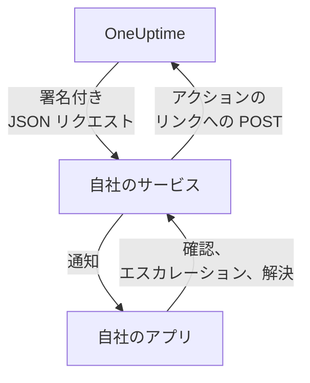

# カスタム通知チャネル

カスタムチャネルは、オンコールの呼び出しを自分で運用するサービスに送ります。自社のアプリ、ポケベルのシステム、ネットワークの外に出るものを確認するゲートウェイなどです。サーバー全体に一度追加するだけで、誰も何も設定せずにそのチャネルで呼び出しを受けられます。Admin Dashboard では **Custom Channels** という名前です。

> [!NOTE]
> カスタムチャネルは [OneUptime Enterprise Edition](/docs/self-hosted/enterprise) の一部で、カスタムチャネルを含む Enterprise ライセンスが必要です。Community Edition には **Custom Channels** ページがなく、どのチャネルにも何も送りません。 [ライセンスがない場合](#ライセンスがない場合) を参照してください。

:::cards
- [チャネルを追加する](#チャネルを追加する): 名前、URL、署名シークレット。
- [サービスが受け取るもの](#サービスが受け取るもの): 呼び出しごと、人ごとに 1 つの署名付き JSON リクエスト。
- [呼び出しに対応する](#呼び出しに対応する): 自分のアプリから確認、エスカレーション、解決を行います。
- [配信と再試行](#配信と再試行): サービスが停止しているときに起きること。
- [その他の通知](#その他の通知): 所有者向けの通知、メモ、シフトを、希望する人に送ります。
- [ライセンスがない場合](#ライセンスがない場合): 止まるものと、保持されるもの。
:::

## 仕組み



オンコールポリシーが誰かを呼び出し、その人のオンコールルールがチャネルを使っていると、OneUptime はチャネルの URL にリクエストを送ります。リクエストには、呼び出しの相手 (名前とメールアドレス) と内容が示され、その人がアプリで確認、エスカレーション、解決をしたときにサービスが呼び出すリンクが含まれます。

## チャネルを追加する

1. Admin Dashboard で **設定**、 **Custom Channels** の順に開き、 **Add** を選びます。
2. **Channel** ステップで、次を入力します。
   - **名前**: 通知方法とオンコールルールで表示される名前です。例: `CorpoApp`。
   - **Webhook URL**: OneUptime が各呼び出しを送る先です。プライベートネットワーク上でもかまいません。
   - **Signing Secret**: OneUptime が作成します。サービスにコピーしてください。サービスはこれで各リクエストを確認します。チャネルを編集すると、もう一度確認できます。
3. **Delivery** ステップで保存し、 **Send test** を選んでサービスに [テストリクエスト](#テストリクエスト) を送ります。

**Delivery** ステップでは、 **Page everyone through this channel** がオンになっています。このとき OneUptime は、すべてのプロジェクトの全員のオンコールルールと、後からプロジェクトに参加する人のルールにチャネルを追加し、発生したものに対するルールを持たない対応者に連絡するためにもチャネルを使います。各自がルールにチャネルを追加するようにする場合は、オフにします。

ユーザーは **ユーザー設定**、 **通知方法**、 **Custom Channels** の順に開くとチャネルを確認でき、 **Send test** ボタンもあります。オンコールルールでは `Custom Channel: CorpoApp` として選びます。ユーザーが設定することは何もありません。各呼び出しの相手はサービスに伝えられます。

誰のルールも変えずに送信を止めるには、チャネルを編集して **オン** をオフにします。そのチャネルに送られるはずだった呼び出しは、未送信としてオンコールログに記録されます。チャネルを削除すると、そのチャネルを使うオンコールルールもすべて削除されます。

## サービスが受け取るもの

呼び出しはそれぞれ、JSON 本文を持つ `POST` リクエストです。

| ヘッダー | 内容 |
| --- | --- |
| `Content-Type` | `application/json` |
| `X-OneUptime-Event` | イベント。例: `on-call.incident.created` |
| `X-OneUptime-Signature` | `sha256=` と、チャネルの署名シークレットで計算した生の本文の 16 進 HMAC-SHA256 |

```json title="An incident page"
{
  "version": 1,
  "event": "on-call.incident.created",
  "notificationId": "5f2c8a1e-6b1d-4c3a-9e7f-2a4b6c8d0e1f",
  "sentAt": "2026-10-27T03:14:15.000Z",
  "channel": { "id": "0b7e…", "name": "CorpoApp" },
  "title": "New Incident INC-42: API latency high",
  "message": "A new incident has been created: INC-42 (API latency high) in Agency A. Click to view details.",
  "project": { "id": "8d1f…", "name": "Agency A" },
  "team": { "id": "2c9a…", "name": "SRE" },
  "user": { "id": "4e6b…", "name": "Jane Tan", "email": "jane@example.com" },
  "recordType": "incident",
  "record": {
    "id": "9a3c…",
    "number": "INC-42",
    "title": "API latency high",
    "description": "p95 latency above 2 seconds for 5 minutes.",
    "severity": "Critical",
    "state": "Created",
    "url": "https://oneuptime.example.com/dashboard/8d1f…/incidents/9a3c…"
  },
  "onCallPolicy": { "id": "1d4e…", "name": "Primary" },
  "escalationRule": { "id": "7b2f…", "name": "Level 1" },
  "isPageAgain": false,
  "actions": {
    "acknowledge": "https://oneuptime.example.com/api/custom-notification-channel/page/5f2c…/acknowledge?token=…",
    "escalate": "https://oneuptime.example.com/api/custom-notification-channel/page/5f2c…/escalate?token=…",
    "resolve": "https://oneuptime.example.com/api/custom-notification-channel/page/5f2c…/resolve?token=…"
  }
}
```

| フィールド | 内容 |
| --- | --- |
| `version` | `1`。このバージョンには、フィールドが追加されるだけです。 |
| `event` | `on-call.incident.created`、`on-call.alert.created`、`on-call.incidentEpisode.created`、`on-call.alertEpisode.created`、[その他の通知](#その他の通知) では `notification`、または `test` |
| `notificationId` | 呼び出しごと、人ごとに 1 つ。処理済みのリクエストを捨てるのに使います。 |
| `title`、`message` | プッシュ通知と同じように、そのまま表示できる文面 |
| `user` | 呼び出しの相手。アプリ内のアカウントは `email` または `id` で探します。 |
| `team` | 呼び出しに使われたチーム。直接呼び出された場合は `null` |
| `recordType`、`record` | 呼び出しの対象: `incident`、`alert`、`incidentEpisode`、`alertEpisode` のいずれか |
| `onCallPolicy`、`escalationRule` | 呼び出したポリシーとレベル |
| `isPageAgain` | レコードがしばらく前に確認され、まだ解決していない場合は `true` |
| `actions` | [呼び出しに対応する](#呼び出しに対応する) ためにサービスが呼び出すリンク |

複数の人への呼び出しは、人ごとに 1 つのリクエストになり、それぞれにその人専用のリンクが付きます。これで OneUptime は誰が応答したかを把握できます。タイトル、メッセージ、説明は合計で 16,384 文字までに収められます。それより長い説明は切り詰められ、末尾が「… (truncated — see OneUptime for the full text)」になります。

### 署名を確認する

リクエストの生の本文の HMAC を、本文を解析する前に計算し、ヘッダーと比較します。

```javascript title="Node.js"
const crypto = require("crypto");

function isFromOneUptime(rawBody, signatureHeader, secret) {
  const expected =
    "sha256=" + crypto.createHmac("sha256", secret).update(rawBody).digest("hex");
  const received = String(signatureHeader || "");

  return (
    received.length === expected.length &&
    crypto.timingSafeEqual(Buffer.from(received), Buffer.from(expected))
  );
}
```

## 呼び出しに対応する

その人がアプリでボタンを押すと、サービスは `actions` の該当するリンクに `POST` リクエストを送ります。API キーは不要です。各リンクにはその呼び出しだけに有効なトークンが付いていて、有効期間は 7 日です。アクションは、呼び出された本人が行ったものとして記録されます。

| アクション | 動作 |
| --- | --- |
| `acknowledge` | その人の呼び出しを確認し、あわせてインシデント、アラート、エピソードを確認します |
| `escalate` | その人が対応できない場合です。オンコールポリシーの次のレベルをすぐに呼び出し、その人の呼び出しを止めます |
| `resolve` | その人自身の権限で許可されていれば、インシデント、アラート、エピソードを解決します |

```bash title="Acknowledge a page"
curl -X POST "https://oneuptime.example.com/api/custom-notification-channel/page/5f2c…/acknowledge?token=…"
```

応答には何が起きたかが示されます。その文言は、アプリでそのまま表示できます。

```json title="The answer"
{
  "action": "acknowledge",
  "result": "acknowledged",
  "message": "Acknowledged."
}
```

`result` は `acknowledged`、`alreadyAcknowledged`、`escalated`、`notEscalated`、`resolved`、`alreadyResolved` のいずれかです。期限切れや誤ったリンクは、4xx のステータスとメッセージで拒否されます。

## その他の通知

ユーザーが受け取る通知は呼び出しだけではありません。OneUptime は、所有するインシデントの状態が変わったとき、メモが投稿されたとき、オンコールシフトが始まるときなどにも知らせます。それぞれの送り先は各自が **ユーザー設定 > 通知設定** で選びます。チャネルがオンになっている間、そこには **Custom Channels** 列があります。この列は、各自がオンにするまで全員オフです。

通知は、オンになっているすべてのチャネルに、チャネルごとに 1 つのリクエストとして送られます。 `event` は `notification` です。

```json title="A notification"
{
  "version": 1,
  "event": "notification",
  "notificationId": null,
  "sentAt": "2026-10-27T03:20:00.000Z",
  "channel": { "id": "0b7e…", "name": "CorpoApp" },
  "title": "Incident INC-42 acknowledged",
  "message": "Incident INC-42 (API latency high) was acknowledged in Agency A.",
  "project": { "id": "8d1f…", "name": "Agency A" },
  "team": null,
  "user": { "id": "4e6b…", "name": "Jane Tan", "email": "jane@example.com" },
  "recordType": null,
  "record": null,
  "onCallPolicy": null,
  "escalationRule": null,
  "isPageAgain": false,
  "actions": null,
  "notificationType": "Send incident state changed notification when I am the owner of the incident",
  "url": "https://oneuptime.example.com/dashboard/8d1f…/incidents/9a3c…"
}
```

`title` と `message` は、その人のプッシュ通知と同じ内容です。 `notificationType` は送信のもとになった設定の名前で、 `url` は対象へのリンクか `null` です。対応するものはないため、 `actions` は `null` です。

## 配信と再試行

サービスが 10 秒以内に 2xx のステータスで応答すると、リクエストは配信済みになります。応答がなかったリクエストや、408、429、5xx のステータスで応答したリクエストは、1 秒後と、さらにその 4 秒後に再送されます。試行は合計 3 回です。その他の 4xx のステータスでは再送されません。

各試行の結果は、チャネル名とサービスが応答したステータスとともに、その人のオンコールログに記録されます。URL は記録されません。配信されなかった呼び出しでもオンコールポリシーは止まらず、誰も確認しなければ通常どおりエスカレーションされます。サービスが人に連絡する唯一の手段である場合は、ルールの後ろのほうにメールまたは SMS のルールを残しておいてください。

## テストリクエスト

Admin Dashboard のページや各自の通知方法にある **Send test** は、 `event` を `test`、ボタンを押した人を `user` とし、 `notificationId`、`record`、`actions` を `null` にしたリクエストを送ります。実際の呼び出しが届く前に、サービスを試すのに使います。

## ライセンスがない場合

カスタムチャネルは、Enterprise Edition の 14 日間の試用期間中と、ライセンスの期限が切れてから 30 日間の猶予期間中は動作します。その後、またはカスタムチャネルを含まないライセンスでは、次のようになります。

- **カスタムチャネルには何も送られません。** チャネルに送られるはずだった呼び出しは、その人のオンコールログに未送信として記録されます。テストも同じです。
- **チャネルは選択肢に表示されなくなります。** 各自の通知方法、オンコールルール、通知設定から消え、準備状況とフォールバックでも数えられなくなります。
- **ページは読み取り専用になります。** チャネルの表示と削除はできますが、追加や変更はできず、ルールや通知設定の送り先にチャネルを指定することも誰にもできません。
- **何も削除されません。** チャネルと、それを使うオンコールルールと設定は保持されます。

ライセンスが有効化されると、再起動なしですぐにすべてが再開します。カスタムチャネルが止まっていた間にプロジェクトに参加した人のルールには、全員を呼び出すチャネルは追加されません。必要なら自分で追加できます。
