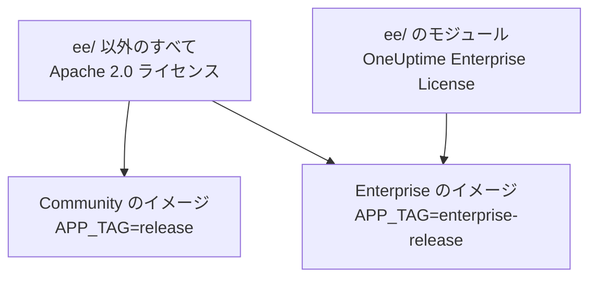
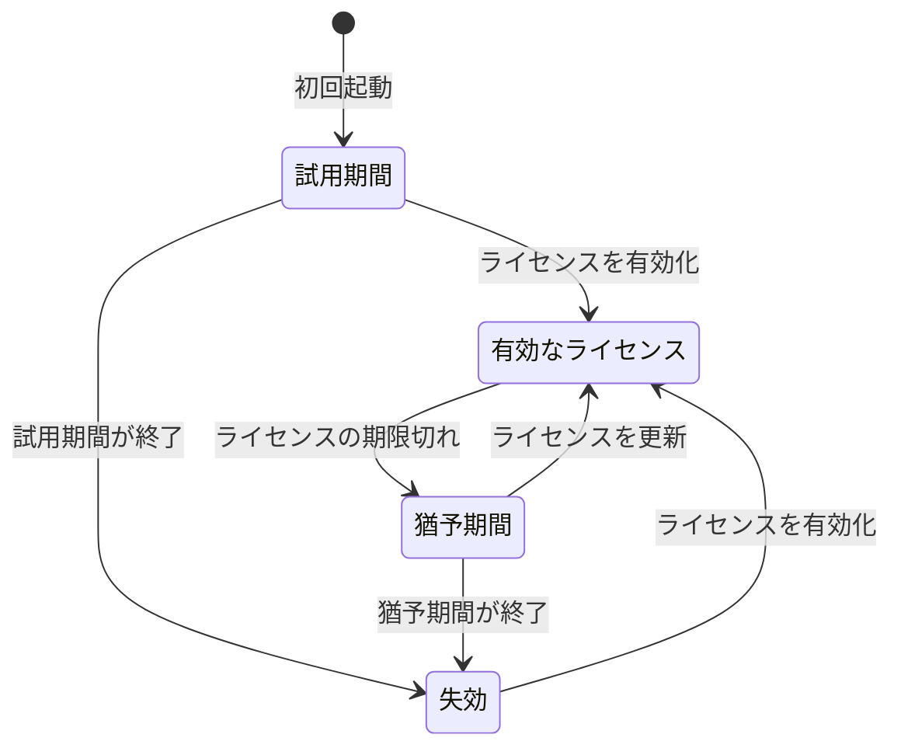

# エンタープライズ版

OneUptime は一つのリポジトリからビルドされ、二つのエディションで提供されます。

- **Community Edition**: 監視、インシデント、オブザーバビリティのプラットフォーム全体で、SAML と OpenID Connect のシングルサインオンを含みます。Apache 2.0 ライセンスのオープンソースで、どんな規模でも無料でセルフホストできます。
- **Enterprise Edition**: Community Edition に、リポジトリの [`ee/`](https://github.com/OneUptime/oneuptime/tree/master/ee) ディレクトリにあるエンタープライズモジュールを加えたものです。これらのモジュールは、SCIM プロビジョニングと、ガバナンスおよびインスタンス管理の機能を追加します。モジュールは [OneUptime Enterprise License](https://github.com/OneUptime/oneuptime/blob/master/ee/LICENSE) の下で提供され、本番環境で使うにはユーザー数に応じた Enterprise ライセンスが必要です。

二つのエディションは別々のコンテナイメージです。Community のイメージには `ee/` のコードが含まれません。OneUptime Cloud は Enterprise Edition で動作しており、クラウドではこれらの機能のうちどれを使えるかをプランが決めます。



> [!NOTE]
> **シングルサインオンはすべてのエディションに含まれます。** プロジェクトとステータスページへの SAML と OIDC のサインイン、グローバル SSO、「Require SSO for login」は Community Edition の一部であり、ライセンスの状態によって無効になることはありません。

このページでは、各エディションに含まれるもの、Enterprise Edition の実行方法、ライセンスの仕組み、エディションを切り替えたときに起こることを説明します。

:::cards
- [エディションを比較する](#各エディションに含まれるもの): Enterprise Edition が追加するもの。
- [Enterprise のイメージを実行する](#enterprise-edition-を実行する): Kubernetes でも Docker Compose でも、設定は一つだけです。
- [ライセンスを有効化する](#ライセンス): キーを使ってオンラインで、または署名付きトークンを使ってオフラインで。
- [ライセンスが切れたとき](#ライセンスの期限切れまたは未設定のとき): 止まるもの、決して止まらないもの、元に戻る方法。
:::

## 各エディションに含まれるもの

| 機能 | Community | Enterprise | OneUptime Cloud |
| --- | --- | --- | --- |
| 監視、アラート、インシデント、オンコール、ステータスページ、ログ、メトリクス、トレース、例外、ダッシュボード、ワークフロー、AI 機能、API、Terraform | あり | あり | すべてのプラン |
| パスワードによるサインイン、二要素認証、チーム、ロール、API キー | あり | あり | すべてのプラン |
| プロジェクトへのサインイン用の [SAML SSO と OpenID Connect](/docs/identity/sso) | あり | あり | Scale プラン以上 |
| プライベートなステータスページへのサインイン用の SAML SSO と OpenID Connect | あり | あり | Scale プラン以上 |
| [グローバル (インスタンス全体) の SSO と OIDC](/docs/identity/global-sso) | あり | あり | 該当なし |
| プロジェクトとステータスページ向けの [SCIM プロビジョニング](/docs/identity/scim) | なし | あり | Scale プラン以上 |
| チームのコンプライアンス設定 | なし | あり | Scale プラン以上 |
| 監査ログ | なし | あり | Enterprise プラン |
| 保持期間の上書き: テレメトリの種類ごとの保持期間 (ログ、トレース、メトリクス、プロファイル。ログの重大度とトレースのステータスごとのルール付き) と、サービスごと・リソースごとの保持期間 | なし | あり | Scale プラン以上 |
| 管理画面の **Health** ダッシュボード: インスタンスの概要、バックグラウンドキュー、インスタンスのログ、PostgreSQL、Valkey、ClickHouse クラスター、診断ログ、テレメトリの取り込み | なし | あり | 該当なし |
| 管理画面の **Query Console** | なし | あり | 利用不可 |
| PostgreSQL と Valkey (Redis) のヘルスアラート | なし | あり | 該当なし |
| ClickHouse の容量ビュー、容量アラート、ディスクの自動整理 | あり | あり | 該当なし |
| 管理者ダッシュボードの移行ステータス、サポートバンドル、グローバルプローブ | あり | あり | 該当なし |
| Enterprise ライセンス、シート、インスタンスの管理 | なし | あり | 該当なし |

どちらのエディションでも、シングルサインオンにはプロジェクト、プライベートなステータスページ、インスタンス全体の「Require SSO for login」が含まれます。

すべてのエディションに、プロジェクトの既定のテレメトリ保持期間があります。設定場所は **プロジェクト設定 > テレメトリと APM > データ保持** です。保持期間の上書きは、Enterprise Edition がその上に追加するものです。

OneUptime Cloud では、有料の機能はどのプランでもいつでもオフにできます。試用 (または下位プランへの変更) によって設定されたまま残った保持期間の上書きは、新しいテレメトリに引き続き適用されます。そのため Scale プラン未満では、保持期間のページはその上書きをアップグレードカードの下に **上書きを削除** ボタンとともに表示します。削除はどのプランでもできますが、もう一度設定するには Scale プランが必要です。すでに保存されたテレメトリは、保存されたときの保持期間を維持します。同様に、プロジェクトがまだ SSO を必須にしている間は、**プロジェクト設定 > セキュリティ > SSO** のアップグレードカードの下に **ログインに SSO を必須にする** スイッチが表示され、オフにできます。

「該当なし」の行は、インスタンス管理の機能です。OneUptime Cloud では、OneUptime がインスタンスを運用します。

## Enterprise Edition を実行する

どちらのエディションも、同じ設定、同じデータベース、同じデータを使います。エディションを切り替えて変わるのは実行するイメージだけで、ほかには何も変わりません。どちらの方向でも移行は不要です。

:::tabs
@tab Kubernetes
`values.yaml` でイメージの種類を設定します。

```yaml title="values.yaml"
image:
  type: enterprise-edition
```

その後、いつもどおりアップグレードします。

```bash
helm upgrade my-oneuptime oneuptime/oneuptime -f values.yaml
```

すると chart は各イメージタグの `enterprise-` 版を取得します。たとえば `oneuptime/app:enterprise-release`、または `image.tag` を固定している場合は `enterprise-<version>` です。Community Edition を実行するには、`image.type: community-edition` (既定値) を設定します。
@tab Docker Compose
`config.env` で `APP_TAG` を設定します。

```bash title="config.env"
APP_TAG=enterprise-release
```

リリースを固定するには `enterprise-<version>` を使います。その後、イメージを取得して再起動します。

```bash
npm run update
```

Community Edition に戻すには、`APP_TAG=release` **と** `IS_ENTERPRISE_EDITION=false` を設定します。`IS_ENTERPRISE_EDITION=true` が設定されている間は、`npm run update` が `APP_TAG` を `enterprise-release` に戻し、Community のイメージは起動を拒否します。
:::

### `IS_ENTERPRISE_EDITION` は非推奨

エディションを決めるのは、実行するイメージです。`IS_ENTERPRISE_EDITION` はもうエンタープライズ機能を有効にせず、今後のリリースで削除されます。設定しないままでかまいません。

Community のイメージで `IS_ENTERPRISE_EDITION=true` を設定しても、エンタープライズ機能は有効に **なりません**。代わりにアプリは **起動を拒否します**。こうすることで、Community のイメージに着地したアップグレードが、SCIM プロビジョニング (デプロビジョニングを含む) と監査ログの記録を黙って止めることは決してありません。エラーには何を設定すべきかが示されます。Enterprise Edition を維持するなら `APP_TAG=enterprise-<version>`、Community Edition を実行するなら `IS_ENTERPRISE_EDITION=false` です。Helm ではこれは起こりません。chart がこの変数を `image.type` から導き出すためです。

`ONEUPTIME_EDITION=community` を設定すると、Enterprise のイメージが Community Edition として動作します。ダウングレードを実際に行う前に試すのに便利です。Enterprise のイメージは `ONEUPTIME_EDITION=enterprise` を自分で設定します。`community` 以外の値で上書きしないでください。

## ライセンス

リポジトリのルートにある [`LICENSE`](https://github.com/OneUptime/oneuptime/blob/master/LICENSE) ファイルが、どのライセンスが何に適用されるかを定めています。`ee/` ディレクトリ内のものはすべて [OneUptime Enterprise License](https://github.com/OneUptime/oneuptime/blob/master/ee/LICENSE) の下にあり、サードパーティのコンポーネントは所有者が提供するライセンスのままで、それ以外はすべて Apache 2.0 ライセンスの下にあります。

新しい Enterprise Edition のインストールは、そのインストールが初めて Enterprise Edition を起動したときから数えて **14 日間の試用期間** として動作します。試用期間は評価用です。Enterprise Edition を本番環境で使うには、OneUptime Enterprise License の下でのサブスクリプションが必要です。試用期間が終わる前にライセンスを有効化してください。終わった後は、SCIM、監査ログの記録、保持期間の上書きが止まり、エンタープライズの設定は読み取り専用になります ([ライセンスの期限切れまたは未設定のとき](#ライセンスの期限切れまたは未設定のとき) を参照)。ライセンスを入手するには、[sales@oneuptime.com](mailto:sales@oneuptime.com) にお問い合わせください。

ライセンスは **エディションラベル** から管理します。マスター管理者には、管理者ダッシュボードのヘッダーと Dashboard のフッターに表示されます。ラベルにはライセンスの状態とシートの使用状況が表示され、マスター管理者にはインスタンス ID も表示されます。

### オンラインでの有効化 (ライセンスキー)

:::steps
1. マスター管理者としてサインインし、エディションラベルを開きます。
2. ライセンスキーを入力して検証します。
:::

インストールは OneUptime でキーを確認し、受け取ったライセンスを保存します。それ以降は、毎日の同期でライセンスを最新の状態に保ちます。追加のシートや更新などの変更をすぐに取得するには、エディションラベルの **Refresh license** を使います。

オンラインでの有効化には、OneUptime サーバーから `https://oneuptime.com` への送信 HTTPS が必要です。サーバーが中継を通してしかインターネットに出られない場合は、`ENTERPRISE_LICENSE_SERVER_URL` に中継の `https://` アドレスを設定します。中継は `/api/enterprise-license/` を oneuptime.com に転送する必要があります。

### オフラインでの有効化 (ネットワークから隔離されたインストール)

インターネットへの経路がないインストールでは、キーの代わりに **署名付きライセンストークン** を使えます。

:::steps
1. マスター管理者としてサインインし、エディションラベルを開いて **インスタンス ID** を控えます。
2. そのインスタンス ID 用のオフラインライセンストークンを OneUptime ([sales@oneuptime.com](mailto:sales@oneuptime.com)) に依頼します。
3. トークンをエディションラベルのトークン欄に貼り付けて有効化します。
:::

インストールは、リリースに組み込まれた OneUptime の署名鍵を使って、トークンを自分で検証します。OneUptime に接続することはありません。あるインスタンス ID 用に発行されたトークンは他のすべてのインストールで拒否され、インスタンス ID なしで発行されたトークン (オンラインで有効化したインストールが受け取るトークンなど) も拒否されます。更新やシートの追加を行うには、現在のトークンの期限が切れる前に新しいトークンを有効化します。

> [!IMPORTANT]
> **オフラインでの有効化には、OneUptime のライセンス署名鍵を信頼するリリースが必要です。** リリースにまだその鍵が含まれていない場合、有効化は「this build does not trust the key that signed this token」で失敗します。その場合はオンラインで有効化するか、鍵を含むリリースにアップグレードしてください。

### 毎日のライセンス同期で送信されるもの

オンラインで有効化したインストールは、1 日に 1 回 OneUptime にレポートを送信します。レポートには次のものが含まれます。

- ライセンスキー
- インスタンス ID (インストールが生成するランダムな識別子) と、インストールに設定されたホスト名 (`HOST`)
- インストールが実行している OneUptime のバージョン
- インストールのユーザー数
- 各ユーザーのメールアドレスを小文字にした **SHA-256 ハッシュ**。OneUptime はこのハッシュを使い、複数のインストールにアカウントを持つ人を一つのシートとして数えます。一般ユーザーのメールアドレスそのものが送信されることはありません
- インストールの **マスター管理者** のメールアドレス。OneUptime が更新やシートの上限についてあなたに連絡できるようにするためです

応答には、その日に OneUptime が把握しているライセンスが含まれます。会社名、有効期限、シートの上限、すべてのインストールを合計したユーザー数、ライセンスに登録されたインストールです。インストールの他のレプリカは、約 1 分以内に変更を取り込みます。

ライセンスを有効化または更新するときにインストールが送信するのは、ライセンスキー、インスタンス ID、ホスト名、バージョンだけです。

それ以外は何も送信されません。監視データ、テレメトリ、ログ、設定がインストールの外に出ることはありません。Community Edition はこれらを一切送信せず、オフラインで有効化したインストールも同様です。

### ライセンスの期限切れまたは未設定のとき

すべてのエンタープライズ機能は、14 日間の試用期間中と、ライセンスの期限が切れてから 30 日間 (猶予期間) は動作します。どちらかが終わる前に、エディションラベルが警告します。その後は、ライセンスが有効化されるまで **SCIM、監査ログの記録、保持期間の上書きが止まり**、Community Edition と同じ状態になって、エンタープライズの設定は読み取り専用になります。シングルサインオンはエンタープライズ機能ではありません。SAML と OIDC のサインイン、グローバル SSO、「Require SSO for login」は、ライセンスがどの状態でも同じように動作します。



| 状態 | 起こること |
| --- | --- |
| **有効なライセンス** | すべてのエンタープライズ機能が動作します。ライセンスされたシート数を超えて新しいユーザーを追加することはできません。既存のユーザーが削除されることはありません。 |
| **試用期間または猶予期間** (ライセンスのないインストールの最初の 14 日間、またはライセンスの期限が切れてから 30 日間)、または期限が記録されていないライセンスを持つインストール | すべてのエンタープライズ機能が動作し、エディションラベルに警告が表示されます。期限切れ後の猶予期間中も、シートの上限は引き続き適用されます。期限が記録されていないライセンスを持つインストールは、ライセンスのないインストールと同じ 14 日間の試用期間で動作し、シートの上限は適用されません。保持しているライセンスの記録がすでに不完全だからです。 |
| **試用期間または猶予期間の後** (期限切れ、未設定、無効なライセンス、またはその機能を含まないライセンス) | SCIM プロビジョニング、監査ログの記録、保持期間の上書きが **止まります** (下記参照)。エンタープライズの設定は **読み取り専用** になります。表示と削除はできますが、作成や変更はできません。インシデントに対応できるよう、一つの変更だけは常にできます。SCIM のベアラートークンの差し替えです。ほかのすべてが読み取り専用の間も、SCIM の設定ページではこの操作ができます。SCIM の設定で **ベアラートークンをリセット** を使うと、新しいトークンが一度だけ表示されます。API では `bearerToken` だけを送信します (最低でも 32 文字)。監査ログの記録をオンにしたり範囲を広げたりすることはできません。エンタープライズの Health ダッシュボードと Query Console はロックされます。シートの上限は適用されなくなります。 |

ライセンスが失効すると止まるもの:

- **SCIM プロビジョニングが止まります。** ID プロバイダーからの SCIM リクエストはデプロビジョニングも含めて拒否され、SCIM によるチームのロックが解除されるため、SCIM のプッシュグループが管理するチームを手動で編集できるようになります。
- **監査ログの記録が止まります。** それまでに記録された監査ログは保持されます。
- **保持期間の上書きが適用されなくなります。** 新しいテレメトリはプロジェクトの既定の保持期間だけ保持されます。すでに保存されたテレメトリは、書き込まれたときの保持期間を維持します。API で上書きを消去することはできますが、設定することはできません。

止まら **ない** もの:

- **シングルサインオン。** プロジェクト、プライベートなステータスページ、インスタンス全体 (グローバル SSO)、モバイルアプリへの SAML と OIDC のサインイン、そして「Require SSO for login」は、すべてのエディションの一部です。ライセンスが失効してもこれらは何も変わらず、シングルサインオンの設定は引き続き編集できます。
- **中核となる監視は一切影響を受けません**。モニター、アラート、インシデント、オンコール、ステータスページ、テレメトリはすべて動作し続けます。
- **マスター管理者はいつでも自分のパスワードでサインインできます。**
- **何も削除されません。** SCIM の設定、監査ログ、保持期間の上書きはそのまま残ります。

**ライセンスが有効化されるとすぐにすべてが再開します**。再起動は不要で、SCIM プロビジョニング、監査ログの記録、保持期間の上書きは今の設定のまま戻ってきます。OneUptime がこれらをオフにするのは、ライセンスが失効したと分かっているときだけです。サーバーの起動中のひとときなど、ライセンスの状態を読み取れない間は、SCIM、監査ログの記録、保持期間の上書きはオンのままです。

> [!WARNING]
> **ID プロバイダーが SCIM でユーザーをデプロビジョニングしている場合は、試用期間または猶予期間が終わる前にライセンスを有効化してください。** その後は、ID プロバイダーで削除した人を SCIM がデプロビジョニングしなくなります。その人たちの OneUptime アカウントは残り、「Require SSO for login」が適用されない限り、そのアカウントのメール受信箱にまだアクセスできる人なら誰でもパスワードを設定してサインインできます。ライセンスを失効させる場合は、それらのユーザーを OneUptime で自分で削除してください。

## Enterprise から Community への切り替え

設定はデータベースに残ります。インストールに有効なライセンスがあるか、まだ試用期間または猶予期間中であれば、Enterprise のイメージに戻すとすべてが元どおりに復元されます。シングルサインオンは変わりません。SAML と OIDC のサインイン、グローバル SSO、「Require SSO for login」は、どちらのイメージでも同じように動作します。Community のイメージでは次のようになります。

- **SCIM が止まります。** プロビジョニングのエンドポイントがなくなるため、IdP からの SCIM 呼び出しは失敗します。SCIM のデプロビジョニングも含まれます。
- **SCIM によるチームのロックが解除され**、SCIM のプッシュグループが管理していたチームを手動で編集できるようになります。サーバーは起動時に、SCIM によるチームのロックが解除されたプロジェクトをログに記録します。
- **監査ログの記録が止まります。** それまでに記録された監査ログは保持されますが、監査ログのページにはアップグレードの案内が表示されます。
- **保持期間の上書きが適用されなくなります。** 新しいテレメトリはプロジェクトの既定の保持期間だけ保持され、**プロジェクト設定 > テレメトリと APM > データ保持** と、各サービス・各リソースの設定ページにある保持期間のカードには、アップグレードの案内が表示されます。上書きはデータベースに残り、元に戻したときに再び適用されます。
- **エンタープライズの設定ページにはアップグレードの案内が表示されます。** API では、エンタープライズの設定の読み取りと削除、SCIM のベアラートークンのリセットは引き続きできますが、それ以外の作成や変更はできません。監査ログの記録はオンにできません。
- **エンタープライズの Health ダッシュボード、Query Console、PostgreSQL と Valkey のヘルスアラートが止まります。** ClickHouse の容量監視と整理、移行ステータス、サポートバンドルは引き続き動作します。

> [!CAUTION]
> **ID プロバイダーが SCIM でユーザーをデプロビジョニングしているインストールを Community のイメージに切り替える前に、誰がアクセスできるかを確認してください。** SCIM がなければ、ID プロバイダーで削除した人も OneUptime のアカウントを持ち続け、「Require SSO for login」が適用されない限り、そのアカウントのメール受信箱にまだアクセスできる人なら誰でもパスワードを設定してサインインできます。先にそれらのユーザーを削除してください。

## トラブルシューティング

:::details アップグレード後にアプリが起動を拒否する
Community のイメージで `IS_ENTERPRISE_EDITION=true` が設定されています。Enterprise Edition を維持するには `APP_TAG=enterprise-<version>` を、Community Edition を実行するには `IS_ENTERPRISE_EDITION=false` を設定し、もう一度 `npm run update` を実行します。
:::

:::details オフラインでの有効化が「this build does not trust the key that signed this token」で失敗する
お使いのリリースは、OneUptime のライセンス署名鍵を信頼するようになる前にビルドされたものです。オンラインで有効化するか、鍵を含むリリースにアップグレードしてください。
:::

:::details ID プロバイダーからの SCIM リクエストが拒否される
Enterprise のイメージでは、ライセンスが失効しています。ライセンスを有効化すれば、再起動なしでプロビジョニングが再開します。Community のイメージには、SCIM のエンドポイントがそもそも存在しません。
:::

## 次のステップ

:::cards
- [アップグレード](/docs/installation/upgrading): 新しいリリースへの移行と、エディションのイメージ間の切り替え。
- [SSO](/docs/identity/sso): すべてのエディションで使えるシングルサインオン。
- [グローバル SSO](/docs/identity/global-sso): インスタンス全体で一つの ID プロバイダー。
- [SCIM](/docs/identity/scim): ID プロバイダーからユーザーとチームをプロビジョニングします。
:::
