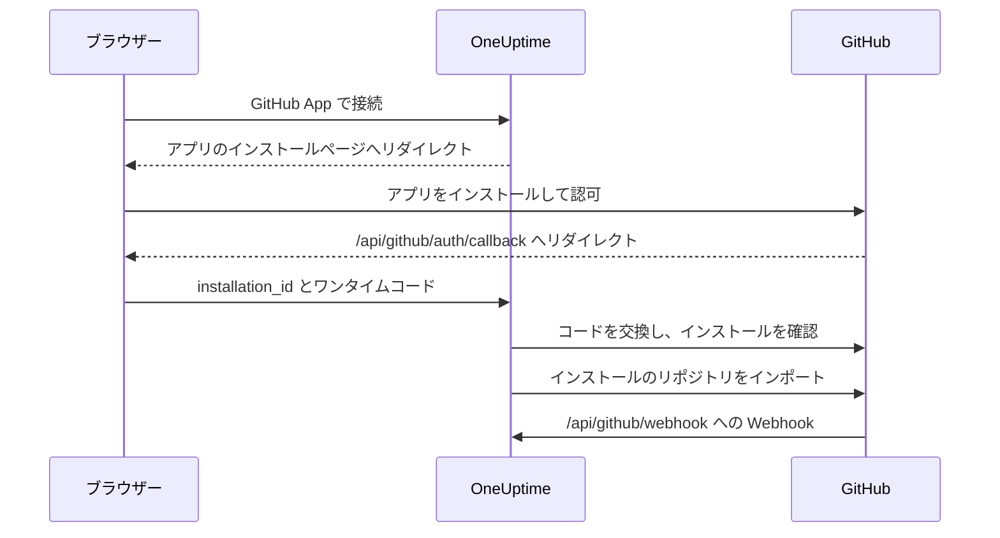

# GitHub 統合

自分が所有する GitHub App を使って、セルフホストの OneUptime を GitHub に接続します。OneUptime からアプリをインストールすると、インストールのリポジトリがプロジェクトにインポートされて同期が保たれ、AI 修正タスクが pull request を作成し、チームは GitHub でアプリにメンションして作業を任せられるようになります。

このページは OneUptime サーバーを運用する人向けです。アプリは一度だけ作成し、その後は各プロジェクトが **コードリポジトリ** から接続します。

:::cards
- [GitHub App を作成する](#github-app-を作成する): 正しい URL、権限、イベントでアプリを登録します。
- [OneUptime を設定する](#oneuptime-を設定する): アプリの 6 つの値をサーバーに設定します。
- [リポジトリを接続する](#リポジトリを接続する): OneUptime からアプリをインストールします。
- [トラブルシューティング](#トラブルシューティング): コードリポジトリのメッセージの意味。
:::

## 仕組み

インストールは GitHub ではなく OneUptime から始めます。OneUptime が GitHub へ送り出すときのリンクが、インストールをプロジェクトに結び付けます。



- ブラウザーのリダイレクトには、インストールとワンタイムの OAuth コードが含まれます。OneUptime はコードを交換して、アプリをインストールした GitHub アカウントがそのインストールを管理していることを確認し、そのリポジトリをインポートします。
- Webhook はリポジトリの一覧を同期し、アプリに作業を渡します。メンション、割り当て、トリガーラベル、レビュー依頼です。GitHub はそれぞれに webhook secret で署名し、OneUptime は検証できないものを拒否します。

## 始める前に

- アプリをインストールする組織またはユーザーのために GitHub App を作成できる GitHub アカウント。組織にインストールするには、その組織のオーナーであるか、オーナーにリクエストを承認してもらう必要があります。
- GitHub が Webhook のために到達できる、OneUptime の公開 HTTPS ホスト名。 [ネットワークアクセス](#セルフホスト環境のネットワークアクセス) を参照してください。
- サーバーの設定へのアクセス。Docker Compose では `config.env`、Kubernetes では Helm の values です。

## GitHub App を作成する

:::steps
### GitHub App の設定を開く

- **組織の場合:** `https://github.com/organizations/YOUR_ORG/settings/apps`
- **個人アカウントの場合:** `https://github.com/settings/apps`

**New GitHub App** を選択します。

### 登録フォームに入力する

| フィールド | 値 |
| --- | --- |
| **GitHub App name** | 一意の任意の名前。たとえば `OneUptime`。正確に控えておきます。これが `GITHUB_APP_NAME` です。 |
| **Homepage URL** | `https://your-oneuptime-domain.com` |
| **Callback URL** | `https://your-oneuptime-domain.com/api/github/auth/callback` |
| **Request user authorization (OAuth) during installation** | オン。 **これは必須です** 。下の注記を参照してください。 |
| **Setup URL** | GitHub が入力を許可する場合は `https://your-oneuptime-domain.com/api/github/auth/callback` (下記参照)。 |
| **Redirect on update** | 任意。誰かが GitHub でインストールを変更すると、OneUptime はその人を **コードリポジトリ** に案内します。 |
| **Webhook URL** | `https://your-oneuptime-domain.com/api/github/webhook`。Webhook は **Active** にします。 |
| **Webhook secret** | 長いランダムな文字列。控えておきます。これが `GITHUB_APP_WEBHOOK_SECRET` です。 **必須** : OneUptime は署名のない Webhook を拒否するため、`GITHUB_APP_WEBHOOK_SECRET` を未設定のままにすると、検証されていないペイロードを受け入れるのではなく、リポジトリの同期が止まります。 |

GitHub のドキュメントによると、 **Request user authorization (OAuth) during installation** をオンにすると [Setup URL は入力できません](https://docs.github.com/en/apps/creating-github-apps/registering-a-github-app/about-the-setup-url)。代わりに、ユーザーはアプリのインストール後に Callback URL へ送られます。どちらも同じ OneUptime のアドレスを指すため、いずれにしてもリダイレクトは正しい場所に届きます。

> [!IMPORTANT]
> **「Request user authorization (OAuth) during installation」が必須である理由。** インストール後、GitHub は URL に `installation_id` を付けてリダイレクトします。この番号だけでは、インストールの所有者について何も証明できません。誰でも別の番号を入力できるからです。このオプションを有効にすると、GitHub はインストールを実行した GitHub アカウントに結び付いた使い捨ての OAuth `code` も返します。OneUptime はそれを交換し、そのアカウントが本当にインストールを管理していることを確認してから、プロジェクトに接続します。
>
> これがないと、OneUptime はインストールの接続を拒否し、ダッシュボードはこの設定を有効にするよう求めるエラーを表示します。これは意図的な動作です。インストール ID を検証せずに受け入れると、ある OneUptime プロジェクトが別の組織のリポジトリを自分のものにできてしまいます。

### 権限を設定する

**Permissions & events** で、次の **Repository permissions** を設定します。

| 権限 | アクセス | OneUptime の用途 |
| --- | --- | --- |
| Contents | Read and write | リポジトリのファイルを読み取り、AI 修正の pull request のブランチを push する |
| Pull requests | Read and write | pull request を作成・更新し、レビューを投稿する |
| Issues | Read and write | アプリのコメントを投稿する。 **pull request でも同様** で、GitHub は pull request の会話を issues API 経由で扱います |
| Checks | Read-only | 任意。修正の pull request の CI 結果を読み取る。これがないと、CI の状態は未検証のままです |
| Metadata | Read-only | リポジトリの基本的なメタデータ (GitHub が必須としています) |

**アプリを対話的にするのは Issues: Read and write です。** これがないと、メンションは受信されるものの、アプリが返信しようとした時点で何も言わずに失敗します。GitHub は pull request の会話のコメントを issues API から提供するため、アプリが書くすべての返信はこの 1 つの権限にかかっています。 [GitHub から OneUptime を使う](/docs/ai/github-app) を参照してください。

OneUptime には、組織やアカウントの権限は必要ありません。

### Webhook イベントを購読する

OneUptime は 2 種類のイベントを使い、それぞれ役割が異なります。

**リポジトリの同期** : `installation` と `installation_repositories`。GitHub App はこれらを自動的に受信します。接続されたリポジトリの集合を、アプリのインストール先と一致させ続けます。

**対話的なアプリ** : これらは明示的に購読する必要があり、それぞれがアプリに作業を渡す特定の方法を有効にします。

| イベント | 有効になること |
| --- | --- |
| **Issue comment** | issue **および** pull request での `@mention` コマンド |
| **Issues** | issue をアプリに割り当てることと、リポジトリのトリガーラベル |
| **Pull request** | アプリにレビューを依頼すること |
| **Pull request review** | 送信されたレビューの本文に書かれたメンション |
| **Pull request review comment** | diff のインラインコメントでのメンション |

これらをどれも購読していなくても、GitHub App はリポジトリを接続し、OneUptime から修正の pull request を作成します。ただし、GitHub で書かれたことには一切応答しません。これが「ボットに無視される」の最も一般的な原因です。コマンドの内容と、誰が使えるかについては [GitHub から OneUptime を使う](/docs/ai/github-app) を参照してください。

その他のイベント ( **Push**、 **Workflow run** ) は受信確認されたうえで無視されます。これらを購読しても、通知や CI/CD の自動化は有効になりません。

### アプリをインストールできる場所を選ぶ

**Where can this GitHub App be installed?** で次から選びます。

- **Only on this account** - 非公開/社内での利用向け
- **Any account** - 他の人にもアプリをインストールしてもらう場合

### アプリを作成して ID を控える

**Create GitHub App** を選択します。GitHub がアプリの設定ページを開きます。ページ上部の **App ID** と、 **About** セクションの **Client ID** を控えます。

### client secret を生成する

**Client secrets** で **Generate a new client secret** を選択します。すぐにコピーしてください。GitHub は一度しか表示しません。

### 秘密鍵を生成する

**Private keys** で **Generate a private key** を選択します。GitHub が `.pem` ファイルをダウンロードします。安全に保管してください。OneUptime はこれを使ってアプリとして認証します。
:::

## OneUptime を設定する

:::tabs
@tab Docker Compose
`config.env` は 1 行に 1 つの値を持つため、秘密鍵は base64 でエンコードして 1 行で指定します。OneUptime がデコードします。

```bash
base64 < private-key.pem | tr -d '\n'
```

```bash title="config.env"
GITHUB_APP_ID=YOUR_APP_ID
GITHUB_APP_NAME=YOUR_APP_NAME
GITHUB_APP_CLIENT_ID=YOUR_CLIENT_ID
GITHUB_APP_CLIENT_SECRET=YOUR_CLIENT_SECRET
GITHUB_APP_PRIVATE_KEY=YOUR_BASE64_ENCODED_PRIVATE_KEY
GITHUB_APP_WEBHOOK_SECRET=YOUR_WEBHOOK_SECRET
```

変更は、コンテナーを作り直す `npm run start` で適用します。`docker compose restart` では `config.env` は読み込み直されません。
@tab Kubernetes
```yaml title="values.yaml"
gitHubApp:
  id: "YOUR_APP_ID"
  name: "YOUR_APP_NAME" # The exact name of your GitHub App
  clientId: "YOUR_CLIENT_ID"
  clientSecret: "YOUR_CLIENT_SECRET"
  privateKey: "<BASE64_ENCODED_PRIVATE_KEY_CONTENT>"
  webhookSecret: "YOUR_WEBHOOK_SECRET"
```

`privateKey` には PEM そのものを複数行のブロック (`privateKey: |`) として指定することもできます。変更は `helm upgrade` で適用します。
:::

OneUptime が再び起動すると、 **コードリポジトリ** には **このサーバーでは GitHub App が設定されていません** の代わりに **GitHub App で接続** が表示されます。

### 環境変数リファレンス

| Docker Compose (`config.env`) | Helm (`values.yaml`) | 値 |
| --- | --- | --- |
| `GITHUB_APP_ID` | `gitHubApp.id` | **App ID**。アプリとして認証するのに使います。 |
| `GITHUB_APP_NAME` | `gitHubApp.name` | アプリの正確な名前。インストールリンクとアプリの `@mention` ハンドル (小文字、スペースはハイフン) はこれから作られます。これがないと、 **コードリポジトリ** は接続できません。 |
| `GITHUB_APP_CLIENT_ID` | `gitHubApp.clientId` | **Client ID**。アプリをインストールした人を確認するのに必要です。 |
| `GITHUB_APP_CLIENT_SECRET` | `gitHubApp.clientSecret` | 生成した client secret。client ID とともに必要です。 |
| `GITHUB_APP_PRIVATE_KEY` | `gitHubApp.privateKey` | 秘密鍵。PEM、または base64 でエンコードした PEM です。 |
| `GITHUB_APP_WEBHOOK_SECRET` | `gitHubApp.webhookSecret` | webhook secret。すべての Webhook はこれで検証され、これがなければどれも受け入れられません。 |

6 つすべてが必須です。

## リポジトリを接続する

接続は GitHub のアプリのページからではなく、OneUptime から始めます。OneUptime が GitHub へ送り出すときのリンクが、インストールをプロジェクトに結び付けます。

:::steps
1. OneUptime のダッシュボードにログインします
2. **製品** > **タスク** > **コードリポジトリ** に移動します
3. **GitHub App で接続** をクリックします。OneUptime が GitHub に案内します
4. アプリをインストールする組織またはアカウントを選び、アクセスできるリポジトリを選びます。 **All repositories** (現在と今後のすべてのリポジトリ) か **Only select repositories** です
5. **Install** をクリックします (そこにアプリがすでにインストールされている場合は **Save** )
6. GitHub から **コードリポジトリ** に戻り、インストールのすべてのリポジトリがインポートされます。あとからインストールに追加または削除されたリポジトリも自動的に同期されます。
:::

**接続できる人。** 接続するとインストールのリポジトリがプロジェクトにインポートされるため、コードリポジトリを追加する権限が必要です。 **Project Owner**、 **Project Admin**、 **Project Member**、 **Settings Admin**、 **Settings Member**、または **Create Code Repository** を持つチームです。この権限をブロックしているチームは、権限を取り消します。OneUptime Cloud では、コードリポジトリには Growth プラン以上が必要です。それ以外の人にはカードがロックされ、必要なものが表示されます。

**同じブラウザーで 15 分以内に完了してください。** リンクは、開始したブラウザーで 15 分間、1 回だけ使えます。GitHub から戻ると、OneUptime は何かをインポートする前に権限をもう一度確認します。

## セルフホスト環境のネットワークアクセス

### トラフィックの方向とエンドポイント

| トラフィック | 必要なアクセス |
| --- | --- |
| OneUptime から GitHub | DNS と、GitHub App のトークンとリポジトリの API 呼び出しのための `api.github.com` への TCP 443 のアウトバウンド HTTPS、および OAuth トークンの交換と HTTPS による Git 操作のための `github.com` へのアウトバウンド HTTPS |
| GitHub から OneUptime | インストールとリポジトリへのアクセスの同期、および対話的なアプリのための、`POST /api/github/webhook` への TCP 443 の公開 HTTPS |
| ユーザーのブラウザーから OneUptime | ダッシュボードへのアクセスと、インストールと認可のリダイレクトのための `GET /api/github/auth/callback`。これらはユーザーの VPN 経由のアクセスのままでかまいません |

callback は [ブラウザーのリダイレクト](https://docs.github.com/en/apps/creating-github-apps/registering-a-github-app/about-the-user-authorization-callback-url) ですが、Webhook は GitHub のサーバーからのリクエストです。ユーザーの VPN 接続では、GitHub は Webhook にアクセスできません。上記のドメインは統合の中心となるリクエストを対象としています。リポジトリ用の追加ツール、ダウンロード、LFS、パッケージには、ほかの宛先が必要になる場合があります。これらの設定は GitHub.com についてのものです。ファイアウォールを変更しても、GitHub Enterprise Server のホスト名に対応するよう設定されるわけではありません。

### プライベートな環境とコールバックのセキュリティ

公開 DNS、完全なチェーンを備えた公的に信頼された HTTPS 証明書、OneUptime の ingress へのプライベートなルートを持つ公開ゲートウェイを通じて `/api/github/webhook` を公開します。ゲートウェイへのインバウンドの TCP 443 を許可し、公開側の転送はこの POST ルートに限定します。ユーザーが VPN 経由でアクセスする場合、ダッシュボードとブラウザーの callback はプライベートな ingress のままにします。スプリット DNS を使えば、同じホスト名を内部と外部の両方で提供できます。

`config.env` で `HOST=oneuptime.example.com` と `HTTP_PROTOCOL=https` を、または Helm で `host: oneuptime.example.com` と `httpProtocol: https` を設定します。設定を適用し、OneUptime が再起動するまで待ちます。これらの値は URL を生成するだけで、DNS、TLS、ネットワークアクセスを用意するものではありません。ホスト名が変わった場合は、GitHub App の webhook、callback、setup、ホームページの URL を更新してください。

メソッド、元のパス、クエリ文字列、ボディ、`Content-Type`、`X-Hub-Signature-256`、`X-GitHub-Event`、`X-GitHub-Delivery` を保持します。公開ホストと HTTPS スキームは、信頼できるプロキシヘッダーで保持します。Webhook はブラウザーの SSO、CAPTCHA、プロキシのログインページの対象から外します。GitHub の SSL 検証は有効なままにし、両方のシステムに同じ `GITHUB_APP_WEBHOOK_SECRET` を設定します。OneUptime は署名のないリクエストを拒否し、このシークレットがなければ Webhook を検証できません。GitHub の [Webhook の検証に関するガイダンス](https://docs.github.com/en/webhooks/using-webhooks/validating-webhook-deliveries) を参照してください。

Webhook の送信元 IP も制限する場合は、GitHub の Meta API にある現在の `hooks` の範囲を使い、定期的に更新してください。GitHub Actions のランナーの範囲で代用したり、署名の検証を省いたりしないでください。GitHub は、 [アドレスは変わることがあり、公開されている一覧は網羅的ではない](https://docs.github.com/en/authentication/keeping-your-account-and-data-secure/about-githubs-ip-addresses) と注意しています。

### アクセスの確認と制限事項

:::steps
1. **コードリポジトリ** からインストールを接続します。
2. GitHub App の設定で **Advanced** を開き、 **Recent Deliveries** を確認します。配信を再送し、ゲートウェイが転送して OneUptime が受け入れることを確認します。
3. インストールにテスト用のリポジトリを追加または削除し、OneUptime のリポジトリ一覧がそれに従うことを確認します。
:::

GitHub は [配信の診断](https://docs.github.com/en/webhooks/testing-and-troubleshooting-webhooks/viewing-webhook-deliveries) について説明しており、 [10 秒以内の 2xx 応答](https://docs.github.com/en/webhooks/using-webhooks/best-practices-for-using-webhooks) を求めています。ブラウザーから Webhook への GET では、署名付きの POST はテストできません。

> [!WARNING]
> インバウンドのアクセスがない場合、ブラウザーでの認可とアウトバウンドの API と Git の操作は動作することがありますが、Webhook は OneUptime に届きません。削除されたインストールやリポジトリへのアクセスの変更は同期されず、アプリはメンション、割り当て、レビュー依頼に一切応答しません。

[プライベートネットワークへのアクセス設定](/docs/self-hosted/private-network-access) は、プライベートな宛先へのアウトバウンドのリクエストを制御するもので、Webhook を GitHub から到達可能にするものではありません。

## トラブルシューティング

### 接続が完了しなかった

GitHub から戻ったときにインストールが接続されていなければ、 **コードリポジトリ** に **GitHub は接続されませんでした** と、その理由を説明する一文があなたの言語で表示されます。ページの残りの部分は通常どおり読み込まれるので、その場で接続し直せます。GitHub 自身の応答は表示されません。それは理由とともに OneUptime サーバーのログに記録されています。

| ページの表示 | 対処方法 |
| --- | --- |
| **"この接続リンクは無効か、有効期限が切れているか、すでに使用されています。最初からやり直してください。"** | リンクは、開始したブラウザーで 15 分間、1 回だけ使えます。 **コードリポジトリ** からやり直し、同じブラウザーで 15 分以内に GitHub での操作を終えてください。GitHub のアプリのページからインストールしても、どのプロジェクトにも接続されません。 |
| **"このプロジェクトにコードリポジトリを追加する権限がありません。"** | 接続には、コードリポジトリを追加する権限が必要です ( [リポジトリを接続する](#リポジトリを接続する) を参照)。プロジェクトの管理者に付与を依頼してください。GitHub から戻ったときにもう一度確認されるため、その間に権限が外された場合もここで接続は終了します。 |
| **"GitHub に接続するには、... プランが必要です。"** | OneUptime Cloud では、コードリポジトリには文中のプランが必要です。プロジェクトのプランをアップグレードしてから、もう一度接続してください。 |
| **"GitHub がアプリをインストールしたユーザーを確認できなかったため、インストールを検証できませんでした。"** | GitHub App の設定で **Request user authorization (OAuth) during installation** をオンにし ( [GitHub App を作成する](#github-app-を作成する) を参照)、もう一度接続します。 |
| **"OneUptime は、お使いの GitHub アカウントがこのインストールを管理できることを確認できませんでした。"** | インストールを完了した GitHub アカウントは、そのインストールを管理していません。インストール先の組織またはユーザーを所有するアカウントでアプリをインストールするか、オーナーに依頼してください。 |
| **"GitHub からインストールが返されませんでした。"** | 組織のメンバーがアプリをインストールする代わりにリクエストした場合は、まず組織のオーナーがリクエストを承認する必要があります。承認されたら、もう一度接続します。 |
| **"この OneUptime サーバーでは GitHub App が設定されていません。"** | `GITHUB_APP_CLIENT_ID` と `GITHUB_APP_CLIENT_SECRET` の両方を設定し ( [OneUptime を設定する](#oneuptime-を設定する) を参照)、OneUptime を再起動します。 |
| **"OneUptime は接続を完了できませんでした。もう一度お試しください。"** | GitHub がエラーを返したか、完了処理中にリクエストまたは書き込みが失敗しました。どちらかは OneUptime サーバーのログでわかります。もう一度試し、それでも続く場合はログと GitHub App の設定を確認してください。 |

### その他の問題

:::details コードリポジトリに「このサーバーでは GitHub App が設定されていません」と表示される
`GITHUB_APP_NAME` が設定されていません。ほかの 5 つの値とともにアプリの正確な名前を設定し、OneUptime を再起動します。
:::

:::details アプリをインストールしても OneUptime に戻らない
アプリの **Callback URL** が `https://your-oneuptime-domain.com/api/github/auth/callback` であることを確認します。 **Setup URL** を設定している場合はそちらも確認します。どちらも `HOST` のホスト名上の同じ `/api/github/auth/callback` エンドポイントを指している必要があります。
:::

:::details GitHub の Recent Deliveries に "Invalid webhook signature" と表示される
GitHub App の webhook secret と `GITHUB_APP_WEBHOOK_SECRET` が異なるか、`GITHUB_APP_WEBHOOK_SECRET` が設定されていないか、プロキシがリクエストのボディを変更しています。両方に同じシークレットを設定し、OneUptime を再起動して、ゲートウェイがボディを変更せずに転送することを確認します。
:::

:::details Webhook イベントが届かない
Webhook の URL に HTTPS で公開的に到達できることを確認し、続いて GitHub App の設定の **Advanced > Recent Deliveries** で各試行とその応答を確認します。`GITHUB_APP_WEBHOOK_SECRET` が未設定の間、Webhook は拒否されます。
:::

:::details リポジトリや修正タスクが認証エラーで失敗する
OneUptime は `GITHUB_APP_ID` と `GITHUB_APP_PRIVATE_KEY` を使ってアプリとして認証します。App ID が正しいこと、そして鍵が `BEGIN` と `END` の行を含む完全な PEM か、その PEM を base64 でエンコードしたものであることを確認します。GitHub からアプリがアンインストールされた場合は、 **コードリポジトリ** からもう一度接続します。
:::

:::details インストール後にリポジトリが足りない
GitHub のインストールの設定で、インストールがアクセスできるリポジトリを確認します。そこで追加したリポジトリは、Webhook が OneUptime に届く限り自動的にインポートされます。
:::

:::details アプリが GitHub でのメンションを無視する
アプリに **Issues: Read and write** を付与し、 [Webhook イベントを購読する](#webhook-イベントを購読する) の対話的なイベントを購読させます。また、メンションは `GITHUB_APP_NAME` から作られたハンドルにしか一致しないため、そこにはアプリの実際の名前を設定してください。
:::

## セキュリティのベストプラクティス

- **シークレットを定期的にローテーションしてください。** 新しい client secret と秘密鍵を定期的に生成します。
- **webhook secret は設定したままにしてください。** OneUptime は検証できない Webhook を拒否します。
- **リポジトリへのアクセスを制限してください。** 接続が必要なリポジトリだけをインストールに許可します。
- **Webhook の配信を監視してください。** 失敗した配信や不審なアクティビティがないか、定期的に確認します。
- **秘密鍵はバージョン管理に含めないでください。**

## 次のステップ

:::cards
- [GitHub から OneUptime を使う](/docs/ai/github-app): アプリに出せるコマンドと、それを出せる人。
- [修正タスク](/docs/ai/ai-agent): AI エージェントが修正の pull request を作成する仕組み。
- [プライベートネットワークへのアクセス](/docs/self-hosted/private-network-access): ワークフローと Webhook が社内ツールに到達できるようにします。
:::
