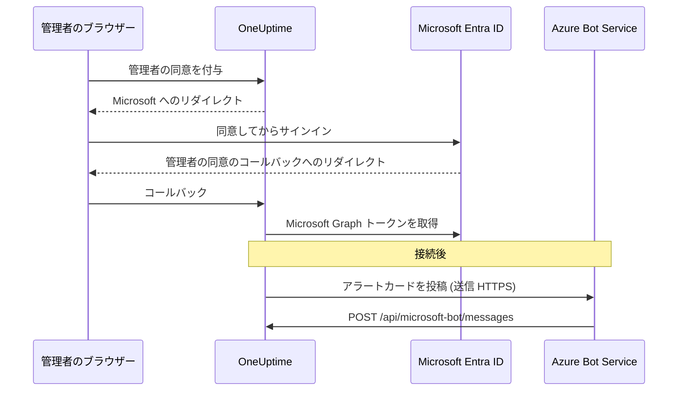
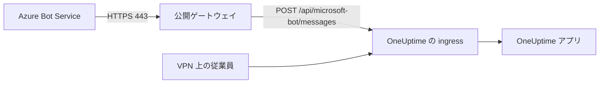

# Microsoft Teams 統合

セルフホストの OneUptime を Microsoft Teams に接続します。Microsoft Entra ID にアプリを登録し、そのアプリ用の Azure Bot を作成し、アプリの資格情報を OneUptime に渡して、サーバーが生成する Teams アプリパッケージをインストールします。以降、OneUptime はアラートとインシデントをチャネルやチャットに投稿し、チームは Teams からそのまま対応できます。

このページは OneUptime サーバーを運用する人向けです。Teams を接続したら、通知ルールはプロジェクトごとに設定します。[Microsoft Teams](/docs/workspace-connections/microsoft-teams) を参照してください。

:::cards
- [統合をセットアップする](#統合をセットアップする): Azure ポータルから最初のチームまでの 9 つのステップ。
- [環境変数](#環境変数): OneUptime がアプリ登録から必要とする 3 つの値。
- [ネットワークアクセス](#ネットワークアクセス): Microsoft から到達できなければならないボットのエンドポイント。
- [トラブルシューティング](#トラブルシューティング): 到達できないエンドポイント、足りないインストール、失敗した接続。
:::

## 仕組み

OneUptime は Teams 統合に Azure Bot を使います。通信は双方向で、2 つの方向は互いに独立しています。OneUptime はメッセージを投稿するために Microsoft を呼び出し、Azure Bot Service は誰かがボタンを押したとき、ボットにメッセージを送ったとき、ボットをチャットに追加したときにサーバーを呼び出します。



Incoming Webhook や Teams のワークフロー URL は、このボットのメッセージングエンドポイントの代わりにはなりません。

ビデオ通話 (インシデント用の Teams 会議) はこのボットを使いません。独自のアプリ登録が必要で、[ビデオ通話](/docs/workspace-connections/video-calls#セルフホストのサーバーでのワンクリック接続) で説明しています。

## 始める前に

- Azure Bot リソース用の Azure サブスクリプション。
- Microsoft Entra ID でアプリ登録を作成できるアカウントと、管理者の同意を付与する Microsoft 365 管理者。
- Azure Bot Service から到達できる、OneUptime の公開 HTTPS ホスト名。[ネットワークアクセス](#ネットワークアクセス) を参照してください。
- サーバー設定へのアクセス (Docker Compose なら `config.env`、Kubernetes なら Helm の values)。
- プロジェクトを接続するには、そのプロジェクトでの **Project Owner**、**Project Admin**、**Project Member** のいずれかのロール。

## 統合をセットアップする

:::steps
### ステップ 1: Azure のアプリ登録を作成する

[Azure ポータル](https://portal.azure.com) で **App registrations** を開き、**New registration** を選択します。フォームに次のように入力します。

- **Name:** oneuptime
- **Supported account types:** Accounts in this organizational directory only (Single tenant)
- **Redirect URI:** Web - `https://your-oneuptime-domain.com/api/microsoft-teams/auth`

**Register** を選択し、2 つ目の Web リダイレクト URI として `https://your-oneuptime-domain.com/api/microsoft-teams/admin-consent/callback` を追加します。**Application (client) ID** と **Directory (tenant) ID** を控えておいてください。どちらも後で必要になります。

> [!NOTE]
> **シングルテナントにする理由:** セルフホストの OneUptime は 1 つの組織にサービスを提供し、そのボットは `MICROSOFT_TEAMS_APP_TENANT_ID` (ステップ 6) で設定した 1 つのテナント用に登録されます。アプリをマルチテナントとして登録しても対象は広がらず、失敗の原因が 1 つ増えるだけです。ホームの Microsoft テナントがあなたのテナントと異なるゲスト / B2B ユーザーは自分のテナント ID でボットにアクセスし、OneUptime はそれをあなたのプロジェクトに対応付けられません。すでにマルチテナントのアプリを登録している場合もそのまま動作します。`MICROSOFT_TEAMS_APP_TENANT_ID` が自分のテナントであることを確認し、ゲストアカウントがボットを使うにはあなたのテナントのアカウントが必要になると考えてください。

### ステップ 2: アプリのアクセス許可を設定する

アプリ登録で **API permissions** を開き、**Add a permission** を選択して **Microsoft Graph** を選びます。

**委任されたアクセス許可を追加** (サインインしたユーザーの代わりに動作する場合):

- **User.Read** - OAuth フローの中で、認証されたユーザーのプロファイル情報 (表示名、メール) を取得するために必要
- **Team.ReadBasic.All** - 接続するチームを選ぶときに、ユーザーがメンバーになっているチームを一覧表示するために必要
- **Channel.ReadBasic.All** - チャネル情報を読み取り、通知の配信先としてチームのチャネルを一覧表示するために必要
- **ChannelMessage.Send** - アラートとインシデントの通知を Teams のチャネルに送信するために必要

**アプリケーションのアクセス許可を追加** (サインインしたユーザーなしで、アプリ自身として動作する場合):

- **Team.ReadBasic.All** - 管理者の同意が付与された後、組織内のすべてのチームを一覧表示するために必要
- **Channel.ReadBasic.All** - チャネルが存在することを確認し、その詳細を取得するために必要
- **TeamsAppInstallation.ReadForTeam.All** - 診断に必要。チームに実際にインストールされているアプリパッケージを OneUptime が読み取り、このデプロイのクライアント ID と比較できるようになるため、送信に失敗したときに考えられる原因の *どれ* なのかを伝えられます。この許可がないと、OneUptime は「インストールされていない」と「インストールされているが、他人のパッケージ」を区別できず、Microsoft の応答をそのまま伝えることしかできません。この統合のデバッグに数分ではなく数日かかる最大の理由がこれです。付与してください。
- **Chat.ReadBasic.WhereInstalled** - 任意。OneUptime アプリが参加している各チャットの名前を OneUptime が読み取れるようにします。この許可がない場合、各チャットはマニフェストの **ChatSettings.Read.Chat** アクセス許可 (下記) を通じてこれを付与します。古いマニフェストで追加されたチャットは、そのチャットでアプリが更新されて初めてこの許可を持ちます。

`ChannelMessage.Send` は委任されたアクセス許可のみで、[Microsoft Graph のアクセス許可リファレンス](https://learn.microsoft.com/en-us/graph/permissions-reference#channelmessagesend) にはアプリケーションのアクセス許可としての版がありません。上の委任されたアクセス許可の一覧に入れたままにしてください。

次に、組織に対して **Grant admin consent** を選択します。

ボット自体は、Teams アプリのマニフェストで定義されたリソース固有の同意 (RSC) のアクセス許可を使います。これらは Entra ID ではなく、アプリがチームやチャットにインストールまたは更新されたときに付与されます。

- **ChannelMessage.Send.Group** - ボットがチームのチャネルにメッセージを送信できるようにします
- **ChannelMessage.Read.Group** - 対話型コマンドのために、ボットがチャネルのメッセージを読み取れるようにします
- **Channel.Create.Group** - 必要に応じて、ボットがチャネルを作成できるようにします
- **ChatMessage.Read.Chat** - ボットが追加されたチャットのメッセージを読み取れるようにします (対話型コマンド用)
- **ChatMember.Read.Chat** - ボットが追加されたチャットのメンバーを読み取れるようにします (OneUptime でチャットに名前を付けるため)
- **ChatSettings.Read.Chat** - アプリが追加されたグループチャットの名前を OneUptime が読み取れるようにします。Teams はグループチャットの名前を確実にはボットに送らないため、この許可がないと、名前の付いたグループチャットがメンバーの名前で表示されます
- **TeamsAppInstallation.Read.Group** - 投稿しようとしているチームにアプリがインストールされていることを OneUptime が確認できるようにします

これらのアクセス許可ができる前にアプリのマニフェストをアップロードした場合は、**プロジェクト設定 > ワークスペース > Microsoft Teams** からもう一度ダウンロードし、OneUptime アプリの更新として Teams にアップロードしてください。Teams はアプリがそのチームやチャットにインストールまたは更新されたときにチームとチャットのアクセス許可を付与するため、すでにアプリがあるすべてのチームとチャットで更新を承認してください。チャットについては [グループチャットがメンバーの名前で表示される](#グループチャットがメンバーの名前で表示される) を参照してください。

### ステップ 3: クライアントシークレットを作成する

アプリ登録で **Certificates & secrets** を開き、**New client secret** を選択します。説明を追加し、有効期限を選び (24 か月が妥当な選択です)、**Add** を選択します。シークレットの値はすぐにコピーしてください。Azure が表示するのは 1 回だけです。

> [!IMPORTANT]
> コピーするのはシークレットの **Value** で、**Secret ID** ではありません。値のほうが長い文字列です。

### ステップ 4: Bot Service を作成する

Azure ポータルで **Azure Bot** リソースを作成します。

- **Bot handle:** oneuptime-bot
- **Subscription** と **Resource group:** 自分のもの
- **Pricing tier:** テストには F0 (Free) で十分
- **Type of App:** Single Tenant。既存のアプリ登録の、ステップ 1 の **Application (client) ID** と **Directory (tenant) ID** を指定

**Review + create**、続いて **Create** を選択します。ボットのデプロイが終わったら、その **Configuration** ページを開き、**Messaging endpoint** を `https://your-oneuptime-domain.com/api/microsoft-bot/messages` に設定して保存します。

**先に進む前にエンドポイントを確認してください。** Azure Bot Service はこの URL を公開インターネットから呼び出すため、自分のネットワークの外から確認します。クラスターの内部からや、Azure には見えないホストが見える VPN 経由で確認しても意味がありません。

```bash
curl -sS -i https://your-oneuptime-domain.com/api/microsoft-bot/messages
```

ステータスコードだけを見るのではなく `-i` を使ってください。404 の場合、**誰がそれを生成したかを教えてくれるのは本文だけ**であり、その区別こそが診断のすべてです。

- **405** が正しい応答で、これが返れば完了です。エンドポイントは POST のみを受け付けるため、GET には `Allow: POST` とエンドポイントの説明付きで `405 Method Not Allowed` が返ります。そこに到達できること自体がテストの対象です。
- **JSON の本文 `{"message":"Page not found - /api/microsoft-bot/messages"}` を伴う 404** は OneUptime から返されたものなので、リクエストは *届いています*。このデプロイが上記の 405 応答より古い (古いバージョンはこのルートを POST にしか提供していなかったため、GET は汎用の「not found」ハンドラーに入っていた) か、OneUptime の手前の何かがパスを書き換え、アプリに届く前に `/api` プレフィックスを取り除いています (よくある原因は `rewrite-target: /` を設定した Kubernetes の ingress です)。
- nginx、ingress、ロードバランサーが返す **HTML のエラーページを伴う 404** はその逆で、リクエストは OneUptime に届いておらず、手前にあるものが `/api` をアプリにルーティングしていません。
- **TLS エラー、タイムアウト、接続拒否** は、Azure も到達できないことを意味します。下にある [メッセージングエンドポイントのトラブルシューティング](#カードのボタンに-unable-to-reach-app-と表示されチャットが表示されない) を参照してください。

### ステップ 5: ボットに Microsoft Teams チャネルを追加する

Azure Bot リソースで **Channels** を開き、**Microsoft Teams** を追加します。特別な要件がない限りメッセージングの既定のオプションのままにして、保存します。このチャネルがないと、ボットは Teams の会話にプロビジョニングされません。

### ステップ 6: OneUptime の環境変数を設定する

アプリの資格情報を OneUptime に渡します。

:::tabs
@tab Docker Compose
```bash title="config.env"
MICROSOFT_TEAMS_APP_CLIENT_ID=YOUR_TEAMS_APP_CLIENT_ID
MICROSOFT_TEAMS_APP_CLIENT_SECRET=YOUR_TEAMS_APP_CLIENT_SECRET
MICROSOFT_TEAMS_APP_TENANT_ID=YOUR_MICROSOFT_TENANT_ID
```

コンテナーを作り直す `npm run start` で変更を反映します。`docker compose restart` は `config.env` を読み直しません。
@tab Kubernetes
```yaml title="values.yaml"
microsoftTeamsApp:
  clientId: YOUR_TEAMS_APP_CLIENT_ID
  clientSecret: YOUR_TEAMS_APP_CLIENT_SECRET
  tenantId: YOUR_MICROSOFT_TENANT_ID
```

自分で管理する Kubernetes の Secret に値を保存する場合は、代わりに `microsoftTeamsApp.existingSecret` に、その `name` とキー `clientIdKey`、`clientSecretKey`、`tenantIdKey` を設定します。`helm upgrade` で変更を反映します。
:::

OneUptime が再び起動すると、**プロジェクト設定 > ワークスペース > Microsoft Teams** にセットアップガイドの代わりに **管理者の同意を付与** カードが表示されます。

### ステップ 7: OneUptime で管理者の同意を付与する

**プロジェクト設定 > ワークスペース > Microsoft Teams** を開き、**管理者の同意を付与** を選択します。Microsoft 365 管理者として Microsoft にサインインし、アクセス許可を承認します。Microsoft から同じページに戻り、カードに **管理者の同意が完了しました** と表示されます。これでプロジェクトがテナントに接続されました。

続いて **自分のアカウントを Microsoft Teams に接続** を選択し、自分のアカウントをリンクします。ほかのプロジェクトメンバーも **ユーザー設定 > ワークスペース > Microsoft Teams** から同じ操作をします。

### ステップ 8: Teams アプリのマニフェストをアップロードする

管理者の同意の後、**プロジェクト設定 > ワークスペース > Microsoft Teams** に **対応が必要です: このデプロイのアプリを Microsoft Teams にインストールしてください** カードが表示されます。**アプリマニフェストの Zip をダウンロード** を選択します。パッケージにはこのデプロイのボット ID が入っています。

Microsoft Teams で **Apps > Manage your apps** を開き、**Upload an app**、続いて **Upload a custom app** を選択して、ダウンロードした zip を選びます。

> [!WARNING]
> セルフホストのデプロイでは、Microsoft Teams ストアから「OneUptime」をインストールしないでください。ストアのアプリは OneUptime Cloud のボットを指しているため、Teams はそれを受け入れたうえで、このデプロイが送るすべてのメッセージを拒否します。

### ステップ 9: 各チームに OneUptime を追加する (必須)

マニフェストをアップロードすると、アプリは **あなた** 用にインストールされます。それだけではボットはどのチームのチャネルにもアクセス **できません**。Microsoft はアプリが追加されたチームのメッセージしか受け付けないため、通知を受け取りたいすべてのチームでこの操作が必要です。

1. Microsoft Teams で、**チーム名** (チャネル名ではありません) の横にある「...」をクリックします
2. **Manage team** > **Apps** > **More apps** を選びます
3. **OneUptime** を検索し、**Add** をクリックします

注意:

- OneUptime を自分用にインストールすることや、チャットに追加することは、**別の** インストールです。どちらでも、チームのチャネルに投稿できるようにはなりません。
- **プライベートチャネル** では、チャネル自体にアプリをインストールする必要があります。チャネルを開き、「...」 > **Manage channel** > **Apps** > **Add an app** を選びます。チームレベルのインストールはプライベートチャネルには及びません。
- **共有チャネル** はそもそも通知を受け取れません。Microsoft Teams は共有チャネルでのボットをサポートしていないためです。OneUptime はチャネルピッカーで共有チャネルを非表示にします。
- **Manage team > Apps > More apps** が空またはグレー表示の場合は、Teams のアプリセットアップポリシーがカスタムアプリをブロックしています。Teams 管理センターの **Teams apps > Manage apps** と **Setup policies** で修正してください。
:::

## 環境変数

| Docker Compose (`config.env`) | Helm (`values.yaml`) | 値 |
| --- | --- | --- |
| `MICROSOFT_TEAMS_APP_CLIENT_ID` | `microsoftTeamsApp.clientId` | **Application (client) ID**。Teams アプリパッケージのボット ID でもあるため、GUID でなければなりません。 |
| `MICROSOFT_TEAMS_APP_CLIENT_SECRET` | `microsoftTeamsApp.clientSecret` | クライアントシークレットの **Value** (ID ではありません)。 |
| `MICROSOFT_TEAMS_APP_TENANT_ID` | `microsoftTeamsApp.tenantId` | **Directory (tenant) ID**。ボットはこのテナントでシングルテナントアプリとして認証します。 |
| `HOST` | `host` | 公開ホスト名。リダイレクト URI、メッセージングエンドポイント、Teams アプリパッケージはこれをもとに組み立てられます。 |
| `HTTP_PROTOCOL` | `httpProtocol` | `https`。Azure Bot Service は HTTPS のエンドポイントしか呼び出しません。 |

3 つの `MICROSOFT_TEAMS_APP_*` 値はすべて必須です。

- クライアント ID がないと、Microsoft Teams のページには **管理者の同意を付与** の代わりにセットアップガイドが表示されます。
- クライアント ID かシークレットがないと、接続は **"この OneUptime サーバーでは Microsoft Teams が設定されていません。"** で終わります。
- テナント ID がないとボットが認証できないため、投稿もボットのエンドポイントも失敗します。

## ネットワークアクセス

Microsoft は [セルフホストのボットに公開されたアクセス可能な HTTPS エンドポイント](https://learn.microsoft.com/en-us/azure/bot-service/bot-service-resources-faq-security?view=azure-bot-service-4.0) を求めています。プライベート IP アドレス、内部 DNS 名、従業員の VPN 接続では、Azure Bot Service は OneUptime にアクセスできません。

| 方向 | 宛先 | 目的 |
| --- | --- | --- |
| OneUptime から Microsoft へ | TCP 443 上の HTTPS で Microsoft Graph、Microsoft ID、Bot Framework の各サービスへ | トークンの交換、チームとチャネルの検索、通知の配信 |
| Microsoft から OneUptime へ | `POST /api/microsoft-bot/messages` | ボットのメッセージ、会話へのインストールイベント、カードのアクション |
| ユーザーのブラウザーから OneUptime へ | `/api/microsoft-teams/auth` と `/api/microsoft-teams/admin-consent/callback` | サインインと管理者の同意のリダイレクト |

アプリ登録から `/api/microsoft-teams/auth` と `/api/microsoft-teams/admin-consent/callback` へのリダイレクトは、ユーザーのブラウザーを通って戻ってきます。そのブラウザーは、たとえば社内ネットワークや VPN を通じて OneUptime に到達できなければなりません。ボットのメッセージとカードのアクションは Microsoft のサーバーから届くため、それ専用の到達可能な ingress が必要です。アラートの送信が成功しても、受信の接続性が確認できたことにはなりません。

### プライベートなデプロイからボットのエンドポイントを公開する



:::steps
1. OneUptime のホスト名の公開 DNS を、インターネットに面したリバースプロキシまたはロードバランサーに向けます。受信の TCP 443 を許可し、公的に信頼された TLS 証明書を完全なチェーン付きで提供します。
2. ゲートウェイを OneUptime のプライベートな ingress に、直接または自前のサイト間 VPN / プライベートリンク経由で接続し、オリジンのサービスポートを許可します。Kubernetes の `ClusterIP` サービスには、ゲートウェイから到達できる ingress か別の経路が必要です。データベースやその他の内部サービスはプライベートのままにします。
3. そのゲートウェイ経由で `/api/microsoft-bot/messages` を公開し、ステップ 4 の Azure Bot の **Messaging endpoint** を完全な公開 HTTPS URL に設定します。メソッド、`/api` プレフィックス、クエリ文字列、本文、`Authorization` ヘッダーはそのまま保持します。公開の `Host` を保持し、公開ホストと HTTPS スキームを示す信頼できる転送ヘッダーを設定します。このルートにリダイレクト、ブラウザー SSO、CAPTCHA、プロキシのサインインを追加しないでください。OneUptime の Bot Framework アダプターがリクエストを受け取って認証する必要があります。
4. 必要に応じて、ほかのルートはプライベートのままにします。スプリット DNS を使えば、従業員は社内ネットワークや VPN を通じて同じホスト名をプライベートな ingress に解決できます。その ingress も、ホスト名に対して有効な証明書で HTTPS を提供し、上の表にあるブラウザーのリダイレクトを許可しなければなりません。オリジンへのアクセスは、ゲートウェイと許可された内部クライアントに限定します。
5. Docker Compose の `config.env` では `HOST=oneuptime.example.com` と `HTTP_PROTOCOL=https`、Helm の values では `host: oneuptime.example.com` と `httpProtocol: https` を設定します。例を自分のドメインに置き換え、デプロイの更新を適用して、アプリの再起動を待ちます。これらの値は URL を生成するだけで、DNS、TLS、ネットワークアクセスをプロビジョニングするわけではありません。ホスト名を変えた場合は、Azure Bot のエンドポイントとアプリ登録のリダイレクトを更新し、Teams のマニフェストをもう一度ダウンロードしてアップロードします。
:::

OneUptime の [プライベートネットワークアクセスの設定](/docs/self-hosted/private-network-access) は、内部サービスへの送信リクエストを制御するものです。`ALLOW_PRIVATE_NETWORK_WEBHOOKS` を有効にしても、Microsoft からボットのエンドポイントに到達できるようにはなりません。

### 送信アクセスと IP 制限

OneUptime アプリからの DNS 解決と送信 HTTPS を許可します。`graph.microsoft.com`、`login.microsoftonline.com`、Bot Framework の認証エンドポイントとチャネルエンドポイント、そして会話ごとに渡されるコネクタサービスの URL を使います。商用クラウドのフォールバックのコネクタは `https://smba.trafficmanager.net/teams/` ですが、会話のサービス URL はこれと異なる場合があります。[Microsoft のファイアウォールのガイダンス](https://learn.microsoft.com/en-us/azure/bot-service/bot-service-resources-faq-security?view=azure-bot-service-4.0) に従い、テスト中にブロックされた通信を調べてください。これはホスト名の完全な一覧ではありません。

Microsoft は、Bot Framework の受信トラフィックについて固定の IP 許可リストをサポートしていません。送信元アドレスが変わるためです。Teams クライアントのメディア用 IP 範囲は、ボットの Webhook の送信元を表すものではありません。送信元 IP を身元の証明として扱うのではなく、Bot Framework の認証を有効にしたままにしてください。

### 受信アクセスなしでのテストとデプロイ

ステップ 4 を使い、ネットワークと VPN の外から公開 DNS、TLS、ルーティングを確認します。次に Teams を接続し、テスト通知を送り、ボットにメッセージを送り、カードのボタンを押します。OneUptime でアクションを確認し、Microsoft の配信診断をゲートウェイとアプリのログと照らし合わせます。GET のルートに到達できることや通知が配信されたことだけでは、認証された受信のボット POST は確認できません。

開発用には、[Teams ボットをローカルでテストするための Microsoft のガイド](https://learn.microsoft.com/en-us/microsoftteams/platform/bots/how-to/authentication/add-authentication#testing-the-bot-locally-in-teams) が、トンネルでローカルのサービスを公開する方法を説明しています。ボットのエンドポイントを許可するプロキシに転送し、Microsoft の例のパス `/api/messages` ではなく `/api/microsoft-bot/messages` を使ってください。トンネルの公開 URL が変わるたびに、設定済みのホスト名と Azure Bot のエンドポイントを更新し、テストが終わったらトンネルを止め、本番では安定した ingress を使います。トンネルも受信アクセスを開くことに変わりはありません。

> [!WARNING]
> ポリシーで受信の接続が禁止されている場合、Teams ボットの統合を完全に動作させることはできません。コマンド、カードのアクション、会話の検出は、Microsoft が OneUptime に到達できることに依存しています。Azure Bot Private Endpoint ではこの要件は解決しません。Microsoft の [ネットワーク分離の手順](https://learn.microsoft.com/en-us/azure/bot-service/dl-network-isolation-how-to?view=azure-bot-service-4.0) は Direct Line の分離を説明したもので、公衆ネットワークアクセスを無効にすると Teams チャネルの構成が壊れると明記しています。完全に切り離されたインストールでは Teams を使えません。

## トラブルシューティング

まず次の点を確認します。

- アプリ登録に上記のアクセス許可があり、管理者の同意が付与されている。
- リダイレクト URI が完全に一致している (`your-oneuptime-domain.com` を実際のドメインに置き換えてください)。
- 環境変数が設定され、設定後に OneUptime を再起動している。
- ボットのメッセージングエンドポイントにインターネットから到達でき、ボットに Microsoft Teams チャネルがある。
- アップロードした Teams アプリパッケージが、このデプロイからダウンロードしたものである。

### カードのボタンに "Unable to reach app" と表示され、チャットが表示されない

これらの症状はたいてい、**Azure Bot Service が認証済みのアクティビティをメッセージングエンドポイントに配信できない** ことを意味します。ルーティング、ボットの認証、プロジェクトの設定を確認してください。

紛らわしいのは、アラートカードは引き続き Teams に届くため、統合がほぼ正常に見えることです。実際はそうではありません。2 つの方向は独立していて、動いているのは片方だけです。

| 方向 | 経路 | Azure からの到達が必要か |
| --- | --- | --- |
| OneUptime がアラートカードをチャネルに投稿する | OneUptime がクライアントシークレットで認証して Microsoft を呼び出す | **いいえ** |
| そのカードのボタンを押す | Azure Bot Service が `/api/microsoft-bot/messages` に POST する | **はい** |
| ボットに `help` と送る | Azure Bot Service が `/api/microsoft-bot/messages` に POST する | **はい** |
| チャットが **Microsoft Teams のチャット** に登録される | Azure Bot Service がボットのアクティビティを `/api/microsoft-bot/messages` に POST する | **はい** |

つまり、アラートが届くことで確認できるのはその送信だけで、すべての Graph のアクセス許可や受信のボットエンドポイントが確認できるわけではありません。対話型の機能には、受信したボットのアクティビティが正しく処理されることが必要です。

OneUptime は、アプリのインストール、会話へのボットの追加、そのチャットでのボットへのメッセージといったボットのアクティビティからチャットを登録します。これらはすべて同じ受信エンドポイントを通って届きます。アプリを追加してメッセージを送った後も **Microsoft Teams のチャット** の一覧が空なら、そのプロジェクトにはチャットが 1 つも登録されていません。受信リクエスト、認証エラー、テナントとプロジェクトの対応付けを確認してください。**チャットを更新** をクリックすると、OneUptime が保存しているチャットを読み直し、保存済みの各グループチャットの名前を Microsoft から読み直します。

**次の順番で診断します:**

1. **404 ではなく POST を探します。** ほとんどの調査はここで道を誤ります。

   ```bash
   grep 'POST /api/microsoft-bot/messages' <your access log>
   ```

   POST の行がなければ、正しいアクセスログがリクエストを記録していることを確認してから、Azure に設定したエンドポイントとネットワークの経路を確認します。POST が届いていれば、その応答と、OneUptime の認証エラーやプロジェクト対応付けのエラーを調べます。404 を返している `GET` の行は別の確認事項です。下の注記を参照してください。

2. **ステップ 4 と同じように、ネットワークの外からエンドポイントを呼び出します。** 本文が見えるよう `curl -i` を使います。`405` が返れば、ルートが稼働していて、コマンドを実行した場所から到達できることが証明されます。TLS エラー、タイムアウト、接続拒否が返れば、それが答えです。

3. **証明書チェーンを確認します。** Azure は、完全なチェーン付きで提供される、公的に信頼された証明書による HTTPS を求めます。自己署名証明書、内部 CA、中間証明書の欠落があると、OneUptime がリクエストを見る前に TLS ハンドシェイクが失敗するため、アクセスログは空のままで、Azure が一度も試していないように見えます。

   ```bash
   openssl s_client -connect your-oneuptime-domain.com:443 -servername your-oneuptime-domain.com -verify_return_error </dev/null
   ```

4. **ホストが公開 DNS で解決できることを確認します。** プライベート DNS 名、スプリットホライズンのレコード、内部専用の ingress は、あなたや VPN からは到達できても Azure からは見えません。あなたのネットワークにアクセスできないネットワークから名前解決してください。

5. **Azure Bot リソースのエンドポイントを確認します。** スキームとパスを含め、このデプロイと完全に一致している必要があります: `https://your-oneuptime-domain.com/api/microsoft-bot/messages`。

**`GET /api/microsoft-bot/messages` への 404 は障害ではなく、Azure が到達できなかった証拠でもありません。** このエンドポイントは以前から POST しか受け付けていないため、このバージョンより前では、ブラウザーからの GET は OneUptime の汎用の「not found」ハンドラーに入り、`{"message":"Page not found - /api/microsoft-bot/messages"}` として返っていました。ルートがないように見えるため、存在しないリグレッションを探して回った管理者は一人ではありません。しかし、これが実際に証明しているのは、OneUptime がその応答を生成した、つまりリクエストがアプリに届いたということです。サイズは 58 バイトなので、アクセスログには `"GET /api/microsoft-bot/messages HTTP/1.1" 404 58` と記録されます。

このバージョンは GET に `405 Method Not Allowed` と自身の説明で応答するため、この区別にもう説明は要りません。まだ古いバージョンを使っている場合は、404 を本文で判断してください。OneUptime の JSON ならリクエストは届いています。プロキシの HTML エラーページなら届いていません。

### グループチャットがメンバーの名前で表示される

Teams はグループチャットの名前を確実にはボットに送らないため、OneUptime は Microsoft Graph から名前を読み取ります。それにはマニフェストの **ChatSettings.Read.Chat** アクセス許可が必要で、各チャットは OneUptime アプリがそのチャットにインストールまたは更新されたときにこれを付与します。古いマニフェストでアプリが追加されたチャットはこの許可を持たず、**チャットを更新** がそれらに印を付けます。次の 2 つのどちらかの方法で修正します。

1. **プロジェクト設定 > ワークスペース > Microsoft Teams** からマニフェストをもう一度ダウンロードし、OneUptime アプリの更新として Teams にアップロードし、該当する各チャットで更新を承認してから、**チャットを更新** をクリックします。
   - Teams がアップロードを更新として受け付けるのは、そのバージョンがインストール済みのものより大きい場合だけです。リリースイメージは `APP_VERSION` からバージョンを設定します。`APP_VERSION` なしのビルドは固定のフォールバック値を使い、この値は OneUptime がマニフェストを変更したときにしか変わりません。パッケージが新しくないと Teams に言われた場合は、アップロードの前にマニフェストの `version` を上げてください。
   - テナントが事前承認されたアプリにしかチャットのアクセス許可を認めていない場合は、先に OneUptime の事前承認ポリシーに **ChatSettings.Read.Chat** を追加してください (例: `Update-MgBetaTeamAppPreapproval -TeamsAppId <app id> -ResourceSpecificApplicationPermissionsAllowedForChats @('ChatMember.Read.Chat','ChatMessage.Read.Chat','ChatSettings.Read.Chat')`)。そうしないと、更新したアプリをチャットに追加できません。
2. または、アプリ登録にアプリケーションのアクセス許可 **Chat.ReadBasic.WhereInstalled** (ステップ 2) を管理者の同意付きで付与してから、**チャットを更新** をクリックします。こうすると、チャットごとに更新しなくても、アプリが参加しているすべてのチャットを一度にカバーできます。OneUptime は現在の Microsoft Graph トークンを期限切れまで使い続けるため、付与したばかりのアクセス許可が有効になるまで最大 1 時間かかることがあります。

Teams で名前の付いていないグループチャットは、仕様どおりメンバーの名前で表示されます。Teams で名前を変更したチャットは、次に誰かが **チャットを更新** をクリックしたときに新しい名前になります。

### このデプロイのボット設定を確認する

```bash
curl -sS https://your-oneuptime-domain.com/api/microsoft-bot/test | jq
```

これは OneUptime がローカルで確認できる内容を報告します。`MICROSOFT_TEAMS_APP_CLIENT_ID` と `MICROSOFT_TEAMS_APP_CLIENT_SECRET` が設定されているか、このデプロイが想定しているメッセージングエンドポイント、そして最も役に立つ、Teams アプリパッケージに入っていなければならない **ボット ID** です。

読み取るのは環境変数だけです。Azure を呼び出さないため、Azure Bot リソースが存在するか、そのメッセージングエンドポイントがここを指しているか、Teams チャネルが有効か、シークレットがまだ有効か、Azure が到達できるかはわかりません。応答自体が、確認したことと確認していないことを一覧にして、そのことを伝えます。ゴーサインと誤解されないようにするためです。

これで行える決定的な確認は 1 つだけです。返される `botId` を、Teams にインストールされている OneUptime アプリのボット ID と比べてください。一致しなければ、そのパッケージはこのデプロイからのメッセージを受け取れません。ステップ 8 を参照してください。

### "The OneUptime app is not installed in the Microsoft Teams team ..."

OneUptime が Microsoft Graph で確認し、アプリがそのチーム (プライベートチャネルの場合はそのチャネル) に本当にありません。上の **ステップ 9** を完了してください。OneUptime は Graph のアプリケーションのアクセス許可でテナント内のすべてのチャネルを一覧表示できますが、*投稿* できるのはアプリがメンバーになっているチームだけです。

### "Microsoft Teams refused the message ... because the OneUptime bot is not a member of that conversation"

Microsoft が投稿を拒否し (Microsoft 自身の言葉では `BotNotInConversationRoster`)、OneUptime はアプリがないことを確認 **できませんでした**。アプリがないと決めつけないでください。原因を次の順に確認します。最初の 2 つは、Teams から見ると正しいセットアップと見分けがつきません。

1. **チームのアプリが別のパッケージである。** **Manage team > Apps** に「OneUptime」というアイコンが見えるだけでは不十分です。重要なのは、そのパッケージのボット ID が *この* デプロイの `MICROSOFT_TEAMS_APP_CLIENT_ID` かどうかです。Teams ストアの公開 OneUptime アプリは OneUptime Cloud のボットを指しており、セルフホストのデプロイからの投稿は決して受け付けません。あなたのデプロイ用に作られているのは、**プロジェクト設定 > ワークスペース > Microsoft Teams** (ステップ 8) からダウンロードしたマニフェストだけです。迷ったら、チームからアプリを削除し、自分のマニフェストをもう一度アップロードして、それを追加してください。
2. **Azure Bot に Microsoft Teams チャネルがない。** **ステップ 5** を完了してください。これがないとボットは Teams の会話にプロビジョニングされないため、アプリのインストールが問題なく済み、アプリ一覧が正しく見えていても、ボットはどのチャネルのメンバー一覧にも入りません。
3. **アプリが自分用やチャットにはインストールされているが、チームにはない。** **ステップ 9** を完了してください。
4. **チャネルがプライベートである。** チームレベルのインストールはプライベートチャネルには及びません。ステップ 9 の注意を参照してください。

**TeamsAppInstallation.ReadForTeam.All** (ステップ 2) を付与すると、OneUptime はこれらを列挙する代わりに、どれが原因かを教えてくれます。

### 通知があるチームでは届くのに、別のチームでは届かない

インストールはチームごとです。あるチームに OneUptime を追加しても、ほかのチームには何の影響もありません。統合を接続しても同じです。接続で付与されるのはテナント全体の Graph の *読み取り* アクセスで、そのためチャネルピッカーには、ボットが投稿できないチームのチャネルも表示されることがあります。通知を受け取りたいすべてのチームで **ステップ 9** を完了してください。

### "ルールをテスト" は成功するのに、実際の通知が届かない

ルールで実際に有効になっている宛先を確認してください。ルールが試すのは、そのルールに設定された内容だけです。**Create Microsoft Teams Channel** が有効な場合、テストはチャネルを作成してそこに投稿します。それで証明されるのは、ボットが *そのチャネルが作成されたチーム* に投稿できることだけで、ほかのチームについては何もわかりません。**プロジェクト設定 > 通知 > 通知ログ** にはすべてのテスト送信が記録され、失敗した場合は Microsoft のエラーがそのまま残ります。

### "Sorry, I couldn't find your project configuration"

ボットのアクティビティの送信元の Microsoft テナントが、どの OneUptime プロジェクトにも接続されていません。サーバーログでテナント ID を確認します。

```bash
grep "Project auth not found for tenant ID" <your app logs>
```

それをプロジェクトに保存されているテナントと比べます。

```sql
SELECT "projectId", "workspaceProjectId"
FROM "WorkspaceProjectAuthToken"
WHERE "workspaceType" = 'MicrosoftTeams';
```

一致しない場合、ボットにメッセージを送っているユーザーは別の Microsoft テナントにサインインしています (多くは、ホームテナントがあなたのテナントではないゲスト / B2B アカウントです)。接続済みのテナントのアカウントを使うか、1:1 チャットではなく接続済みのチームのチャネルでボットを @ メンションするよう依頼してください。

### "This Microsoft 365 organization is connected to more than one OneUptime project"

2 つ以上の OneUptime プロジェクトが同じ Microsoft テナントを接続しています。ボットのメッセージにはテナント ID しか含まれないため、OneUptime はどのプロジェクトのことか判断できず、推測せずに拒否します。1 つを除くすべてのプロジェクトから Microsoft Teams を切断してください。

### "Microsoft Teams App Client ID must be a valid GUID"

`MICROSOFT_TEAMS_APP_CLIENT_ID` が GUID でない場合、**アプリマニフェストの Zip をダウンロード** はパッケージの作成を拒否します。Teams はアプリとボットの ID に GUID を求めるためです。アプリ登録の概要ページから **Application (client) ID** をコピーし直して設定し、構成を反映してください。

### 接続が完了しなかった

Microsoft から戻ってきたのに接続されていなかった場合 (管理者の同意を付与したときや、Microsoft でサインインしたとき)、操作を始めた Microsoft Teams のページ (**プロジェクト設定 > ワークスペース > Microsoft Teams**、または自分のアカウントを接続していた場合は自分の **ユーザー設定 > ワークスペース > Microsoft Teams**) に **Microsoft Teams は接続されませんでした** と、その理由を説明するあなたの言語の文が表示されます。ページの残りの部分は通常どおり読み込まれるので、その場でもう一度試せます。Microsoft 自身の応答 (たとえば `AADSTS` コード) が表示されることはありません。それは理由と一緒に OneUptime のサーバーログに記録されています。

| ページの表示 | 対処 |
| --- | --- |
| **"この接続リンクは無効か、有効期限が切れているか、すでに使用されています。最初からやり直してください。"** | リンクは、それを開始したブラウザーで、15 分間、1 回だけ使えます。Microsoft Teams のページから最初からやり直し、同じブラウザーで 15 分以内に完了してください。 |
| **"このプロジェクトを Microsoft Teams に接続する権限がありません。"** | プロジェクトに管理者の同意を付与するには **Project Owner**、**Project Admin**、**Project Member** のいずれかが必要です。Microsoft から戻ったときに再確認されます。 |
| **"あなたはもうこのプロジェクトのメンバーではありません。"** | 自分の Microsoft アカウントを接続するには、Microsoft から戻った時点でプロジェクトのメンバーである必要があります。 |
| **"この接続の対象とは別の Microsoft 365 組織にサインインしました。"** | 管理者の同意を付与した Microsoft 365 組織、またはプロジェクトが接続されている組織のアカウントでサインインしてください。 |
| **"お使いの Microsoft 365 組織にはまだチームがありません。"** | Microsoft Teams でチームを作成してから、もう一度管理者の同意を付与してください。 |
| **"接続がキャンセルされたため、何も変更されていません。"** | Microsoft で同意が付与されませんでした。最初からやり直し、同意を承認してください。 |
| **"この OneUptime サーバーでは Microsoft Teams が設定されていません。"** | Microsoft Teams アプリのクライアント ID とシークレットを設定し ([ステップ 6](#ステップ-6-oneuptime-の環境変数を設定する) を参照)、OneUptime を再起動してください。 |
| **"OneUptime は接続を完了できませんでした。もう一度お試しください。"** | Microsoft がエラーを返したか、完了処理中にリクエストか書き込みが失敗しました。どれが起きたかは OneUptime のサーバーログでわかります。もう一度試し、繰り返し起きる場合はログとアプリ登録の設定を確認してください。 |

この統合をより良くしたいと考えています。ご意見は [hello@oneuptime.com](mailto:hello@oneuptime.com) までお寄せください。

## 次のステップ

:::cards
- [Microsoft Teams](/docs/workspace-connections/microsoft-teams): プロジェクトの通知ルールとサマリーを作成します。
- [Slack 統合](/docs/self-hosted/slack-integration): サーバーに Slack アプリもセットアップします。
- [プライベートネットワークへのアクセス](/docs/self-hosted/private-network-access): ワークフローと Webhook が社内ツールに届くようにします。
:::
