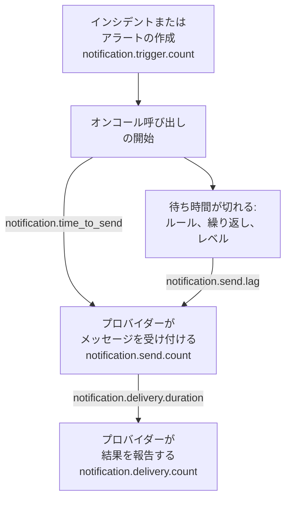

# 通知配信メトリクス

OneUptime は、送信する通知がどうなったかを記録します。どれだけのインシデントとアラートが通知を必要としたか、各メッセージがプロバイダーに届いたか、オンコール呼び出しが送り出されるまでにどれだけかかったか、そして電話に届いたかです。OneUptime 自身のテレメトリーを OneUptime プロジェクト、または任意の OpenTelemetry バックエンドに送信して、インストールが対応する人々のための配信目標を設定し、それを守れているかを確認します。

:::cards
- [有効にする](#有効にする): 二つの設定。これがないと何も記録されません。
- [メトリクス](#メトリクス): トリガーから電話まで、七つのメトリクス。
- [呼び出しの時間の測り方](#呼び出しの時間の測り方): 送信までの時間と送信遅延が何から数えられるか。
- [最初に設定する SLO](#最初に設定する-slo): 四つの目標を、クエリごとに。
:::

## 仕組み



すべてのメッセージは、オンコール呼び出しだけでなく、すべてのチャネルで `notification.send.count` に数えられます。二つの時間、`notification.time_to_send` と `notification.send.lag` は、オンコール呼び出しだけを対象にします。

## 有効にする

OneUptime に OpenTelemetry エクスポーターが設定されるまで、何も記録されません。エクスポーターがなければ、メトリクスには何のコストもかからず、どこにも保存されません。エクスポーターは、そのプロジェクトの Server [取り込みキー](/docs/telemetry/ingestion-keys)を使って OneUptime プロジェクトに向けるか、HTTP 経由の OTLP を受け付ける任意のバックエンドに向けます。

:::tabs
@tab Kubernetes
```yaml
openTelemetryExporter:
  endpoint: https://oneuptime.example.com/otlp
  headers: x-oneuptime-token=YOUR_INGESTION_KEY
```
`app` と `worker` のデプロイメントがこれらを送信します。`app.disableTelemetryCollection` と `worker.disableTelemetryCollection` は既定値の `false` のままにしてください。
@tab Docker Compose
```bash
OPENTELEMETRY_EXPORTER_OTLP_ENDPOINT=https://oneuptime.example.com/otlp
OPENTELEMETRY_EXPORTER_OTLP_HEADERS=x-oneuptime-token=YOUR_INGESTION_KEY
DISABLE_TELEMETRY_FOR_APP=false
```
これらを `config.env` に設定してから、`npm start` を実行します。`DISABLE_TELEMETRY_FOR_APP` は既定で `true` で、その場合は何も送信されません。
:::

OneUptime にはエンドポイントとヘッダーの両方が必要です。ヘッダーがないと何も送信しません。各ヘッダーは `name=value` の形で書き、複数のヘッダーは `;` で区切ります。値に `=` が含まれていてもかまいません。OneUptime はエンドポイントに `/v1/metrics` を自分で付け加え、同じ設定で自身のトレースとログも送信します。各メトリクスは、OneUptime が最初に記録した時点で現れます。`notification.send.count` なら最初のメッセージを送信した時点です。

### OneUptime プロジェクトにデルタを送信する

OneUptime は、OpenTelemetry の既定どおりにカウンターとヒストグラムを送信します。各ポイントは、そのサーバープロセスが起動してからの累計を持ちます。メトリクスエクスプローラーはグラフの各ステップ内のポイントを合計するため、時間範囲の件数とパーセンタイルを正確に読めるのは、デルタ、つまり前のポイント以降に起きたことを持つポイントからだけです。メトリクスを OneUptime プロジェクトに送るときは、デルタを送信してください。

:::tabs
@tab Kubernetes
```yaml
extraEnv:
  - name: OTEL_EXPORTER_OTLP_METRICS_TEMPORALITY_PREFERENCE
    value: delta
```
サービス独自のリストはチャート全体のリストを置き換えます。`app.extraEnv` または `worker.extraEnv` を設定している場合は、そこにも追加してください。
@tab Docker Compose
```yaml title="docker-compose.override.yml"
services:
  app:
    environment:
      OTEL_EXPORTER_OTLP_METRICS_TEMPORALITY_PREFERENCE: delta
```
これを `docker-compose.yml` の隣に作成するか、既存のファイルに追加してから、`npm start` を実行します。
:::

これは、OneUptime が自身について送信するすべてのメトリクスに適用されます。Prometheus のように累計を自分で読むバックエンドでは、変更は不要です。

## メトリクス

| メトリクス | 種類 | 単位 | 答える問い |
| --- | --- | --- | --- |
| `notification.trigger.count` | カウンター | `1` | 通知を必要としたレコードの数 |
| `notification.send.count` | カウンター | `1` | プロバイダーに渡された各メッセージがどうなったか |
| `notification.send.duration` | ヒストグラム | `ms` | プロバイダーが受け付けるまでにかかった時間 |
| `notification.time_to_send` | ヒストグラム | `ms` | トリガーから、呼び出しがプロバイダーに届くまでの時間 |
| `notification.send.lag` | ヒストグラム | `ms` | 後で送信される通知が、予定時刻からプロバイダーに届くまでの時間 |
| `notification.delivery.count` | カウンター | `1` | プロバイダーが受け付けたメッセージがどう終わったか |
| `notification.delivery.duration` | ヒストグラム | `ms` | プロバイダーが受け付けてから、メッセージが終わるまでの時間 |

各属性は少数の固定値のいずれかを持ち、プロジェクト、人、電話番号、レコードを持つことはありません。唯一の例外はカスタムチャネルの ID と名前です。インストールにあるのは数個で、それらを区別することがまさに目的です。

### 人に通知するレコード

`notification.trigger.count` は、インシデント、アラート、インシデントエピソード、アラートエピソードを、作成されるたびに数えます。

| 属性 | 値 |
| --- | --- |
| `notification.trigger.type` | `incident`、`alert`、`incident_episode`、`alert_episode` |
| `notification.trigger.source` | OneUptime がモニターまたはルールから作成した場合は `automatic`。人または API が作成した場合は `manual` |
| `monitor.type` | インシデントまたはアラートを作成したモニターの種類。たとえば `Incoming Request`、`Logs`、`Metrics`。モニターが作成していない場合は省略されます |

### プロバイダーに渡されたメッセージ

`notification.send.count` はプロバイダーに渡されたすべてのメッセージを数え、`notification.send.duration` はプロバイダーへの呼び出しの時間を測ります。どちらも次の属性を持ちます。

| 属性 | 値 |
| --- | --- |
| `notification.channel` | `email`、`sms`、`call`、`whatsapp`、`telegram`、`push`、`webhook`、`slack`、`microsoft_teams`、`mattermost`、`custom_channel` |
| `notification.provider` | `twilio`、`sms_and_call_gateway`、`smtp`、`sendgrid`、`amazon_ses`、`mailgun`、`postmark`、`resend`、`microsoft_graph`、`expo`、`push_relay`、`web_push`、`meta_whatsapp`、`telegram_bot_api`、`slack`、`microsoft_teams`、`mattermost`、`webhook`、`custom_channel`、または何も渡されなかった場合は `none` |
| `notification.provider.config` | インストール自身のアカウントと設定には `global`。プロジェクト独自の Twilio アカウント、SMTP サーバー、Webhook、ワークスペース接続には `project` で、その失敗はプロジェクトが直すものです |
| `notification.on_call_page` | オンコール呼び出しの通知なら `true`、それ以外は `false` |
| `outcome` | 次のとおり、`success`、`failure`、`not_sent` |
| `notification.destination` | Slack、Microsoft Teams、Mattermost では、一人への `direct_message`、チャネルや Teams のグループチャットへの投稿には `channel`、ステータスページ購読者のものなど受信 Webhook には `incoming_webhook`。Webhook では、ステータスページ購読者自身の Webhook には `status_page_subscriber`。人の Webhook とほかのすべてのチャネルには付きません |
| `notification.custom_channel.id`、`notification.custom_channel.name` | カスタムチャネルのみ。チャネルの ID と、100 文字に切り詰めた名前 |

- `success`: プロバイダーがメッセージを受け付けました。
- `failure`: プロバイダーが拒否したか到達できなかった、または送信に失敗しました。見つからなかったチャットチャネルは、所要時間のない失敗です。
- `not_sent`: 意図的に送信されませんでした。プロジェクトがチャネルをオフにした、残高が不足している、またはブロックされている、このサーバーでプッシュがオフになっている、あるいはカスタムチャネルがオフ、削除済み、またはライセンスの対象外です。成功率にはこれらを含めません。設定が働いた結果であり、プラットフォームの障害ではないからです。

ステータスページ購読者自身の Webhook へのメッセージは、何回試みても一回と数えます。エンドポイントが 2xx のステータスで応答したときは `success`、ほかのステータスで応答したとき、到達できなかったとき、またはアドレスが許可されていないときは `failure` です。

### 電話に届いたもの

`notification.delivery.count` は、プロバイダーが受け付けた各メッセージがどう終わったかを、プロバイダーが後で報告するとおりに、メッセージごとに一度数えます。`notification.delivery.duration` は、プロバイダーが受け付けてからの時間を測ります。どちらも `notification.channel`、`notification.provider`、`notification.provider.config`、`notification.on_call_page`、そして最終ステータスである `outcome` を持ちます。

| チャネル | プロバイダー | `outcome` | 所要時間 |
| --- | --- | --- | --- |
| `sms` | `twilio` | `delivered`、`undelivered`、`failed` | Twilio がステータスを報告するまで |
| `call` | `twilio` | `answered`、`not_answered`、`failed` | 通話に応答されるまで、そうでなければ終了するまで |
| `push` | `expo`、`push_relay` | `delivered`、`undelivered`、`failed` | 測定しません。受領通知は Apple や Google がプッシュを受け取ったかどうかを示しますが、いつかは示しません |
| `whatsapp` | `meta_whatsapp` | `delivered`、`failed` | Meta がステータスを報告するまで |

呼び出し音が鳴り終わった、話し中だった、または拒否された通話は `not_answered` です。もう存在しないアプリへのプッシュは `undelivered` で、既読になった WhatsApp メッセージは配信済みとして数えられます。`notification.provider.config` が `project` になるのは、プロジェクト独自の Twilio アカウントでの SMS と通話だけです。

ステータスが届くのは、プロバイダーが報告できる場合だけです。

- SMS と通話: Twilio 経由で、Twilio がサーバーの `HOST` に到達できる場合（[Twilio 統合](/docs/self-hosted/twilio-integration#3-ネットワークアクセスを設定する)を参照）。SMS と通話のゲートウェイは何も報告しません。
- WhatsApp: Meta の Webhook がインストール用に設定されている場合。
- プッシュ: Expo の受領通知から。OneUptime はプッシュの約 15 分後にこれを読み取り、プッシュリレー経由でも同様です。プッシュを送信したインストールがそれを数えます。
- メール、Telegram、Webhook、チャット、カスタムチャネルは最終ステータスを報告しません。

## 呼び出しの時間の測り方

### 送信までの時間

`notification.time_to_send` は、呼び出しのトリガーから、プロバイダーが通知を受け付けるまでを測ります。測るのは、呼び出しの開始時点で送るべき通知だけです。つまり、最初のエスカレーションルールの人々に対し、何も待たないオンコールルールで送る通知と、誰にも届かなかったために呼び出しがすぐに進むレベルです。オンコールの設定が求める待ち時間はプラットフォームの遅延ではないので含めません。それは[送信遅延](#送信遅延)に含まれます。測るのはプロバイダーが受け付けた通知だけで、失敗は `notification.send.count` に現れます。

| 属性 | 値 |
| --- | --- |
| `notification.channel` | `notification.send.count` と同じ |
| `notification.page.start` | 時間を何から数えるか。次のとおり |
| `notification.trigger.type` | 呼び出しの対象となるレコード: `incident`、`alert`、`incident_episode`、`alert_episode` |
| `notification.custom_channel.id`、`notification.custom_channel.name` | カスタムチャネルのみ |

| `notification.page.start` | 時間の起点 |
| --- | --- |
| `monitor_data_received` | モニターを作動させたデータを OneUptime が受信した時点。受信リクエスト、サーバーエージェントのレポート、受信メール、プローブのチェック、SNMP トラップ、ネットワークデバイスのポーリングのいずれかです。データが評価待ちのキューで待った時間も含まれます。 |
| `record_created` | インシデント、アラート、エピソードが作成された時点。テレメトリーモニター、ルール、または人による作成と、停止したハートビートのような不在のチェックの場合です。 |
| `page_started` | 呼び出しが後から開始された時点。人、ワークフロー、または新たに一致したルールが開始した場合と、直接の呼び出しです。オンコールルールまたは OneUptime AI が保留した呼び出しでは保留が終わった時点、ただしそれより早く開始されたなら開始時点です。再度の呼び出しでは確認後のタイムアウトが切れた時点です。そのため、どちらかに遅れて着手したワーカーは、この時間に現れます。 |

受信リクエストの場合、時間はエンドポイントが受信した最新のリクエストから数えるので、少し短く出ることがあります。

### 送信遅延

`notification.send.lag` は、後で送信される通知の予定時刻から、プロバイダーがそれを受け付けるまでを測ります。これを送るのは二つのワーカーで、それぞれ毎分一回動きます。そのため、遅れていないワーカーは最大で約一分を示し、遅れたワーカーはどれだけ遅れたかを示します。

| `notification.schedule` | 予定時刻 |
| --- | --- |
| `rule_wait` | 「10 分後に電話して」のような、待つオンコールルール: その人が呼び出されてからその時間が経った時点。ワーカーが最後にその人のルールを処理した時点より前になることはないので、後から追加または変更されたルールは、その時点から数えます。 |
| `repeat` | 誰かが確認するまで繰り返されるプッシュ: 間隔が切れるたび。 |
| `escalation` | 後のエスカレーションレベル: その前のレベルが待ち時間を終えた時点、または人が呼び出しを次に回したときはすぐ。 |
| `policy_repeat` | 最初のレベルからやり直すポリシー: 最後のレベルの待ち時間が切れた時点。 |

これも `notification.channel`、`notification.trigger.type`、そしてカスタムチャネルでは `notification.custom_channel.id` と `notification.custom_channel.name` を持ちます。呼び出しの開始時点で送るべき通知がここに入ることはありません。保留の後や再度の呼び出しとして、ワーカーが呼び出しを遅れて開始した場合も同じです。それは送信までの時間に入ります。

### ヒストグラムのバケット

各ヒストグラムには、目標を境界で読めるように設定された独自のバケット境界があり、単位はミリ秒です。

| ヒストグラム | バケット境界（ミリ秒） |
| --- | --- |
| `notification.send.duration` | `5, 10, 25, 50, 100, 250, 500, 1000, 2500, 5000, 10000, 30000, 60000, 120000` |
| `notification.time_to_send` | `250, 500, 1000, 2000, 5000, 10000, 15000, 30000, 60000, 120000, 300000, 600000, 1800000, 3600000` |
| `notification.send.lag` | `1000, 5000, 10000, 15000, 30000, 45000, 60000, 75000, 90000, 120000, 180000, 300000, 600000, 1800000, 3600000` |
| `notification.delivery.duration` | `500, 1000, 2000, 5000, 10000, 15000, 30000, 60000, 120000, 300000, 600000, 1800000, 3600000, 14400000, 86400000` |

パーセンタイルはバケットから算出され、それが入るバケットの中央として描かれます。そのため、バケットの境界と比べてください。`notification.time_to_send` の P95 が 30000 以下なら、呼び出しの 95% が 30 秒以内だったことを意味します。

## 最初に設定する SLO

ほとんどのインストールが約束できる四つの目標で、それぞれメトリクスを受け取るプロジェクトのメトリクスエクスプローラーで、一つか二つのクエリから組み立てます。メトリクスがデルタとして届けば、時間範囲を正確に読めます。[OneUptime プロジェクトにデルタを送信する](#oneuptime-プロジェクトにデルタを送信する)を参照してください。

### メトリクスエクスプローラーで組み立てる

:::steps
1. プロジェクトの[メトリクスエクスプローラー](/docs/telemetry/metrics-explorer)を開き、目標の最初のメトリクスをクリックします。そのクエリは `a` です。
2. **集計の基準** で集計方法を選びます。次に **フィルターとグループ化** を開き、各条件を **属性で絞り込み** に追加します。
3. 二つ目のクエリには、**メトリクスを追加** をクリックし、`b` を同じように設定します。
4. 数式には、**数式を追加** をクリックし、**数式** に入力します。
5. 目標を外したときに知らせを受けるには、**アクション → このビューからモニターを作成** をクリックし、値が目標を超えたときにアラートを出します。[メトリクス モニター](/docs/monitor/metrics-monitor)を参照してください。
:::

エラーバジェット付きで 30 日間にわたって目標を追うには、そのモニターを [SLO](/docs/slo/introduction) に結び付けます。SLO は目標を外していた時間を数えます。

### オンコール SMS が Twilio に届く

インストール自身の Twilio アカウントから送るオンコール SMS のうち、失敗は最大 1% で、99% が受け付けられます。

| クエリ | メトリクス | 集計 | 条件 |
| --- | --- | --- | --- |
| `a` | `notification.send.count` | **合計** | `notification.channel = sms`、`notification.on_call_page = true`、`notification.provider.config = global`、`outcome != not_sent` |
| `b` | `notification.send.count` | **合計** | 同じ条件に `outcome = failure` を加える |

数式 `$b / $a * 100` は失敗した割合で、それが 1 以下にとどまる間は目標を満たしています。失敗のないステップは、`b` にポイントがないため、ポイントが描かれません。`outcome != not_sent` はプロジェクト自身の設定が止めたものを除外し、`global` はプロジェクト独自の Twilio アカウントを除外します。SMS を自身の SMS・通話ゲートウェイ経由で送るインストールでは、同じクエリがゲートウェイを測定します。別のチャネルには `sms` を `call`、`push`、`email` に変えます。

### 呼び出しが 30 秒以内に送り出される

オンコール呼び出しの 95% が、トリガーから 30 秒以内にプロバイダーに届きます。

| クエリ | メトリクス | 集計 | 条件 |
| --- | --- | --- | --- |
| `a` | `notification.time_to_send` | **P95** | `notification.page.start != page_started` |

`a` が 30000 以下にとどまる間は目標を満たしています。後から開始された呼び出しはトリガーからではなく開始時点または予定時刻から測られるので、除外します。`notification.page.start` でグループ化するとモニターのキュー（`monitor_data_received`）をほかと分けて見られ、`notification.channel` でグループ化すると遅いチャネルを見つけられます。

### 後で送信される通知が 90 秒以内に送り出される

待ち時間の後に送信される通知の 99% が、予定時刻から 90 秒以内にプロバイダーに届きます。

| クエリ | メトリクス | 集計 | 条件 |
| --- | --- | --- | --- |
| `a` | `notification.send.lag` | **P99** | — |

`a` が 90000 以下にとどまる間は目標を満たしています。`notification.schedule` でグループ化すると、どのワーカーが遅れたかがわかります。`rule_wait` と `repeat` は一方のワーカー、`escalation` と `policy_repeat` はもう一方のワーカーのものです。

### オンコール SMS が電話に届く

インストール自身のアカウントで Twilio が受け付けたオンコール SMS のうち、未配信は最大 5% です。

| クエリ | メトリクス | 集計 | 条件 |
| --- | --- | --- | --- |
| `a` | `notification.delivery.count` | **合計** | `notification.channel = sms`、`notification.on_call_page = true`、`notification.provider.config = global` |
| `b` | `notification.delivery.count` | **合計** | 同じ条件に `outcome != delivered` を加える |

数式 `$b / $a * 100` は配信されなかった割合です。その一部は通信事業者と電源の切れた電話が決めるので、数週間で見た値から目標を設定してください。通話には `call` と `outcome != answered` を使います。Twilio がサーバーに到達できる必要があります。[電話に届いたもの](#電話に届いたもの)を参照してください。

## トラブルシューティング

:::details 通知のメトリクスが届かない
`OPENTELEMETRY_EXPORTER_OTLP_ENDPOINT` と `OPENTELEMETRY_EXPORTER_OTLP_HEADERS` の両方が設定されていること、Docker Compose では `DISABLE_TELEMETRY_FOR_APP` が `false` であることを確認してから、OneUptime を再起動します。OneUptime は起動時に、読み取れないヘッダーがあるときや何も送信しないときに、警告をログに出力します。メトリクスは何かが記録されて初めて現れるので、まず通知を送信してください。
:::

:::details 件数が増え続けるだけ、またはパーセンタイルがほとんど動かない
メトリクスが累計として届いています。デルタを送信してください。[OneUptime プロジェクトにデルタを送信する](#oneuptime-プロジェクトにデルタを送信する)を参照してください。
:::

:::details 最終ステータスが届かない
最終ステータスはプロバイダーから後で届き、プロバイダーが報告できる場合だけです。[電話に届いたもの](#電話に届いたもの)を参照してください。Twilio が到達できないインストールでは、SMS と通話は送信済みとして数えられますが、配信済みとしては数えられません。
:::

## 次のステップ

:::cards
- [メトリクスエクスプローラー](/docs/telemetry/metrics-explorer): 任意のメトリクスをグラフにし、組み合わせ、比較します。
- [メトリクス モニター](/docs/monitor/metrics-monitor): 目標を外したときにアラートを出します。
- [Twilio 統合](/docs/self-hosted/twilio-integration): 電話に届いたものを Twilio に報告させます。
- [エスカレーションルール](/docs/on-call/escalation-rules): 送信遅延の起点となる待ち時間。
:::
