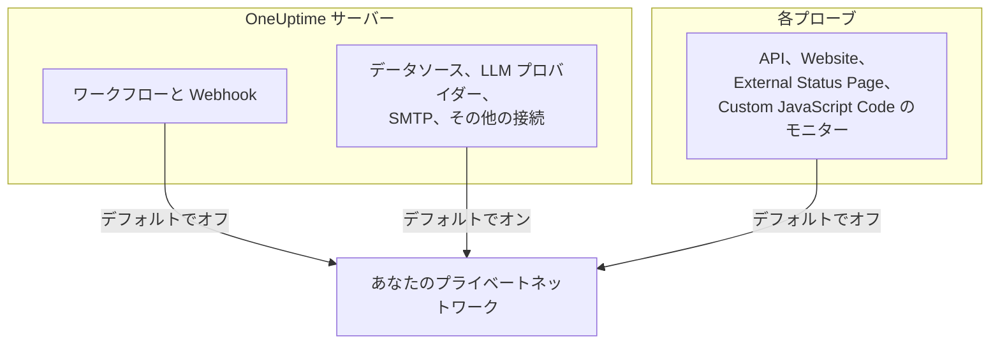

# プライベートネットワークへのアクセス

OneUptime は、プライベート、ループバック、リンクローカルの範囲に解決されるホストへの特定の送信リクエストを拒否します。ワークフローを社内ツールに向けようとしたことがあれば、次のメッセージを目にしているはずです。

> Webhook URL resolves to a private, loopback, or link-local address and is not allowed

このデフォルトは、誰でもサインアップでき、Webhook の宛先が信頼できない入力であるホスト型の製品には適しています。しかしセルフホストのインスタンスでは、ごく普通のこと、つまり自分のネットワーク上にしか存在しないセルフホストの Mattermost、Jira、チケット管理システムにアラートを送ることの妨げになります。

このページでは、それを意図的かつ限定的に許可する方法を説明します。決めるのは三つのスイッチで、それぞれが独自の種類の接続を担当し、別々のマシンで設定します。

| 社内で到達したいもの | 設定の場所 | セルフホスト環境でのデフォルト |
| --- | --- | --- |
| ワークフロー、プロジェクトの Webhook、オンコールのユーザー Webhook | **API サーバー**の環境 | プライベートアドレスは拒否 |
| データソース、LLM プロバイダー、SMTP サーバー、OIDC ディスカバリー、その他の接続 | **API サーバー**の環境 | プライベートアドレスは許可 |
| API、Website、External Status Page、Custom JavaScript Code の**モニター** | **プローブ**自身の環境 | プライベートアドレスは拒否 |



Ping、Port、SSL 証明書、DNS、DNSSEC、SNMP / ネットワークデバイス、SQL クエリ、データベースの健全性、Synthetic、Network Path といったネットワークネイティブなモニタータイプは、独自のトランスポートを使います。このページの設定が管理するのは、任意のレスポンス内容をプロジェクトに返す HTTP トランスポート、つまり API、Website、External Status Page、Custom JavaScript Code のモニターです。

:::cards
- [Webhook とワークフロー](#webhook-とワークフロー): Webhook からネットワーク内に送信できるようにします。
- [その他の送信接続](#その他の送信接続): データソース、LLM プロバイダー、メールサーバー。
- [プローブとモニター](#プローブとモニター): プローブにプライベートなサイトを確認させます。
- [動作を確認する](#動作を確認する): 拒否メッセージがどのスイッチを示しているかを読み取ります。
:::

## ブロックされるもの、ブロックを解除できるもの

ブロックされる宛先は二つの階層に分かれます。

| 階層 | 範囲 | 許可できるか |
| --- | --- | --- |
| **プライベート** | RFC-1918 (`10.0.0.0/8`, `172.16.0.0/12`, `192.168.0.0/16`)、CGNAT (`100.64.0.0/10`)、IPv6 ユニークローカル (`fc00::/7`)、サイトローカル (`fec0::/10`) | はい |
| **禁止** | ループバック (`127.0.0.0/8`, `::1`)、未指定アドレス、リンクローカル (`169.254.0.0/16`, `fe80::/10`)、マルチキャスト、予約済み、ブロードキャスト、および名前 `localhost` と `metadata.google.internal` | Webhook の許可リストに正確なホストまたは CIDR を記載した場合のみ。モニターでは決して許可されません。 |

クラウドメタデータのエンドポイント `169.254.169.254` が禁止の階層にあるのには理由があります。クラウドの VM では、このエンドポイントはそのマシンから HTTP リクエストを送れるあらゆるものにインスタンスの IAM 認証情報を渡してしまうため、包括的な設定でこれが開放されることは決してありません。

内部に IPv4 の宛先を含む IPv6 の表記 (IPv4 マップド (`::ffff:10.0.0.5`)、NAT64、6to4、Teredo) は、到達先の IPv4 アドレスによって分類されます。そのため、これらを使ってプライベート階層の許可をすり抜け、禁止アドレスを持ち込むことはできません。

## Webhook とワークフロー

次の送信先が対象です。宛先は、プロジェクトの認証済みメンバーが書いた URL だからです。

- ワークフローの **API** コンポーネント (GET / POST / PUT / PATCH / DELETE)
- ワークフローの **Custom JavaScript** コンポーネントが行う HTTP リクエスト
- プロジェクトの Webhook 通知 (インシデント、アラート、モニター、オンコール、計画メンテナンス、ステータスページのイベント)
- オンコールの**ユーザー Webhook**

**対象外**で、今後も対象にならないのが **ステータスページ購読者の Webhook** です。公開ステータスページの訪問者なら誰でも登録できるため、この送信先を緩めると、インターネット上の誰もがあなたのサーバーにプライベートネットワークへの POST を行わせることができてしまいます。これは設定できません。

Webhook ではない送信接続 (外部データソース、LLM プロバイダー、SMTP サーバー (プロジェクトの SMTP 設定とワークフローの **Email** コンポーネント)、SMTP OAuth トークンのエンドポイント、OIDC ディスカバリー、Runbook の HTTP ステップ) は、`DATA_SOURCE_BLOCK_PRIVATE_ADDRESSES` によって別途管理されており、セルフホスト環境ではすでにプライベート範囲を許可しています。[その他の送信接続](#その他の送信接続)を参照してください。

### API サーバーの設定

API サーバーでこれらのいずれか、または両方を設定し、再起動します。どちらもデフォルトでオフなので、どちらも設定していないインスタンスはこれまでとまったく同じように動作します。

| 変数 | Helm の値 | 許可されるもの |
| --- | --- | --- |
| `ALLOW_PRIVATE_NETWORK_WEBHOOKS` | `webhooks.allowPrivateNetwork` | `true` に設定すると、プライベート階層全体。 |
| `PRIVATE_NETWORK_WEBHOOK_ALLOWLIST` | `webhooks.privateNetworkAllowlist` | 記載したホストと CIDR (階層を問わず)。 |

:::tabs
@tab Docker Compose
```bash title="config.env"
ALLOW_PRIVATE_NETWORK_WEBHOOKS=true
PRIVATE_NETWORK_WEBHOOK_ALLOWLIST=mattermost.internal,*.svc.cluster.local,10.20.0.0/16
```
@tab Kubernetes
```yaml title="values.yaml"
webhooks:
  allowPrivateNetwork: true
  privateNetworkAllowlist: "mattermost.internal,10.20.0.0/16"
```
:::

Docker Compose では、`config.env` に `ALLOW_PRIVATE_NETWORK_WEBHOOKS=false` の行があります。行をもう一つ追加するのではなくその行を変更し、`npm run start` を実行してください。Kubernetes では、リリースをアップグレードします。

許可リストのエントリーはカンマ、スペース、改行のいずれかで区切ることができ、それぞれ次のいずれかにできます。

- ホスト名 — `mattermost.internal`
- ワイルドカード — `*.svc.cluster.local` (サブドメインに一致し、サフィックスそのものには一致しません)
- IPv4 または IPv6 アドレス — `10.20.30.40`, `fd00::1`
- CIDR — `10.20.0.0/16`, `fd12:3456::/32`

エントリーに含まれるスキーム、ポート、パス、ユーザー情報は取り除かれるため、手元にある Webhook URL をそのまま貼り付けても機能します。

許可リストに記載したホスト名は **DNS チェックなしで**信頼されます。それこそが記載する目的であり、ブロックリストが拒否するアドレスに解決されることが想定されているからです。アドレスのエントリーは、URL 内のリテラルと、DNS がそれに対して返すすべてのアドレスとに照合されます。

> [!CAUTION]
> **`169.254.169.254`、またはそれを含む範囲を、決して許可リストに入れないでください。** クラウドの VM では、プロジェクトのすべてのメンバーにインスタンスの IAM 認証情報を与えることになります。

## その他の送信接続

もう一つのガードは、プロジェクトのメンバーが宛先を選ぶものの Webhook ではない送信接続を対象とします。

- 外部データソース (PostgreSQL、MySQL、SQL Server、ClickHouse、Elasticsearch、REST API の接続)、Splunk などのセキュリティイベント接続、脅威インテリジェンスフィード
- LLM プロバイダー (セルフホストの Ollama や vLLM を含む)
- SMTP サーバー (プロジェクトの SMTP 設定とワークフローの **Email** コンポーネント)、および SMTP とワークフローの OAuth トークン URL
- シングルサインオンのための OIDC ディスカバリー
- ステータスページとダッシュボードのカスタムドメイン検証
- Runbook の HTTP ステップ
- インポートが読み取る Grafana OnCall API の URL (**プロジェクト設定** > **基本** > **別のツールからインポート**)

このガードは Webhook の設定とは逆に働きます。セルフホスト環境では、これらの接続先であるデータベース、メールサーバー、モデルサーバーは通常自分のネットワーク上にあるため、デフォルトでプライベート階層を**許可**します。禁止階層 (ループバック、リンクローカル、クラウドメタデータのエンドポイント) はどちらの場合も拒否され、そのための許可リストはありません。

`DATA_SOURCE_BLOCK_PRIVATE_ADDRESSES` はこのガードを厳しくします。`true` に設定すると、これらの接続でもプライベート階層が拒否されます。たとえば、インスタンス上のプロジェクトが、社内ネットワークに到達すべきでない人々のものである場合に使います。

:::tabs
@tab Docker Compose
```bash title="config.env"
DATA_SOURCE_BLOCK_PRIVATE_ADDRESSES=true
```
@tab Kubernetes
```yaml title="values.yaml"
outboundConnections:
  blockPrivateNetwork: true
```
:::

この設定は、プロジェクトではなく管理者が設定するグローバル LLM プロバイダーには適用されません (`GLOBAL_LLM_PROVIDER_*` 変数、Helm チャートの `vllm.globalProvider`、または管理者ダッシュボードの **設定** > **グローバルLLMプロバイダー** で設定します)。そのようなプロバイダーは引き続きプライベートアドレスに到達できますが、ループバックとリンクローカルはそのプロバイダーに対しても拒否されたままです。

有効にするのは正確な値 `true` だけです。`BILLING_ENABLED=true` のインスタンスでは、何を設定しても常に有効です。上記の Webhook の設定や下記のプローブの設定がどの宛先を許可するかは変わりません。各ゲートはそれぞれ個別に設定します。ただし、Webhook とワークフローのリクエストも含めて、拒否メッセージの書き方は変わります。有効な場合、拒否されたホスト名は、何に解決されたかを示さずに報告されます ([動作を確認する](#動作を確認する)を参照)。

Docker Compose では、`config.env` に `DATA_SOURCE_BLOCK_PRIVATE_ADDRESSES=false` の行があります (`config.env` がそれより古い場合は追加してください)。行をもう一つ追加するのではなくその行を `true` に変更し、`npm run start` を実行して新しい値でコンテナーを再作成します。`docker compose restart` は `config.env` を再読み込みしません。Kubernetes では、values ファイルで設定してリリースをアップグレードします。チャートがそれを app と worker の Pod に渡します。

有効な場合、拒否されたホスト名は何に解決されたかを示さずに報告されます。たとえば _"LLM provider host ollama.internal could not be reached."_ のようになります。まったく解決できない名前にも同じメッセージが返されるため、プロジェクトのメンバーがこれらのフィールドを使ってどの内部名が存在するかを調べることはできません。IP として入力したアドレスは、引き続き理由とともに示されます。たとえば _"LLM provider host 10.0.4.12 is not allowed: private network address."_ のようになります。`LOG_LEVEL=DEBUG` では、アプリは拒否された各名前の解決先アドレスをログに記録します。

## プローブとモニター

影響を受けるモニタータイプは **API**、**ウェブサイト**、**外部ステータスページ**、**Custom JavaScript Code** の四つです。標準のプローブでは、これらは公開されている HTTP(S) の宛先には到達できますが、プライベートなアドレス空間は拒否します。API、Website、External Status Page のモニターは、接続ごとに DNS の結果を検証して固定し、リダイレクトのたびに再検証します。Custom JavaScript Code は、サンドボックスのブリッジで同じアドレスポリシーを適用します。

スイッチは API サーバーの環境ではなく、**プローブのプロセスが自身の環境から**読み取ります。そして、すべてのプローブがそれを読み取ります。Docker Compose に同梱のもの、Helm チャートがデプロイするもの、自分で実行する[カスタムプローブ](/docs/probe/custom-probe)のすべてです。プローブをデプロイする人がその環境を管理し、そのプローブからどのネットワークが見えるかを知っています。カスタムプローブは通常は別のマシンで、多くの場合は別の人が運用しており、API サーバーの設定を読むことはありません。

:::tabs
@tab Docker Compose
`config.env` にはすでに `PROBE_ALLOW_PRIVATE_NETWORK_MONITORS=false` の行があります。行をもう一つ追加するのではなく、その行を `true` に変更してください。同じ変数が二度現れると、後の行が優先されるためです。その後 `npm run start` を実行すると、新しい値でコンテナーが再作成されます。`docker compose restart` は `config.env` を再読み込みしません。同梱のすべてのプローブがこの一行を読み取るため、`probe-1` に、そしてスタックで二つ目のプローブを実行している場合は `probe-2` にも適用されます。

```bash title="config.env"
PROBE_ALLOW_PRIVATE_NETWORK_MONITORS=true
```
@tab Kubernetes
values ファイルでプローブごとに設定し、リリースをアップグレードします。`probes:` の下の各エントリーは別々のプローブなので、プライベートアドレスに到達させたいすべてのプローブで設定してください。

```yaml title="values.yaml"
probes:
  one:
    allowPrivateNetworkMonitors: true
```
:::

カスタムプローブでは、そのプローブ自身の環境で `PROBE_ALLOW_PRIVATE_NETWORK_MONITORS=true` を設定して再起動します。値は正確に `true` でなければなりません。`TRUE` や `1` など、それ以外の値ではスイッチはオフのままで、`LOG_LEVEL` の設定にかかわらず、プローブは起動時の警告でそのことを伝えます。

同梱のプローブは**グローバルプローブ**です。インスタンスの `REGISTER_PROBE_KEY` で自身を登録し、インスタンス上のすべてのプロジェクトがそれを選択できます。したがって、同梱のプローブでスイッチをオンにすると、**インスタンス上のすべてのプロジェクト**のモニターが、そのプローブを通じてプライベートアドレスに到達できるようになります。単一チームのインストールでは、通常それが望ましい状態です。プロジェクト間でその到達範囲を共有すべきでない場合 (別々のチームや、ホストしている顧客など) は、同梱のプローブではオフのままにし、代わりに各ネットワークの内部にプライベート (カスタム) プローブをデプロイして、そこでだけオンにします。

例外が一つあります。`REGISTER_PROBE_KEY` で自身を登録し、自身の環境に `BILLING_ENABLED=true` を持つプローブ (誰でもサインアップでき、すべてのプロジェクトがグローバルプローブを共有する、オープンサインアップのホスト型製品のグローバルプローブ) は、スイッチがオンでも公開専用のままで、起動時にスイッチを無視している旨の警告をログに記録します。Docker Compose と Helm チャートに同梱のプローブには、インスタンスの `BILLING_ENABLED` が自動的に渡されます。そのようなインスタンス向けに実行する他の `REGISTER_PROBE_KEY` プローブにも渡してください。プローブは他の方法では自分がグローバルであることを知ることができないため、管理者ダッシュボードで作成され `PROBE_ID` と `PROBE_KEY` で実行されるグローバルプローブは、プライベートプローブと同じようにスイッチに従います。プロジェクト間でそのプローブのネットワークを共有すべきでない場合は、そこでオンにしないでください。プライベートプローブは、どのインスタンスでもスイッチに従います。

すべてのプローブは、起動時に有効なプライベートネットワークポリシー (プライベートネットワークの監視がオンかオフか、そしてその理由) をログに記録します。無視されている値と、スイッチがすべてのプロジェクトに開放するグローバルプローブは、どの `LOG_LEVEL` でも警告として記録されます。通常のオン/オフの行と、同じ判断を `privateNetworkMonitors` の下に記録する "Probe environment" の JSON は、Helm チャートのデフォルトである `LOG_LEVEL=INFO` で記録されます。Docker Compose は `LOG_LEVEL=ERROR` で出荷されるため、そこで確認するには `LOG_LEVEL=INFO` を設定してください。変更したばかりのプローブ上のモニターがまだ拒否される場合は、まずそのログを確認してください。

オンにしても、ループバック、リンクローカル、クラウドメタデータのエンドポイントは開放**されません**。これらはすべてのプローブで拒否されたままです。モニターの作成者が所有していないネットワークで動作するプローブにとって、これが最も重要です。

> [!WARNING]
> 他の人に代わって運用するプローブでは、オフのままにしてください。

## 動作を確認する

ワークフローまたはモニターをもう一度実行します。それでも拒否される場合、エラーメッセージがどのゲートが閉じているかを示します。

- _"...points to a private network address and is not allowed. Self-hosted instances can allow this by setting `ALLOW_PRIVATE_NETWORK_WEBHOOKS`..."_ — API サーバーの設定がありません。
- _"...private network address... Set PROBE_ALLOW_PRIVATE_NETWORK_MONITORS=true on the probe running this monitor to allow it."_ — プライベート (カスタム) プローブがモニターを実行し、そのスイッチがオフです。これは API サーバーではなくプローブで設定することに注意してください。
- _"...private network address... Set PROBE_ALLOW_PRIVATE_NETWORK_MONITORS=true on the probe running this monitor to allow it (probes.<name>.allowPrivateNetworkMonitors in the Helm chart). This is a global probe, so that allows it for every project on this instance; otherwise, select a private probe deployed on that network."_ — 同梱の (グローバル) プローブがモニターを実行し、そのスイッチがオフです。インスタンス上のすべてのプロジェクトがそのネットワークに到達してよい場合は、上記の説明に従ってそのプローブでオンにします。そうでない場合は、モニターでプライベートプローブを選択します。
- _"...Global probes cannot monitor private network addresses. Deploy and select a private probe for this target."_ — 環境に `BILLING_ENABLED=true` を持つグローバルプローブがモニターを実行しました。そこでは、自動登録されたグローバルプローブはスイッチの設定にかかわらず公開専用のままです。宛先のネットワーク内にプライベートプローブをデプロイし、モニターでそれを選択してください。
- _"Monitor target host ... could not be reached."_ — 宛先が**ホスト名**である API、Website、External Status Page のモニターは、名前が拒否されたアドレスに解決された場合にも、DNS が失敗した場合にもこれを報告します。そのため、モニターを使ってどの内部名が存在するかを調べることはできません。一緒に表示されるエラーの詳細は、どちらの場合も `PROBE_ALLOW_PRIVATE_NETWORK_MONITORS` に言及しますが、どちらのケースに当たるかは示しません。名前がプライベートアドレスを指している場合は、プローブの起動ログでプライベートネットワークポリシーを確認してください。オフの場合、対処法は上記のメッセージと同じです。`LOG_LEVEL=DEBUG` では、プローブは拒否された各名前の正確な理由もログに記録します。
- _"Request URL could not be reached."_ — **Custom JavaScript Code** モニターにも同じルールが適用されます。**ホスト名**をリクエストするスクリプトは、名前が拒否されたアドレスに解決された場合にも、DNS が失敗した場合にもこれを受け取ります。`LOG_LEVEL=DEBUG` では、プローブが正確な理由をログに記録します。
- _"Webhook URL could not be reached."_ または、ワークフローからは _"Request URL could not be reached."_ — インスタンスが `DATA_SOURCE_BLOCK_PRIVATE_ADDRESSES=true` (または `BILLING_ENABLED=true`) で実行されているため、拒否された**ホスト名**は説明されません。拒否されたアドレスに解決されたか、まったく解決されなかったかのどちらかです。`LOG_LEVEL=DEBUG` では、app または worker がそのどちらであったかと、アドレスをログに記録します。
- _"...points to a private, loopback, or link-local address and is not allowed."_ — 宛先が禁止階層にあります。Webhook の場合、本当に必要なら `PRIVATE_NETWORK_WEBHOOK_ALLOWLIST` に正確なホストまたは CIDR を記載してください。モニターの場合、例外はありません。
- _"...hostname could not be resolved via DNS."_ — コンテナーが名前を解決できません。宛先とネットワークを共有しているか確認してください。

## セキュリティに関する注意

これを開放すると、OneUptime インスタンスに到達させられる範囲が実際に変わります。そのため、慎重に行う価値があります。

- **包括的なブール値より許可リストを優先してください。** `mattermost.internal` を記載するのは、すべての RFC-1918 アドレスを開放するよりはるかに小さな許可です。
- **ワークフロー、または API、Website、External Status Page、Custom JavaScript Code のモニターを作成できる人は誰でも、あなたが許可したものすべてに到達できます。** それらのプロジェクトのメンバーシップは、それに応じて扱ってください。
- **レスポンス本文が返ってきます。** ワークフローの API コンポーネントはステータス、ヘッダー、本文をワークフローのログに返すため、許可したホストは書き込めるだけでなく読み取ることもできます。
- **Webhook リクエストではリダイレクトを決してたどりません。** そのため、許可した公開ホストが二回目のホップでサーバーを内部ホストに転送することはできません。
- **可能な場合は、インスタンス全体ではなくプローブ単位で範囲を絞ってください。** ひとつのネットワーク内にデプロイしたプローブは、API サーバーの送信トラフィックを開放するよりも狭い許可です。

## 次のステップ

:::cards
- [カスタム プローブ](/docs/probe/custom-probe): 確認対象のネットワーク内でプローブを実行します。
- [ワークフローの設定](/docs/workflows/configuration): ワークフローのステップが到達できる範囲と、実行できること。
- [LLM プロバイダー](/docs/ai/llm-provider): OneUptime AI をネットワーク上のモデルに接続します。
- [アーキテクチャ](/docs/self-hosted/architecture): セルフホスト環境のどの部分がどの接続を行うか。
:::
