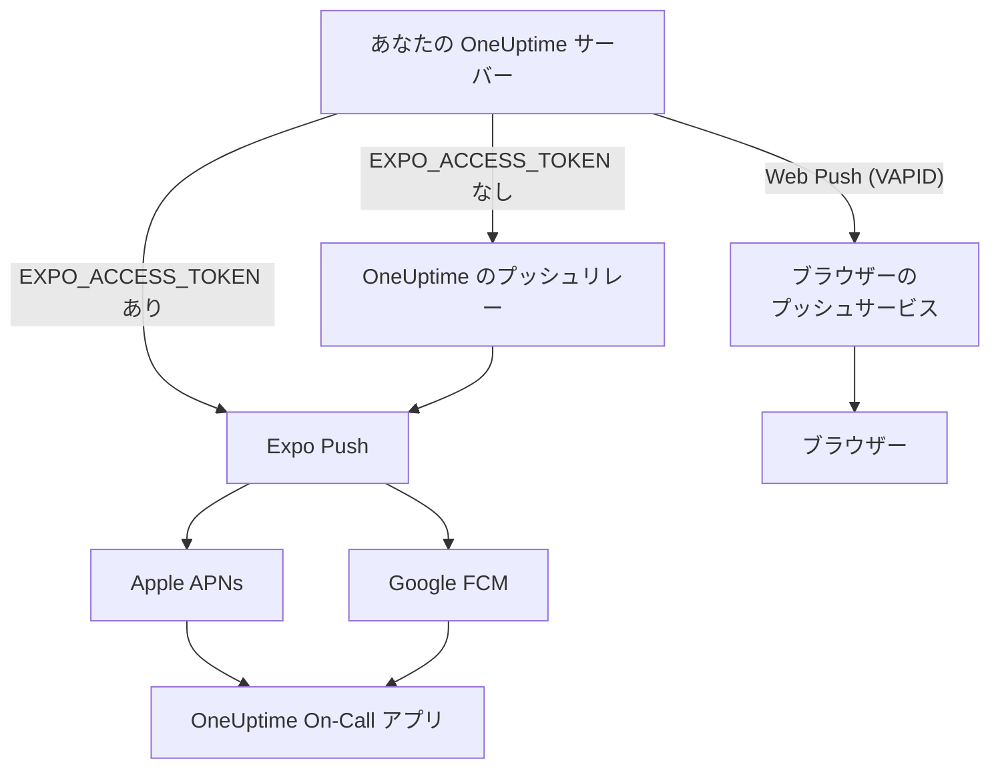
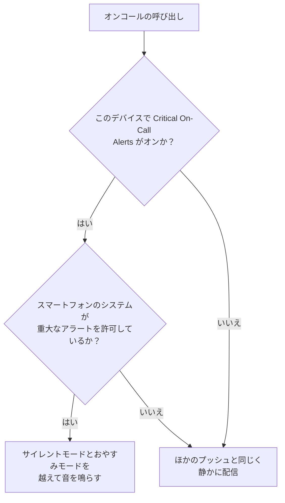

# プッシュ通知

OneUptime は、スマートフォンでは **OneUptime On-Call** モバイルアプリを通じて、ブラウザーでは Web Push を通じて人を呼び出します。モバイルのプッシュは **Expo Push** で配信されます。セルフホストのインスタンスは既定で OneUptime のプッシュリレーを経由して送信するため、リレーへの外向きのネットワークアクセスがあればよく、Expo、Apple、Google の独自の認証情報は不要です。

:::cards
- [プッシュの送信方法を選ぶ](#セルフホストの設定): プッシュリレー、または独自の Expo アクセストークン。
- [ファイアウォールを開ける](#ネットワークアクセス): サーバーと利用者のデバイスが到達するアドレス。
- [サイレントモードでも鳴らす](#重大なオンコールアラート-サイレントモードを上書き): 消音中のスマートフォンでもオンコールの呼び出しを鳴らします。
- [届かないプッシュを直す](#トラブルシューティング): Expo の各エラーの意味。
:::

## 仕組み



OneUptime のモバイルアプリは、Expo Push トークンをバックエンドに登録します。バックエンドは OneUptime のプッシュリレーを経由して通知を送信し、`EXPO_ACCESS_TOKEN` が設定されている場合は Expo に直接送信します。Expo はメッセージを Apple APNs または Google FCM に転送し、デバイスに届けます。

Web のプッシュ通知は引き続き VAPID キーと Web Push プロトコルを使います。

## セルフホストの設定

公式のモバイルアプリと既定のリレーを使う場合、サーバーに Expo の認証情報は不要です。Expo から直接配信するには、アプリの Expo プロジェクトに合った認証情報で `EXPO_ACCESS_TOKEN` を設定します。Web Push には `VAPID_PUBLIC_KEY`、`VAPID_PRIVATE_KEY`、`VAPID_SUBJECT` が必要です。

| 変数 | Helm の値 | 既定値 | 役割 |
| --- | --- | --- | --- |
| `PUSH_NOTIFICATION_RELAY_URL` | `pushNotification.relayUrl` | `https://oneuptime.com/api/notification/push-relay/send` | `EXPO_ACCESS_TOKEN` が未設定の間、モバイルのプッシュを送る先。 |
| `EXPO_ACCESS_TOKEN` | `expo.accessToken` | 空 | Expo プロジェクトのトークンを使い、モバイルのプッシュを Expo に直接送ります。 |
| `VAPID_PUBLIC_KEY` | `vapid.publicKey` | 空 | ブラウザーが購読に使うキーペアの公開側。 |
| `VAPID_PRIVATE_KEY` | `vapid.privateKey` | 空 | すべての Web Push に署名する秘密側。 |
| `VAPID_SUBJECT` | `vapid.subject` | `mailto:support@oneuptime.com` | ブラウザーのプッシュサービスがあなたに連絡できる連絡先アドレス。 |

VAPID のキーペアは `npx web-push generate-vapid-keys` で一度だけ生成し、保管してください。あるキーペアで購読したブラウザーは、キーペアが変わるとプッシュを受け取れなくなります。

:::tabs
@tab Docker Compose
```bash title="config.env"
VAPID_PUBLIC_KEY=your-public-key
VAPID_PRIVATE_KEY=your-private-key
VAPID_SUBJECT=mailto:oncall@example.com
# Leave unset to send mobile pushes through the push relay.
EXPO_ACCESS_TOKEN=
```
@tab Kubernetes
```yaml title="values.yaml"
vapid:
  publicKey: your-public-key
  privateKey: your-private-key
  subject: mailto:oncall@example.com
# Leave empty to send mobile pushes through the push relay.
expo:
  accessToken:
```
:::

## ネットワークアクセス

| 方向 | 宛先 | プロトコル / ポート | 必要になる場合 |
| --- | --- | --- | --- |
| OneUptime → 既定のプッシュリレー | `https://oneuptime.com/api/notification/push-relay/send`, `https://oneuptime.com/api/notification/push-relay/receipts` | HTTPS / TCP 443 | `EXPO_ACCESS_TOKEN` が未設定のときのモバイルのプッシュ。 |
| OneUptime → Expo | `https://exp.host/--/api/v2/push/send`, `https://exp.host/--/api/v2/push/getReceipts` | HTTPS / TCP 443 | `EXPO_ACCESS_TOKEN` が設定されているときの直接のモバイルのプッシュ。 |
| OneUptime → ブラウザーのプッシュサービス | ブラウザーのプッシュ購読に保存された HTTPS エンドポイント | HTTPS / 通常は TCP 443 | Web Push。 |
| モバイルアプリまたはブラウザー → OneUptime | あなたの OneUptime のホスト名 | HTTPS / TCP 443 | サインイン、デバイスの登録、通知リンクを開く操作。 |

`PUSH_NOTIFICATION_RELAY_URL` を変更する場合は、その宛先のホスト名と設定したポートを許可してください。独自のリレーは OneUptime のリレー API を実装する必要があります。これらの既定値と、リレーと直接配信の切り替えは、[OneUptime の設定](https://github.com/OneUptime/oneuptime/blob/master/config.example.env) と [プッシュサービス](https://github.com/OneUptime/oneuptime/blob/master/packages/Common/Server/Services/PushNotificationService.ts) で定義されています。Expo への直接のリクエストは、[Expo の送信ガイド](https://docs.expo.dev/push-notifications/sending-notifications/) に記載されたエンドポイントを使います。OneUptime は、`/send` の代わりに `/receipts` を付けた同じアドレスで、リレーから配信の受領確認を読み取ります。このルートを持たないリレーでもプッシュは配信されますが、その場合、アプリが削除されたデバイスに気づくのは、以後そのデバイスへのプッシュが拒否されたときだけです。

Web Push では、チームが使うブラウザーの実際の購読エンドポイントのホストを許可してください。OneUptime は `fcm.googleapis.com`、`android.googleapis.com`、`push.services.mozilla.com`、`notify.windows.com`、`push.apple.com` を、それぞれのサブドメインも含めて受け付けます。典型的な例は `updates.push.services.mozilla.com` と `web.push.apple.com` です。宛先は [ブラウザーのプッシュ購読](https://developer.mozilla.org/en-US/docs/Web/API/PushSubscription) が提供します。Expo や OneUptime のリレーだけを許可しても Web Push は有効になりません。

通知を送信する OneUptime のプロセスから、DNS の名前解決と外向きの TLS を許可してください。そのトラストストアは宛先の証明書を検証できる必要があり、プロキシは対話的な認証なしで API リクエストを通す必要があります。プッシュのプロバイダーが OneUptime サーバーの Webhook を呼び出すことはないため、利用者のデバイスが VPN などのプライベート接続でアクセスできるなら、サーバーはプライベートのままで構いません。リレーや外部のプッシュサービスにアクセスできないサーバーは、これらの通知を配信できません。

デバイスの接続性は別の要件です。iOS のデバイスには APNs へのアクセスが必要で、通常は TCP 5223、フォールバックとして TCP 443 を使います。宛先の範囲は [Apple の最新のネットワーク要件](https://support.apple.com/en-us/102266) を参照してください。Android のデバイスには TCP 5228–5230 と 443 で FCM へのアクセスが必要です。[Google の最新のホストとファイアウォールのガイダンス](https://firebase.google.com/docs/cloud-messaging/network-configuration) を使ってください。これらのデバイスのポートを OneUptime で受信用に開く必要はなく、サーバー側のモバイル配信は APNs/FCM に直接接続するのではなく、リレーまたは Expo を使います。

:::steps
1. 通知を送信するコンテナーまたは Pod から、配信方式の宛先 (リレー、Expo、ブラウザーのプッシュサービス) への DNS と HTTPS を確認します。
2. **ユーザー設定 > 通知方法 > プッシュ通知** から **テスト通知** でテストを送り、登録済みのデバイスに届くことを確認します。Web Push はブラウザーごとに個別にテストします。
3. OneUptime のログでリレー、Expo、Web Push のエラーを確認します。API への送信に成功しただけでは、デバイスへの配信は確認できません。
:::

モバイルのプッシュについては、OneUptime は各プッシュの約 15 分後に Expo の配信の受領確認も読み取ります。デバイスに届かなかったプッシュは、プッシュのログで未配信と表示され、オンコールの呼び出しであればオンコールのタイムラインにも表示されます。

## 重大なオンコールアラート (サイレントモードを上書き)

既定では、プッシュ通知は端末の設定に従います。サイレントのスマートフォンは鳴らず、おやすみモードは通知を保留します。オンコール担当者にとって午前 3 時にこれは誤った既定値なので、モバイルアプリにはデバイスごとの設定 **Settings > Notifications > Critical On-Call Alerts** があり、*オンコールの呼び出しだけ* がその両方を越えて音を鳴らせるようにします。

対象は意図的に狭くしています。対象になるのは、オンコールの通知ルールが生成した呼び出しだけです。オーナーの購読、メモ投稿のお知らせ、状態変更の更新、モニターの通知は、この設定がどうであっても決して昇格しません。



呼び出しがサイレントモードを上書きするには、次の 3 つがすべて満たされている必要があります。1 つでも欠けていれば、呼び出しは配信されますが、静かに届きます。

1. **担当者がそのデバイスでオンにしている。** デバイスごとに `UserPush.isCriticalAlertEnabled` に保存され、既定ではオフです。同じ人のスマートフォンとタブレットは別々に決めます。
2. **サーバーが呼び出しを重大とマークする。** iOS には APNs の重大なサウンドのペイロードと `interruptionLevel: critical` を送り、Android には通知チャンネル `oncall_critical` を指定します。
3. **オペレーティングシステムが許可している**。ここが 2 つのプラットフォームで異なる点です。

:::tabs
@tab iOS
iOS の重大なアラートには `com.apple.developer.usernotifications.critical-alerts` エンタイトルメントが必要です。Apple は、緊急の出来事を人に知らせるアプリに対して、申請に応じて開発者アカウントごとにこれを付与します。[Apple の Critical Alerts 申請フォーム](https://developer.apple.com/contact/request/notifications-critical-alerts-entitlement/) から申請してください。

App Store の公式アプリ **OneUptime On-Call** は、**バージョン 1.5.0** からこのエンタイトルメントを持っています。それより前のバージョンは持っておらず、iOS が重大なアラートを提供することはないため、設定をオンにする前にアプリを更新してください。

アプリを自分でビルドする場合、エンタイトルメントは任意です。プロビジョニングプロファイルはチームに付与されていないエンタイトルメントを持てず、持てないエンタイトルメントを宣言したビルドは **署名に失敗します**。これをオンにしているのは `packages/MobileApp/eas.json` の `production` プロファイルだけで、Apple が公式アプリを公開するチームに付与しているためです。独自の Apple チームで署名するフォークは、Apple がそのチームにもエンタイトルメントを付与するまで、その `env` エントリーを削除する必要があります。付与されたら、ビルド時にオンにします。

```bash
EXPO_IOS_CRITICAL_ALERTS_ENTITLEMENT=true npx expo prebuild
```

または、`packages/MobileApp/eas.json` のビルドプロファイルの `env` ブロックに `EXPO_IOS_CRITICAL_ALERTS_ENTITLEMENT: "true"` を追加します。

デバイスでは、アプリの **Settings > Notifications > Critical On-Call Alerts** をオンにし、iOS に尋ねられたら重大なアラートを許可します。iOS の設定の **Settings > Notifications > OneUptime On-Call** にアプリ用の **Critical Alerts** スイッチが追加されるのは、アプリが許可を求めた後だけです。そのため、アプリで設定をオンにする前はこのスイッチはありません。確認を拒否した場合でも、後から iOS の設定のこのスイッチで重大なアラートを許可できます。

エンタイトルメントのないビルドでは、iOS は確認もスイッチも表示せず、アプリの設定画面には、このバージョンのアプリは重大なアラートを受け取れないと表示されます。iOS が表示していないスイッチを探しに行くよう担当者を促すことはありません。
@tab Android
Android にはベンダーの承認手続きはありませんが、おやすみモードの回避は、アプリ内の確認ではなくシステムの画面で利用者が許可します。担当者が設定をオンにすると、アプリが **Settings > Notifications > Do Not Disturb access** を開き、戻ってきたときに改めて確認します。

2 つの仕組みが働き、それぞれ別のケースをカバーします。

- 通知チャンネル `oncall_critical` は `bypassDnd` を要求します。これはおやすみモードをカバーし、上記のアクセスが必要です。
- 同じチャンネルは **アラーム** のオーディオストリームを使います。着信音を消音しただけのスマートフォンでも聞こえます。こちらには許可は一切必要ありません。

Android はチャンネルを初めて作成したときにその設定を固定するため、アプリの更新では変更できず、新しいチャンネル ID を出すしかありません。
:::

動作を確認するには、**ユーザー設定 > 通知方法 > プッシュ通知** からデバイスにテスト通知を送ります。デバイスで重大なアラートが有効になっていれば、テストも重大なアラートとして送られます。先にスマートフォンを消音しておけば、本物の呼び出しが届くかどうかを耳で確かめられます。

## トラブルシューティング

### プッシュ通知が届かない

- モバイルアプリが EAS Build でビルドされていることを確認します (Expo Go はプッシュ通知に対応していません)
- デバイスがデータベースの `UserPush` テーブルに登録されていることを確認します
- OneUptime サーバーのログで Expo Push API のエラーを確認します
- デバイスがインターネットに接続されていて、通知の許可が有効になっていることを確認します
- **ユーザー設定 > 通知方法 > プッシュ通知** を確認します。**通知を受信していません** と表示されたデバイスは受信を停止しており、再登録が必要です (下記参照)

### iOS の設定に Critical Alerts スイッチがない

- App Store から OneUptime On-Call を更新します。1.5.0 より前のバージョンは Apple の重大なアラートのエンタイトルメントなしでビルドされており、iOS はそれらに Critical Alerts スイッチをまったく表示しません
- アプリで **Settings > Notifications > Critical On-Call Alerts** をオンにします。iOS が自身の設定にスイッチを追加するのはアプリが許可を求めた後だけで、アプリはこの設定がオンになったときに許可を求めます
- オンコールの通知ルールやプッシュデバイスを削除して追加し直しても、これは変わりません。この設定はルールではなく、デバイス上のアプリに属します

### 重大なアラートがサイレントモードを上書きしない

- **その** デバイスでスイッチがオンになっているか確認します。設定はデバイスごとで、再インストールや一から設定した新しいスマートフォンでは新しいデバイス登録が作られます (古いスマートフォンのバックアップから設定したスマートフォンは、古いほうが通知を受け取らなくなった時点で、アプリの設定ごと古いスマートフォンの登録を引き継ぎます)
- **iOS**: ビルドが Apple の重大なアラートのエンタイトルメントを持っていること (上記参照) と、iOS Settings > Notifications > OneUptime On-Call で Critical Alerts が許可されていることを確認します
- **Android**: Settings > Notifications > Do Not Disturb access で、アプリにおやすみモードへのアクセスがあることを確認します
- 設定画面には、これらのうち何が欠けているかが表示されます。アプリが最後に要求した内容を信用するのではなく、OS から現在の状態を読み取ります

### 「未配信」と表示されたプッシュ

Expo がプッシュを受け付けても、デバイスに届いたとは限りません。Apple や Google がまだ拒否することがあります。OneUptime は各モバイルのプッシュの配信の受領確認を送信の約 15 分後に読み取ります。`EXPO_ACCESS_TOKEN` が設定されていない場合はプッシュリレーを経由します。受領確認がエラーを報告すると、プッシュのログと呼び出しのオンコールのタイムラインが、送信済みから **Push notification not delivered** に変わり、Expo のエラーコードが付きます。

- `DeviceNotRegistered`: モバイルアプリがデバイスから削除されたか、そのプッシュトークンが無効になりました。次のセクションを参照してください。
- `MessageRateExceeded`: 短時間にデバイスへ送られた通知が多すぎました。以後のプッシュは通常どおり送信されます。
- `MessageTooBig`: 通知がプッシュサービスの受け付ける大きさを超えていました。OneUptime は通知を収まるよう短くするため、通常は起こりません。起きた場合はご報告ください。
- `InvalidCredentials` または `MismatchSenderId`: プッシュを送った Expo プロジェクトのプッシュ認証情報が無効です。`EXPO_ACCESS_TOKEN` を使う場合は Expo プロジェクトのプッシュ認証情報を確認し、既定のリレーを使う場合は OneUptime のサポートに連絡してください。

Expo がプッシュをその場で拒否した場合、プッシュのログにはすぐに理由が表示されます。プッシュリレー経由でも同じです。リレーはサーバーエラーで応答するのではなく、Expo のエラーコードをそのまま伝えます。

### ログに「DeviceNotRegistered」エラーが出る

Expo は、モバイルアプリがデバイスから削除されたとき、またはデバイスのプッシュトークンが無効になったときに `DeviceNotRegistered` を報告します。通常はプッシュの配信の受領確認でそう伝え、OneUptime はそれをプッシュの約 15 分後に読み取ります。プッシュがその場で拒否されることもあります。いずれの場合も、OneUptime はそのデバイスへの送信を停止します。デバイスは削除されるのではなく通知を受け取っていないとマークされるため、通知ルールは残り、届かなかった呼び出しのプッシュのログとオンコールのタイムラインに理由が表示されます。**ユーザー設定 > 通知方法 > プッシュ通知** には **通知を受信していません** と表示されます。所有者のほかのデバイスと通知方法には、引き続き呼び出しが届きます。

デバイスを復帰させるには、サインインした状態でそのデバイスのモバイルアプリを開きます。アプリが再登録され、Expo でプッシュトークンが更新され、デバイスはそのルールで再び通知を受け取ります。アプリが削除されていた場合は、再インストールしてサインインします。アプリが再登録される前に送られたプッシュの受領確認では、デバイスはマークされません。最新のモバイルアプリを古いスマートフォンのバックアップから新しいスマートフォンに設定すると、アプリは以前のプッシュトークンを OneUptime に伝えます。古いスマートフォンのデバイスがもう通知を受け取っていなければ、新しいスマートフォンがそのルールごと引き継ぎます。

プッシュリレー経由 (`EXPO_ACCESS_TOKEN` なし) でも同じように動作します。リレーはプッシュの送信時に `DeviceNotRegistered` を報告し、インスタンスが問い合わせた配信の受領確認を読み取ります。

どれも役に立たない場合は、OneUptime のログのエラーを添えて [hello@oneuptime.com](mailto:hello@oneuptime.com) までご連絡ください。

## 次のステップ

:::cards
- [モバイルアプリ](/docs/mobile-desktop-apps/index): OneUptime On-Call アプリをインストールしてサインインします。
- [モバイルアプリのトラブルシューティング](/docs/mobile-desktop-apps/faq-troubleshooting): スマートフォンでのサインインと通知の問題を解決します。
- [エスカレーションルール](/docs/on-call/escalation-rules): 誰をいつ呼び出すかを決めます。
- [プライベートネットワークへのアクセス](/docs/self-hosted/private-network-access): サーバーが自分のネットワーク内で到達できる範囲。
:::
