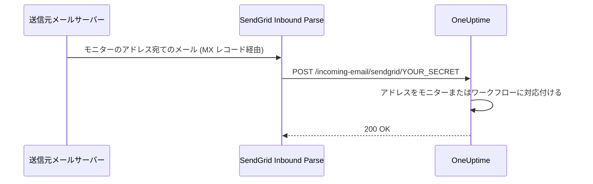

# SendGrid 受信メール

OneUptime の **Incoming Email Monitor** を使うと、モニターごとに固有のメールアドレスに送られたメールをもとにアラートを作成・解決できます。レガシーシステムやアラートツール、メールを送信できるあらゆるサービスとの連携に便利です。

同じ設定でワークフローもメールを受信できます。**Incoming Email** トリガーを持つワークフローには同じドメイン上に専用のアドレスが割り当てられ、そのアドレスに届いたメールごとにワークフローが開始されます。[トリガー](/docs/workflows/triggers#incoming-email) を参照してください。

このガイドでは、受信メールをセルフホストの OneUptime インスタンスに転送するよう SendGrid Inbound Parse を設定する方法を説明します。OneUptime Cloud ではこの設定は不要で、アドレスはすぐに使えます。

:::cards
- [始める前に](#前提条件): SendGrid アカウント、ドメイン、公開 HTTPS アドレス。
- [設定する](#設定手順): MX レコードからテストメールまでの 7 つのステップ。
- [環境変数](#環境変数のリファレンス): 3 つの設定とその既定値。
- [トラブルシューティング](#トラブルシューティング): 届かないメールと失敗する Webhook。
:::

## 仕組み



1. OneUptime で **Incoming Email Monitor** を作成します
2. OneUptime がそのモニター用の固有のメールアドレスを生成します (例: `monitor-abc123@inbound.yourdomain.com`)
3. そのアドレスにメールが送られると、SendGrid が受信し、Webhook で OneUptime に転送します
4. OneUptime は設定された条件に照らしてメールを評価し、アラートを作成または解決します

## 前提条件

- Inbound Parse を利用できる SendGrid アカウント
- DNS 設定にアクセスできる、自分で管理しているドメイン
- SendGrid の Webhook を OneUptime インスタンスに転送する公開 HTTPS エンドポイント

## ネットワークアクセス

Inbound Parse では、OneUptime への接続を開始するのは SendGrid です。OneUptime からの外向きのインターネットアクセスを許可するだけでは足りません。

| 方向 | 宛先 | プロトコル / ポート | 目的 |
| --- | --- | --- | --- |
| SendGrid → OneUptime | `https://your-oneuptime-domain.com/incoming-email/sendgrid/YOUR_SECRET` | HTTPS / TCP 443 | 解析したメールを multipart の POST として配信します。 |
| 送信元メールサーバー → SendGrid | `mx.sendgrid.net` (受信ドメインの公開 MX レコードで選ばれます) | SMTP / TCP 25 | SendGrid でメールを受信します。この接続は OneUptime サーバーには向かいません。 |
| OneUptime → SendGrid (SendGrid プロバイダーでのメール送信を別途設定した場合のみ) | `api.sendgrid.com` | HTTPS / TCP 443 | Mail Send API で通知メールを送信します。 |

Webhook のホスト名の DNS を公開し、公開クライアントが信頼する証明書を提供してください。プライベートな OneUptime のデプロイメントでは、内部で OneUptime に到達できる公開リバースプロキシやゲートウェイを通じて、Webhook のパスだけを公開できます。パス、シークレット、コンテンツタイプ、multipart のリクエストボディを保ったまま、対話的なログインやブラウザーのチャレンジなしで POST を通してください。OneUptime サーバーに受信用の SMTP リスナーは不要です。[SendGrid の Inbound Parse の設定](https://www.twilio.com/docs/sendgrid/for-developers/parsing-email/setting-up-the-inbound-parse-webhook) を参照してください。

`INBOUND_EMAIL_WEBHOOK_SECRET` に強力なランダム値を設定し、URL の `YOUR_SECRET` をその値に置き換えます。ルートにはパスの最後のセグメントが必要です。シークレットが設定されていれば OneUptime はその値を確認し、変数を空にするとこの確認は無効になります。完全な URL とモニターのメールアドレスは、プロキシのログも含めて非公開にしてください。現在、OneUptime は SendGrid の署名付き Inbound Parse ヘッダーや OAuth トークンを検証しません。それらの仕組みが必要な場合は、[SendGrid の Webhook セキュリティのドキュメント](https://www.twilio.com/docs/sendgrid/for-developers/parsing-email/securing-your-parse-webhooks) に従い、OneUptime に転送する前にそれらを検証するゲートウェイを設定してください。

SendGrid は Inbound Parse 用の信頼できる静的な送信元 IP の一覧を提供していません。SendGrid のメール送信用 IP や `mx.sendgrid.net` の名前解決で得られるアドレスは、Webhook の許可リストにはなりません。現在の DNS の結果を固定するのではなく、[SendGrid のファイアウォールに関するガイダンス](https://support.sendgrid.com/hc/en-us/articles/44375457225371-How-to-Configure-Firewall-Settings-for-SendGrid-Webhook-and-Inbound-Parse-IPs) に従ってください。

Inbound Parse は外向きのメール送信とは別のものです。モニター宛てのメールを受信するために、OneUptime が SendGrid の API を呼び出す必要はありません。通知の送信にも SendGrid を選ぶ場合は、DNS の名前解決と `api.sendgrid.com` への外向きの HTTPS を許可してください。[Mail Send](https://www.twilio.com/docs/sendgrid/api-reference/mail-send/mail-send) では送信のために受信側のコールバックは不要です。代わりに SMTP を使う場合は、OneUptime で設定した SMTP サーバーとポートを許可してください。

## 設定手順

:::steps
### 受信メール用のドメインを選ぶ

`inbound.yourdomain.com`、`email.yourdomain.com`、`monitor.yourdomain.com` のように、OneUptime 宛てのメール受信専用のサブドメインを選びます。OneUptime のモニターとワークフロー宛てのメールだけに使うため、あなたのメールボックスがそこに置かれることはありません。

### その MX レコードを SendGrid に向ける

サブドメイン宛てのメールを SendGrid に送る MX レコードを追加します。

| 種類 | ホスト/名前 | 優先度 | 値 |
| --- | --- | --- | --- |
| MX | inbound | 10 | mx.sendgrid.net |

ドメインが `example.com` で `inbound.example.com` を使う場合、レコードは次のようになります。

```text
inbound.example.com.  IN  MX  10  mx.sendgrid.net.
```

DNS の変更が反映されるまで最大 48 時間かかることがありますが、通常は数時間以内に完了します。

### SendGrid でドメインを認証する

受信ドメインは、[SendGrid で認証済みのドメイン](https://www.twilio.com/docs/sendgrid/ui/account-and-settings/inbound-parse) のいずれかに属している必要があります。[SendGrid のダッシュボード](https://app.sendgrid.com) で **Settings** > **Sender Authentication** に移動し、**Authenticate Your Domain** をクリックして、求められる DNS レコード (DKIM 用の CNAME レコード) を追加します。

### Inbound Parse の Webhook を追加する

SendGrid のダッシュボードで **Settings** > **Inbound Parse** に移動し、**Add Host & URL** をクリックします。次のように入力してから **Add** をクリックします。

| 項目 | 値 |
| --- | --- |
| **Receiving Domain** | 受信用のサブドメイン (例: `inbound.yourdomain.com`) |
| **Destination URL** | `https://your-oneuptime-domain.com/incoming-email/sendgrid/YOUR_SECRET` |
| **Check incoming emails for spam** | 任意 (必要に応じて有効にします) |
| **Send raw, full MIME message** | チェックしないままにします (不要) |
| **POST the raw, full MIME message** | チェックしないままにします (不要) |

### OneUptime を設定する

Destination URL と同じシークレットを使って、受信メールの変数を設定します。

:::tabs
@tab Docker Compose
```bash title="config.env"
INBOUND_EMAIL_PROVIDER=SendGrid
INBOUND_EMAIL_DOMAIN=inbound.yourdomain.com
INBOUND_EMAIL_WEBHOOK_SECRET=replace-with-a-strong-random-secret
```
@tab Kubernetes
```yaml title="values.yaml"
inboundEmail:
  provider: "SendGrid"
  domain: "inbound.yourdomain.com"
  webhookSecret: "replace-with-a-strong-random-secret"
```
:::

次に適用します。Docker Compose では `npm run start` を実行すると新しい値でコンテナーが作り直されます。Kubernetes では Helm のリリースをアップグレードします。

### Incoming Email モニターを作成する

[Incoming Email モニターを作成します](/docs/monitor/incoming-email-monitor#受信メール-モニターを作成する)。その **概要** ページには `monitor-abc123def456@inbound.yourdomain.com` のようなアドレスが表示され、条件によってどのメールでアラートを作成し、どのメールで解決するかが決まります。

ワークフローも同じドメインを使います。ワークフローに **Incoming Email** トリガーを追加してクリックすると、そのアドレス (`workflow-…@inbound.yourdomain.com`) が設定の上部に表示されます。上記の受信メールの変数が設定されるまで、トリガーにはサーバーがメールを受信できるよう設定されていないと表示されます。

### テストメールを送る

モニターのアドレスに、条件に一致する件名のメールを送ります。モニターの概要にそのメールが表示され、条件に一致するとアラートが作成されます。
:::

## 環境変数のリファレンス

| 変数 | Helm の値 | 説明 | 必須 | 既定値 |
| --- | --- | --- | --- | --- |
| `INBOUND_EMAIL_PROVIDER` | `inboundEmail.provider` | 受信メールのプロバイダー。SendGrid のみです。 | いいえ | `SendGrid` |
| `INBOUND_EMAIL_DOMAIN` | `inboundEmail.domain` | 受信メール用に設定したサブドメイン。設定するまで受信メールはオフです。 | はい | 空 |
| `INBOUND_EMAIL_WEBHOOK_SECRET` | `inboundEmail.webhookSecret` | Webhook の URL の最後のセグメント `/incoming-email/sendgrid/YOUR_SECRET` と照合するシークレット。公開エンドポイントでは設定してください。空の値では検証が無効になります。 | 推奨 | 空 |

Incoming Email モニターが照合できる項目 (件名、送信者、本文、受信者、メールが期限内に届いたかどうか) は、[利用できるフィルターの種類](/docs/monitor/incoming-email-monitor#使用できるフィルタータイプ) にあります。

## トラブルシューティング

:::details メールが受信されない
1. **DNS の伝播を確認する:** `dig MX inbound.yourdomain.com` が `mx.sendgrid.net` を返すはずです。
2. **SendGrid の Inbound Parse の設定を確認する:** SendGrid のダッシュボードの **Settings** > **Inbound Parse** で、ドメインと Webhook の URL を確認します。
3. **OneUptime のログを確認する:** OneUptime の `app` サービスのログで、受信メールの Webhook リクエストとエラーを探します。SendGrid は Inbound Parse の詳細なログを残さないため、これらのログが届いたものの記録になります。
:::

:::details Webhook が失敗する
1. **公開 Webhook のルートを確認する:** シークレットを含む完全な URL が、インターネットから OneUptime に届く必要があります。最後のシークレットのセグメントがない URL はルートに一致しません。
2. **ファイアウォールのルールを確認する:** ログインのリダイレクトやブラウザーのチャレンジなしで Webhook のパスへの HTTPS POST リクエストを許可し、SendGrid のメール送信用 IP を Webhook の送信元の許可リストとして使わないでください。
3. **SSL 証明書を確認する:** Webhook のホスト名には、公的に信頼される有効な証明書を使い、証明書チェーンも含めてください。
:::

:::details モニターがアラートを作成しない
1. **条件を確認する:** アラート作成の条件がメールの内容と一致しているかを確認し、パターンを使う前にまず完全一致の文字列で試してください。
2. **モニターを確認する:** 無効になっていないこと、種類が Incoming Email であることを確認します。
3. **モニターの概要を確認する:** メールが受信・処理されたかを確認し、評価ログで条件がどう一致したかを読みます。
:::

:::details トリガーに、サーバーがメールを受信できるよう設定されていないと表示される
サーバーで `INBOUND_EMAIL_DOMAIN` が空です。設定して変更を適用し、ワークフローのトリガーを開き直してください。
:::

## セキュリティのベストプラクティス

1. **HTTPS を使う:** Webhook のエンドポイントには常に HTTPS を使います
2. **Webhook のシークレット:** `INBOUND_EMAIL_WEBHOOK_SECRET` を設定し、追加の検証として Webhook の URL に含めます (例: `/incoming-email/sendgrid/your-secret`)
3. **ドメインの検証:** メールのセキュリティを高めるため、SendGrid でドメインを検証します
4. **アクセスを制限する:** 信頼できるメールの送信元に対してだけモニターを作成します
5. **ログを監視する:** 受信メールのログを定期的に確認し、不審なアクティビティがないか調べます

## 次のステップ

:::cards
- [Incoming Email Monitor](/docs/monitor/incoming-email-monitor): 条件、アドレスの形式、例。
- [ワークフローのトリガー](/docs/workflows/triggers): メールからワークフローを開始します。
- [プライベートネットワークへのアクセス](/docs/self-hosted/private-network-access): サーバーが自分のネットワーク内で到達できる範囲。
- [アーキテクチャ](/docs/self-hosted/architecture): セルフホスト環境で Webhook が届く場所。
:::
