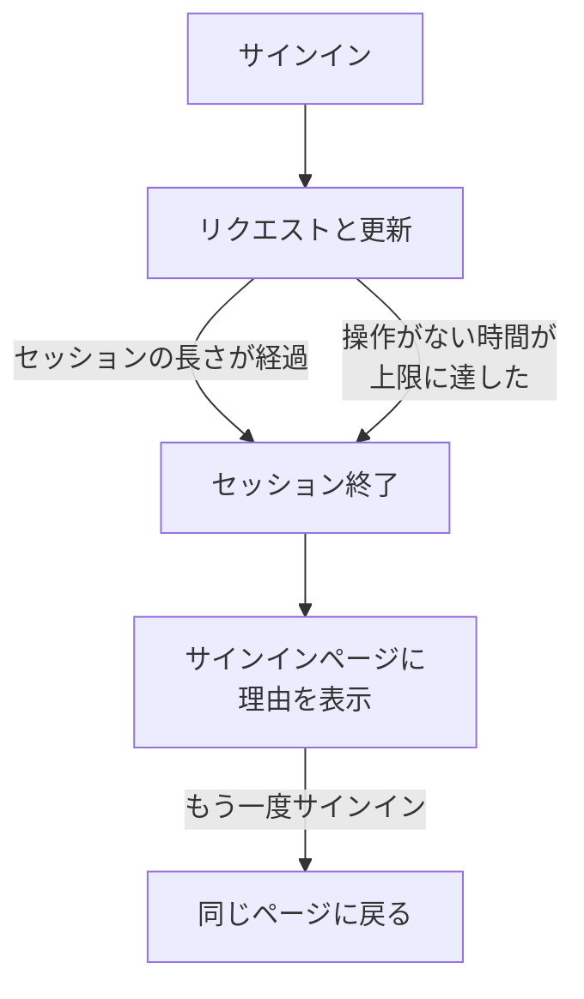

# セッションの長さ

OneUptime にサインインしたままでいられる時間を、もう一度サインインするまでの時間として選びます。サインインしてからの決まった時間、使わずにいる時間、またはその両方です。ダッシュボード、Admin Dashboard、モバイルアプリへのすべてのサインインに適用され、パスワード、パスキー、Microsoft でのサインイン、シングルサインオンのどれでも同じです。SSO サインインには独自の長さを設定できます。

> [!NOTE]
> セッションの長さは [OneUptime Enterprise Edition](/docs/self-hosted/enterprise) の一部です。Community Edition には **セッションの長さ** ページがなく、すべてのサインインは [制限なし](#制限なし) で説明するとおりに続きます。

:::cards
- [セッションの長さを設定する](#セッションの長さを設定する): Admin Dashboard の 2 つの設定。
- [セッションが終わるとき](#セッションが終わるとき): サーバーが数えるものと、そのタイミング。
- [SSO サインイン](#sso-サインイン): シングルサインオン独自の長さ。
- [サインインではないもの](#サインインではないもの): API キー、MCP 接続、ステータスページの閲覧者。
:::

## 制限なし

長さを設定するまで、サインインに長さの制限はありません。アクセストークンは 15 分間有効で、バックグラウンドで更新トークンによって更新されます。更新トークンは 30 日間有効で、使うたびに期限がリセットされます。30 日に 1 回以上 OneUptime を開く人はサインインしたままで、開かない人はもう一度サインインします。

## セッションの長さを設定する

:::steps
### セッションの長さを開く
Admin Dashboard で **設定** を開き、サイドメニューの **セッションの長さ** を開きます。

### 長さを選ぶ
- **サインアウトするまでの時間**: サインインした時点から、どれだけ操作していてもサインインが続く時間です。
- **操作がない場合にサインアウトするまでの時間**: OneUptime でクリック、入力、スクロールをしないままでいられる時間です。

選んだ内容はすぐに保存されます。

### サインアウトされる人を確認する
短い長さは、現在サインインしているすべての人に適用されます。すぐにサインアウトされる人がいる場合、OneUptime はまず人数と、あなたが含まれるかどうかを示します。続けるには **保存してサインアウトさせる** を選びます。
:::

| 設定 | 選択肢 | 既定値 |
| --- | --- | --- |
| **サインアウトするまでの時間** | 1 時間から 90 日 | **制限なし** |
| **操作がない場合にサインアウトするまでの時間** | 15 分から 14 日 | 30 日 (これが最長) |

API では、サーバーのグローバル設定で、`sessionLengthInMinutes` は 15 から 525600 (1 年) までの任意の整数の分を、`sessionIdleTimeoutInMinutes` は 15 から 43200 (30 日) までを受け付けます。空の場合は既定値です。

## セッションが終わるとき

- サーバーは、どちらの長さもセッション自体から数えます。サインインした時刻と、その人が最後に操作した時刻です。すべてのリクエスト、すべての更新、すべてのライブ更新で確認し、サインアウトをブラウザーに任せることはありません。
- 操作がない時間は、ダッシュボードまたは Admin Dashboard のいずれかのタブでの最後のクリック、キー入力、スクロールから数えます。開いたままのタブだけではセッションは続きません。
- モバイルアプリは、使われるたびに操作があったものとして数えます。
- セッションが終わると、ブラウザーはサインインページに移動し、理由が表示されます。もう一度サインインすると、元のページに戻ります。

| 変更 | 現在サインインしている人への影響 |
| --- | --- |
| セッションの長さまたは操作がない時間を短くする | すでに超えている人はすぐにサインアウトされ、ほかの人は達した時点でサインアウトされます |
| 長くする、または制限をなくす | 誰もサインアウトされず、次の更新からセッションが長く続きます |

## SSO サインイン

シングルサインオンによるサインインにも同じ 2 つの設定が適用されます。独自の長さを設定するには、**セッションの長さ** ページで **その他の設定** を開き、**SSO サインインに別の長さを使う** をオンにします。すると、その下の 2 つの設定がプロジェクトの SAML または OpenID Connect プロバイダー、またはサーバー自体の [グローバル SSO](/docs/identity/global-sso) によるサインインに適用され、ページ上部の 2 つがそれ以外のすべてのサインインに適用されます。

さらに、SSO を必須にしているプロジェクトは、SSO サインインが続いている間だけセッションを受け入れます。その時間は、SSO サインインに適用される長さを超えることはありません。

API では、スイッチは `useSeparateSsoSessionLengths`、SSO サインインの長さは `ssoSessionLengthInMinutes` と `ssoSessionIdleTimeoutInMinutes` で、範囲は同じです。

## サインインではないもの

- **API キー** は、設定した有効期限のままです。
- **MCP 接続** (OAuth で接続した AI アシスタント) は、独自の有効期間のままです。SSO を必須にしているプロジェクトでは、接続が承認に使った SSO サインインより長く続くことはありません。
- **非公開のステータスページ** には、閲覧者向けの独自の長さがあります。[プライベートユーザー](/docs/status-pages/index#プライベートユーザー) を参照してください。

## ライセンスがない場合

試用期間または猶予期間の後、有効なライセンスがない場合や、セッションの長さを含まないライセンスの場合は、長さを設定または変更できません。すでに設定済みの長さによるサインアウトは引き続き行われ、削除することもできます。Community Edition のイメージでは長さは適用されません。値はデータベースに残り、元に戻すと再び適用されます。

## 次のステップ

:::cards
- [SSO](/docs/identity/sso): ID プロバイダーでサインインできるようにします。
- [グローバル SSO](/docs/identity/global-sso): サーバー全体で 1 つの ID プロバイダーを使います。
- [Enterprise Edition](/docs/self-hosted/enterprise): Enterprise Edition で追加されるものと、そのライセンス。
:::
