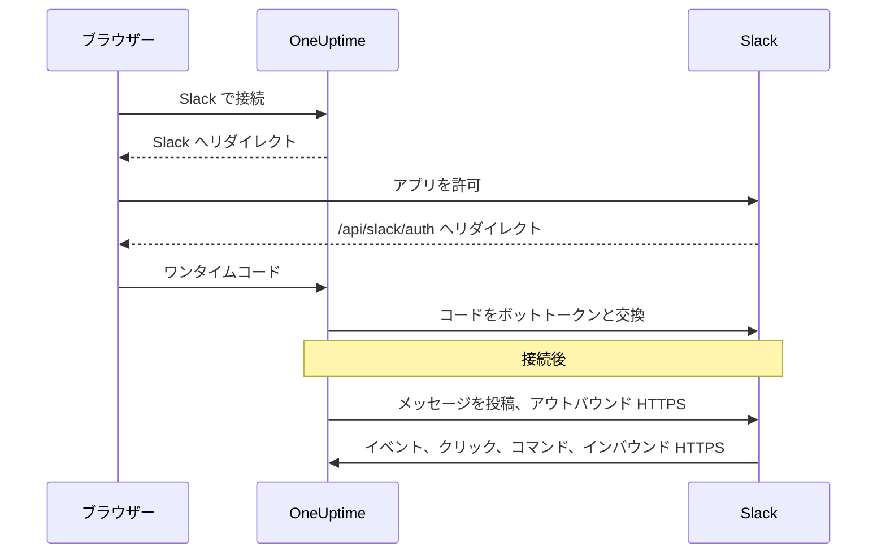
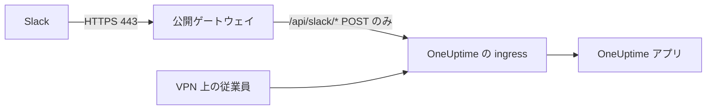

# Slack 統合

セルフホストの OneUptime を Slack に接続します。サーバーが生成するマニフェストから Slack アプリを作成し、アプリの認証情報を OneUptime に渡して、各プロジェクトをワークスペースに接続します。その後、OneUptime はインシデント、アラート、計画メンテナンスをチャンネルに投稿し、チームは Slack からそれらに対応できます。

このページは OneUptime サーバーを運用する人向けです。Slack を接続したら、通知ルールはプロジェクトごとに設定します。 [Slack](/docs/workspace-connections/slack) を参照してください。

:::cards
- [Slack アプリを設定する](#slack-アプリを設定する): マニフェストからアプリを作成し、プロジェクトを接続します。
- [環境変数](#環境変数): OneUptime がアプリから必要とする 3 つの値。
- [ネットワークアクセス](#セルフホスト環境のネットワークアクセス): Slack が到達できる必要のあるコールバック。
- [トラブルシューティング](#トラブルシューティング): Slack ページのメッセージの意味と対処方法。
:::

## 仕組み

Slack アプリはあなた自身のものです。ワークスペースにインストールされ、あなたのサーバーとだけ通信します。トラフィックは双方向に流れ、それぞれの方向に専用のネットワークアクセスが必要です。



- **送信方向**: OneUptime は Slack の Web API を呼び出して、メッセージの投稿、チャンネルの作成、画像のアップロードを行います。
- **受信方向**: Slack はイベント、ボタンのクリック、メニュー、スラッシュコマンドのために、サーバー上の 4 つのルートを呼び出します。各リクエストはアプリの signing secret で署名されています。OneUptime は、署名が一致しないリクエストや、タイムスタンプが 5 分より古いリクエストを拒否します。

## 始める前に

- アプリを作成してインストールできる Slack ワークスペース。
- Slack から到達できる、OneUptime の公開 HTTPS ホスト名。 [ネットワークアクセス](#セルフホスト環境のネットワークアクセス) を参照してください。
- サーバーの設定へのアクセス。Docker Compose では `config.env`、Kubernetes では Helm の values です。
- プロジェクトを接続するには、そのプロジェクトでの **Project Owner**、 **Project Admin**、または **Project Member** ロール。

## Slack アプリを設定する

:::steps
### 公開 URL を設定する

OneUptime は、アプリのマニフェストとすべてのコールバック URL を `HOST` と `HTTP_PROTOCOL` から組み立てます。Slack が呼び出すホスト名を HTTPS で設定します。

:::tabs
@tab Docker Compose
```bash title="config.env"
HOST=oneuptime.example.com
HTTP_PROTOCOL=https
```
@tab Kubernetes
```yaml title="values.yaml"
host: oneuptime.example.com
httpProtocol: https
```
:::

これらの値は URL を生成するだけです。DNS レコード、証明書、ファイアウォールルールは作成しません。

### アプリのマニフェストをコピーする

**プロジェクト設定 > ワークスペース > Slack** を開きます。サーバーで Slack が設定されるまで、このページには **Slack と OneUptime プロジェクトの連携** が、あなたのホスト名用に生成されたマニフェストとともに表示されます。マニフェストは `https://oneuptime.example.com/api/slack/app-manifest` でも提供されます。

マニフェスト内のすべての URL が公開ホスト名で始まっていることを確認します。そうでない場合は、先に `HOST` と `HTTP_PROTOCOL` を修正して変更を適用します。

### Slack アプリを作成する

[api.slack.com/apps](https://api.slack.com/apps) でマニフェストから新しいアプリを作成し、ワークスペースを選んでマニフェストを貼り付けます。URL がホスト名と一致するよう、必ず自分のサーバーが生成したマニフェストを使ってください。

### アプリの認証情報をコピーする

アプリの **Basic Information** ページの **App Credentials** で、 **Client ID**、 **Client Secret**、 **Signing Secret** をコピーします。

### 認証情報を OneUptime に追加する

:::tabs
@tab Docker Compose
```bash title="config.env"
SLACK_APP_CLIENT_ID=YOUR_SLACK_APP_CLIENT_ID
SLACK_APP_CLIENT_SECRET=YOUR_SLACK_APP_CLIENT_SECRET
SLACK_APP_SIGNING_SECRET=YOUR_SLACK_APP_SIGNING_SECRET
```
@tab Kubernetes
```yaml title="values.yaml"
slackApp:
  clientId: "YOUR_SLACK_APP_CLIENT_ID"
  clientSecret: "YOUR_SLACK_APP_CLIENT_SECRET"
  signingSecret: "YOUR_SLACK_APP_SIGNING_SECRET"
```

値を自分で管理する Kubernetes の Secret に保管するには、代わりに `slackApp.existingSecret` を設定します。その `name` と、キー `clientIdKey`、`clientSecretKey`、`signingSecretKey` です。
:::

### 設定を適用する

:::tabs
@tab Docker Compose
```bash
npm run start
```

これにより、新しい `config.env` でコンテナーが作り直されます。`docker compose restart` では読み込み直されません。
@tab Kubernetes
```bash
helm upgrade my-oneuptime oneuptime/oneuptime -f values.yaml
```
:::

OneUptime が再び起動すると、 **プロジェクト設定 > ワークスペース > Slack** にはマニフェストの代わりに **Slack で接続** ボタンが表示されます。

### イベントのリクエスト URL を検証する

Slack アプリの **Event Subscriptions** で、リクエスト URL を検証します。OneUptime は signing secret が設定されて初めて Slack の challenge に応答するため、アプリの作成中に失敗した場合はもう一度試してください。

### プロジェクトを接続する

**プロジェクト設定 > ワークスペース > Slack** で **Slack で接続** を選択し、Slack でアプリを許可します。Slack は同じページに戻し、そのページにはワークスペース名が表示されるようになります。

### 自分の Slack アカウントを接続する

ボタン、フォーム、コマンドは、それを使う Slack アカウントにリンクされた OneUptime ユーザーとして動作します。各自が **ユーザー設定 > ワークスペース > Slack** を開き、 **Connect my account with Slack** を選択します。アカウントを接続していない人には、接続を求めるダイレクトメッセージがアプリから届きます。
:::

## 環境変数

| Docker Compose (`config.env`) | Helm (`values.yaml`) | 必須 | 値 |
| --- | --- | --- | --- |
| `SLACK_APP_CLIENT_ID` | `slackApp.clientId` | はい | アプリの **Client ID**。これがないと、Slack ページには **Slack で接続** の代わりにセットアップガイドが表示されます。 |
| `SLACK_APP_CLIENT_SECRET` | `slackApp.clientSecret` | はい | アプリの **Client Secret**。Slack が返すコードをトークンと交換するのに使います。 |
| `SLACK_APP_SIGNING_SECRET` | `slackApp.signingSecret` | はい | アプリの **Signing Secret**。Slack からのすべてのリクエストをこれで検証します。 |
| `HOST` | `host` | はい | スキームを除いた公開ホスト名。 |
| `HTTP_PROTOCOL` | `httpProtocol` | はい | `https`。Slack は HTTPS の URL しか呼び出しません。 |

## アプリでできること

マニフェストは次の機能を設定します。各機能は表のルートでサーバーに到達するため、Slack がそのルートに到達できる場合にだけ動作します。

| 機能 | 内容 | ルート |
| --- | --- | --- |
| `/incident` と **Create New Incident** ショートカット | Slack からインシデントを宣言する | `POST /api/slack/interactive` |
| `/maintenance` と **Create Scheduled Event** ショートカット | Slack からメンテナンスを予定する | `POST /api/slack/interactive` |
| `/oneuptime` | ログ、トレース、メトリクス、インシデント、モニターについて OneUptime AI に質問する | `POST /api/slack/command` |
| OneUptime のメッセージにあるボタンとフォーム | 確認、解決、メモの追加、状態の変更、オンコールポリシーの実行 | `POST /api/slack/interactive` と `POST /api/slack/options-load` |
| イベント | メンション、メッセージ、リアクション、ピン留め。たとえばメッセージをメモとして保存する | `POST /api/slack/events` |

### メッセージ内の画像

インシデントやアラートの説明には、たとえば合成モニターのスクリーンショットを含められます ( [スクリーンショットを表示する](/docs/monitor/incident-alert-templating#スクリーンショットを表示する) を参照)。OneUptime はそれぞれをプライベートファイルとしてワークスペースにアップロードして Slack のメッセージに表示するため、ボットスコープ `files:write` が必要です。生成されるマニフェストにはこれが含まれています。

古いマニフェストから Slack アプリを作成した場合は、 **OAuth & Permissions > Bot Token Scopes** に `files:write` を追加します (または現在のマニフェストからアプリを更新します)。続いて **プロジェクト設定 > ワークスペース > Slack** でもう一度 **Slack で接続** を選択し、新しいスコープを付与します。それまでは、各スクリーンショットは代替テキストとして表示されます。

## セルフホスト環境のネットワークアクセス

### トラフィックの方向とエンドポイント

| トラフィック | 必要なアクセス |
| --- | --- |
| OneUptime から Slack | DNS と、Web API の呼び出しと OAuth トークンの交換のための `slack.com` への TCP 443 のアウトバウンド HTTPS。使用する場合は、コマンドの応答 URL と Incoming Webhook による通知のための `hooks.slack.com` |
| Slack から OneUptime | 統合のすべての機能のための、下記 4 つの POST ルートへの TCP 443 の公開 HTTPS |
| ユーザーのブラウザーから OneUptime | ダッシュボードへのアクセスと、`/api/slack/auth/:projectId/:userId` および `/api/slack/auth/:projectId/:userId/user` への OAuth リダイレクト。これらはユーザーの VPN 経由のアクセスのままでかまいません |

アウトバウンドのドメインは OneUptime の Slack 統合について述べたもので、Slack クライアントや Slack のすべての機能のための完全な許可リストではありません。Slack の *Incoming Webhook* は Slack がホストしています。OneUptime はそこへ送信するので、あなたのサーバー上のインバウンドのエンドポイントではありません。Slack の [Incoming Webhook ガイド](https://docs.slack.dev/messaging/sending-messages-using-incoming-webhooks/) を参照してください。

これらのコールバックを ingress 経由で OneUptime に転送します。

| メソッドとパス | 用途 |
| --- | --- |
| `POST /api/slack/events` | Events API の検証、リアクション、ピン留め、メンション、メッセージ |
| `POST /api/slack/interactive` | ボタン、ショートカット、モーダルの送信、`/incident` と `/maintenance` |
| `POST /api/slack/options-load` | インタラクティブメニューの選択肢のリクエスト |
| `POST /api/slack/command` | `/oneuptime` コマンド |

OAuth は [ブラウザーのリダイレクトと、それに続くサーバー側のトークン交換](https://docs.slack.dev/authentication/installing-with-oauth/) です。マニフェストはリダイレクト URL のプレフィックスとして `/api/slack/auth` を登録し、OneUptime は認可を開始するときにプロジェクトとユーザーのパスを付け加えます。ブラウザーからのアクセスだけでは、Slack はイベントやボタンのクリックを届けられません。

### プライベートな環境とコールバックのセキュリティ



公開 DNS と、公的に信頼された HTTPS 証明書、完全な証明書チェーン、OneUptime の ingress へのプライベートなルートを備えたゲートウェイを使います。ゲートウェイへのインバウンドの TCP 443 を許可し、上記 4 つのコールバックルートだけを転送します。プライベートな `ClusterIP`、内部 DNS 名、従業員の VPN 接続には Slack から到達できません。スプリット DNS を使えば、同じホスト名でもダッシュボードと OAuth のルートをプライベートのままにできます。

ホスト名を変更したら、マニフェストを生成し直して Slack アプリを更新します。

ゲートウェイを通しても、次のものを保持します。

- メソッド、パス、クエリ文字列、元のボディ。
- `Content-Type`、`X-Slack-Signature`、`X-Slack-Request-Timestamp`。
- 公開ホストと HTTPS スキーム (信頼できるプロキシヘッダーを使う)。

コールバックルートはブラウザーの SSO、CAPTCHA、プロキシのログインページの対象から外し、OneUptime の signing secret とタイムスタンプのチェックは有効なままにします。サーバーの時計は同期しておいてください。5 分を超えてずれたリクエストは拒否されます。Slack は [リクエスト署名の検証](https://docs.slack.dev/authentication/verifying-requests-from-slack/) について説明しています。送信元 IP のチェックはその代わりにはなりません。

### アクセスの確認と制限事項

:::steps
1. Slack アプリの **Event Subscriptions** で、リクエスト URL を検証します。Slack は [POST の challenge を送信し、TLS を確認します](https://docs.slack.dev/apis/events-api/using-http-request-urls/)。
2. テスト通知を送り、スラッシュコマンドを実行し、インシデントのメッセージのボタンを押し、購読しているイベントを発生させます。
3. シークレットをログに残さずに、ゲートウェイと OneUptime のログで配信の失敗を確認します。
:::

Slack は素早い応答を求めており、 [インタラクションには 3 秒以内の応答](https://docs.slack.dev/interactivity/handling-user-interaction/) が必要です。ブラウザーからの GET や、アウトバウンドのメッセージ送信の成功では、これらの POST コールバックは確認できません。

> [!WARNING]
> インバウンドの接続がすべて禁止されている場合でも、認可済みのアプリはアウトバウンド HTTPS でメッセージを送信できますが、イベント、ボタン、ショートカット、コマンドは動作しません。OneUptime のマニフェストは HTTP コールバックを使い、Socket Mode を無効にしています。Slack の Socket Mode を有効にしても、これらのルートの代わりとしてはサポートされていません。

[プライベートネットワークへのアクセス設定](/docs/self-hosted/private-network-access) は、プライベートな宛先へのアウトバウンドのリクエストを制御します。コールバックを Slack に公開するものではありません。

## トラブルシューティング

### 接続が完了しなかった

Slack から戻ったときに接続ができていなければ、開始した Slack ページ ( **プロジェクト設定 > ワークスペース > Slack**、またはアカウントを接続していた場合は自分の **ユーザー設定 > ワークスペース > Slack** ) に **Slack は接続されませんでした** と、その理由を説明する一文があなたの言語で表示されます。ページの残りの部分は通常どおり読み込まれるので、その場で接続し直せます。Slack 自身の応答は表示されません。それは理由とともに OneUptime サーバーのログに記録されています。

| ページの表示 | 対処方法 |
| --- | --- |
| **"この接続リンクは無効か、有効期限が切れているか、すでに使用されています。最初からやり直してください。"** | リンクは、開始したブラウザーで 15 分間、1 回だけ使えます。Slack ページからやり直し、同じブラウザーで 15 分以内に Slack での操作を終えてください。 |
| **"このプロジェクトを Slack に接続する権限がありません。"** | OneUptime を Slack にインストールするには、 **Project Owner**、 **Project Admin**、または **Project Member** が必要です。Slack から戻ったときにもう一度確認されるため、その間にロールが外された場合もここで接続は終了します。 |
| **"あなたはもうこのプロジェクトのメンバーではありません。"** | 自分の Slack アカウントを接続するには、Slack から戻った時点でプロジェクトのメンバーである必要があります。 |
| **"このプロジェクトはまだ Slack ワークスペースに接続されていません。"** | 先に **プロジェクト設定 > ワークスペース > Slack** から OneUptime を Slack にインストールし、そのあとで自分のアカウントを接続します。 |
| **"このプロジェクトが接続されているものとは別の Slack ワークスペースにサインインしました。"** | プロジェクトがインストールされている Slack ワークスペースにサインインした状態で、アカウントを接続します。 |
| **"接続がキャンセルされたため、何も変更されていません。"** | Slack でリクエストが許可されませんでした。やり直して許可してください。 |
| **"この OneUptime サーバーでは Slack が設定されていません。"** | `SLACK_APP_CLIENT_ID` と `SLACK_APP_CLIENT_SECRET` を設定し ( [環境変数](#環境変数) を参照)、OneUptime を再起動します。 |
| **"OneUptime は接続を完了できませんでした。もう一度お試しください。"** | Slack がエラーを返したか、完了処理中にリクエストまたは書き込みが失敗しました。どちらかは OneUptime サーバーのログでわかります。もう一度試し、それでも続く場合はログと Slack アプリの設定を確認してください。 |

### その他の問題

:::details Slack がイベントのリクエスト URL を検証できない
OneUptime が Slack の challenge に応答するのは、`SLACK_APP_SIGNING_SECRET` が設定されていて、リクエストが届いたときだけです。signing secret を設定し、設定を適用して、検証をやり直します。それでも失敗する場合は、公的に信頼された証明書で `POST /api/slack/events` にインターネットから到達できることを確認します。
:::

:::details ボタンとスラッシュコマンドは何もしないが、通知は届く
通知はアウトバウンドなので、インバウンドのアクセスがなくても動作します。ボタン、ショートカット、コマンドはインバウンドです。Slack が `POST /api/slack/interactive` と `POST /api/slack/command` に到達できること、そしてゲートウェイがボディと `X-Slack-Signature` および `X-Slack-Request-Timestamp` ヘッダーを保持していることを確認します。
:::

:::details 自分の Slack アカウントが OneUptime に接続されていないとアプリに言われる
ボタン、フォーム、コマンドを使うには、Slack アカウントが OneUptime のユーザーにリンクされている必要があります。 **ユーザー設定 > ワークスペース > Slack** を開き、 **Connect my account with Slack** を選択します。プロジェクトから外された場合は、アプリが代わりにそのことを伝え、Slack からの操作は拒否されます。
:::

:::details スクリーンショットがテキストで表示される
Slack アプリに `files:write` スコープがありません。 [メッセージ内の画像](#メッセージ内の画像) を参照してください。
:::

## 次のステップ

:::cards
- [Slack](/docs/workspace-connections/slack): プロジェクトの通知ルールとサマリーを作成します。
- [Microsoft Teams 統合](/docs/self-hosted/microsoft-teams-integration): サーバーに Teams ボットも設定します。
- [プライベートネットワークへのアクセス](/docs/self-hosted/private-network-access): ワークフローと Webhook が社内ツールに到達できるようにします。
:::
