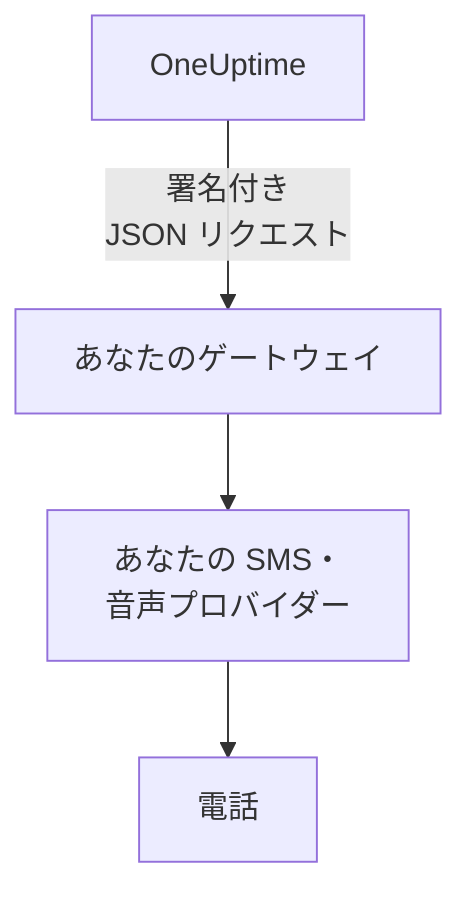

# SMS・通話ゲートウェイ

OneUptime は、SMS と通話を Twilio の代わりに、あなたが運用するゲートウェイを通じて送信できます。社内の規則で、すべてのメッセージを自社の SMS・音声プロバイダー、またはネットワークの外に出る前にメッセージを検査するシステムに通す必要がある場合に使います。OneUptime は SMS と通話を 1 件ずつ署名付きの JSON リクエストとしてゲートウェイに送信し、ゲートウェイがそれを配信します。

:::cards
- [ゲートウェイを設定する](#ゲートウェイを設定する): URL と、自動で作成される署名シークレット。
- [ゲートウェイが受け取るもの](#ゲートウェイが受け取るもの): SMS や通話 1 件ごとに、署名付きの JSON リクエストが 1 つ。
- [呼び出しに対応する](#呼び出しに対応する): 通話や返信から、確認、エスカレーション、解決を行います。
- [配信と再試行](#配信と再試行): ゲートウェイが停止しているときに起こること。
:::

## 仕組み



ゲートウェイは、サーバー自身の Twilio アカウントを経由するはずだったすべてのもの、つまりオンコールの呼び出し、通知、確認コード、ステータスページの購読者への SMS について、そのアカウントの代わりになります。**プロジェクト設定 > 通知 > 通知設定** の **Twilio 設定** カードで独自の Twilio 設定を追加したプロジェクトは、引き続きその設定を通じて送信します。各プロジェクトの SMS と通話のスイッチ、および課金が有効な場合はその残高が、Twilio の場合と同じようにチェックされます。

## ゲートウェイを設定する

:::steps
1. Admin Dashboard で **設定 > 通話とSMS** に移動し、**SMS and Call Provider** カードの **Edit Provider** をクリックします。
2. **Your own gateway** を選び、**Gateway URL** を入力します。ゲートウェイはプライベートネットワーク上にあってもかまいません。
3. 保存します。OneUptime が署名シークレットを作成します。カードからコピーして、ゲートウェイに設定します。
4. **Send Test** をクリックします。ゲートウェイは 2xx ステータスで応答し、何も送信しないようにします。
:::

シークレットを置き換えるには、**その他の項目** の **Signing Secret** を空にして保存します。OneUptime が新しいシークレットを作成します。Twilio に戻すには、**Twilio** を選んで保存します。

## ゲートウェイが受け取るもの

SMS と通話はそれぞれ 1 件の `POST` リクエストで、JSON の本文と次のヘッダーが付きます。

| ヘッダー | 値 |
| --- | --- |
| `Content-Type` | `application/json` |
| `X-OneUptime-Event` | `sms`、`call`、`test` のいずれか |
| `X-OneUptime-Signature` | `sha256=` に続けて、署名シークレットをキーとした本文の HMAC-SHA256 を 16 進数で |
| `User-Agent` | `OneUptime-CallAndSmsGateway/1.0` |

```json title="An on-call page by SMS"
{
  "version": 1,
  "event": "sms",
  "id": "7c5b0d0e-3e5f-4d1a-9a4f-2b8e6c1d9f00",
  "sentAt": "2026-10-27T09:30:00.000Z",
  "to": "+15551234567",
  "message": "OneUptime: A new alert has been created. Alert #42: Database is down…",
  "isSensitive": false,
  "project": {
    "id": "0f6b8c3a-1d2e-4f5a-8b9c-0d1e2f3a4b5c",
    "name": "Production"
  },
  "actions": {
    "acknowledge": "https://oneuptime.example.com/api/custom-notification-channel/page/5f2c…/acknowledge?token=…",
    "escalate": "https://oneuptime.example.com/api/custom-notification-channel/page/5f2c…/escalate?token=…",
    "resolve": "https://oneuptime.example.com/api/custom-notification-channel/page/5f2c…/resolve?token=…"
  }
}
```

| フィールド | 内容 |
| --- | --- |
| `version` | この形式では常に `1`。フィールドは追加されるだけです。 |
| `event` | `sms`、`call`、`test` のいずれかで、`X-OneUptime-Event` と同じです。 |
| `id` | このメッセージに固有で、配信の試行ごとに同じです。すでに送信したメッセージを無視するのに使います。 |
| `sentAt` | OneUptime が送信した日時 (ISO 8601)。 |
| `to` | E.164 形式の電話番号。テストでは `null`。 |
| `message` | SMS の本文、または通話で伝える内容。SMS は最大 1,600 文字、通話のテキストは最大 16,384 文字です。それより長いテキストは切り詰められ、残りは OneUptime にあるという注記で終わります。 |
| `isSensitive` | 確認コードでは `true`。メッセージを自社のログに残さないでください。 |
| `project` | プロジェクトの `id` と `name`。プロジェクトから送信されたものでない場合は `null`。 |
| `actions` | オンコールの呼び出しでは、それに対応するためのリンク。それ以外では `null`。 |

通話はスクリプトではなく、内容として渡されます。`message` は通話で伝える内容で、Twilio の「確認するには 1 を押してください」は含まれません。キー入力など独自の方法でアクションを提示し、対応するリンクを呼び出してください。

### 署名を確認する

リクエストの生の本文の HMAC を、本文を解析する前に計算し、ヘッダーと比較します。この確認は [カスタムチャネル](/docs/self-hosted/custom-notification-channels#署名を確認する) と同じなので、1 つの検証処理で両方に対応できます。

```javascript title="Node.js"
const crypto = require("crypto");

function isFromOneUptime(rawBody, signatureHeader, secret) {
  const expected =
    "sha256=" + crypto.createHmac("sha256", secret).update(rawBody).digest("hex");
  const received = String(signatureHeader || "");

  return (
    received.length === expected.length &&
    crypto.timingSafeEqual(Buffer.from(received), Buffer.from(expected))
  );
}
```

## 呼び出しに対応する

通話中の操作や返信で相手が応答すると、ゲートウェイは `actions` 内の対応するリンクに `POST` リクエストを送信します。リンクはカスタムチャネルのリンクと同じように機能します。API キーは不要で、各リンクにはその呼び出し専用の、7 日間有効なトークンが含まれ、アクションは呼び出された本人が行ったものとして記録されます。各アクションと応答については、[呼び出しに対応する](/docs/self-hosted/custom-notification-channels#呼び出しに対応する) を参照してください。

```bash title="Acknowledge a page"
curl -X POST "https://oneuptime.example.com/api/custom-notification-channel/page/5f2c…/acknowledge?token=…"
```

## 配信と再試行

ゲートウェイが 10 秒以内に 2xx ステータスで応答すると、リクエストは配信済みとみなされます。応答がなかったリクエスト、または 408、429、5xx ステータスで応答したリクエストは、1 秒後と、そこからさらに 4 秒後に再送されます。試行は合計 3 回です。それ以外の 4xx ステータスでは再送されません。

SMS または通話のログ、およびオンコールの呼び出しではその人のオンコールログには、`Sent to the SMS and call gateway (HTTP 200).` または配信されなかった理由が記録され、URL は記録されません。OneUptime はメッセージが電話に届いたかどうかを知ることができないため、SMS はゲートウェイが受け付けた時点で送信済みと表示され、送信元の番号は空欄のままになります。

## テストリクエスト

**Send test** は、`event` を `test` に、`to`、`project`、`actions` を `null` にしたリクエストを送信します。2xx ステータスで応答し、何も送信しないでください。

## 次のステップ

:::cards
- [カスタム通知チャネル](/docs/self-hosted/custom-notification-channels): 自社のアプリを通じて人を呼び出します。
- [プッシュ通知](/docs/self-hosted/push-notifications): サーバー全体でプッシュをオフにします。
- [Twilio 統合](/docs/self-hosted/twilio-integration): 代わりに Twilio を通じて送信します。
- [プライベートネットワークへのアクセス](/docs/self-hosted/private-network-access): サーバーが自社のネットワーク内で到達できる範囲。
:::
