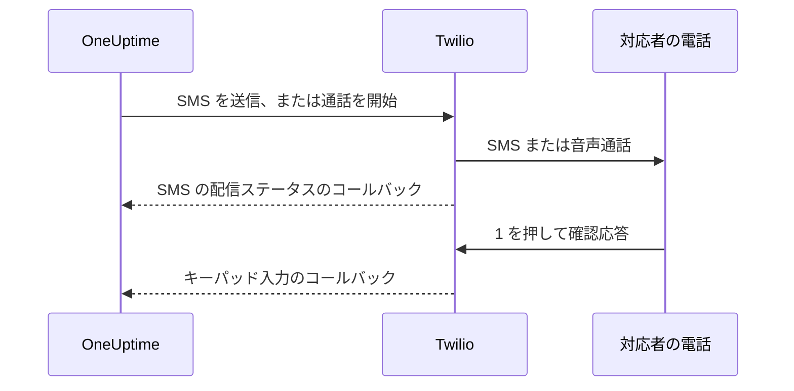

# Twilio 統合

セルフホストの OneUptime は、あなた自身の Twilio アカウントを通じて SMS と音声のアラートを送信し、料金は Twilio に直接支払います。Twilio の認証情報は環境変数ではなく OneUptime のダッシュボードに保存します。通知の配信は保存された設定を読み取り、Helm チャートには Twilio の認証情報の値がありません。

> [!NOTE]
> 過去のマイグレーションで `TWILIO_ACCOUNT_SID`、`TWILIO_AUTH_TOKEN`、`TWILIO_PHONE_NUMBER` が取り込まれました。これらの変数を変更しても、既存のインストールの認証情報は更新されません。

:::cards
- [Twilio アカウントを準備する](#1-twilio-アカウントを準備する): 認証情報、電話番号、アカウントの制限。
- [認証情報を保存する](#2-oneuptime-に認証情報を保存する): 1 つのプロジェクト用、またはインストール全体用。
- [ネットワークアクセスを設定する](#3-ネットワークアクセスを設定する): Twilio がサーバーのどこに、いつ到達する必要があるか。
- [電話番号を確認する](#5-チームメンバーの電話番号を確認する): チームメンバーの番号の確認方法。
:::

## 1. Twilio アカウントを準備する

:::steps
### 認証情報をコピーする

[Twilio Console](https://console.twilio.com/) を開き、 **Account SID** と **Auth Token** をコピーします。

### 電話番号を取得する

必要な SMS や音声の機能を持つ Twilio の電話番号を取得します。送信元と送信先の番号には、国番号を含む E.164 形式を使ってください。

### アカウントの制限を確認する

アカウントの残高、送信先の国の許可、適用される送信者登録の要件を確認します。トライアルアカウントには受信者、地域などの制限があり、OneUptime の実際のアラートが届かないことがあります。テストの前に [Twilio のアカウントとトライアルに関するドキュメント](https://www.twilio.com/docs/usage/tutorials/how-to-use-your-free-trial-account)を確認してください。本番ではアップグレードしたアカウントを使います。
:::

## 2. OneUptime に認証情報を保存する

認証情報は、1 つのプロジェクト用に保存するか、インストール全体用に一度だけ保存します。

| | プロジェクトの設定 | インストール全体の設定 |
| --- | --- | --- |
| 場所 | **プロジェクト設定 > 通知 > 通知設定** の **Twilio 設定** カード | **Admin Dashboard > 設定 > 通話とSMS** |
| 設定できる人 | **Project Owner**、 **Project Admin**、またはカスタムロールの **Create Call and SMS** | マスター管理者 |
| 用途 | プロジェクトのデフォルトである間のプロジェクトメンバーへの SMS と通話、割り当てられたステータスページ、この設定を使う着信ポリシー | デフォルトの設定がないプロジェクトのメンバーへの SMS と通話 |

プロジェクトの設定を追加するには:

:::steps
1. **プロジェクト設定 > 通知 > 通知設定** に移動します。
2. **Twilio 設定** で **Twilio 設定を作成** を選択します。
3. 名前、 **Twilio アカウント SID**、 **Twilio 認証トークン**、 **Twilio プライマリ電話番号** を入力します。必要なら、ほかの国向けにカンマ区切りで **Twilio セカンダリ電話番号** を入力します。
4. **プロジェクトのデフォルトに設定** は、プロジェクトの最初の設定ではオンになっています。そのため、オンコール通知を含むプロジェクトメンバーへの SMS と通話は、保存した時点からこの設定を通ります。このアカウントをステータスページや着信専用にする場合はオフにしてください。2 つ目以降の設定はスイッチがオフの状態で始まります。これらのメッセージを移すには、スイッチをオンにするか、設定の行メニューから **プロジェクトのデフォルトに設定** を選びます。`isProjectDefault` を省略した API リクエストも同じように扱われます。
5. 保存します。プロジェクトのデフォルトにできる設定は 1 つだけです。ステータスページは、それぞれに明示的に割り当てられた設定を使います。

> [!IMPORTANT]
> **SMS** と **音声通話** はどのプロジェクトでも最初はオフになっており、オンにするまでプロジェクトの誰もそれらの電話番号を追加できません。同じページの **通知チャネル** カードでこれらをオンにできるのは、プロジェクトのオーナー、 **Billing Admin**、または **Manage Billing** を持つ人です。
:::

インストール全体のデフォルトにする場合は、代わりに管理者が **Admin Dashboard > 設定 > 通話とSMS** を開き、Twilio の認証情報と電話番号を編集して保存します。メンバーへの通知は、プロジェクトにデフォルトの設定がないときにこのグローバル設定を使います。Auth Token は秘密にしてください。

## 3. ネットワークアクセスを設定する

送信は外向きのアクセスだけで動きます。配信状況の更新、キーパッドでの確認応答、着信には、Twilio からサーバーへの到達が必要です。

プライベートなデプロイでは、SMS と通話を送るために DNS の名前解決と、Twilio への TCP 443 経由の外向き HTTPS が必要です。Twilio は API のアドレスが動的なため、`*.twilio.com` への外向き HTTPS を許可するよう推奨しています。[Twilio の IP アドレス](https://help.twilio.com/articles/115015934048-All-About-Twilio-IP-Addresses)を参照してください。これは Kubernetes の NetworkPolicy や外部のファイアウォールも含め、OneUptime アプリケーションのワークロードの外向き通信に適用します。

内向きのアクセスが必要かどうかは機能によります。

| 機能 | Twilio から OneUptime への到達が必要か |
| --- | --- |
| SMS の送信 | いいえ。ただし配信ステータスの更新にはコールバックが必要です。 |
| 単純なテスト用の音声通話 | いいえ。OneUptime は読み上げの指示を外向きの API リクエストに含めて送ります。 |
| 1 を押してオンコールのアラートに確認応答する | はい。Twilio がキーパッド入力を OneUptime に送ります。 |
| 着信ポリシー | はい。Twilio が通話の指示を要求し、発信の結果を報告します。 |

外部から見たパスは次のとおりで、OneUptime の Nginx ゲートウェイを通ります。プレースホルダーは通知ごとに異なります。

| メソッド | パス | 用途 |
| --- | --- | --- |
| POST | `/notification/sms/status-callback/:smsLogId/:token` | SMS の配信ステータス |
| POST | `/api/user-notification-log-timeline/call/gather-input/:itemId?token=...` | キーパッドでの確認応答 |
| POST | `/notification/incoming-call/voice` | 任意: 着信の指示 |
| POST | `/notification/incoming-call/dial-status/:callLogId/:callLogItemId` | 任意: 着信のルーティング結果 |

SMS と確認応答の URL は OneUptime が自動で生成します。そのトークンを固定の Webhook URL に置き換えないでください。着信については [着信ポリシー](/docs/on-call/incoming-call-policy)の手順に従ってください。番号を割り当てると、その番号の Webhook が設定されます。

Twilio は [公開されていて到達できる Webhook URL](https://www.twilio.com/docs/usage/webhooks/webhooks-overview) を必要とします。公的に信頼された TLS 証明書を使い、プロキシを通しても元のホスト、プロトコル、パス、クエリパラメーター、本文、 `X-Twilio-Signature` ヘッダーを保ってください。着信のハンドラーは Twilio の署名を検証します。SMS の配信ではメッセージごとの URL トークン、キーパッドでの確認応答では署名付きのクエリトークンを使います。トークンを共有のログやスクリーンショットに含めないでください。[Twilio の Webhook のセキュリティ](https://www.twilio.com/docs/usage/webhooks/webhooks-security)を参照してください。

### プライベートなデプロイからコールバックを公開する

:::steps
1. OneUptime のホスト名 (例: `oneuptime.example.com`) の DNS を公開し、インターネットに面したリバースプロキシかロードバランサーを指すようにします。内向きの TCP 443 を許可し、完全なチェーンを持つ公的に信頼された証明書を設定します。プライベート IP、内部専用の DNS、管理者の VPN 接続では、Twilio は接続できません。
2. そのゲートウェイに、OneUptime のプライベートな ingress へのネットワーク経路を用意します。直接でも、自社のサイト間 VPN やプライベートリンク経由でもかまいません。アップストリームのサービスのポートを許可します。Kubernetes の `ClusterIP` サービスには、到達可能な ingress か、ゲートウェイからの別の経路が必要です。データベースなどの内部サービスは非公開のままにします。
3. 上の表のうち、使うコールバックのパスだけを公開します。外部の `/notification` プレフィックスをアプリケーションに対応付ける OneUptime の Nginx ゲートウェイを通して転送してください。キーパッドのルートでは `/api` を残します。HTTP メソッドとリクエストのデータを保ち、別の URL にリダイレクトしないでください。公開用の `Host` を保ち、プロキシで公開ホストと HTTPS スキームの信頼された転送ヘッダーを設定します。
4. これらのルートを、ブラウザーの SSO、CAPTCHA、プロキシのログインページの対象から外します。OneUptime のコールバック認証は有効のままにします。プライベートなオリジンへのアクセスは、ゲートウェイと許可された内部クライアントに限ります。
5. Docker Compose の `config.env` に `HOST=oneuptime.example.com` と `HTTP_PROTOCOL=https` を、Helm の values には `host: oneuptime.example.com` と `httpProtocol: https` を設定します。デプロイの変更を適用し、アプリケーションの再起動を待ちます。これらの設定は URL を生成するだけで、DNS、証明書、ファイアウォールのルールは作りません。OneUptime には Twilio のコールバック専用のホスト名の設定はありません。ホスト名が変わったら、既存の Twilio の電話番号の Webhook も更新してください。
:::

ダッシュボードはプライベートな ingress のままにしておけます。スプリット DNS を使えば、社員は社内ネットワークや VPN 経由で同じホスト名をその ingress に解決し、Twilio はゲートウェイに解決します。どちらの経路でも、そのホスト名に有効な証明書を提供してください。OneUptime の [プライベートネットワークアクセスの設定](/docs/self-hosted/private-network-access) は内部サービスへの外向きのリクエストを制御するもので、`ALLOW_PRIVATE_NETWORK_WEBHOOKS` は内向きのエンドポイントを公開しません。

### IP の制限と、内向きのアクセスがないデプロイ

Twilio の通常の Webhook の送信元アドレスは変わるため、SIP やメディアの IP 範囲をコールバックの許可リストに使わないでください。対象となる Twilio のエディションでは [Static Proxy for Webhooks](https://www.twilio.com/docs/iam/twilio-editions/twilio-static-proxy) を利用できます。自分のエディションが対象か、どの製品に対応しているかを確認し、Twilio が現在公開している範囲でファイアウォールを設定してください。利用する場合も、コールバックの検証は続けます。

> [!WARNING]
> ポリシーで内向きの接続が禁止されている場合、SMS の送信と単純なインラインの音声再生は外向きの HTTPS で動きます。SMS の配信状況の更新、キーパッドでの確認応答、着信のルーティングは、到達できるコールバックがなければ動きません。完全に切り離されたインストールでは Twilio を使えません。

開発では、Twilio の [Webhook のテストガイド](https://www.twilio.com/docs/usage/webhooks/webhook-testing)で公開トンネルの使い方が説明されています。必要なルートだけを許可するプロキシに転送し、得られたホスト名を上記のように設定し、テストが終わったら停止してください。トンネルでも内向きのアクセスは開かれます。

## 4. 配信とコールバックを別々にテストする

:::steps
1. 社内ネットワークと VPN の外から、コールバックのホスト名が公開ゲートウェイに解決され、有効な TLS 証明書を返すことを確認します。ブラウザーからの GET では、これらの POST のコールバックは確認できません。
2. プロジェクトの Twilio の設定で **テスト SMS を送信** と **テスト通話を発信** を使い、送信先の電話で受信を確認します。どちらにも Twilio の設定を追加する権限が必要です。 **Project Owner**、 **Project Admin**、またはカスタムロールの **Create Call and SMS** と **Read Call and SMS** です。
3. ユーザーの確認済みの SMS や通話の連絡先と通知ルールを設定してから、管理されたオンコールのアラートを発生させます。1 を押し、OneUptime で確認応答されたことを確かめます。着信ポリシーを使う場合は、設定した番号に電話をかけ、ルーティングと通話ログを確認します。
4. OneUptime と Twilio のメッセージログで SMS の配信ステータスを確認します。送信が受け付けられても配信の証明にはなりません。[Twilio はその後のステータスの変化をコールバックで報告します](https://www.twilio.com/docs/messaging/guides/track-outbound-message-status)。
:::

| 症状 | 確認する場所 |
| --- | --- |
| 何も送信されない | 認証情報、番号の機能、アカウントの制限、外向きの接続。 |
| SMS や通話は届くが、ステータスや確認応答が更新されない | コールバックの URL と公開 ingress のログ。Twilio の [HTTP 取得エラーのガイド](https://www.twilio.com/docs/api/errors/11200)は、到達できないコールバック、TLS の問題、HTTP エラーの診断に役立ちます。 |

テスト通話が成功しただけでは、コールバックに到達できることの確認にはなりません。

## 5. チームメンバーの電話番号を確認する

SMS や通話用の電話番号を追加すると、すぐに確認コードが送信され、確認ダイアログが開きます。ダイアログにはコードを送信した時刻と有効期限が表示され、求められれば新しいコードを送りますが、1 分に 1 回までです。確認の前に何かを再送する必要はありません。

コードを送れないときは、送ったと表示するのではなく、その理由を示します。たとえば、プロジェクトのデフォルトの設定も上記のインストール全体の設定もない間は、Twilio アカウントが設定されていないと表示されます。最初のコードを送れなかった番号は追加されず、Twilio が送信先の国を拒否したなど、その理由がフォームに表示されます。

SMS で確認した番号は、2 つ目のコードなしで通話用にも確認済みになります。通話での確認では SMS は確認されません。固定電話のように通話を受けられる番号でも、テキストメッセージを受け取れるとは限らないからです。Twilio がコードを受け付けたのに届かない場合は、プロジェクトの SMS ログにその配信ステータスが表示されます。

## 次のステップ

:::cards
- [着信ポリシー](/docs/on-call/incoming-call-policy): Twilio の番号を通じて、発信者がオンコールのエンジニアにつながるようにします。
- [エスカレーションルール](/docs/on-call/escalation-rules): 各レベルで誰に、SMS、通話などのどの方法で通知するかを決めます。
- [SMTP](/docs/emails/smtp): メールも自分のメールサーバーから送信します。
- [プライベートネットワークアクセス](/docs/self-hosted/private-network-access): ワークフローと Webhook から社内ツールに到達できるようにします。
:::
