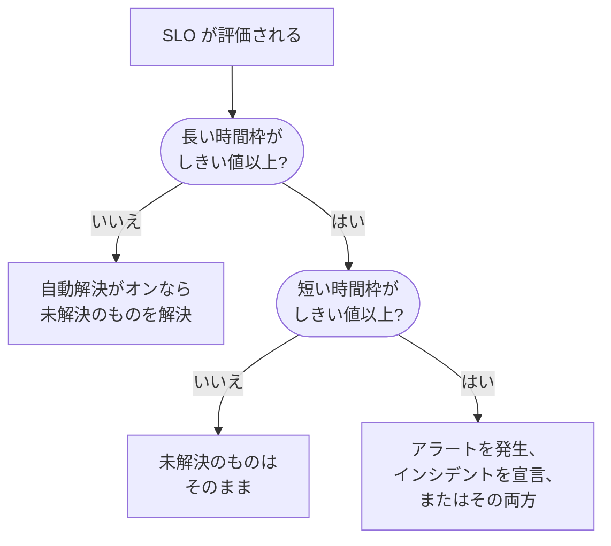

# バーンレートアラートとインシデント

エラーバジェットは現在の位置を教えてくれます。バーンレートルールは、いつベッドから出るべきかを教えてくれます。SLO が問題になるほど速くエラーバジェットを消費すると、バーンレートルールがアラートを発生させるか、インシデントを宣言するか、その両方を行います。タイトル、説明、重大度、所有者、ラベル、オンコールのエスカレーション、ワークスペースへの通知は自分で決められます。

:::cards
- [ルールが発火を判断する方法](#ルールが発火を判断する方法): 2 つの時間枠が両方ともしきい値を超えたとき。
- [既定のルール](#既定のルール): SLO の時間枠に合わせた Fast burn、Slow burn、Slow leak。
- [ルールを作成する](#ルールを作成または編集する): SLO のバーンレートルールページでの 5 つのステップ。
- [テンプレート変数](#各アラートとインシデントの内容): 独自のタイトルと説明を書きます。
:::

## バーンレートの意味

バーンレートは、一定のペースと比べてエラーバジェットをどれだけ速く使っているかを表します:

```text
burn rate = (share of time that was bad) ÷ (share of time the target allows to be bad)
```

バーンレートが 1 なら、時間枠全体でちょうど予算を使い切り、余りなく目標を達成します。値が大きいほど早く使い切ります。30 日間で 99.9% の SLO の場合:

| 続いた場合のバーンレート | 予算がなくなるまで |
| --- | --- |
| 1 | 30 日 |
| 2 | 15 日 |
| 6 | 5 日 |
| 14.4 | 約 2 日 (50 時間) |

バーンレートは予算の残りに左右されません。「今どれだけ悪いか」に答えるもので、誰かを呼び出すかどうかを決めるために必要なのはまさにこれです。

代わりに予算の残りに応じて対応するには、たとえば残りが 4 分の 1 になったら信頼性の作業だけをリリースするといった対応を、SLO の [エラーバジェットポリシー](/docs/slo/error-budget-policy) で決めておきます。

## ルールが発火を判断する方法

OneUptime は、SLO を評価するたび (5 分ごと) に、有効な各バーンレートルールを確認します。各ルールは 2 つの時間枠でバーンレートを測定し、両方がしきい値以上のときにだけ発火します:

- **長い時間枠** (たとえば 1 時間) は、消費が持続的で無視できないものであり、1 回のチェック失敗ではないことを示します。
- **短い時間枠** (たとえば 5 分) は、それがまだ続いていることを示します。これがないと、1 時間前のスパイクが、回復した後も長くアラートを出し続けてしまいます。

これは Google SRE Workbook のマルチウィンドウ、マルチバーンレートのパターンで、OneUptime はこれを自動で設定します。



SLO に長い時間枠 1 つ分の監視履歴がそろうまで、ルールは発火できません。そうしないと、モニターの最初のチェック失敗を数分の履歴で割ることになり、巨大なバーンレートになってしまうためです。そのため新しい SLO は、最初の 1 時間は **Fast burn** ルールを、最初の 6 時間は **Slow burn** ルールを、最初の 3 日間は **Slow leak** ルールを発火させられません。後で SLO にそれだけの履歴がなくなった場合 (たとえばモニターを新しいものに入れ替えた後) は、ルールは開いたものを放置せずに解決します。SLO のいずれかのモニターが定期メンテナンス中の間も、ルールは発火しません。[定期メンテナンス](#定期メンテナンス) を参照してください。

## 既定のルール

新しい SLO にはそれぞれ 3 つのバーンレートルールが付きます。30 日間の時間枠の場合:

| ルール | しきい値 | 長い時間枠 | 短い時間枠 | 発火する条件 |
| --- | --- | --- | --- | --- |
| **Fast burn** | 14.4× | 1 時間 | 5 分 | 予算の約 2% を 1 時間で消費: 約 2 日でなくなるペースです。 |
| **Slow burn** | 6× | 6 時間 | 30 分 | 予算の約 5% を 6 時間で消費: 約 5 日でなくなるペースです。 |
| **Slow leak** | 1× | 3 日 | 6 時間 | 予算の約 10% を 3 日間で消費: 時間枠の終わりまでになくなるペースです。 |

Fast burn と Slow burn は人を呼び出すためのルールで、プロジェクトで最も高いアラートの重大度でアラートを発生させます。Slow leak はチケット扱いのルールで、プロジェクトで最も低いアラートの重大度でアラートを発生させます。ほかの 2 つのルールでは決して発火しない、一定のペースで続く消費を捉えます: 3× では 99.9% の予算が 10 日でなくなりますが、発火するのは Slow leak だけです。アラートが解決された後は、3 日間の長い時間枠ではなく 24 時間待ってから次のアラートを発生させます。

しきい値は 30 日間の予算を前提に計算されているため、OneUptime は SLO の時間枠に合わせて調整します。Fast burn と Slow burn は、それぞれ常に「1 時間で予算の 2%」と「6 時間で予算の 5%」を意味します:

| SLO の時間枠 | Fast burn のしきい値 | Slow burn のしきい値 |
| --- | --- | --- |
| 7 日 | 3.36× | 1.4× |
| 28 日 | 13.44× | 5.6× |
| 30 日 | 14.4× | 6× |
| 90 日 | 43.2× | 18× |

Slow leak は常に「長い時間枠で予算の 10%」を意味します。30 日以上の時間枠では、長い時間枠と短い時間枠は 3 日と 6 時間のままで、しきい値が時間枠に合わせて大きくなります。それより短い時間枠では、長い時間枠は SLO の時間枠の 10 分の 1、短い時間枠はさらにその 12 分の 1 になるため、しきい値は 1× のままです。3 日のままだとしきい値が 1× を下回り、目標を達成する見込みの SLO でも発火してしまいます。

| SLO の時間枠 | Slow leak のしきい値 | 長い時間枠 | 短い時間枠 |
| --- | --- | --- | --- |
| 7 日 | 1× | 16.8 時間 | 84 分 |
| 28 日 | 1× | 2.8 日 | 5.6 時間 |
| 30 日 | 1× | 3 日 | 6 時間 |
| 90 日 | 3× | 3 日 | 6 時間 |

暦月の SLO には 30 日間の値が使われます。どのルールも既定のタイトルと説明を使い、アラートを自動で解決し、所有者やラベルは追加しません。インシデントを宣言するルールはないので、OneUptime をアップグレードしても勝手にインシデントが宣言されることはありません。編集、削除、独自のルールの追加ができます。

### 既存の SLO におすすめのルールを追加する

Slow leak が導入される前に作成された SLO には、Fast burn と Slow burn しかありません。OneUptime をアップグレードしても、アラートを発生させ始めるルールが勝手に追加されることはないためです。SLO に 3 つの既定のルールのいずれかが欠けている間は、その SLO の **バーンレートルール** ページで、表の上のお知らせに欠けているルールの名前が表示されます。お知らせの **おすすめのルールを追加** をクリックすると、SLO の時間枠に合わせて調整された、追加されるルールが正確に表示されるので、確認して追加します。追加されるのは欠けているルールだけで、もう一度クリックしても何も追加されません。

SLO に同じ名前のルール、または同じ長い時間枠のルールがあれば、オンかオフかにかかわらず、そのルールはすでにあるものとみなされます。そのため、名前を変えたり調整したりした既定のルールが二重に追加されることはありません。不要な既定のルールをお知らせに表示させたくない場合は、そのルールを削除せずに残し、無効にしてください。SLO のバーンレートルールを作成する権限が必要です。追加された各ルールは、自分で作成したルールと同じように SLO のフィードに投稿され、監査ログに記録されます。

### 多数の SLO にまとめて追加する

多数の SLO におすすめのルールを追加するには、各 SLO のページではなく SLO の一覧から始めます。

:::steps
#### SLO を選択する

**SLO** を開き、更新する SLO を選択します。フィルターで表示されるすべての SLO を対象にするには、ページ全体を選択してから、一覧に表示される、一致したすべての SLO を選択します。

#### 「おすすめのルールを追加」を選ぶ

**一括操作** を開き、**おすすめのルールを追加** を選びます。

#### 追加される内容を確認して確定する

何かが追加される前に、確認画面には、選択した SLO のうち各ルールが追加される SLO の数が表示されます。ルールはそれぞれの SLO の時間枠に合わせて調整されます。時間枠の異なる SLO に同じルールが異なる形で追加される場合 (7 日間の SLO と 30 日間の SLO の Slow leak など) は、形ごとにしきい値、時間枠、追加先の SLO が一覧表示されます。おすすめのルールがすでにすべてある SLO の数と、読み取れなかった SLO の数も表示されます。**おすすめのルールを追加** をクリックすると追加されます。
:::

各 SLO には欠けているルールだけが、その SLO の **バーンレートルール** ページから追加する場合とまったく同じように追加されます。すでにあるものとみなす条件も同じで、ルールごとにフィードの項目と監査ログのエントリーが作成されます。結果には SLO ごとに、ルールが追加されたか、おすすめのルールがすでにすべてあったか、変更されなかったかが表示され、変更されなかった場合はその理由 (たとえば変更する権限のない SLO であること) も表示されます。変更されない SLO があっても、ほかの SLO の処理が止まることはなく、同じ SLO にもう一度実行しても何も追加されません。アーカイブされた SLO は評価されないため、一覧に表示されず、ルールが提案されることもありません。先に SLO のアーカイブを解除してください。

スクリプトからも、プロジェクトの [API キー](/docs/api-reference/api-reference) を使って API で同じことができます。1 つの SLO 向けのリクエストは `{ "serviceLevelObjectiveId": "..." }` を受け取り、ルールを `rules` で返します。一括リクエストは `{ "serviceLevelObjectiveIds": ["..."] }` を受け取り (1 回のリクエストで SLO は最大 100 件)、SLO ごとに 1 つのエントリーを、指定した順に `results` で返します:

| リクエスト | 内容 |
| --- | --- |
| `POST /api/service-level-objective-burn-rate-rule/recommended-rules` | SLO に欠けているおすすめのルールを一覧表示します。何も書き込みません。 |
| `POST /api/service-level-objective-burn-rate-rule/recommended-rules/add` | それらを追加し、追加したものを一覧表示します。もう一度リクエストしても何も追加されません。 |
| `POST /api/service-level-objective-burn-rate-rule/recommended-rules/bulk` | 各 SLO に欠けているものを返します。ルール付きの `Missing`、`NothingMissing`、または読み取る権限のない SLO については `Refused` です。何も書き込みません。 |
| `POST /api/service-level-objective-burn-rate-rule/recommended-rules/bulk/add` | 各 SLO に欠けているものを、SLO 1 つずつ順に追加します。ルール付きの `Added`、`NothingMissing`、`Refused`、または失敗する前に追加されたルール付きの `Failed` です。もう一度リクエストすると、まだ欠けているものだけが追加されます。 |

## ルールを作成または編集する

SLO のバーンレートルールを作成する権限が必要です。

:::steps
### バーンレートルールを開く

SLO を開き、サイドメニューの **ルール** セクションにある **バーンレートルール** に移動して **SLO のバーンレートルールを作成** をクリックするか、既定のルールのいずれかを編集します。

### ルールに名前を付ける

**ルール** で **名前** を入力します (「Fast burn」など)。新しいルールはオンです。あとで発火を止めるには、編集フォームで **有効** をオフにします。

### バーンの時間枠を設定する

**バーンの時間枠** で **バーンレートのしきい値** (たとえば `14.4`)、**長い時間枠（分）**、**短い時間枠（分）** を設定し、必要に応じて **再発火の抑制（分）** も設定します。

### 宣言する内容を選ぶ

**宣言する内容** で **発火したとき** に答えます: **アラートを作成** (既定)、**インシデントを宣言**、または **両方** です。**SLO の所有者を所有者として追加** を使うと、ルールが作成するものすべての所有者に SLO の所有者も加わります。

### アラートとインシデントを記述する

**アラート** と **インシデント** のステップは、ルールが宣言するものについてだけ表示されます。それぞれにタイトルと重大度があり、折りたたまれたセクションとして **説明**、**所有権とラベル**、**オンコール**、**その他の項目** (自動解決、プライバシー、修正メモを含む) があります。新しいルールは、編集できる既定のタイトルと説明から始まります。最後のステップで **SLO のバーンレートルールを作成** をクリックします。
:::

OneUptime は、ルールを保存するときにその数値を確認します:

| 設定 | 条件 |
| --- | --- |
| **バーンレートのしきい値** | 0 より大きいこと。 |
| **短い時間枠（分）** | 0 より大きいこと。 |
| **長い時間枠（分）** | 短い時間枠より長いこと。 |
| **再発火の抑制（分）** | 0 以上であること。空の場合は長い時間枠の長さを意味します。 |

**発火したとき** のどの答えも何かを作成します。アラートも作成せずインシデントも宣言しないルールは API が拒否します。評価のたびに確認されながら、何も宣言しないことになるためです。

ルールの表には、各ルールのしきい値、時間枠と抑制、宣言する内容 (およびアラートやインシデントが手動でのみ解決されるか、非公開か)、重大度、オンコールポリシー、所有者、ラベルが表示されます。

> [!TIP]
> 最初のおすすめ: 3 つの既定のルールを残し、高速消費ルールは高い重大度で人を呼び出すオンコールポリシーに送り、低速消費ルールには業務時間向けに低い重大度のアラートを発生させ、低速漏出ルールは担当チーム向けのチケットとして残します。チームがインシデントで運用しているなら、高速消費ルールで **インシデントを宣言** を選び、アラートも受け取るなら **両方** を選びます。

## ルールが宣言するもの

|  | **アラート** | **インシデント** |
| --- | --- | --- |
| 作成する答え | **アラートを作成** (既定) または **両方** | **インシデントを宣言** または **両方** |
| 位置付け | 軽いシグナル: アラートの一覧に入ります。 | 重いシグナル: インシデント番号が付き、対応のワークフロー全体が始まります。 |
| タイトルと説明 | 独自のもの、または既定のテキスト | 独自のもの、または既定のテキスト |
| 重大度 | **アラートの重大度**: 空の場合はプロジェクトで最も高いもの | **インシデントの重大度**: 空の場合はプロジェクトで最も高いもの |
| エスカレーション | **アラートのオンコールポリシー** | **インシデントのオンコールポリシー** |
| 所有者とラベル | **アラートの所有者** と **アラートラベル** | **インシデントの所有者** と **インシデントのラベル** |
| 非公開 | オフ | オフ |
| 自動解決 | オン | オン |
| ステータスページ | 公開しない | 公開しない |

それぞれを別々に設定できるので、短いアラートを担当チームのローテーションに送り、詳しいインシデントを重大インシデント用のローテーションに送ることができます。両者は別々に扱われます。それぞれが独立して重複排除、解決、抑制されるので、インシデントを解決してもアラートの抑制はリセットされず、その逆も同じです。

### SLO は影響を受けるリソース

バーンレートルールが作成する各アラートとインシデントは、**影響を受けるリソース** に SLO を表示し、SLO にリンクします。アラートとインシデントの一覧の **影響を受けるリソース** フィルターで 1 つの SLO に絞り込め、SLO の **アラート** ページと **インシデント** ページにそれらが一覧表示され、サイドメニューのバッジが未解決の数を示します。このリンクは OneUptime が自動で設定し、アラートやインシデントを編集しても削除されません。

### バーンレートのインシデントは内部にとどまる

エラーバジェットの急速な消費はエンジニアリングへのシグナルであり、宣言された障害ではありません。バーンレートのインシデントはステータスページに表示されず、ステータスページの購読者に通知することもありません。モニターにもリンクされません。リンクすると、解決したときに SLO の測定元であるモニターのステータス履歴そのものを書き換えてしまうためです。

そのようなインシデントを手動で解決すると、消費が回復してルールが本当に再び発火するまで、何も再宣言しません。インシデントに対応している最中にルールと戦うことはありません。

## 各アラートとインシデントの内容

新しいルールは、アラートとインシデントのどちらでも既定のタイトルと説明から始まります。タイトルや説明を空にすると、既定のテキストに戻ります。既定のタイトルは次のとおりです:

```text
SLO burn rate: {{sloName}} — {{ruleName}}
```

既定の説明は、ルール名、しきい値に対する両方の時間枠のバーンレート、エラーバジェットの残りを示します。

独自に書くには、タイトル、説明、修正メモでテンプレート変数を使います。これらの各フィールドの **テンプレート変数** に変数が一覧表示されます。クリックするとカーソル位置に挿入されます。フィールドに `{{` と入力して選ぶこともできます。説明と修正メモでは、ツールバーの **変数を挿入** も使えます。変数はルールが発火したときに埋められます:

| 変数 | 内容 | 例 |
| --- | --- | --- |
| `{{sloName}}` | SLO の名前。 | `Checkout availability` |
| `{{sloId}}` | SLO の ID。 | `b7f4c2d8-1f3e-4a5b-9c6d-7e8f9a0b1c2d` |
| `{{sloLink}}` | OneUptime ダッシュボードの SLO へのリンク。 | `https://oneuptime.com/dashboard/project-id/slos/slo-id` |
| `{{sloStatus}}` | この評価後の SLO のステータス。 | `At Risk` |
| `{{ruleName}}` | 発火したバーンレートルールの名前。 | `Fast burn` |
| `{{burnRateThreshold}}` | ルールのバーンレートのしきい値 (持続可能なペースの倍数)。 | `14.4` |
| `{{longWindowBurnRate}}` | ルールの長い時間枠で測定したバーンレート。 | `21.5` |
| `{{shortWindowBurnRate}}` | ルールの短い時間枠で測定したバーンレート。 | `36` |
| `{{longWindowInMinutes}}` | ルールの長い時間枠の長さ (分)。 | `60` |
| `{{shortWindowInMinutes}}` | ルールの短い時間枠の長さ (分)。 | `5` |
| `{{targetPercentage}}` | SLO の目標 (パーセント)。 | `99.9` |
| `{{currentSliPercentage}}` | SLO のコンプライアンスの時間枠で測定した SLI (パーセント)。 | `99.87` |
| `{{errorBudgetRemainingPercentage}}` | まだ使えるエラーバジェットの割合 (パーセント)。予算を超過すると負の値になります。 | `42.5` |
| `{{errorBudgetRemaining}}` | まだ使えるエラーバジェット (期間)。予算を超過するとマイナス記号で始まります。 | `18m 22s` |
| `{{errorBudgetRemainingMinutes}}` | まだ使えるエラーバジェット (分)。 | `18.37` |
| `{{windowDescription}}` | SLO のコンプライアンスの時間枠を言葉で表したもの。 | `rolling 30-day window` |
| `{{policyTier}}` | この評価のあとに SLO がいるエラーバジェットポリシーの段階の名前。どの段階にもいないときは「None」。 | `Reliability first` |
| `{{policyTierThresholdPercentage}}` | その段階の予算残量のしきい値 (パーセント)。SLO がどの段階にもいないときは空です。 | `25` |
| `{{policyTierWhatWeDo}}` | その段階でチームが取り決めた対応。段階に書かれたとおりです。SLO がどの段階にもいないときは空です。 | `Only reliability work and critical fixes ship.` |

たとえば、タイトル `{{ruleName}}: {{sloName}} is burning {{longWindowBurnRate}}x` は `Fast burn: Checkout availability is burning 21.5x` になります。

:::details 変数の埋め方
- 数値は小数点以下 2 桁に丸められます。
- 波かっこの内側の空白は問題ありません。`{{ sloName }}` も使えます。
- つづりを間違えた変数はそのまま残るので、入力ミスは黙って消えずにアラートに表れます。
- タイトルは 500 文字、説明と修正メモは 50,000 文字まで使えます。変数を埋めた後に 500 文字を超えるタイトルは 1 行にまとめられ、省略記号で短くされるので、アラートやインシデントは確実に作成されます。
- ルールの発火時に SLO へのリンクを組み立てられない場合、`{{sloLink}}` は空のままで、アラートやインシデントは作成されます。
:::

## 所有者、ラベル、プライバシー

- **アラートの所有者** と **インシデントの所有者** は、**所有者を追加** を使って 1 つの一覧から選んだ人とチームです。アラートやインシデントが作成されるとすぐに追加され、通知を受け取ります。人はプロジェクトのメンバーである必要があります。
- **SLO の所有者を所有者として追加** を使うと、SLO の所有者 (所有者ユーザーと所有者チームのメンバー) も、ルールが作成するものすべてに追加されます。SLO の所有者は SLO 自体のステータスの変化をすでに知らされているので、2 回通知されることがあります。既定ではオフです。
- 各所有者は 1 回だけ追加されます。プロジェクトの所有者ルールなどですでにアラートやインシデントの所有者になっているユーザーや、追加された所有者チームに属しているユーザーは、重ねて追加されません。
- **アラートラベル** と **インシデントのラベル** はアラートやインシデントに追加されるので、フィルター、所有者ルール、ワークスペースの通知ルールで一致させられます。
- 非公開のアラートやインシデントは、その所有者、プロジェクトの管理者、プロジェクトの所有者にだけ表示されます。

ラベル、所有者チーム、オンコールポリシーは、SLO のプロジェクトに属している必要があります。

## 解決と再発火の抑制

- **解決は長い時間枠に従います。** 自動解決がオン (既定) の場合、長い時間枠のバーンレートがしきい値を下回るとすぐに、OneUptime はルールのアラートとインシデントを解決します。短い時間枠で解決すると状態が揺れ動きます。断続的な障害が穏やかな 5 分の後に解決され、一晩中また人を呼び出すことになります。
- **自動解決をオフにした場合。** **アラートを自動解決** または **インシデントを自動解決** をオフにすると、消費が回復した後も、誰かが解決するまでそのレコードは開いたままです。ルールはその上に新しいものを開かず、手動で解決されて長い時間枠がしきい値を下回った後、抑制期間が過ぎれば再び発火できます。
- **再発火の抑制。** レコードが解決された後、ルールは抑制期間 (既定は長い時間枠の長さ) の間、その種類のレコードを再び宣言しません。これにより、回復中のシステムは残ったノイズで誰かを呼び出すことなく回復する時間を得られます。Slow leak は、3 日間の長い時間枠ではなく 24 時間の抑制期間で作成されるため、再発した漏れは翌日には再び報告されます。

次の変更は、自動解決の設定にかかわらず、ルールが開いたものを常に解決します。正当化できなくなったルールのためにエスカレーションが続かないようにするためです:

- **発火したとき** を変えてアラートまたはインシデントを外すと、その出力が開いていたものが閉じられます。
- ルールをオフにするか削除する。
- SLO の評価をオフにする、SLO をアーカイブする、または削除する。
- SLO が **一時停止中** または **設定ミス** になる。その間は何も測定しないためです。
- ルールのしきい値や時間枠がなくなる、または SLO に長い時間枠 1 つ分の履歴がなくなる。

## 定期メンテナンス

SLO のモニターが進行中のメンテナンスイベントに入っている間、その SLO のバーンレートルールはアラートを発生させず、インシデントも宣言しません。計画された作業で誰かを呼び出すべきではないためです。ルールがすでに開いたものは、通常どおり解決されます。その時間は、SLO のダウンタイムのステータスに従って引き続きエラーバジェットに数えられます。

## SLO のフィード

SLO の **フィード** には、ルールが発生させた各アラートと宣言した各インシデントが、リンクとそれを説明するバーンレートとともに投稿され、それぞれが自動または手動で解決されたときにも投稿されます。まだ開いていたためにルールが再び引き継いだレコードは、2 回投稿されません。ルールの作成、編集、削除も投稿され、SLO の **監査ログ** に記録されます。[SLO のフィードと監査ログ](/docs/slo/feed-and-audit-logs) を参照してください。

## トラブルシューティング

:::details SLO を作成した直後にルールが発火しなかった
ルールが発火するのは、SLO に長い時間枠 1 つ分の監視履歴がそろってからです。既定の高速消費ルールでは 1 時間、低速消費ルールでは 6 時間、低速漏出ルールでは 3 日間 (SLO の時間枠が 30 日より短い場合は、その時間枠の 10 分の 1) です。
:::

:::details 障害がまだ続いているのにアラートが解決された
自動解決は長い時間枠に従います。長い時間枠のバーンレートがしきい値を下回るとすぐに、アラートは解決されます。ルールの長い時間枠を長くするか、**アラートを自動解決** をオフにしてアラートを手動で解決します。
:::

:::details メンテナンスイベント中に何も発火しなかった
SLO のいずれかのモニターが進行中のメンテナンスイベントに入っている間、バーンレートルールは発火しません。ダウンタイムは引き続き予算に数えられます。
:::

:::details 最小サンプル数はある?
モニターの可用性で測定する SLO にはありません。可用性は秒単位で測定されるため、時間枠の 1 秒 1 秒がサンプルになり、低トラフィック時の対策は必要ありません。最小サンプル数が意味を持つのはイベントベースの SLI だけで、これはまだ提供されていません。
:::

## 次のステップ

:::cards
- [エラーバジェット](/docs/slo/error-budget): 予算とは何か、どれだけもつか。
- [エラーバジェットポリシー](/docs/slo/error-budget-policy): 予算の残りに応じて、段階ごとに対応します。
- [エスカレーションルール](/docs/on-call/escalation-rules): 誰を、どの順番で呼び出すか。
- [SLO のフィードと監査ログ](/docs/slo/feed-and-audit-logs): ルールが発生させたすべてのアラートとインシデント。
:::
