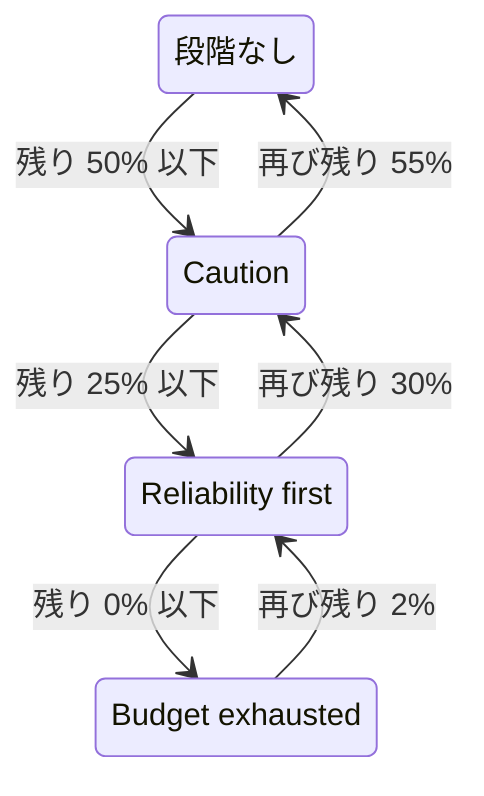

# エラーバジェットポリシー

エラーバジェットポリシーは、SLO のエラーバジェットが減っていくなかでチームが取り決めた対応を書き留めるものです。たとえば、半分を使ったらリスクのある変更をレビューする、すべて使ったらリリースを凍結する、といった対応です。OneUptime は、予算が達したポリシーの段階に SLO を置き、その段階でのチームの取り決めを SLO のページに表示し、SLO が段階に入ったときにアラートを発生させたりインシデントを宣言したりできるほか、段階が変わるたびに、選んだ Slack、Microsoft Teams、Mattermost のチャネルに投稿し、リリースを保留すべきかどうかを CI/CD パイプラインに伝えます。これは [Google SRE Workbook](https://sre.google/workbook/error-budget-policy/) のエラーバジェットポリシーのプラクティスです。

:::cards
- [段階のしくみ](#段階のしくみ): どの段階が適用され、SLO がいつそこから抜けるか。
- [ポリシーを設定する](#ポリシーを設定する): 推奨ポリシーから始めるか、独自の段階を書きます。
- [アラートとインシデント](#アラートとインシデント): SLO が段階に入ったときにチームに知らせます。
- [Slack、Microsoft Teams、Mattermost に投稿する](#slackmicrosoft-teamsmattermost-に投稿する): 誰も呼び出さずに、SLO が段階に入ったことをチャネルに知らせます。
- [デプロイゲート](#デプロイゲート): 段階がデプロイを凍結している間、CI/CD からのリリースを保留します。
- [API で段階を読み取る](#api-で段階を読み取る): CI やスクリプトから段階を確認します。
:::

## 段階のしくみ

ポリシーは段階の集まりです。各段階には 3 つの項目があります。

| 項目 | 内容 |
| --- | --- |
| **名前** | チームが段階に付ける名前。たとえば「Reliability first」です。 |
| **残り予算のしきい値 (%)** | エラーバジェットの残りがこの割合以下のときに段階が適用されます。0 から 100 までで、小数も使えます。SLO の段階ごとに異なるしきい値が必要です。 |
| **対応内容** | SLO がその段階にある間にチームがすると取り決めた対応 (Markdown)。必須で、10,000 文字まで書けます。 |

段階は、予算の残りがそのしきい値以下である間適用されます。そのため、0% の段階は予算を使い切った状態の段階です。複数の段階が適用されるときは、しきい値が最も低い段階、つまり最も深刻な段階に SLO が入ります。どれも適用されないときは、SLO はどの段階にもいません。50%、25%、0% の段階がある場合、予算が 30% 残っている SLO は 50% の段階に、10% 残っている SLO は 25% の段階に入ります。

段階は、SLO がその段階にある間、デプロイを凍結することもできます。[デプロイゲート](#デプロイゲート) を参照してください。

### 段階に入る、段階から抜ける

段階は、SLO のステータスと同じように予算の残りに従います。

- 段階にはすぐに入ります。予算が段階のしきい値以下であることを見つけた評価で、SLO はその段階に入ります。一度に複数のしきい値を下回った予算は、最も深刻な段階に直接移ります。
- より軽い段階へ抜けるのは、予算がはっきり戻るまで待ちます。0% の段階は、予算が再び 2% 残った時点で抜けます。それ以外の段階は、予算がしきい値を 5 ポイント上回った時点で抜けます。

そのため、0% の段階は **予算を使い切りました** ステータスと連動し、SLO のリスクありのしきい値にある段階は **リスクあり** と連動します。[ステータスの変化とリスクありのしきい値](/docs/slo/error-budget#ステータスの変化とリスクありのしきい値) を参照してください。しきい値のあたりを行き来するローリングの時間枠でも、段階が行ったり来たりすることはありません。



## ポリシーを設定する

SLO のエラーバジェットポリシーの段階を作成する権限が必要です。

:::steps
### エラーバジェットポリシー を開く

SLO を開き、サイドメニューの **ルール** セクションにある **エラーバジェットポリシー** に移動します。このページには SLO の段階が一覧表示され、それぞれの名前、適用される予算の残り、チームの対応がわかります。

### 推奨ポリシーから始める

SLO に段階がまだないうちは、ページに **おすすめのポリシーを使う** が表示されます。クリックし、一覧表示される 3 つの段階を確認して確定します。そのあと、各段階の文言をチーム独自の取り決めに合わせて書き直します。

### または自分で段階を追加する

**SLO のエラーバジェットポリシーの段階を作成** をクリックします。**名前** と **残り予算のしきい値 (%)** を入力し、チームの取り決めを **対応内容** に書きます。SLO がその段階にある間、パイプラインにリリースを保留させるには、**Deployment を凍結** をオンにします。

### 段階が発生させるものを選ぶ

段階は取り決めを記録して表示します。SLO が段階に入ったときに誰かに知らせるには、折りたたまれたアラートとインシデントの設定を開き、アラート、インシデント、またはその両方をオンにします。どちらも既定ではオフです。[アラートとインシデント](#アラートとインシデント) を参照してください。
:::

段階の追加、編集、削除はすぐに反映されます。OneUptime は約 1 分以内に SLO をもう一度評価します。予算がすでに段階のしきい値以下であれば、そのとき SLO はその段階に入り、段階は設定どおりのものを発生させます。段階をオフにするか削除すると、その段階が発生させたものは解決され、SLO は予算に合った段階に移ります。段階のアラートやインシデントをオフにすると、そのアラートやインシデントが解決されます。

### 推奨ポリシー

**おすすめのポリシーを使う** は、予算の半分、4 分の 1、ゼロに 3 つの段階を次の英語の文言で追加します。

| 段階 | 適用される条件 | チームの対応 | Deployment |
| --- | --- | --- | --- |
| **Caution** | 残り 50% 以下 | Half of the error budget is spent. Review risky changes before they ship, and find out what has been spending the budget. | 許可 |
| **Reliability first** | 残り 25% 以下 | Reliability comes first. Only reliability improvements and critical fixes ship until the budget recovers. | 許可 |
| **Budget exhausted** | 残り 0% 以下 | The error budget is spent. Freeze non-critical releases: only fixes for this SLO's reliability and security fixes ship until the budget is back. | 凍結 |

どの段階も、オンにするまではアラートを発生させず、インシデントも宣言しません。**Budget exhausted** は、その取り決めのとおりデプロイを凍結し、確認画面にもそう示されます。[デプロイゲート](#デプロイゲート) を参照してください。デプロイゲートができる前に追加された段階は、凍結をオンにするまで何も凍結しません。追加されるのは SLO にまだない段階だけです。名前が同じ段階、またはしきい値が同じ段階は、オンでもオフでも、すでにあるものとみなされます。そのため、2 つ目のタブや API から 2 回実行しても、何も二重には追加されません。いずれかの段階を追加できなかった場合はどの段階も追加されず、SLO は元のままなので、もう一度試せます。こうして追加された各段階は、あなたが追加したものとして SLO の監査ログに記録されます。

## 段階が表示される場所

- SLO の **概要** には、SLO がいる段階と、チームがそこで取り決めた対応が表示されます。SLO を開いた人は誰でも、いま有効な取り決めを確認できます。段階がデプロイを凍結している間は、段階名の下の赤いバッジに、いつから凍結されているかが表示されます。
- **エラーバジェットのバーンダウン** グラフには、リスクありのしきい値の線と並んで、各段階のしきい値にラベル付きの線が引かれます。
- SLO の **フィード** には、段階が変わるたびに投稿されます。SLO が抜けた段階と入った段階、予算の残り、新しい段階でチームが取り決めた対応、そしてその変化でデプロイが凍結されたか再び許可されたかです。
- ルールで指定した Slack、Microsoft Teams、Mattermost のチャネルにも、同じ内容が投稿されます。[Slack、Microsoft Teams、Mattermost に投稿する](#slackmicrosoft-teamsmattermost-に投稿する) を参照してください。
- SLO の **監査ログ** は、段階の変化と、デプロイの凍結や再許可を、そのつど OneUptime 自身による変更として記録します。そのため、表示されるのは **システムイベントを保存** がオンの場合だけです。[監査ログをオンにする](/docs/slo/feed-and-audit-logs#監査ログをオンにする) を参照してください。段階の追加、編集、削除は、それを行った人の操作として記録されます。
- SLO の読み取り API は、段階と、デプロイが許可されているかどうかを返します。[API で段階を読み取る](#api-で段階を読み取る) と [デプロイゲート](#デプロイゲート) を参照してください。

## アラートとインシデント

各段階は、SLO が入ったときにアラートを発生させる、インシデントを宣言する、またはその両方を行えます。オプションはバーンレートルールのアラートとインシデントと同じです。重大度、オンコールポリシー、タイトル・説明・対応メモのテンプレート、プライバシー、自動解決、ラベル、所有者チームと所有者ユーザー、SLO の所有者を所有者として追加する設定です。[ルールが宣言するもの](/docs/slo/burn-rate-alerts#ルールが宣言するもの) を参照してください。どちらも既定ではオフなので、どちらかをオンにするまで段階は誰にも知らせません。

- より深刻な段階に入ると、前の段階が発生させたものは、その自動解決の設定にかかわらず解決されます。新しい段階が置き換えるためです。そのため、同時に開いているのは多くても 1 つの段階のアラートとインシデントだけで、それらは SLO がいる段階のものです。
- より軽い段階に回復したとき、またはすべての段階から抜けたときは、段階の自動解決がオン (既定) であれば解決されます。自動解決がオフの場合は、誰かが解決するまで開いたままです。
- 再発火の抑制はありません。段階が再び発生させるのは、SLO がその段階からはっきり抜けて、もう一度入ったあとだけなので、ばたつくことはありません。SLO がまだその段階にある間に、段階が発生させたものを誰かが手動で解決した場合は、解決されたままです。
- SLO のいずれかのモニターが計画メンテナンス中の間は、段階は何も発生させません。それでも段階自体は変わり、開いているものは引き続き解決されます。メンテナンスが終わったときに SLO がまだその段階にあれば、そのとき段階は設定どおりのものを発生させます。

バーンレートルールと同じく、段階が発生させたアラートやインシデントは **影響を受けるリソース** に SLO を表示し、インシデントがステータスページに表示されることはありません。SLO のフィードは、それぞれの発生と解決を投稿します。

### 内容

段階のタイトル、説明、対応メモでは、ルールと同じようにテンプレート変数が使えます。[各アラートとインシデントの内容](/docs/slo/burn-rate-alerts#各アラートとインシデントの内容) を参照してください。段階の項目では、SLO とその予算の変数と、段階独自の 3 つの変数を使えます。`{{sloName}}`、`{{sloId}}`、`{{sloLink}}`、`{{sloStatus}}`、`{{policyTier}}`、`{{policyTierThresholdPercentage}}`、`{{policyTierWhatWeDo}}`、`{{targetPercentage}}`、`{{currentSliPercentage}}`、`{{errorBudgetRemainingPercentage}}`、`{{errorBudgetRemaining}}`、`{{errorBudgetRemainingMinutes}}`、`{{windowDescription}}` です。`{{ruleName}}` やバーンレートなど、ルール独自の変数は表示されず、段階のテンプレートでは空になります。

段階の 3 つの変数は、バーンレートルールのテンプレートでも使えます。

| 変数 | 内容 |
| --- | --- |
| `{{policyTier}}` | 評価のあとに SLO がいる段階の名前。どの段階にもいないときは `None` です。 |
| `{{policyTierThresholdPercentage}}` | その段階のしきい値。たとえば `25` です。SLO がどの段階にもいないときは空です。 |
| `{{policyTierWhatWeDo}}` | その段階でチームが取り決めた対応。SLO がどの段階にもいないときは空です。 |

タイトルを空のままにした段階は、組み込みのタイトルを使います。

```text
SLO error budget policy: {{sloName}} — {{policyTier}}
```

組み込みの説明は、段階の名前を挙げ、予算の残りを段階のしきい値と比べ、チームがその段階で取り決めた対応を示します。

## Slack、Microsoft Teams、Mattermost に投稿する

ルールを使うと、SLO のエラーバジェットポリシーの変化を、チームが読んでいる Slack、Microsoft Teams、Mattermost のチャネルに、誰も呼び出さずに投稿できます。投稿されるのは、SLO が段階に入ったとき、より軽い段階に回復したとき、すべての段階から抜けたとき、そしてデプロイが凍結されたときと再び許可されたときです。各ルールは、どの SLO のどの変化を投稿するかを選びます。先にワークスペースをプロジェクトに接続してください。[Slack](/docs/workspace-connections/slack)、[Microsoft Teams](/docs/workspace-connections/microsoft-teams)、[Mattermost](/docs/workspace-connections/mattermost) を参照してください。

:::steps
### SLO のワークスペースセクションを開く

**SLO** → **ワークスペース** → **Slack**、**Microsoft Teams**、または **Mattermost** に移動します。**ワークスペース** セクションには、プロジェクトが接続したチャットワークスペースだけが表示されます。

### ルールを作成する

**SLO の通知ルールを作成** をクリックし、**ルール名** を付けます。**対象の SLO** では、**すべての SLO** のままにするか、**条件に一致する SLO のみ** を選んで条件を追加します。[ルールに一致するもの](#ルールに一致するもの) を参照してください。

### 投稿先を選ぶ

**次に、Slack で** の欄に、ルールが投稿するチャネルを指定します。Microsoft Teams では、チームとそのチャネル、または OneUptime アプリが追加されたチャットを選びます。SLO には専用のチャネルがないため、ルールはすでにあるチャネルとチャットにだけ投稿します。
:::

メッセージは、SLO の **フィード** と同じ言葉で変化を伝えます。SLO が抜けた段階と入った段階、デプロイがどう変わったか、エラーバジェットの残り、新しい段階のしきい値、そしてその段階でチームが取り決めた対応 (チームが書いたとおりの文面) です。その取り決めに含まれる `<!channel>` などのメンションは、テキストとして投稿され、誰にも通知されません。

- 変化は、それを生んだ評価が保存されたあとに一度だけ投稿されます。保存されなかった評価は何も投稿せず、次の評価がその変化を投稿します。
- SLO が同じ段階にとどまっている間は、予算がしきい値のあたりをどれだけ長く行き来しても、何も投稿されません。[段階に入る、段階から抜ける](#段階に入る段階から抜ける) を参照してください。
- SLO がいる段階の **Deployment を凍結** をオンまたはオフにすると、そのためのメッセージが別に投稿されます。
- 一時停止中や設定ミスの SLO、無効化またはアーカイブされた SLO は、段階を保ったまま何も投稿しません。
- 送信できなかったメッセージはログに記録され、評価、SLO のフィード、段階が発生させるものは、それに関係なく続きます。

### ルールに一致するもの

| 条件 | 一致するもの |
| --- | --- |
| **SLO** | 選んだ SLO、またはそれ以外のすべての SLO。 |
| **SLO ラベル** | SLO のラベル。選んだラベルのいずれかが付いているか、すべてが付いているか、どれも付いていないか。 |
| **SLO 名** | SLO の名前。入力したテキストと等しいかどうか、含むかどうか、そのテキストで始まるか終わるか。 |
| **エラーバジェットポリシーの変更** | 変化の内容。**より重い段階に移行**、**より軽い段階に回復**、**すべての段階から離脱**、**Deployment 凍結中**、または **Deployment 再許可** です。 |
| **SLO の所有者** | SLO の所有者として登録されている人とチーム。選んだいずれかが所有者か、どれも所有者でないか。所有者のチームに所属しているだけでは数えられません。 |

デプロイを凍結した、または再び許可した段階の変化は、両方の変化を兼ねた一つのメッセージになります。そのため、**Deployment 凍結中** のルールは、デプロイを凍結する段階に入った変化も投稿します。リリース用のチャネルには、すべての凍結が届きます。

## 予算が測定されないとき

- **一時停止中** または **設定ミス** の SLO は予算を測定しないため、段階はそのまま残り、段階が発生させたものも測定が再開するまで開いたままです。これに対してバーンレートルールは、そのとき開いているものを解決します。
- SLO の評価をオフにするか、SLO をアーカイブすると、その段階が発生させたものが解決されます。SLO がいる段階はそのまま残ります。
- SLO を削除すると、その段階も削除され、段階が発生させたものが解決されます。
- いずれの場合も、SLO は段階を保つので、デプロイについての応答もそのまま保ちます。[デプロイゲート](#デプロイゲート) を参照してください。

## デプロイゲート

段階はデプロイを凍結できます。**Deployment を凍結** がオンになっている段階に SLO がいる間、SLO の `deploymentsAllowed` 項目は `false` になります。そのため、リリース前にこの項目を確認する CI/CD パイプラインはリリースを保留します。それ以外のとき、つまり SLO にポリシーがないとき、予算がどの段階よりも上にある間、デプロイを凍結しない段階にいるときは `true` です。推奨ポリシーの **Budget exhausted** 段階はデプロイを凍結します。

:::steps
### Deployment を凍結 をオンにする

SLO の **エラーバジェットポリシー** を開き、段階を編集して **Deployment を凍結** をオンにし、保存します。表のその段階の **Deployment** 列には **凍結** と表示されます。

### パイプラインにキーを渡す

SLO を読み取れるプロジェクトの [API キー](/docs/api-reference/api-reference) を作成し、`ONEUPTIME_API_KEY` という名前でパイプラインのシークレットとして保存します。

### リリースの前に SLO を確認する

下のチェックを、デプロイするステップの前にステップとして追加し、`<slo-id>` を SLO の ID に置き換えます。
:::

:::tabs
@tab Shell
```bash
ALLOWED=$(curl -sS -X POST 'https://oneuptime.com/api/service-level-objective/<slo-id>/get-item' \
  -H "ApiKey: $ONEUPTIME_API_KEY" \
  -H 'Content-Type: application/json' \
  -d '{ "select": { "deploymentsAllowed": true } }' | jq -r '.deploymentsAllowed')
[ "$ALLOWED" = "true" ]
```
@tab GitHub Actions
```yaml title=".github/workflows/deploy.yml"
name: Deploy
on:
  push:
    branches: [main]

jobs:
  deploy:
    runs-on: ubuntu-latest
    steps:
      - uses: actions/checkout@v4
      - name: Stop while the error budget policy freezes deployments
        env:
          ONEUPTIME_API_KEY: ${{ secrets.ONEUPTIME_API_KEY }}
          SLO_ID: <slo-id>
        run: |
          SLO=$(curl -sS -X POST "https://oneuptime.com/api/service-level-objective/$SLO_ID/get-item" \
            -H "ApiKey: $ONEUPTIME_API_KEY" \
            -H 'Content-Type: application/json' \
            -d '{ "select": { "deploymentsAllowed": true, "currentErrorBudgetPolicyTierName": true } }')
          if [ "$(echo "$SLO" | jq -r '.deploymentsAllowed')" != "true" ]; then
            echo "Not deploying: $SLO"
            exit 1
          fi
      - name: Deploy
        run: ./deploy.sh
```
@tab GitLab CI
```yaml title=".gitlab-ci.yml"
error-budget-gate:
  stage: test
  image: alpine:3.20
  variables:
    SLO_ID: <slo-id>
  before_script:
    - apk add --no-cache curl jq
  script:
    - >
      SLO=$(curl -sS -X POST "https://oneuptime.com/api/service-level-objective/$SLO_ID/get-item"
      -H "ApiKey: $ONEUPTIME_API_KEY"
      -H 'Content-Type: application/json'
      -d '{ "select": { "deploymentsAllowed": true, "currentErrorBudgetPolicyTierName": true } }')
    - echo "$SLO"
    - test "$(echo "$SLO" | jq -r '.deploymentsAllowed')" = "true"
```
:::

チェックが通るのは、応答が `true` のときだけです。凍結中の SLO、この項目のない応答 (キーが SLO を読み取れない、または ID が間違っている場合)、応答がまったくない場合は、いずれもステップを止めます。そのため、パイプラインが受け取っていない応答をもとにリリースすることはありません。GitLab CI では、ジョブが test ステージで実行されるので、SLO が凍結中なら後続の deploy ステージが止まります。`ONEUPTIME_API_KEY` はマスクされた CI/CD 変数として追加してください。セルフホストのインストールでは、oneuptime.com の代わりにそのインストール自身のアドレスを使います。

SLO は 2 つの項目で応答します。どちらも SLO 自体の読み取り権限で読み取れます。

| 項目 | 内容 |
| --- | --- |
| `deploymentsAllowed` | SLO がデプロイを凍結する段階にいる間は `false`、それ以外は `true` です。 |
| `deploymentsFrozenAt` | デプロイが凍結された日時。許可されている間は空です。 |

応答は次のように変わります。

- デプロイは、デプロイを凍結する段階に SLO を入れた評価で凍結され、SLO をその段階から出した評価で再び許可されます。段階から出るタイミングには、その段階の回復の余裕が適用されます。[段階に入る、段階から抜ける](#段階に入る段階から抜ける) を参照してください。凍結する段階から別の凍結する段階に移ったときは凍結されたままで、`deploymentsFrozenAt` の時刻も変わりません。
- SLO がいる段階の **Deployment を凍結** をオンまたはオフに切り替えると、約 1 分以内に反映されます。予算が回復する前にリリースするには、これをオフにします。この変更は、あなたによる変更として SLO の監査ログに記録されます。
- **一時停止中** または **設定ミス** の SLO は、段階を保つのと同じく、それまでの応答を保ちます。すべてのモニターを一時停止するメンテナンス期間が、凍結を解除することも、凍結を始めることもありません。無効化またはアーカイブされた SLO はまったく評価されないため、やはり応答を保ちます。
- デプロイが凍結されている間は、SLO の **概要** にいつから凍結されているかが表示され、**フィード** には凍結されたときと再び許可されたときが投稿されます。

## API で段階を読み取る

SLO 自体の読み取り API は、SLO がいる段階を返します。そのため、CI のジョブやスクリプトは、リリースの前など、何かをする前に段階を確認できます。SLO がどの段階にもいない間は、3 つの項目はすべて空です。

| 項目 | 内容 |
| --- | --- |
| `currentErrorBudgetPolicyTierId` | 段階の ID。 |
| `currentErrorBudgetPolicyTierName` | 段階の名前。 |
| `currentErrorBudgetPolicyTierEnteredAt` | SLO がその段階に入った日時。 |

これらは SLO 自体の読み取り権限で読み取れます。SLO の予算を読むのと同じ権限です。たとえば、プロジェクトの [API キー](/docs/api-reference/api-reference) を使う場合は次のとおりです。

```bash
curl -X POST 'https://oneuptime.com/api/service-level-objective/<slo-id>/get-item' \
  -H "ApiKey: $ONEUPTIME_API_KEY" \
  -H 'Content-Type: application/json' \
  -d '{ "select": { "name": true, "errorBudgetRemainingPercentage": true, "currentErrorBudgetPolicyTierName": true, "currentErrorBudgetPolicyTierEnteredAt": true } }'
```

段階そのものは独立したリソース `/api/service-level-objective-error-budget-policy-tier` で、どのリソースにもある一覧、読み取り、作成、変更、削除のリクエストがあります。推奨ポリシー用のリクエストがさらに 2 つあります。どちらも `{ "serviceLevelObjectiveId": "..." }` を受け取り、`tiers` で段階を返します。

| リクエスト | 動作 |
| --- | --- |
| `POST /api/service-level-objective-error-budget-policy-tier/recommended-policy` | SLO に足りない推奨の段階を一覧表示します。何も書き込みません。 |
| `POST /api/service-level-objective-error-budget-policy-tier/recommended-policy/add` | それらを追加し、追加したものを一覧表示します。もう一度リクエストしても何も追加されません。 |

## 権限

| 権限 | ロールにできること |
| --- | --- |
| **Read SLO Error Budget Policy Tier** | SLO の段階を表示する。 |
| **Create SLO Error Budget Policy Tier** | 手動で、または **おすすめのポリシーを使う** で段階を追加する。 |
| **Edit SLO Error Budget Policy Tier** | 段階を変更し、オンまたはオフにする。 |
| **Delete SLO Error Budget Policy Tier** | 段階を削除する。 |

これらの権限はロールの SLO グループにあります。Project Owner と Project Admin のロールはすべてを持ち、Project Member と Viewer のロールは段階を読み取れます。

## まだ利用できないもの

エラーバジェットポリシーのうち、次のものはまだ利用できません。段階ごとの専用のワークフロートリガー、複数の SLO で共有するポリシー、段階の確認済み処理や例外の設定、予算の残りではなく予算の残り期間に基づく段階です。OneUptime がリリースを単独で止めることはありません。[デプロイゲート](#デプロイゲート) で示したように、止めるのは `deploymentsAllowed` を確認するパイプラインです。

## 次のステップ

:::cards
- [エラーバジェット](/docs/slo/error-budget): 予算とは何か、そしてステータスがどう予算に従うか。
- [バーンレートアラートとインシデント](/docs/slo/burn-rate-alerts): 予算の消費が速すぎるときにチームに知らせます。
- [SLO のフィードと監査ログ](/docs/slo/feed-and-audit-logs): 段階の変化と、段階が発生させたもののすべて。
:::
