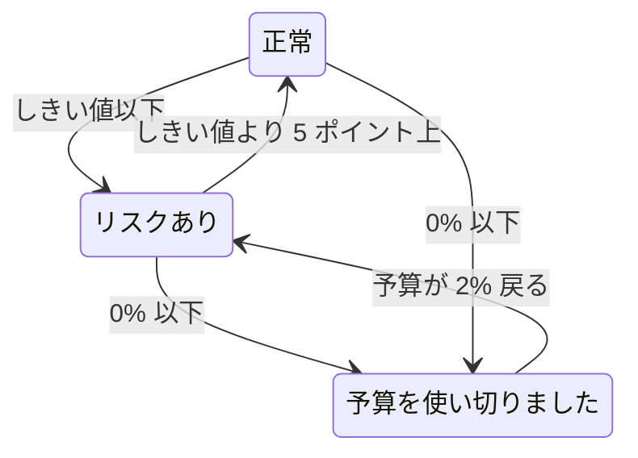

# エラーバジェット

エラーバジェットは、SLO の目標が許容するダウンタイムです。99.9% という目標は「決して落ちない」という意味ではありません。「30 日間で最大 43 分までは停止してよいので、賢く使おう」という意味です。このページでは、OneUptime が予算をどう数えるか、予算がどれだけもつか、どう戻るか、そして誰に知らされるかを説明します。

:::cards
- [予算の計算方法](#予算の計算方法): 計算式と、よく使われる目標の予算。
- [予算の残り期間](#予算の残り期間): 現在のペースで予算がどれだけもつか。
- [予算の回復のしかた](#予算の回復のしかた): ローリングの時間枠と暦月。
- [所有者への通知](#所有者への通知): 予算が少なくなったときに誰に知らされるか。
:::

## 予算の計算方法

予算の総量は、時間枠のうち目標が約束していない部分です:

```text
total budget = (100% − target) × window length
```

| 目標 | 7 日間の時間枠 | 28 日間の時間枠 | 30 日間の時間枠 | 90 日間の時間枠 |
| --- | --- | --- | --- | --- |
| 99% | 1h 40m 48s | 6h 43m 12s | 7h 12m | 21h 36m |
| 99.5% | 50m 24s | 3h 21m 36s | 3h 36m | 10h 48m |
| 99.9% | 10m 5s | 40m 19s | 43m 12s | 2h 9m 36s |
| 99.95% | 5m 2s | 20m 10s | 21m 36s | 1h 4m 48s |
| 99.99% | 1m 0s | 4m 2s | 4m 19s | 12m 58s |

SLO の **設定** ページでは、目標の横にその目標が許容する予算が表示されます。たとえば「30 日間の時間枠あたり 43m 12s のダウンタイム」です。

### 複数のモニターを持つ SLO の予算

**いずれかのモニターがダウン** モードでは、SLO が測定するモニターの数にかかわらず、予算は `(100% − target) × window` です。時間枠は 1 本のタイムラインです。

**モニターの平均秒数** モードでは、予算はモニター全体で合計したモニター秒で数えるため、モニターの数に応じて増えます。30 日間で 99.9% の 3 モニターの SLO の予算は、43 分ではなく約 129 分です。割合 (SLI、予算の残り、バーンレート) の意味は同じで、変わるのは期間だけです。

### 暦月の予算

暦月の SLO は、初日から月全体の予算を持ちます。31 日の月の 99.9% の SLO は、1 日の時点で 44m 38s をすべて持っています。予算は月の経過分に比例して割り当てられるわけではないので、1 日の朝の 1 分間の障害は月の予算から 1 分を使います。

## 予算の残り

ダウンタイムが積み重なると、**概要** の **エラーバジェットの残り** タイルに予算の残りが表示されます:

- 総量に対する割合として。この値は SLO のステータスも決め、バーを満たします。バーには SLO のリスクありのしきい値に印があります。
- 期間として。たとえば "31m 4s left of 43m 12s" です。

予算がなくなると、タイルには **No budget left** と表示されます。ダウンタイムが予算を超えると、タイルには **Budget exceeded** と超過分の時間が表示されます。たとえば "4d 23m over budget · 5m 47s allowed" は、SLO が予算の 5 分 47 秒をすべて使い、さらに 4 日と 23 分を使ったことを意味します。バーは空で赤いままです。

予算の残りは計算と履歴グラフのために符号付きの数値として保存されるため、そこでは超過した予算が負の割合として表示されます。大きな負の割合は、予算に対して超過が大きいことを意味します。サービスが停止していた時間の割合ではありません。

どの秒をダウンタイムとして数えるかは、SLO のダウンタイムのステータスと、複数のモニターを持つ SLO ではマルチモニターモードで決まります。どちらも **設定** → **ダウンタイムの計算** にあります。[SLO 概要](/docs/slo/introduction) を参照してください。

## 予算の残り期間

**概要** の **予算の残り期間** タイルは、「このまま続いたら、いつ予算がなくなるか」に答えます。予算の残りを直近 60 分間のバーンレートで割ります:

```text
runway = budget left ÷ (burn rate × (100% − target))
```

| タイルの表示 | 意味 |
| --- | --- |
| **~2d 5h** のような期間 | 現在のペースで、予算はおよそこの期間でなくなります。琥珀色で、残り 1 日以下なら赤色です。**Under 1m** は 1 分未満を意味します。 |
| **Not burning** | 直近 60 分間に予算は使われていません。 |
| **Sustainable** | ローリングの時間枠のみ。残り期間が少なくとも時間枠 1 つ分あり、古いダウンタイムが時間枠から外れるより速く予算を使っていません。このペースでは予算はなくなりません。 |
| **Lasts until reset** | 暦月のみ。予算がなくなる前に、翌月の初めにリセットされます。 |
| **Overspent** | 予算はすでに使い切っています。タイルには超過量が表示されます。 |

暦月の SLO では、予算がいつリセットされるかもタイルに表示されます。

残り期間は直線的な予測です。ローリングの時間枠では、時間枠から外れる古いダウンタイムが予算を返しますが、予測はそれを考慮しません。残された最短の時間として読んでください。最初の評価の前には表示されず、予算を実時間ではなくモニター秒で数える **モニターの平均秒数** モードの SLO にも表示されません。

## エラーバジェットのバーンダウン

**概要** の **エラーバジェットのバーンダウン** グラフは、現在のコンプライアンスの時間枠全体での予算の残りを割合で示します:

- 0% の線は予算がなくなる位置を示し、破線は SLO のリスクありのしきい値を示します。
- 暦月の SLO では、月初めの満額の予算からリセット時の空の予算まで一定に下がる薄い線が引かれます。その線を下回っている月は、予算を速く使いすぎています。
- 5 分ごとの評価のたびに点が記録されるため、新しい SLO のグラフは最初の評価まで空です。
- グラフ上をドラッグすると時間枠の一部を拡大できます。ダブルクリックするか **ズームをリセット** をクリックすると、時間枠全体の表示に戻ります。

**メトリクスを開く** は SLO の **メトリクス** ページを開きます。その **Error Budget History** タブでは最大 400 日前までさかのぼれます。[SLO のメトリクスとダッシュボード](/docs/slo/metrics) を参照してください。

## 予算の回復のしかた

予算の戻り方は、SLO の時間枠の種類によって異なります:

:::tabs
@tab ローリング
ローリングの時間枠は常に現在から同じ長さだけさかのぼるので、ダウンタイムはやがて時間枠から外れます。障害は、発生からちょうど時間枠 1 つ分の後に数えられなくなります。6 月 1 日の 30 分間の障害は、30 日間の SLO では 7 月 1 日に計算から外れます。予算は一度に戻るのではなく、ダウンタイムの 1 秒 1 秒が時間枠から出ていくにつれて少しずつ戻ります。

つまり、回復は予定するものではなく、積み重ねて得るものです。小さな障害が続くと、古いダウンタイムが外れる一方で新しいダウンタイムが入ってくるため、予算は回復せずに横ばいになります。
@tab Calendar Month
暦月の SLO は、その SLO のタイムゾーンで毎月 1 日の午前 0 時にリセットされます。予算はすべて一度に戻り、前の月は締められます。どちらの方向にも月をまたいで持ち越されるものはありません。悪い月が翌月を損なうことも、良い月が翌月に余裕を与えることもありません。
:::

### 新しい SLO

時間枠より新しいローリングの SLO は、これまでに存在するデータで測定され、予算の総量もそれに合わせて増えます。1 週間前に作成した 30 日間の SLO の予算は、今のところ 7 日分です。時間枠が埋まるまで、**概要** は **Window 23% full** インジケーターと、**エラーバジェットの残り** タイルの同じ注記で、どれだけ埋まったかを示します。時間枠が埋まるにつれて数値は落ち着いていきます。

## ステータスの変化とリスクありのしきい値

予算の残りが SLO のステータスを決めます:

| ステータス | 条件 |
| --- | --- |
| **正常** | リスクありのしきい値より多くの予算が残っています。 |
| **リスクあり** | 予算の残りがリスクありのしきい値以下です。既定は 20% です。 |
| **予算を使い切りました** | 予算の残りが 0 以下です。 |

リスクありのしきい値は **設定** → **目標** で設定します。

ローリングの時間枠は 1 秒ずつ回復するため、境界付近の SLO は 2 つのステータスの間を行ったり来たりしかねません。ステータスの変化がそれぞれ意味を持つように、SLO は境界をはっきり越えたときにだけステータスを離れます:



既定のしきい値 20% では、リスクありの SLO は予算の残りが 25% になると正常に戻り、予算を使い切った SLO は 2% でリスクありに戻ります。ステータスの変化はそれぞれ、その理由を示す SLI、予算、バーンレートとともに SLO の **フィード** に表示されます。

## 所有者への通知

SLO が **リスクあり** または **予算を使い切りました** に移ると、OneUptime はその所有者に通知します:

- 所有者とは、SLO の **所有者** ページにいるユーザーとチームメンバーのうち、まだプロジェクトのメンバーである人です。所有者がいない SLO は、代わりにプロジェクトの所有者に通知します。
- 各所有者は既定でメールを受け取り、さらに **ユーザー設定** → **通知設定** → **監視** で **SLO のステータスが変わりました** に対してオンにしたほかのチャネルでも通知を受け取ります。
- メールの件名にはステータスと SLO が含まれます。たとえば `[SLO At Risk] API Availability` です。

境界付近の SLO が通知を繰り返さないように、所有者が受け取る通知は 1 時間に 1 回までです。**予算を使い切りました** への移行は、その 1 時間の中でも必ず送信されます。

> [!TIP]
> 所有者への通知は、SLO の担当者に予算が危ないことを知らせるものです。エスカレーションポリシーを通じてオンコールチームを呼び出すには、[バーンレートアラートとインシデント](/docs/slo/burn-rate-alerts) を使います。バーンレートルールは、作成する各アラートとインシデントに SLO の所有者を追加することもできます。

## 次のステップ

:::cards
- [バーンレートアラートとインシデント](/docs/slo/burn-rate-alerts): 予算の消費が速すぎるときにチームに知らせます。
- [SLO のメトリクスとダッシュボード](/docs/slo/metrics): 予算の推移をグラフにします。
- [SLO 概要](/docs/slo/introduction): 目標、時間枠、ダウンタイムのステータス。
:::
