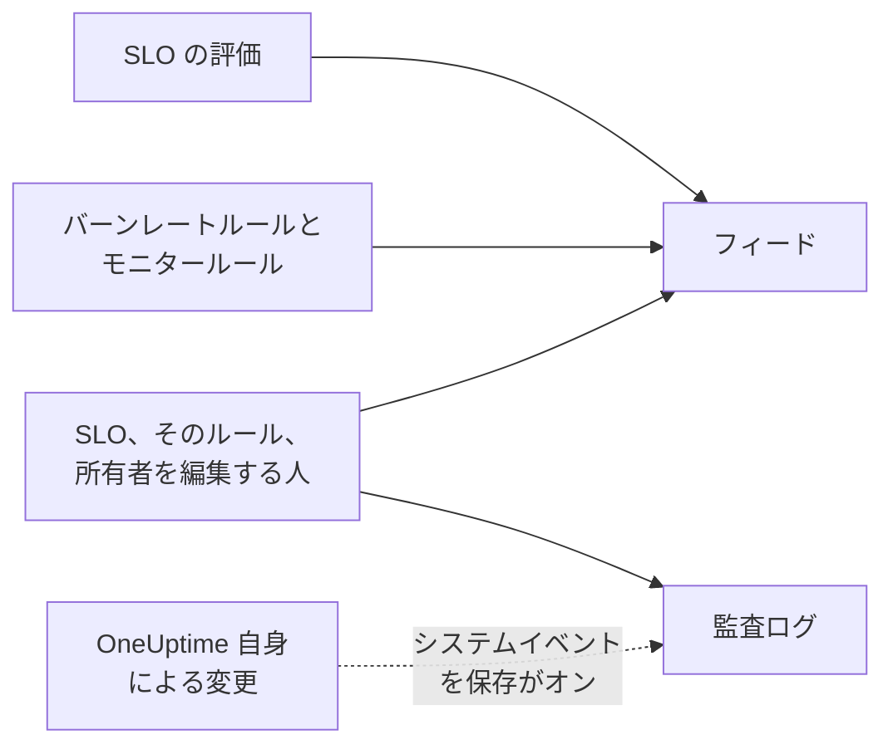

# SLO のフィードと監査ログ

SLO には履歴の記録が 2 つあり、それぞれ別の問いに答えます。**フィード** は「この SLO に何が起きたか」に答えるもので、SLO を見守る人のために書かれています。**監査ログ** は「誰が何を正確に変更したか」にフィールド単位で答えるもので、レビューやコンプライアンスのためのものです。

## フィードと監査ログのどちらを使うか

| | **フィード** | **監査ログ** |
| --- | --- | --- |
| 答える問い | SLO に何が起きたか | 誰が何をいつ変更したか |
| 記録する内容 | ステータスの変化、バーンレートのアラートとインシデント、SLO、そのルール、モニター、所有者への変更 | 人が SLO、そのバーンレートルール、モニタールール、所有者に加えたすべての変更と、変更前と変更後の値 |
| OneUptime 自身の処理を含むか | 含む: 評価と、モニターを割り当てるモニタールール | **システムイベントを保存** がオンの場合のみ |
| プラン | すべてのプラン | OneUptime Cloud の Enterprise プラン、またはセルフホストのインストールの Enterprise Edition |
| 保持期間 | OneUptime Cloud で 3 年間 | 既定は 7 日間、最大 180 日間 |

## SLO のフィード

フィードは SLO の **フィード** ページにあり、最新の項目は SLO の **概要** の **最近のアクティビティ** に表示されます。項目からは、言及している SLO、モニター、アラート、インシデントにリンクでき、ほとんどの項目には数値や変更前と変更後の値を示す **詳細情報** セクションがあります。

| イベント | 投稿されるタイミング |
| --- | --- |
| SLO の作成 | SLO が作成されたとき。目標、コンプライアンスの時間枠、SLI、リスクありのしきい値、説明、作成時の既定のバーンレートルールを示します。 |
| SLO の更新 | 名前、説明、ラベル、目標、コンプライアンスの時間枠、タイムゾーン、リスクありのしきい値、マルチモニターモード、ダウンタイムのステータスが変わったとき。変更前と変更後の値をそれぞれ表示します。 |
| SLO の有効化または無効化 | 評価がオンまたはオフになったとき。 |
| SLO のアーカイブまたは復元 | SLO がアーカイブまたはアーカイブ解除されたとき。 |
| ステータスの変化 | 評価によって SLO が新しいステータスに移ったとき。その理由となる SLI、エラーバジェット、バーンレート、リスクありのしきい値と、**一時停止中** または **設定ミス** の場合はその原因を表示します。 |
| バーンレートのアラートの発生 | バーンレートルールがアラートを作成したとき。アラートへのリンクと、発火の原因となったバーンレートを表示します。 |
| バーンレートのインシデントの宣言 | バーンレートルールがインシデントを宣言したとき。インシデントへのリンクと、発火の原因となったバーンレートを表示します。 |
| バーンレートのアラートまたはインシデントの解決 | ルールのアラートまたはインシデントが閉じられたとき。自動で解決された場合と、自動解決がオフの間に手動で解決された場合があります。 |
| バーンレートルールの追加、変更、削除 | 誰かがバーンレートルールを作成、編集、削除したとき。新しい SLO の既定のルールは、代わりにその「SLO の作成」項目に含まれます。 |
| モニタールールの追加、変更、削除 | 誰かがモニタールールを作成、編集、削除したとき。意味のある変更がない保存は投稿されません。 |
| モニターの割り当てまたは割り当て解除 | モニターが手動またはモニタールールによって SLO に追加または削除されたとき。長い一覧では最初のいくつかのモニターと「ほか N 件」が示されます。 |
| 所有者の追加または削除 | ユーザーまたはチームが SLO の所有者に追加または削除されたとき。 |
| ラベルルールの適用 | SLO の作成時、または誰かがルールを実行したときに、ラベルルールが SLO にラベルを付けたとき。一致したルールを示します。[ラベルルールと所有者ルール](/docs/slo/label-and-owner-rules) を参照してください。 |
| 所有者ルールの適用 | 所有者ルールが SLO に所有者を追加したとき。一致したルールを示します。追加された各所有者には、それぞれ「所有者の追加」項目も作られます。 |

いくつかの詳細:

- 人が変更した場合、項目には変更した人が示されます。評価やモニターを割り当てるモニタールールなど OneUptime 自身による変更と、API や自動化による変更には、ユーザーが付きません。
- まだ開いていたためにルールが再び引き継いだアラートやインシデントは、2 回投稿されません。
- 非公開のアラートやインシデントについては、項目にタイトル、番号、リンクが含まれません。SLO を読める人は誰でもそのフィードを読めるためです。それでも非公開のレコードが作成されたことと、発火の原因となったバーンレートは表示されます。
- フィードの項目は誰も編集や削除ができません。OneUptime Cloud では、3 年より古い項目は削除されます。

## 監査ログ

SLO の **監査ログ** ページには、次のものに加えられた変更が表示されます:

- SLO 自体: 詳細、設定、ラベル、モニター、アーカイブ
- そのバーンレートルール
- そのモニタールール
- その所有者ユーザーと所有者チーム

ルールと所有者への変更は、そのルールや所有者に対して記録され、SLO にまとめられます。そのため SLO のページで履歴全体を 1 か所で確認でき、各エントリーはそれが属するページにリンクしています。ラベルやモニターなどの関連項目は、ID だけでなく名前とともに記録されます。

次の 2 つは含まれません:

- **評価の結果。** SLI、エラーバジェット、バーンレート、ステータス、評価時刻は数分ごとに変わります。その履歴は **概要**、**メトリクス** ページ、**フィード** にあります。
- **OneUptime 自身による変更。** モニタールールによるモニターの割り当てや割り当て解除などです。ただし、プロジェクトで **システムイベントを保存** がオンの場合は記録されます。**フィード** は、モニターの割り当てと割り当て解除をどちらの場合も記録します。

### 監査ログをオンにする

監査ログは Enterprise 機能で、OneUptime Cloud の **Enterprise** プラン、またはセルフホストのインストールの Enterprise Edition が必要です。ほかのプランでは、SLO の **監査ログ** ページに入手方法が表示されます。セルフホストのインストールでは、有効なライセンスがないと監査ログは記録を停止し (14 日間の試用期間の後、またはライセンスの期限切れから 30 日後)、ライセンスが有効化されるとすぐに再開します ([When a license expires or is missing](/docs/self-hosted/enterprise#when-a-license-expires-or-is-missing) を参照)。記録していないときは、**監査ログ** ページにそのことが表示されます。

監査ログは、どのプロジェクトでも既定ではオフです。オンにするには:

:::steps
### 監査ログの設定を開く

**プロジェクト設定** に移動し、サイドメニューで **監査ログ** を開いて **設定** をクリックします。

### 設定を編集する

**Edit Audit Log Settings** をクリックし、**監査ログを有効化** をオンにします。

### 保持する内容を選ぶ

**保持期間（日）** を 7 (既定) から 180 の範囲で設定し、OneUptime 自身による変更も記録するには **システムイベントを保存** をオンにします。保存します。変更は約 1 分以内に反映されます。
:::

監査ログがオフの間、SLO の **監査ログ** ページには **Audit logging is off** とオンにするためのリンクが表示されます。オフにする前に記録されたエントリーは引き続き表示されます。すべてのリソースにわたるプロジェクト全体の監査ログは、**プロジェクト設定** → **監査ログ** → **監査ログ** にあります。

## 次のステップ

:::cards
- [SLO 概要](/docs/slo/introduction): SLO が持つすべてのページ。
- [モニターとモニタールール](/docs/slo/monitor-rules): モニターを割り当て、割り当てを外すもの。
- [バーンレートアラートとインシデント](/docs/slo/burn-rate-alerts): フィードのアラートとインシデントを発生させ、解決するもの。
- [ラベルルールと所有者ルール](/docs/slo/label-and-owner-rules): ラベルと所有者を自動で追加するもの。
:::
