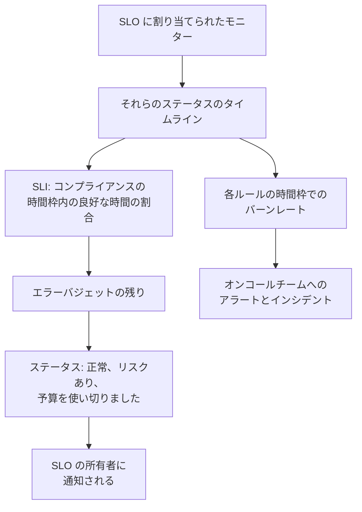

# SLO 概要

サービスレベル目標 (SLO) は、監視している対象の信頼性の目標です。たとえば「直近 30 日間のローリングで 99.9% の時間は利用可能」のように表します。OneUptime は 5 分ごとに各 SLO を目標と照らし合わせて測定するので、「今この瞬間に動いているか」ではなく、「ユーザーにとって意味のある期間で十分に信頼できていたか、そして失敗できる余地はあとどれだけ残っているか」に答えられます。

:::cards
- [SLO を作成する](#slo-を作成する): 名前と目標を決めるだけです。それ以外はすべて既定値から始まります。
- [モニターとモニタールール](/docs/slo/monitor-rules): SLO が測定するモニターを選びます。
- [エラーバジェット](/docs/slo/error-budget): 目標が許容するダウンタイムの量と、予算の回復のしかた。
- [バーンレートアラートとインシデント](/docs/slo/burn-rate-alerts): 予算の消費が速すぎるときにチームに知らせます。
:::

## 仕組み

SLO は、割り当てられたモニターのステータスのタイムラインを読み取ります。これはステータスページに表示されるものと同じデータです。OneUptime はそこから、コンプライアンスの時間枠のうち良好だった時間の割合、エラーバジェットの残り、そして予算が消費される速さを計算します。

## 主な概念

| 用語 | 意味 |
| --- | --- |
| **SLI** (サービスレベル指標) | 測定値です。コンプライアンスの時間枠のうち、SLO のモニターが利用可能だった時間の割合です。 |
| **SLO** (サービスレベル目標) | SLI の目標です。たとえば「直近 30 日間で 99.9% 以上」です。 |
| **エラーバジェット** | 目標が許容するダウンタイムです: `(100% − target) × window`。30 日間で 99.9% なら 43 分 12 秒です。 |
| **バーンレート** | 一定のペースと比べて予算がどれだけ速く使われているかです。バーンレートが 1 なら、予算は時間枠の終わりにちょうど使い切られます。 |

エラーバジェットは、信頼性を「使えるもの」に変えます。たくさん残っていれば、リリースを速めてリスクを取れます。わずかしか残っていなければ、ペースを落として安定性に投資します。SLO は、その話し合いに誰もが見られる数字を与えます。

## SLO を作成する

SLO を作成できるロールが必要です。Project Owner、Project Admin、または Create Service Level Objective 権限を持つカスタムロールです。

:::steps
### SLO を開く

上部バーの **製品** メニューから **SLO** を開きます。最初のグループの、モニターやインシデントの隣にあります。**サービスレベル目標を作成** をクリックします。

### 名前を付けて目標を設定する

**名前** (たとえば「API Availability」) と **目標（%）** を入力します。目標は、モニターが利用可能であるべき時間の割合です。目標の初期値は `99.9` です。0 より大きく 99.999 以下である必要があります。目標が 100% だと、追跡すべきエラーバジェットが残らないためです。

### その他の項目で既定値を確認する

**その他の項目** は折りたたまれており、既定値の意味を説明する 1 行が表示されます。SLO は 30 日間のローリングの時間枠で測定され、エラーバジェットの残りが 20% を下回るとリスクありになります。下の表の項目を変更するには展開します。

### SLO を保存する

**サービスレベル目標を作成** をクリックします。OneUptime が新しい SLO を開きます。新しい SLO にはまだモニターがないため、**概要** には **この SLO で測定するものを選択** が表示されます。

### モニターを割り当てる

**モニタールールを作成** をクリックすると、一致するすべてのモニターを今後も含めて割り当てます。**モニターを追加** をクリックすると、手動で選べます。[モニターとモニタールール](/docs/slo/monitor-rules) を参照してください。

### 最初の数字が表示されるのを待つ

OneUptime は有効な SLO を 5 分ごとに評価します。SLI、エラーバジェット、バーンダウンのグラフは、測定するモニターがある最初の評価の後に表示されます。
:::

**その他の項目** にある項目:

| 項目 | 設定する内容 | 既定値 |
| --- | --- | --- |
| **説明** | SLO の目的。 | 空 |
| **リスクありのしきい値（%）** | SLO が **リスクあり** に移る、エラーバジェットの残りの割合。0 から 100 までの整数です。 | 20 |
| **時間枠の種類** | **ローリング**: 直近 N 日間で、古いダウンタイムが時間枠から外れるにつれて回復します。**Calendar Month**: 月ごとに独立し、1 日にリセットされます。 | **ローリング** |
| **時間枠（日）** | ローリングの時間枠のみ。さかのぼる日数で、1 から 366 までです。通常は 28 または 30 です。 | 30 |
| **タイムゾーン** | 暦月のみ。各月が始まり、終わるタイムゾーンです。 | UTC |
| **ラベル** | SLO を整理して絞り込むためのラベル。 | なし |

SLO の測定方法を決めるものはすべて、後で変更できる既定値から始まります:

| 設定 | 新しい SLO の初期状態 | 変更する場所 |
| --- | --- | --- |
| モニター | なし | **モニター** または **モニタールール** |
| ダウンタイムのステータス | プロジェクトの稼働中でないすべてのステータス | **設定** → **ダウンタイムの計算** |
| マルチモニターモード | **いずれかのモニターがダウン** | **設定** → **ダウンタイムの計算** |
| 評価 | オン | **設定** → **評価** |
| バーンレートルール | 時間枠に合わせた **Fast burn** ルールと **Slow burn** ルール | **バーンレートルール** |

## SLO の構成要素

| 要素 | 決めること |
| --- | --- |
| モニター | SLI の元になるもの。手動またはモニタールールで割り当てます。[モニターとモニタールール](/docs/slo/monitor-rules) を参照してください。 |
| 目標 | SLO が約束する良好な時間の割合。0 より大きく 99.999 以下です。 |
| コンプライアンスの時間枠 | SLI と予算を測定する期間。1 日から 366 日のローリングの時間枠、または暦月です。 |
| リスクありのしきい値 | SLO が **リスクあり** に移る、予算の残りの割合。 |
| ダウンタイムのステータス | どのモニターステータスをダウンタイムとして数えるか。 |
| マルチモニターモード | 複数のモニターのダウンタイムをどう組み合わせるか。 |

### ダウンタイムとして数えるステータス

各 SLO には、ダウンタイムとして数えるモニターステータスの一覧が個別にあります。新しい SLO は、稼働中としてマークされていないプロジェクトのすべてのステータス (Degraded や Offline など) から始まります。これはステータスページと同じです。一覧は **設定** → **ダウンタイムの計算** で変更します。空のままにすると、後からプロジェクトに追加されるものも含め、稼働中でないすべてのステータスを数えます。

> [!TIP]
> 2 つの SLO を使って、同じモニターを 2 通りに測定できます。Degraded と Offline の両方を数える厳しい可用性 SLO と、Offline だけを数えるゆるい全面停止 SLO です。

### コンプライアンスの時間枠

| 時間枠の種類 | 動作 |
| --- | --- |
| **ローリング** | 現在から一定の日数をさかのぼります。古いダウンタイムが時間枠から外れるため、予算は少しずつ戻ります。 |
| **Calendar Month** | SLO のタイムゾーン (既定は UTC) で月の 1 日から測定します。毎月の初めに予算がすべて戻ります。 |

### 1 つの SLO に複数のモニター

SLO が複数のモニターを測定する場合、**マルチモニターモード** でそれらのダウンタイムの組み合わせ方を決めます。新しい SLO は **いずれかのモニターがダウン** を使います。

| モード | ダウンタイムの数え方 | 使う場面 |
| --- | --- | --- |
| **いずれかのモニターがダウン** | 少なくとも 1 つのモニターがダウンしている時間は、SLO 全体のダウンタイムとして数えます。重なった障害は 1 回だけ数えます。 | モニター全体で 1 つのサービスを構成していて、どれか 1 つが落ちるとユーザーが気づく場合。 |
| **モニターの平均秒数** | 各モニターのダウンタイムを個別に数え、監視した時間全体で平均します: SLI = 1 − (全モニターのダウン秒数 ÷ 全モニターの監視秒数)。 | モニターが似たリソースの集まりで、部分的な影響は部分的に数えるべき場合。 |

たとえば、モニター A が 10:00 から 11:00 までダウンし、モニター B は利用可能なままだったとします。**いずれかのモニターがダウン** は 60 分のダウンタイムを記録します。**モニターの平均秒数** は 30 分相当を記録します。2 つのうち 1 つのモニターが 1 時間ダウンしたためです。このモードでは予算もモニター秒で数えます。[エラーバジェット](/docs/slo/error-budget) を参照してください。

## SLO のステータス

OneUptime は評価した各 SLO にステータスを付けます:

| ステータス | 意味 |
| --- | --- |
| **正常** | リスクありのしきい値より多くの予算が残っています。 |
| **リスクあり** | 予算の残りがリスクありのしきい値以下に下がりました。既定は 20% です。 |
| **予算を使い切りました** | 予算をすべて使い切ったか、超過しました。 |
| **設定ミス** | SLO を測定できません。モニターがない、モニターがもう存在しないか時間枠内にまだステータスを記録していない、または目標が範囲外です。 |
| **一時停止中** | 測定対象のすべてのモニターがアーカイブされているか、手動、手動インシデント、または定期メンテナンスによってアクティブな監視がオフになっています。いずれかが再び監視されると自動的に再開します。 |

オフまたはアーカイブされた SLO は評価されないため、ステータスはそのまま残ります。代わりに SLO の一覧には **無効** または **アーカイブ済み** のバッジが表示されます。ステータスが **リスクあり** または **予算を使い切りました** に変わると、SLO の所有者に通知されます。[エラーバジェット](/docs/slo/error-budget) を参照してください。

## SLO の一覧

**SLO** ページには、アーカイブされていない各 SLO が、ステータス、SLI、予算の残り、バーンレート、目標、時間枠、モニター、ラベル、所有者とともに表示されます。

- 一覧の上のタイルは、ステータスごとに SLO を数えます: **正常**、**リスクあり**、**予算を使い切りました**、**設定ミス**、**一時停止中**、**無効**。タイルをクリックするとその SLO だけを表示し、もう一度クリックするとすべてを表示します。
- SLO を選択すると、ラベルや所有者の追加と削除、アーカイブ、削除をまとめて行えます。
- サイドメニューの **設定** セクションには、新しい SLO にラベルと所有者を付ける **ラベルルール** と **所有者ルール** があります。[ラベルルールと所有者ルール](/docs/slo/label-and-owner-rules) を参照してください。
- サイドメニューの **詳細** セクションには、アーカイブされた SLO の一覧である **アーカイブ済み** があります。

## SLO のページ

SLO を開くと、サイドメニューにそのページが表示されます:

| ページ | 表示内容 |
| --- | --- |
| **概要** | ステータス、主要な数値、エラーバジェットのバーンダウン、最近のアクティビティ、未解決のアラートとインシデント、バーンレートルール。 |
| **メトリクス** | SLO の `oneuptime.slo.*` メトリクス、長期間のエラーバジェットの履歴、SLO に影響するインシデントとアラートのメトリクス。[SLO のメトリクスとダッシュボード](/docs/slo/metrics) を参照してください。 |
| **インシデント** | バーンレートルールが宣言したインシデント。バッジは未解決の数を示します。 |
| **アラート** | バーンレートルールが発生させたアラート。バッジは未解決の数を示します。 |
| **フィード** | SLO に起きたことのタイムライン。[SLO のフィードと監査ログ](/docs/slo/feed-and-audit-logs) を参照してください。 |
| **モニター** | 測定しているモニターと、それぞれを割り当てたのが人かルールか。 |
| **モニタールール** | 一致するモニターを割り当てるルール。 |
| **バーンレートルール** | 予算の消費が速すぎるときにアラートを発生させ、インシデントを宣言するルール。 |
| **所有者** | ステータスの変化について知らせを受けるユーザーとチーム。 |
| **設定** | 目標、コンプライアンス期間、ダウンタイムの計算、評価のスイッチ、アーカイブのカード。 |
| **監査ログ** | SLO、そのルール、その所有者を誰がいつ変更したか。 |
| **SLO を削除** | SLO を完全に削除し、未解決だったバーンレートのアラートとインシデントを解決します。 |

**モニター**、**モニタールール**、**バーンレートルール** は **構成** セクションに、**所有者**、**設定**、**監査ログ**、**SLO を削除** は **管理** セクションにあります。どちらも最初は折りたたまれています。コードから SLO を管理するための **開発者** セクションも同様です。セクションのタイトルをクリックすると開きます。

SLO の測定を妨げる問題があると、各ページの上部のバナーが原因を示し、それを直すページへのリンクを表示します。[トラブルシューティング](#トラブルシューティング) を参照してください。

### 概要ページ

**概要** は「予算内に収まっているか」に上から順に答えます:

- **サマリー**: ステータス、その意味を説明する一文、説明。隣には **更新** と、SLO が最後に評価された日時があります。その下に、目標、**コンプライアンスの時間枠** (新しいローリングの時間枠が埋まるまでは充填インジケーター付き。[新しい SLO と時間枠の充填インジケーター](#新しい-slo-と時間枠の充填インジケーター) を参照)、モニター数、所有者が並びます。
- **主要な数値**:
  - **SLI**: 時間枠内の良好な時間の割合と、目標をどれだけ上回っているか、または下回っているか。
  - **エラーバジェットの残り**: 割合、"12m 30s left of 43m 12s" のような期間、リスクありのしきい値に印が付いたバー。予算を超過すると、**Budget exceeded** と超過量を表示します。
  - **バーンレート**: 直近 60 分間で予算がどれだけ速く使われているか。これは既定の高速消費ルールが使う期間です。1× を超えると琥珀色になり、SLO の有効なバーンレートルールのうち最も低いしきい値に達すると、**ルールのしきい値に達しました** とともに赤色になります。
  - **予算の残り期間**: このペースで予算がどれだけもつか。[エラーバジェット](/docs/slo/error-budget#予算の残り期間) を参照してください。
- **エラーバジェットのバーンダウン**: 現在の時間枠全体での予算の残り。[エラーバジェット](/docs/slo/error-budget#エラーバジェットのバーンダウン) を参照してください。
- **最近のアクティビティ**: SLO のフィードの最新の項目。
- **SLO の詳細**: 名前、説明、ラベル。概要ページで編集できる設定はこれだけです。
- **未解決のアラートとインシデント**: バーンレートルールが現在未解決のままにしているもの。
- **バーンレートルール**: 有効な各ルールのしきい値と現在のバーンレート、そしてルールが宣言する内容。

### 設定

**設定** ページには、SLO の測定方法がまとめられており、項目ごとに 1 枚のカードがあります:

| カード | 変更する内容 | 知っておくと便利なこと |
| --- | --- | --- |
| **目標** | **目標（%）** と **リスクありのしきい値（%）**。**目標を編集** で変更します。 | 目標が許容するダウンタイムを表示します。たとえば「30 日間の時間枠あたり 43m 12s のダウンタイム」です。 |
| **コンプライアンス期間** | **時間枠の種類**、**時間枠（日）**、**タイムゾーン**。**期間を編集** で変更します。 | 時間枠を変えてもバーンレートルールのしきい値はそのままなので、後で見直してください。 |
| **ダウンタイムの計算** | **マルチモニターモード** と **ダウンタイムとして扱うモニターステータス**。**ダウンタイムの計算を編集** で変更します。 | ステータスを選ばないと、後から追加されるものも含め、稼働中でないすべてのステータスを数えます。 |
| **評価** | **この SLO を評価** スイッチ。切り替えるとすぐに保存されます。 | オフにするときは確認を求められます。SLO の未解決のバーンレートのアラートとインシデントも解決されるためです。 |
| **Archive SLO** | **アーカイブ** または **アーカイブ解除**。 | [SLO のアーカイブ](#slo-のアーカイブ) を参照してください。 |

目標、期間、ダウンタイムの計算を変更すると、OneUptime は次の実行時に SLO を再評価します。

## SLO のアーカイブ

もう測定しないが残しておきたい SLO (廃止したサービスや昨年の目標など) はアーカイブします。**設定** → **Archive SLO** からアーカイブするか、一覧で SLO を選択して **アーカイブ** を選びます。

アーカイブされた SLO は次のようになります:

- SLO の一覧、ステータスのタイル、ダッシュボードの SLO の選択肢や一覧に表示されなくなります。
- 評価されません。数値は最後の評価時のまま残り、バーンレートルールは発火せず、メトリクスも送信しません。
- 未解決のバーンレートのアラートとインシデントは解決されます。
- 設定、履歴、ルール、所有者は保持されます。モニタールールはモニターの一覧を最新に保つため、再開時には正しいモニターで測定します。

アーカイブされた SLO は、SLO の一覧のサイドメニューにある **詳細** の下の **アーカイブ済み** ページに表示されます。そこで選択して **アーカイブ解除** を選ぶと元に戻ります。次の実行時に再び評価され、SLI と予算はモニターの履歴から計算し直されます。

アーカイブと評価のオフは別々のスイッチです。アーカイブする前にオフだった SLO は、アーカイブ解除してもオフのままです。バナーの **評価をオンにする**、または **設定** → **評価** の **この SLO を評価** で再びオンにします。

| したいこと | 方法 |
| --- | --- |
| しばらく測定を止め、一覧には残す | 評価をオフにする |
| 引退させるが、履歴と設定は残す | アーカイブする |
| 完全に取り除く | 削除する |

## アラート、インシデント、モニターの SLO

バーンレートルールが作成する各アラートとインシデントは、その SLO にリンクされます:

- アラートまたはインシデントのページの **影響を受けるリソース** に SLO が表示され、SLO へのリンクがあります。
- アラートとインシデントの一覧では影響を受けるリソースに SLO が表示され、**影響を受けるリソース** フィルターで一覧を 1 つの SLO に絞り込めます。
- SLO の **アラート** ページと **インシデント** ページにそれらが一覧表示され、サイドメニューのバッジが未解決の数を示します。

このリンクは、ルールがアラートやインシデントを作成するときに OneUptime が設定します。手動では追加できず、アラートやインシデントを編集しても削除されません。

モニターのサイドメニューにも **SLO** ページがあります。そのモニターを測定している SLO が表示されるので、モニターを一時停止したり変更したりする前に、どの目標が依存しているかを確認できます。

## 新しい SLO と時間枠の充填インジケーター

時間枠より新しいローリングの SLO は、これまでに存在するデータで測定されます。昨日作成した 30 日間の SLO には 1 日分のデータしかありません。エラーバジェットは小さく始まり、時間枠が埋まるにつれて増えるため、最初のうちの数値は後よりも大きく動きます。

その間、**概要** はそのことを示します。サマリーには **Window 23% full** インジケーター (初日は **Window under 1% full**) が表示され、**エラーバジェットの残り** タイルの数値の下にも同じ内容が表示されます。どちらも時間枠が埋まると消えます。暦月の SLO は初日から月全体の予算を持つため、これらを表示しません。**モニターの平均秒数** モードの SLO も、予算がモニター全体で数えられるため表示しません。

## トラブルシューティング

SLO のページ上部のバナーが、測定を妨げているものを示します:

| バナー | 意味 | 対処 |
| --- | --- | --- |
| **モニターが割り当てられていません** | SLO にモニターがないため、測定するものがありません。 | モニターを割り当てるか、モニタールールを作成します。 |
| **Waiting for SLO evaluation** | モニターは割り当てられていますが、最後の評価でそれらのステータスデータがありませんでした。 | モニターがチェックされていることを確認します。データのある次の評価の後に数値が表示されます。 |
| **Measurement is paused** | 測定対象のすべてのモニターがアーカイブされているか、アクティブな監視がオフになっています。 | 少なくとも 1 つのモニターの監視を再びオンにするか、メンテナンスが終わるのを待ちます。 |
| **The target is out of range** | 目標が 0 より大きく 100 より小さい範囲にありません。 | **設定** → **目標** で 99.9 などの目標を設定します。 |
| **This SLO is disabled** | 評価がオフになっています。 | **評価をオンにする** をクリックします。 |
| **This SLO is archived** | SLO はアーカイブされています。 | **設定** でアーカイブを解除します。 |
| **まだ評価されていません** | SLO が作成されたばかりです。 | 最初の評価を待ちます。長くても数分です。 |

## 次のステップ

:::cards
- [モニターとモニタールール](/docs/slo/monitor-rules): モニターを手動またはルールで割り当てます。
- [エラーバジェット](/docs/slo/error-budget): 予算の計算、残り期間、予算の戻り方。
- [バーンレートアラートとインシデント](/docs/slo/burn-rate-alerts): 予算の消費が速すぎるときにオンコールチームに知らせます。
- [SLO のメトリクスとダッシュボード](/docs/slo/metrics): SLO をグラフにし、SLO ダッシュボードを作ります。
:::
