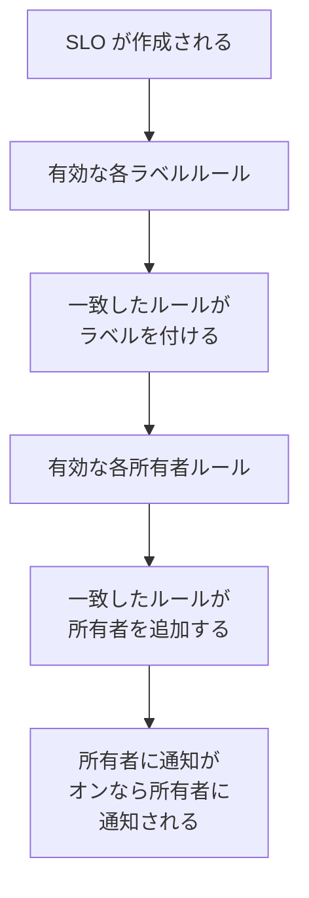

# ラベルルールと所有者ルール

ラベルルールと所有者ルールは、SLO を自動で整理します。**ラベルルール** は一致した新しい SLO すべてにラベルを付け、**所有者ルール** は所有者のユーザーとチームを追加します。たとえば、新しい checkout の SLO に *Checkout* のラベルを付け、checkout チームを所有者にする作業を、誰かが覚えておく必要はありません。どちらも、ほかの製品のラベルルールや所有者ルールと同じように動作します。共通する点は [ラベルルールと所有者ルール](/docs/configuration/label-and-owner-rules) を参照してください。

## 仕組み

ルールは、ダッシュボードまたは API から SLO が作成されたときに実行されます。ラベルルールが先に実行されるので、所有者ルールは、ラベルルールが付けたばかりのラベルに一致させることができます。

どちらの種類もプロジェクト全体に適用されます。SLO の一覧のサイドメニューの **設定** の下にある **ラベルルール** と **所有者ルール** にあります。**設定** セクションは最初は折りたたまれています。タイトルをクリックすると開きます。

## ルールを作成する

:::steps
### ルールの一覧を開く

**SLO** を開き、サイドメニューで **設定** → **ラベルルール** または **設定** → **所有者ルール** を開いて、**SLO のラベルルールを作成** または **SLO の所有者ルールを作成** をクリックします。

### ルールが一致する対象を選ぶ

**一致** ステップで、SLO が満たすべき条件ごとに **条件を追加** をクリックします ([一致条件](#一致条件) を参照)。条件が 2 つ以上ある場合は、**すべてに一致** または **いずれかに一致** を選びます。条件のないルールは、すべての新しい SLO に一致します。

### ルールが追加するものを選ぶ

ラベルルールの 2 番目のステップは **ラベル** で、**追加するラベル** を選びます。所有者ルールでは **所有者** で、追加する **所有者** を選びます。人とチームを、**所有者を追加** を使って 1 つの一覧から選びます。ルールは少なくとも 1 つのラベルまたは所有者を追加する必要があります。

### 名前と折りたたまれた項目を確認する

**名前** は、*Checkout, Production を追加* や *Checkout team を所有者として追加* のように選んだ内容から入力され、自分で名前を入力するまで選択に合わせて変わります。**その他の項目** には、省略可能な **説明** と、所有者ルールの場合は **所有者に通知** があります。

### ルールを保存する

最後のステップでもう一度 **SLO のラベルルールを作成** または **SLO の所有者ルールを作成** をクリックします。ルールは有効な状態で作成されます。
:::

**所有者に通知** (**その他の項目** の中) は既定でオンです。所有者ルールが追加した所有者は、手動で追加された所有者と同じ「所有者として追加されました」という通知を受け取ります。通知せずに所有者を追加するには、オフにします。

ルールを削除せずに一時停止するには、編集フォームで **有効** をオフにします。編集フォームではラベルや所有者は必須ではありません。何も追加しない古いルールでも名前の変更、オフ、削除ができ、一覧では **何も追加しない** と表示されます。

ルールが SLO に一致すると:

- ラベルルールは **追加するラベル** のすべてのラベルを付けます。SLO にすでにあるラベルは重ねて追加されず、複数のルールが一致した場合は、SLO はそのすべてのラベルを得ます。
- 所有者ルールは、ルールのすべてのユーザーとチームを所有者として追加します。SLO にすでにいる所有者はスキップされ、複数のルールが一致した場合は、SLO はそのすべての所有者を得ます。プロジェクトのメンバーでなくなったユーザーや別のプロジェクトのチームは追加されませんが、ルールのほかの所有者は追加されます。

SLO の所有者は、SLO のステータスの変化について知らされる人です。[エラーバジェット](/docs/slo/error-budget) を参照してください。

## 一致条件

各条件は SLO の 1 つのフィールドを比較します:

| フィールド | 比較する対象 | 演算子 |
| --- | --- | --- |
| **SLO ラベル** | SLO のラベル。 | **いずれかを含む**、**すべてを含む**、**いずれも含まない** |
| **SLO 名** | SLO の名前。 | **含む**、**含まない**、**等しい**、**等しくない**、**で始まる**、**で終わる**、**パターンに一致**、**パターンに一致しない** |
| **SLO の説明** | SLO の説明。 | **SLO 名** と同じ |

名前や説明の新しい条件は **含む** から始まります。パターンは、`^checkout-.*` のような正規表現、または `*checkout*` のような `*` ワイルドカードで、大文字と小文字は区別しません。どちらでもないパターン (`checkout-(01` など) は、何にも一致しないまま黙って保存されるのではなく、保存時に拒否されます。

| したいこと | 条件 |
| --- | --- |
| checkout サービスのすべての SLO | **SLO 名** が `checkout` を含む |
| すべての本番 SLO | **SLO ラベル** が *Production* のいずれかを含む |
| checkout の SLO (staging のものを除く) | **すべてに一致**: **SLO 名** が `checkout` を含み、かつ **SLO ラベル** が *Staging* のいずれも含まない |

## ルールが実行されるタイミング

- **SLO が作成されたとき** (ダッシュボードまたは API から): 有効な各ラベルルール、次に有効な各所有者ルール。
- **ルールを実行したとき** (**今すぐ実行** を使用): 下記を参照してください。

SLO を編集してもルールは再適用されず、ルールが何かを削除することもありません。誰かが手動で追加したラベルや所有者も、ルール自身が追加したものも削除されません。オフのルールは何もしません。

## 既存の SLO にルールを実行する

今日作成したルールは、その後に作成される SLO に適用されます。既存の SLO に適用するには、ルールの行の **今すぐ実行** をクリックするか、**表示** をクリックしてからルール自体のページの **今すぐ実行** をクリックします。複数のルールを選択して、表の一括操作から実行することもできます。

実行では、アーカイブされたものも含め、プロジェクトのすべての SLO を確認し、一致した数と変更した数を報告します。実行によって追加された所有者に通知されるのは、実行ダイアログで通知を選び、かつルールの **所有者に通知** がオンの場合だけです。[既存のリソースに対してルールを実行する](/docs/configuration/run-rules-now) を参照してください。

ラベルルールはプロジェクト間でコピーすることもできます。[ラベルルールのインポートとエクスポート](/docs/configuration/label-rule-import-export) を参照してください。

## 履歴

ルールが SLO を変更するたびに、SLO の **フィード** にどのルールが変更したかが記録されます。ルールが追加した各所有者には、それぞれ「所有者として追加されました」というフィードの項目も作られるので、誰がなぜ追加されたかがフィードでわかります。[SLO のフィードと監査ログ](/docs/slo/feed-and-audit-logs) を参照してください。

## 権限

| したいこと | 必要な権限 |
| --- | --- |
| ラベルルールを扱う | **Create SLO Label Rule**、**Edit SLO Label Rule**、**Delete SLO Label Rule**、または **Read SLO Label Rule** |
| 所有者ルールを扱う | **Create SLO Owner Rule**、**Edit SLO Owner Rule**、**Delete SLO Owner Rule**、または **Read SLO Owner Rule** |
| ラベルルールを実行する | **Edit SLO Label Rule** と **Edit Service Level Objective** |
| 所有者ルールを実行する | **Edit SLO Owner Rule**、**Edit Service Level Objective**、**Create SLO User Owner**、**Create SLO Team Owner** |

これらの権限はロールの SLO グループにあり、Project Owner ロールと Project Admin ロールはすべてを持っています。実行はプロジェクトのすべての SLO を変更するため、一部のラベルや自分が所有する SLO に限定された権限では、ルールを実行できません。

## 次のステップ

:::cards
- [ラベルルールと所有者ルール](/docs/configuration/label-and-owner-rules): すべての製品のラベルルールと所有者ルールの仕組み。
- [既存のリソースに対してルールを実行する](/docs/configuration/run-rules-now): ルールの種類ごとの 今すぐ実行 の動作。
- [SLO 概要](/docs/slo/introduction): SLO が持つすべてのページと、SLO の一覧。
:::
