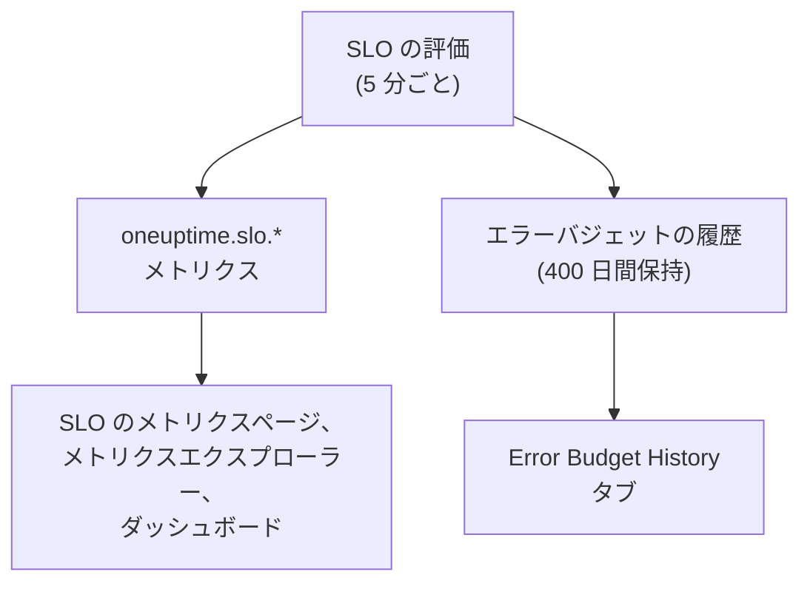

# SLO のメトリクスとダッシュボード

OneUptime は SLO を評価するたび (5 分ごと) に、その結果を `oneuptime.slo.*` という名前のメトリクスとして書き込みます。これらはモニターのメトリクスと同じメトリクスストアに保存されるので、SLO をその **メトリクス** ページでグラフにしたり、メトリクスエクスプローラーで開いたり、ほかの系列と同じように絞り込みやグループ化をしてどのダッシュボードにも置いたりできます。

:::cards
- [メトリクス](#メトリクス): 6 つの系列、その単位、集計方法。
- [メトリクスページ](#メトリクスページ): SLO のグラフ、履歴、インシデントとアラートのメトリクス。
- [ダッシュボードの SLO](#ダッシュボードの-slo): SLO ウィジェットと SLO Dashboard テンプレート。
:::

## 仕組み

## メトリクス

| メトリクス | 単位 | 集計 | 内容 |
| --- | --- | --- | --- |
| `oneuptime.slo.sli.percent` | `%` | Avg | SLO のコンプライアンスの時間枠での SLI。測定した時間のうち良好だった割合です。 |
| `oneuptime.slo.target.percent` | `%` | Avg | SLO の目標。評価のたびに送信されるので、グラフで SLI の上に描画できます。 |
| `oneuptime.slo.error.budget.remaining.percent` | `%` | Avg | 時間枠内でまだ使われていないエラーバジェットの割合。予算を超過すると負になります。 |
| `oneuptime.slo.error.budget.remaining.seconds` | `seconds` | Avg | SLO が違反になるまでにまだ許容できるダウンタイム。予算を超過すると負になります。 |
| `oneuptime.slo.burn.rate` | `x` | Max | 直近 60 分間に予算が使われている速さ。1x は時間枠全体でちょうど予算を使い切る速さです。 |
| `oneuptime.slo.status` | — | Max | 各評価時の SLO のステータス: `0` は 正常、`1` は リスクあり、`2` は 予算を使い切りました です。 |

集計とは、SLO 自体のグラフと SLO Dashboard テンプレートが、グラフの 1 つの区間に入る点をどう組み合わせるかです。割合と期間は平均します。バーンレートとステータスは最大値を取るので、短い消費のスパイクや、予算を使い切りました への短い突入が平均で消えてしまうことはありません。

**モニターの平均秒数** モードの SLO では、`oneuptime.slo.error.budget.remaining.seconds` は、エラーバジェットと同じくモニター全体で合計したモニター秒を数えます。[エラーバジェット](/docs/slo/error-budget) を参照してください。

### 点が書き込まれない場合

- オフまたはアーカイブされた SLO は評価されないので、何も送信しません。
- **一時停止中** または **設定ミス** の SLO は何も測定しないので、測定値ではなく設定である `oneuptime.slo.target.percent` だけを送信します。SLI、予算、バーンレート、ステータスのグラフには空白ができます。
- データのない時間枠でのバーンレートのように、実数でない値はスキップされ、0 として書き込まれることはありません。

### 属性

各点には次の属性が付きます:

| 属性 | 値 |
| --- | --- |
| `sloId` | SLO の ID。SLO 自体のページはこれで絞り込むので、SLO の名前を変えてもグラフが分かれることはありません。 |
| `sloName` | 点が書き込まれたときの SLO の名前。 |
| `projectId` | プロジェクトの ID。 |
| `oneuptime.label.<key>` | SLO のラベルごとに 1 つの属性。`Tier 1` というラベルは `oneuptime.label.tier_1` = `true` になり、`product:checkout` というラベルは `oneuptime.label.product` = `checkout` になります。キーは小文字になり、空白と句読点は `_` に変わります。 |

系列はモニターではなく SLO に属し、テレメトリの使用量には数えられません。

インシデントとアラートのメトリクスには、対応する 2 つの属性 `serviceLevelObjectiveIds` と `serviceLevelObjectiveNames` が付きます。インシデントやアラートが影響する SLO のカンマ区切りの一覧です。

### 保持期間

`oneuptime.slo.*` メトリクスは、モニターのメトリクスと同じ期間保持されます。既定は **30 日間** です。セルフホストのインストールでは、マスター管理者が Admin Dashboard の **データ保持** 設定にある **Monitor Metric Retention (Days)** でこれを変更できます。

これは SLO の **メトリクス** ページの **Error Budget History** タブを制限しません。その履歴は別に保存され、400 日間保持されます。

## メトリクスページ

SLO の **メトリクス** ページには 4 つのタブがあります:

| タブ | 表示内容 |
| --- | --- |
| **SLO Metrics** | 1 つの時間範囲 (既定は直近 1 日) を共有する 3 枚のカードに表示される `oneuptime.slo.*` 系列: **目標** (目標を重ねた SLI と、予算の残り)、**バーン** (バーンレートと予算の残り時間)、**ステータス**。 |
| **Error Budget History** | 長期間の履歴での SLI、予算の残り、バーンレート。目標、リスクありと使い切りの境界、有効な各バーンレートルールのしきい値に線が引かれます。 |
| **インシデントのメトリクス** | この SLO に影響するインシデントの件数、確認までの時間、解決までの時間、継続時間 (既定は直近 1 週間)。バーンレートルールが宣言したインシデントも含まれます。 |
| **アラートのメトリクス** | アラートについて同じ内容。バーンレートルールが発生させたアラートも含まれます。 |

**SLO Metrics**、**インシデントのメトリクス**、**アラートのメトリクス** の各タブはメトリクスストアを読むため、テレメトリを読む権限が必要です。SLO は読めてもテレメトリを読めないカスタムロールでは、これらのタブは空になりますが、**Error Budget History** は引き続き使えます。

## ダッシュボードの SLO

### SLO のメトリクスをグラフにする

:::steps
#### グラフを追加する

ダッシュボードの編集モードで、グラフまたは値のウィジェットを追加し、`oneuptime.slo.*` メトリクスのいずれかを選びます。

#### グループ化または絞り込み

`sloName` と `sloId` でグループ化すると、SLO ごとに 1 本の線になります。`sloId` は同じ名前の 2 つの SLO を区別します。`sloName` や `oneuptime.label.*` 属性で絞り込むこともできます。

#### 集計を選ぶ

上の表の集計を使います。割合と期間には Avg、バーンレートとステータスには Max です。
:::

### SLO ウィジェット

[SLO ウィジェット](/docs/dashboards/widgets#slo) は、1 つの SLO の SLI、予算の残り、またはバーンレートをタイルまたはグラフで表示します。SLO は次の 2 つのいずれかの方法で決まります:

| 設定 | 動作 |
| --- | --- |
| **サービスレベル目標** | ウィジェットを 1 つの SLO に固定します。選択肢にはアーカイブされていない SLO が表示されます。 |
| **Follow SLO Variable** | ダッシュボード変数で選ばれた SLO を表示します。`sloName` キーの **Telemetry Attribute** 変数です。SLO が固定されている間は無視されます。 |

[公開ダッシュボード](/docs/dashboards/sharing) では、変数に従うウィジェットを使うと、閲覧者がプロジェクトのアーカイブされていない任意の SLO を名前で選べます。固定されたウィジェットは自分の SLO だけを表示し、後でアーカイブされた SLO の最後の数値を表示し続けます。

### SLO Dashboard テンプレート

ダッシュボードを作成するときに **SLO Dashboard** テンプレートを選ぶと、プロジェクトのすべての SLO を 3 つの帯で表示する既製のボードができます:

1. **Service Level Objectives**: アーカイブされていないすべての SLO の一覧で、ステータス、目標に対する SLI、予算のバー、バーンレートと、ステータス別の SLO 数を表示します。有効な SLO が先に、予算の少ない順に並びます。オフの SLO は最後に **無効** として表示され、最後の数値はグレーになります。
2. **Error Budget & Burn Rate**: **Lowest Error Budget Remaining**、**Least Error Budget Time Left**、**Peak Burn Rate** のタイルと、`sloName` と `sloId` でグループ化して SLO ごとに 1 本の線を描く **Error Budget Remaining by SLO** と **Burn Rate by SLO** のグラフ。
3. **Selected SLO**: 1 つの SLO の **SLI**、**Error Budget Remaining**、**Burn Rate** のタイルと、**SLI History**、**Error Budget History**、**Burn Rate History** のグラフ。

ツールバーの 1 つの SLO 変数で、ボード全体の範囲が決まります。`sloName` の Telemetry Attribute 変数なので、選択肢はメトリクスにある SLO の名前です。SLO を選ぶと、一覧がその SLO に絞り込まれ、帯のグラフとタイルの範囲が決まり、変数に従う **Selected SLO** のウィジェットが表示されます。選ぶまでは、ツールバーで SLO を選ぶよう求められます。

## トラブルシューティング

:::details ツールバーの SLO の選択肢に SLO がない
選択肢には、直近 1 日に送信された SLO の名前が表示されます。新しい SLO は最初の評価の後に表示されます。**一時停止中** または **設定ミス** の SLO は目標を送信し続けるので選択できます。オフまたはアーカイブされた SLO は、最後の点から約 1 日後に消えます。
:::

:::details 名前を選ぶと 2 つの SLO が表示される
2 つの SLO が同じ名前です。一覧とグラフには両方が表示され、**Selected SLO** のウィジェットは名前があいまいであることを示します。SLO には異なる名前を付けてください。
:::

:::details SLO Metrics タブが空
ロールにテレメトリを読む権限がないか、SLO がまだ評価されていません。**Error Budget History** は SLO 自体を読むので、引き続き使えます。
:::

## 次のステップ

:::cards
- [ダッシュボード ウィジェット](/docs/dashboards/widgets): SLO ウィジェットを含むすべてのウィジェット。
- [ダッシュボード 変数](/docs/dashboards/variables): 1 つの選択肢でボード全体の範囲を決めます。
- [エラーバジェット](/docs/slo/error-budget): 予算の数値の意味。
:::
