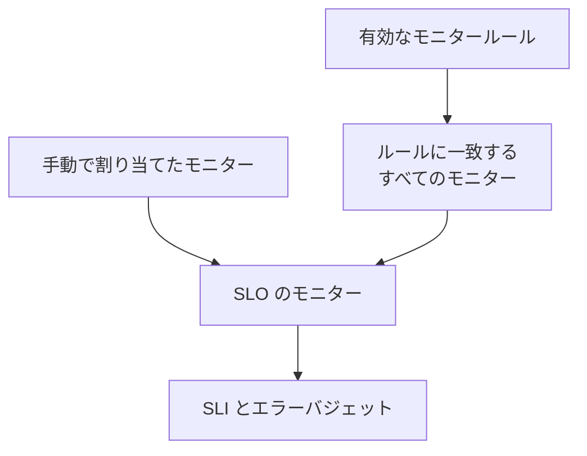

# モニターとモニタールール

SLO は、割り当てられたモニターの可用性を測定します。モニターは手動で割り当てることも、モニタールールに一致するモニターをすべて割り当てさせることも、その両方を使うこともできます。このページでは、SLO のサイドメニューの **構成** にある **モニター** ページと **モニタールール** ページについて説明します。

:::cards
- [モニターを手動で選ぶ](#モニターを手動で割り当てる): 小さく固定されたモニターの組み合わせに最適です。
- [ルールでモニターを割り当てる](#ルールでモニターを割り当てる): 「Production ラベルが付いたすべてのモニター」を自動で最新に保ちます。
- [一致条件](#一致条件): ルールが一致の判定に使えるフィールドと演算子。
:::

## SLO が測定するモニター

SLO は、手動で割り当てたモニターと、有効なモニタールールのいずれかに一致するすべてのモニターを合わせたものを測定します。

作成フォームではモニターを尋ねないため、新しい SLO にはモニターがありません。モニターが 1 つもない間は評価できません。ページには **モニターが割り当てられていません** と表示され、**概要** にはモニターを割り当てる両方の方法が表示されます。

## モニターを手動で割り当てる

SLO を編集する権限が必要です。

:::steps
### モニターページを開く

SLO を開き、**モニター** に移動します。

### モニターを選ぶ

**モニターを追加** をクリックし、プロジェクトのモニターを選びます。まだ割り当てられていないモニターだけが一覧に表示されます。

### 一覧を保存する

**モニターを追加** をクリックします。モニターはソースが **手動** として一覧に表示され、次の評価から SLI に数えられます。
:::

SLO からモニターを外すには、その行の **削除** をクリックします。モニター自体は変わりません。SLO の SLI とエラーバジェットに数えられなくなるだけです。

**モニター** ページには、モニターごとに次の内容が表示されます:

| 列 | 表示内容 |
| --- | --- |
| **現在のステータス** | モニターの現在のステータス。チェックされていないか、まだ何も報告していない場合は、**アーカイブ済み**、**無効**、**プローブが有効になっていません**、**プローブが切断されました**、**不明** のいずれか。 |
| **ソース** | SLO のモニタールールのいずれかが割り当てた場合は **ルール**、誰かが手動で割り当てた場合は **手動**。 |
| **ラベル** | モニターのラベル。 |

## ルールでモニターを割り当てる

モニタールールは、SLO が測定すべきモニターを記述します。たとえば「Production ラベルが付いたすべてのモニター」や「名前が api- で始まるすべてのモニター」です。一致するモニターは、今だけでなく、モニターが作成されたり変更されたりするたびに割り当てられるので、誰かが来月追加するモニターのことを覚えておく必要はありません。

:::steps
### モニタールールを開く

SLO を開き、**モニタールール** に移動して、**SLO のモニタールールを作成** をクリックします。

### ルールに名前を付ける

**基本情報** で **名前** を入力し、必要に応じて、これらのモニターがこの SLO に属する理由を **説明** に書きます。

### 一致させる対象を選ぶ

**一致条件** で **条件を追加** をクリックし、フィールドと演算子を選んで、値を入力または選択します。条件が 2 つ以上ある場合は、**すべてに一致** または **いずれかに一致** を選びます。モニタールールには少なくとも 1 つの条件が必要です。

### ルールを保存する

**SLO のモニタールールを作成** をクリックします。ルールは有効な状態で作成され、SLO のモニターはすぐに再評価されます。一致する各モニターはソースが **ルール** として割り当てられます。
:::

ルールの表には、各ルールの名前、一致条件の説明、有効かどうかが表示されます。ルールを一時停止するには、編集フォームで **有効** をオフにします。**モニターを表示** は SLO の **モニター** ページを開きます。

### 一致条件

各条件は、モニターの 1 つのフィールドを比較します:

| フィールド | 比較する対象 | 演算子 |
| --- | --- | --- |
| **モニターラベル** | モニターのラベル。 | **いずれかを含む**、**すべてを含む**、**いずれも含まない** |
| **モニターの種類** | 種類の一覧から選んだモニターの種類。 | **等しい**、**等しくない** |
| **モニター名** | モニターの名前。 | **含む**、**含まない**、**等しい**、**等しくない**、**で始まる**、**で終わる**、**パターンに一致**、**パターンに一致しない** |
| **モニターの説明** | モニターの説明。 | **モニター名** と同じ |

パターンは、`^api-.*` のような正規表現、または `*checkout*` のような `*` ワイルドカードで、大文字と小文字は区別しません。どちらでもないパターン (`api-(01` など) は、何にも一致しないまま黙って保存されるのではなく、保存時に拒否されます。プロジェクトのすべてのモニターを割り当てるには、**モニター名** がパターン `.*` に一致するという条件を追加します。

| したいこと | 条件 |
| --- | --- |
| すべての本番モニター | **モニターラベル** が *Production* のいずれかを含む |
| すべての API モニター | **モニターの種類** が *API* に等しい |
| 手動モニター以外のすべてのモニター | **モニターの種類** が *Manual* に等しくない |
| 名前が api- で始まるすべてのモニター | **モニター名** がパターン `^api-` に一致 |
| checkout のモニター (staging のものを除く) | **すべてに一致**: **モニター名** がパターン `*checkout*` に一致し、かつ **モニターラベル** が *Staging* のいずれも含まない |

### ルールが実行されるタイミング

- ルールを作成、編集、オン、オフ、削除すると、SLO のモニターがすぐに再評価されます。
- モニターが作成されたとき、またはラベル、名前、説明が変わったときは、プロジェクトのすべてのモニタールールがそのモニターを確認します。モニターのラベルルールが付けるラベルも対象です。
- ラベルが削除されると、そのラベルをルールで使っていた SLO が再評価されます。
- SLO がオフまたはアーカイブされている間も、ルールは SLO のモニターの一覧を最新に保つため、再開時には正しいモニターで測定します。

ルールは保存のたびに再同期されるので、**今すぐ実行** は SLO が取りこぼしたものを追いつかせるためのものです。各行、ルール自体のページ (**表示**)、表の一括操作にあります。ルールを実行すると、SLO の有効なモニタールールがまとめて再評価され、その後ダイアログに割り当てられたモニターと割り当てを外されたモニターの数が表示されます。ルールを実行するには、SLO のモニタールールを編集する権限が必要です。[既存のリソースに対してルールを実行する](/docs/configuration/run-rules-now) を参照してください。

### ルールが所有するモニター

- モニターは、有効なルールが一致している間は割り当てられたままで、一致するルールがなくなるとすぐに割り当てを外されます。
- ルールをオフにするか削除すると、ほかに一致する有効なルールがないモニターだけが割り当てを外されます。
- ルールが割り当てを外すのは、ルールが割り当てたモニターだけです。手動で割り当てたモニターは、たまたま一致したルールに引き継がれることも、一致しなくなったときに外されることもありません。ソースは **手動** のままです。

## ルールがオンのときの手動選択

少なくとも 1 つのルールが有効な間は、SLO のモニターはルールが管理します:

- モニターを手動で追加することはできません。**モニターを追加** は無効になり、バナーに **この SLO のモニターは、モニタールールによって管理されています** と **モニタールールを管理** のリンクが表示されます。
- ルールが割り当てたモニターは、ルールが再び割り当ててしまうため、手動で外せません。**削除** ボタンはロックされ、ツールチップに理由が表示されます。
- ルールをオンにする前に手動で割り当てたモニターは、引き続き外せます。

これは API でも同じです。モニターを自分で選び直すには、すべてのルールをオフにします。

## モニターが数えられる SLO

モニターのページには、そのモニターを測定している SLO が一覧表示されます。モニターを開き、サイドメニューの **SLO** に移動します。モニターを一時停止したり変更したりする前に確認すれば、どの目標が依存しているかがわかります。アーカイブされた SLO は評価されないため、表示されません。

## Auto-Add Monitors With Labels からの移行

以前のバージョンでは、SLO のフォームに **Auto-Add Monitors With Labels** という設定がありました。アップグレード時に、それを使っていた各 SLO には同じラベルに一致する **Auto-add monitors with labels** という名前の有効なモニタールールが作られるため、まったく同じモニターを測定し続けます。SLO の API の `monitorLabels` フィールドは非推奨です。代わりに SLO のモニタールールを使ってください。

:::details 古い設定を保存するものがまだあったら?
アップグレード前に開いたダッシュボードのタブや、以前のバージョン向けに書かれた API クライアントやワークフローは、古い設定をまだ保存する可能性があります。それによって SLO が黙ってモニターを失わないように、次のように動作します:

- **モニタールールがない SLO** は、保存されたラベルを **Auto-add monitors with labels** ルールに変換し、モニターをすぐに再評価します。空の一覧を保存すると、以前と同じように、その設定が割り当てたモニターの割り当てが外れます。
- **モニタールールがある SLO** は、ルールのオン、オフにかかわらず、古い設定で保存されたラベルを無視します。何を測定するかはルールが決めるためです。
- 古い設定でモニターが割り当てられていた SLO で **最初のモニタールールを作成する** と、まず設定がルールに変換されます。そのため、新しいルールは古い設定を置き換えるのではなく、その隣に追加されます。

変換されたルールを削除しても、その後もモニターが割り当てられたままでない限り、削除されたままです。たとえば、以前のバージョンを実行しているサーバーがアップグレード中にモニターを再び割り当てた場合は、次のモニターの変更または次の新しいルールでラベルが再び変換されます。アップグレードが終わったら、そのルールをもう一度削除してください。
:::

## 履歴

割り当てと割り当て解除、およびルールの作成、編集、削除は、すべて SLO の **フィード** に表示されます。ルールの変更は **監査ログ** にも記録されます。[SLO のフィードと監査ログ](/docs/slo/feed-and-audit-logs) を参照してください。

## トラブルシューティング

:::details モニターを追加 が無効になっている
SLO のモニタールールの少なくとも 1 つが有効なので、モニターはルールが管理しています。ルールを変更するか、すべてオフにしてモニターを手動で選びます。
:::

:::details モニターの削除ボタンがロックされている
モニタールールがそのモニターを割り当てており、外してもまた割り当てます。一致しているルールを変更するか、オフにします。
:::

:::details ルールに一致するはずのモニターが割り当てられていない
ルールが有効であること、そして **すべてに一致** のときにすべての条件が満たされていることを確認します。モニターのラベルルールが追加するラベルも対象になります。ルールの **今すぐ実行** をクリックして SLO を再同期します。
:::

:::details ルールの保存がパターンのエラーで失敗する
値が正規表現でも `*` ワイルドカードでもありません。たとえば閉じていない括弧があります。パターンを直すか、**含む** を使います。
:::

## 次のステップ

:::cards
- [SLO 概要](/docs/slo/introduction): 複数のモニターのダウンタイムの組み合わせ方。
- [エラーバジェット](/docs/slo/error-budget): モニターのダウンタイムが消費するもの。
- [既存のリソースに対してルールを実行する](/docs/configuration/run-rules-now): ルールの種類ごとの 今すぐ実行 の動作。
:::
