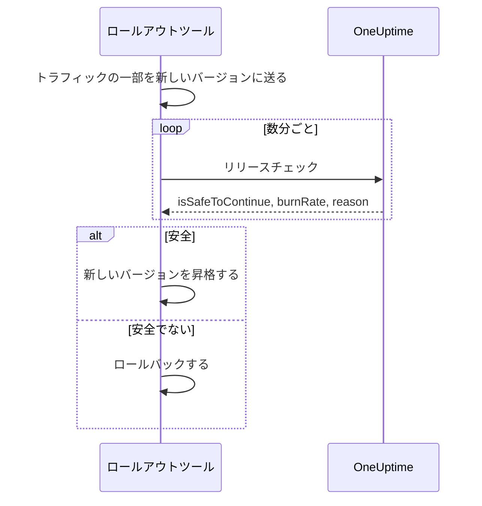

# リリースチェック

リリースチェックは、リリースの展開中に SLO に「このリリースの展開を続けても安全か」を問い合わせ、直近数分間に SLO がエラーバジェットをどれだけ速く消費したかをもとに答えます。Argo Rollouts、Flagger、デプロイパイプラインは、カナリアがトラフィックを受けている間にこれを問い合わせ、答えがノーならリリースをロールバックします。OneUptime 自身は何もデプロイしません。ロールアウトはこれまでどおりロールアウトツールが行い、OneUptime はリリースの状況をそのツールに伝えます。

:::cards
- [チェックを問い合わせる](#チェックを問い合わせる): API キーを使った 1 回のリクエストと、その応答。
- [Argo Rollouts](#argo-rollouts): ロールアウトを中止する分析。
- [Flagger](#flagger): カナリアを停止する webhook。
- [GitHub Actions](#github-actions): デプロイ後にロールバックするステップ。
:::

## 仕組み

[デプロイゲート](/docs/slo/error-budget-policy#デプロイゲート) は、リリースの前に、コンプライアンスの時間枠全体のエラーバジェットから答えます。何かを壊すリリースでも、最初の 10 分間では 1 か月分の予算をほとんど消費していません。そのためリリースチェックは、リリースによって変わるもの、つまり直近数分間のバーンレートを読み取ります。



チェックは、次の 3 つの判定のいずれかで答えます:

| 判定 | 条件 | `isSafeToContinue` |
| --- | --- | --- |
| `Pass` | 時間枠内のエラーバジェットの消費が `maxBurnRate` 以下の速さだった。 | `true` |
| `Fail` | それより速く消費した、または SLO のエラーバジェットポリシーがデプロイを凍結している。 | `false` |
| `NotEnoughData` | 時間枠内のリクエストが `minimumRequestCount` より少なかった、または SLO のモニターが時間枠内にステータスを記録しなかった。リリースを安全と判断するには少なすぎます。 | `false` |

バーンレートが 1 なら、その時間枠は SLO の目標をちょうど満たしています。そのため、`maxBurnRate` の既定値 `1` では、目標より悪い結果のリリースは不合格になります。

チェックが読み取るものは、SLO の測定対象によって異なります:

- [リクエスト SLO](/docs/slo/request-slos) は、時間枠内のサービスのリクエストで判定されます。リクエストは、届いたスパンから読み取ります。新しいバージョンのリクエストだけで判定するには `serviceVersion` を追加します。OneUptime はこれをスパンの `service.version` リソース属性と照合します。この属性は、OpenTelemetry SDK が `OTEL_RESOURCE_ATTRIBUTES=service.version=1.4.2` から設定します。こうすれば、カナリアは古いバージョンのリクエストに薄められることなく、自身のリクエストで判定されます。
- モニターの稼働率の SLO は、時間枠内のモニターのステータスのタイムラインで判定されます。`minimumRequestCount` は適用されず、`serviceVersion` を付けたチェックは拒否されます。モニターにはバージョンがないためです。

## 始める前に

リリースが影響するものを測定する SLO が必要です。カナリアを最もよく判定できるのは、リリースするサービスのリクエスト SLO です。そのサービス自身のリクエストを読み取るためです。

## リリースチェックを設定する

:::steps
### ロールアウトにキーを渡す

SLO を読み取れるロールを持つプロジェクトの [API キー](/docs/api-reference/api-reference) を作成し、ロールアウトツールまたはパイプラインのシークレットとして保存します。

### SLO の ID をコピーする

SLO を開き、アドレスから ID をコピーします: `/slos/<slo-id>`。

### 手動で一度チェックを問い合わせる

キーと ID を使って、[チェックを問い合わせる](#チェックを問い合わせる) にあるリクエストを実行します。`isSafeToContinue` と `reason` を含む応答が返ります。

### ロールアウトに追加する

[Argo Rollouts](#argo-rollouts)、[Flagger](#flagger)、または [GitHub Actions](#github-actions) からチェックを問い合わせ、`isSafeToContinue` が `false` のときにロールバックします。
:::

## チェックを問い合わせる

チェックは、SLO の `release-check` アドレスへの `GET` または `POST` です。オプションはクエリ文字列で送るか、`POST` の JSON 本文として送ります:

```bash
curl -sS "https://oneuptime.com/api/service-level-objective/<slo-id>/release-check?windowInMinutes=10&serviceVersion=1.4.2" \
  -H "ApiKey: $ONEUPTIME_API_KEY"
```

応答には、まず判定が入り、その後に判定の元になった値が続きます:

```json
{
  "isSafeToContinue": false,
  "verdict": "Fail",
  "reason": "The last 10 minutes burned the error budget at 3.2x, faster than the 1x this check allows (SLI 99.68% against the 99.9% target).",
  "sloId": "<slo-id>",
  "sloName": "Checkout requests",
  "sliType": "Request Success",
  "targetPercentage": 99.9,
  "windowInMinutes": 10,
  "maxBurnRate": 1,
  "burnRate": 3.2,
  "sliPercentage": 99.68,
  "deploymentsAllowed": true,
  "errorBudgetPolicyTier": null,
  "sloStatus": "Healthy",
  "checkedAt": "2026-11-15T12:00:00.000Z",
  "goodRequestCount": 2492,
  "totalRequestCount": 2500,
  "minimumRequestCount": 1,
  "serviceVersion": "1.4.2"
}
```

オプション:

| オプション | 既定値 | 動作 |
| --- | --- | --- |
| `windowInMinutes` | `10` | チェックがさかのぼる期間。1 から 360 までの整数の分で指定します。 |
| `maxBurnRate` | `1` | 合格となる最も速いバーンレート。`2` にすると、目標が許容する 2 倍の速さで時間枠が予算を消費しても合格になります。 |
| `minimumRequestCount` | `1` | リクエスト SLO のみ。チェックが判定する最小のリクエスト数です。`0` にすると、リクエストのない時間枠は合格になります。 |
| `serviceVersion` | なし | リクエスト SLO のみ。スパンがこの `service.version` を持つリクエストだけを判定します。 |
| `includeDeploymentGate` | `true` | SLO のエラーバジェットポリシーがデプロイを凍結している間は不合格にします。`false` にすると、バーンレートだけで判定します。 |
| `failWithStatusCode` | `false` | ステータスコードしか読まないツールのために、ノーの応答を 200 ではなく HTTP ステータス 412 で返します。 |

応答の項目:

| 項目 | 内容 |
| --- | --- |
| `isSafeToContinue` | ロールアウトを続けるなら `true`、ロールバックするなら `false`。 |
| `verdict` | `Pass`、`Fail`、`NotEnoughData` のいずれか。 |
| `reason` | ロールアウトのログ用の一文。何を測定し、なぜチェックがそう答えたかを説明します。 |
| `burnRate` と `sliPercentage` | 時間枠内でエラーバジェットを消費した速さと、時間枠内の SLI。 |
| `goodRequestCount` と `totalRequestCount` | リクエスト SLO のみ。時間枠内のリクエスト数と、そのうち良好だった数。 |
| `deploymentsAllowed` と `errorBudgetPolicyTier` | SLO のエラーバジェットポリシーがデプロイを許可しているかどうかと、SLO がいる段階。 |
| `checkedAt` | チェックを測定した日時。 |

測定できない SLO (サービスのないリクエスト SLO、しきい値のないレイテンシ SLO、モニターのないモニターの稼働率の SLO) には、HTTP 400 と修正すべき内容が返ります。そのため、ロールアウトは推測ではなく明確なエラーで止まります。セルフホストのインストールでは、oneuptime.com の代わりにそのインストール自身のアドレスを使います。

## Argo Rollouts

`web` メトリクスを使う分析が、カナリアの各ステップでチェックを問い合わせます。分析が失敗すると、Argo Rollouts はロールアウトを中止し、カナリアをスケールダウンします。まず API キーをシークレットとして保存します:

```bash
kubectl create secret generic oneuptime --from-literal=api-key="$ONEUPTIME_API_KEY"
```

次にテンプレートを追加し、カナリアの最初のステップの後に実行します:

:::tabs
@tab AnalysisTemplate
```yaml title="oneuptime-release-check.yaml"
apiVersion: argoproj.io/v1alpha1
kind: AnalysisTemplate
metadata:
  name: oneuptime-release-check
spec:
  args:
    - name: version
    - name: api-key
      valueFrom:
        secretKeyRef:
          name: oneuptime
          key: api-key
  metrics:
    - name: slo-burn-rate
      interval: 2m
      count: 5
      failureLimit: 0
      successCondition: result == true
      provider:
        web:
          url: "https://oneuptime.com/api/service-level-objective/<slo-id>/release-check?windowInMinutes=10&serviceVersion={{args.version}}"
          headers:
            - key: ApiKey
              value: "{{args.api-key}}"
          jsonPath: "{$.isSafeToContinue}"
```
@tab Rollout
```yaml title="rollout.yaml"
apiVersion: argoproj.io/v1alpha1
kind: Rollout
metadata:
  name: checkout
spec:
  strategy:
    canary:
      steps:
        - setWeight: 10
        - analysis:
            templates:
              - templateName: oneuptime-release-check
            args:
              - name: version
                value: "1.4.2"
        - setWeight: 50
        - pause: { duration: 10m }
```
:::

分析は 2 分間隔で 5 回問い合わせ、最初のノーでロールアウトを中止します。カナリアの Pod が `OTEL_RESOURCE_ATTRIBUTES` に設定するのと同じバージョンを渡してください。最初の重みでカナリアにトラフィックが来ない可能性がある場合は、アドレスに `&minimumRequestCount=0` を追加します。追加しないと、トラフィックのないカナリアは `NotEnoughData` で分析に失敗します。

## Flagger

Flagger は分析の各ステップで `rollout` webhook を呼び出し、webhook が失敗し続けるとカナリアを停止してロールバックします。Flagger の webhook はヘッダーを送らないため、webhook のためにコマンドを実行する Flagger の load tester を経由してチェックを問い合わせます:

```yaml title="canary.yaml"
apiVersion: flagger.app/v1beta1
kind: Canary
metadata:
  name: checkout
spec:
  analysis:
    interval: 1m
    threshold: 2
    maxWeight: 50
    stepWeight: 10
    webhooks:
      - name: oneuptime-release-check
        type: rollout
        url: http://flagger-loadtester.test/
        timeout: 30s
        metadata:
          type: bash
          cmd: "curl -sSf -H \"ApiKey: $ONEUPTIME_API_KEY\" 'https://oneuptime.com/api/service-level-objective/<slo-id>/release-check?windowInMinutes=5&failWithStatusCode=true'"
```

`failWithStatusCode=true` では、ノーは HTTP 412 になるため、`curl -f` がエラーで終了し、webhook が失敗します。load tester には、Kubernetes のシークレットからキーを環境変数 `ONEUPTIME_API_KEY` として渡します。チェックが `threshold` 回失敗すると、Flagger はカナリアをロールバックします。

## GitHub Actions

一度にデプロイするパイプラインでも、リリースを見守ることはできます。デプロイし、チェックを何度か問い合わせ、ノーと答えたらロールバックします。

```yaml title=".github/workflows/deploy.yml"
name: Deploy
on:
  push:
    branches: [main]

jobs:
  deploy:
    runs-on: ubuntu-latest
    steps:
      - uses: actions/checkout@v4
      - name: Deploy
        run: ./deploy.sh
      - name: Watch the release against the SLO
        env:
          ONEUPTIME_API_KEY: ${{ secrets.ONEUPTIME_API_KEY }}
          SLO_ID: <slo-id>
          VERSION: ${{ github.sha }}
        run: |
          for attempt in 1 2 3 4 5; do
            sleep 120
            CHECK=$(curl -sS "https://oneuptime.com/api/service-level-objective/$SLO_ID/release-check?windowInMinutes=10&serviceVersion=$VERSION" \
              -H "ApiKey: $ONEUPTIME_API_KEY")
            echo "$CHECK" | jq -r '.reason'
            if [ "$(echo "$CHECK" | jq -r '.isSafeToContinue')" != "true" ]; then
              exit 1
            fi
          done
      - name: Roll back
        if: failure()
        run: ./rollback.sh
```

このステップは、ノーのときと、`isSafeToContinue: true` を含まないあらゆる応答 (ID の誤り、SLO を読み取れないキー、応答がまったくない場合) で失敗します。そのため、パイプラインが受け取っていない応答をもとに先へ進むことはありません。サービスの起動時に `service.version` をコミット (`${{ github.sha }}`) に設定すると、チェックは新しいバージョンだけを判定します。

## 次のステップ

:::cards
- [リクエストとレイテンシの SLO](/docs/slo/request-slos): カナリアを最もよく判定できる SLI である、サービスのリクエストを測定します。
- [エラーバジェットポリシー](/docs/slo/error-budget-policy): 予算が少ない間はデプロイを凍結します。
- [バーンレートアラートとインシデント](/docs/slo/burn-rate-alerts): 予算の消費が速すぎるときにチームに知らせます。
:::
