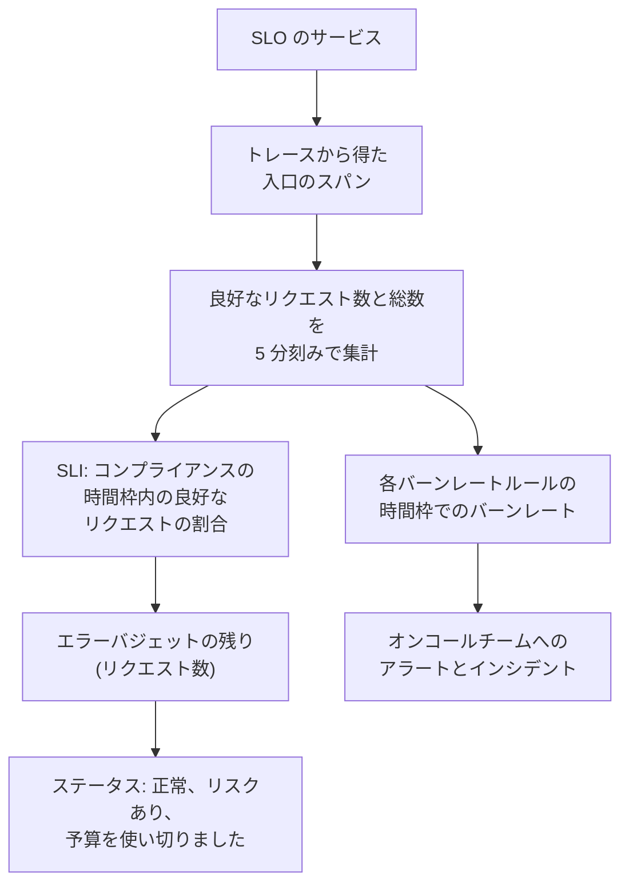

# リクエストとレイテンシの SLO

リクエスト SLO は、ユーザーがサービスから実際に受け取っているものを測定します。つまり、サービスのリクエストのうち成功したものの割合、または十分に速く処理されたものの割合です。OneUptime はサービスがすでに送信しているトレースからリクエストを数えるので、設定するモニターはありません。サービスと目標を選ぶだけで、OneUptime が 5 分ごとに測定します。

:::cards
- [リクエスト SLO を作成する](#リクエスト-slo-を作成する): サービス、レイテンシのしきい値、目標を決めます。
- [一部のリクエストだけを数える](#一部のリクエストだけを数える): 1 つのエンドポイントだけ、またはヘルスチェック以外のすべてのリクエスト。
- [メトリクスに基づく SLO](#メトリクスに基づく-slo): トレースを送信しないサービス向けの、カウンターまたはヒストグラム。
- [リクエストの数え方](#リクエストの数え方): どのスパンを、いつ数えるか。
- [リリースチェック](/docs/slo/release-checks): エラーバジェットを消費するリリースをロールバックします。
:::

## リクエストの成功率とリクエストのレイテンシ

| 測定対象 | リクエストが不良になる条件 | エラーバジェットで数えるもの |
| --- | --- | --- |
| **リクエストの成功率** | スパンのステータスが `Error` のとき。ステータスのないスパンは、OpenTelemetry の定義どおり良好として数えます。 | 失敗したリクエスト |
| **リクエストのレイテンシ** | ステータスにかかわらず、SLO の **レイテンシのしきい値 (ms)** より時間がかかったとき。 | 遅いリクエスト |

SLI はコンプライアンスの時間枠内の良好なリクエストの割合で、エラーバジェットは目標が許容する不良なリクエストです。99.9% なら 1,000 件に 1 件です。レイテンシ SLO は、すぐに失敗したリクエストを良好として数えます。そのため、重要なサービスは両方の方法で測定してください。動作していることを測る SLO と、速いことを測る SLO の 2 つです。

## 仕組み

リクエストとは、SLO のいずれかのサービスの入口のスパンです。リクエストやメッセージがサービスに入るスパンのことで、[トレース](/docs/telemetry/traces-explorer#トレースとスパン) の一覧に既定で表示されるものです。SLO の 2 つのサービスを通過するリクエストは、それぞれのサービスで 1 回ずつ数えます。

そこから先は、リクエスト SLO もほかの SLO と同じように動作します。ステータス、バーンレートルール、エラーバジェットポリシー、所有者、通知は同じで、エラーバジェットが分ではなくリクエスト数で表される点だけが異なります。

## 始める前に

- サービスが OneUptime にトレースを送信していること。[OpenTelemetry](/docs/telemetry/open-telemetry) を参照してください。各サービスは、`service.name` の名前で [サービスカタログ](/docs/telemetry/services) に表示されます。
- SLO を作成できるロール。プロジェクト所有者、プロジェクト管理者、または Create Service Level Objective 権限を持つカスタムロールです。

## リクエスト SLO を作成する

:::steps
### SLO を開く

上部バーの **製品** メニューから **SLO** を開き、**サービスレベル目標を作成** をクリックします。

### 測定対象を選ぶ

**測定対象** で **リクエストの成功率** または **リクエストのレイテンシ** を選び、続いてリクエストを数える **サービス** を選びます。**リクエストのレイテンシ** の場合は **レイテンシのしきい値 (ms)** も設定します。この時間内に処理されたリクエストは、十分に速いものとして数えられます。たとえば `300` です。一部のリクエストだけを数えるには、**リクエストフィルター** を入力します。[一部のリクエストだけを数える](#一部のリクエストだけを数える) を参照してください。**次へ** をクリックします。

### 名前を付けて目標を設定する

**名前** (たとえば「Checkout requests」) と **目標（%）** を入力します。目標は、良好でなければならないリクエストの割合です。**サービスレベル目標を作成** をクリックします。

### 最初の数字が表示されるのを待つ

5 分以内に行われる最初の評価で直近 6 時間分のリクエストを数えるため、SLO にはすぐに数値が表示されます。その後の評価では、コンプライアンスの時間枠全体をカバーするまで、より古いリクエストも数えていきます。
:::

サービス自身の **SLO** ページには、そのサービスを測定する SLO が一覧表示され、そこの **サービスレベル目標を作成** を使うと、サービスが選択済みの同じフォームが開きます。後で SLO の測定対象、サービス、しきい値、フィルターを変更するには、その SLO の **設定** を開き、**測定対象を編集** をクリックします。

## 一部のリクエストだけを数える

リクエスト SLO は、そのサービスのすべてのリクエストを数えます。**リクエストフィルター** を使うと、チェックアウトのエンドポイントのように重要なリクエストだけを数えたり、ユーザーが実際に受け取るものより SLI を良く見せてしまうヘルスチェックのように、一部のリクエストを除外したりできます。フィルターは、トレースエクスプローラーと同じ [検索構文](/docs/telemetry/search-syntax#値の一致) を使ったトレース検索として書きます:

| リクエストフィルター | 数えるもの |
| --- | --- |
| `@http.route:/checkout*` | ルートが `/checkout` で始まるリクエスト。 |
| `-@http.route:/health` | ヘルスチェックを除くすべてのリクエスト。 |
| `@http.request.method:[POST, PUT]` | POST と PUT のリクエスト。 |
| `name:"POST /checkout"` | スパンの名前が `POST /checkout` のリクエスト。 |

すべての条件が一致する必要があるため、`@http.route:/checkout* -@http.route:/checkout/health` は、ヘルスチェックを除くチェックアウトのリクエストを数えます。`@` の付いた条件はリクエストのスパンの属性で、`name:` はスパンの名前です。自由テキストや、`status:` や `duration:` などのエクスプローラーのほかのフィールドは、ここではフィルターになりません。どのリクエストが不良か、遅いかは、SLO がすでに決めているためです。フィルターには、500 文字以内で最大 10 個の条件を指定できます。

**概要** では SLO のサービスの下にフィルターが表示され、**設定** では **測定対象** の下に表示されます。フィルターを変更すると、SLO のリクエストを最初から数え直します。

## メトリクスに基づく SLO

サービスがすでにリクエストをメトリクスとして数えている場合や、トレースを送信していない場合は、代わりにカウンターまたはヒストグラムから SLO を測定します。**測定対象** で **メトリクス** と、それを送信する **サービス** を選び、続いて **メトリクス** のステップで次の項目を入力します:

| 項目 | 入力する内容 |
| --- | --- |
| **メトリクス** | メトリクスの名前。プロジェクトのメトリクスから選ぶか、名前を入力します。たとえば `http_requests_total` や `http.server.request.duration` です。 |
| **良好なイベント** | **カウンター（条件で判定）** または **ヒストグラム（値で判定）**。 |
| **良好とする条件** | カウンターの場合: 良好なイベントを、属性の検索として指定します。たとえば `@http.response.status_code:<500` です。 |
| **良好とする上限値** | ヒストグラムの場合: 良好な観測値の上限となる値を、メトリクス自体の単位で指定します。たとえば、秒単位のヒストグラムで 300 ms を表すなら `0.3` です。ヒストグラムのバケット境界のいずれかを使ってください。 |
| **メトリクスフィルター** | 任意: 数える系列を指定します。たとえば `-@http.route:/health` です。 |

カウンターのイベントは、5 分刻みの各区間でカウンターが増えた量で、Prometheus の `increase()` と同じ読み方です。再起動したカウンターは再びゼロから数え、累積カウンターとデルタカウンターのどちらも数えます。ヒストグラムのイベントはその観測値で、そのうち良好なものは、値以下のバケットに入る観測値です。数えるのは、SLO のサービスから届いたそのメトリクス自体のポイントだけです。同じ名前のゲージは何も数えません。クラウドのメトリクスはすべてゲージで、ゲージを対象にした SLO はそのことをページで示し、メトリクスの選択欄でも示します。クラウドのメトリクスは、メトリクス モニターと、そのモニターの稼働率の SLO で測定してください。

そこから先は、メトリクス SLO もリクエスト SLO と同じように動作し、エラーバジェット、バーンレートルール、リリースチェックはイベント数で表されます。メトリクスを変更すると、イベントを最初から数え直します。

## リクエストの数え方

OneUptime は、各 SLO の良好なリクエスト数と総リクエスト数を 5 分刻みの区間ごとに数え、その集計を保存します。そのため SLO は、毎回すべてのスパンを読むのではなく、自身の集計から時間枠を読み取ります:

- 各区間は終了の 2 分後に集計されるため、遅れて届いたスパンも含まれます。さらに遅れて届くスパンのために、次の評価で直近 2 つの区間をもう一度数えます。
- 新しい SLO は直近 6 時間から始まります。その後の各評価では、時間枠がカバーされるまで、新しいものから順に最大 1 日分の古いリクエストを数えます。
- 数えられるのは、[テレメトリの保持期間](/docs/telemetry/data-retention#テレメトリの保持期間) 内にまだあるリクエストだけです。集計済みの区間は、どのコンプライアンスの時間枠よりも長い 400 日間保存されます。そのため、保持期間より長い時間枠も、SLO が古くなるにつれて埋まっていきます。
- SLO の測定対象、サービス、レイテンシのしきい値、リクエストフィルターを変更すると、リクエストを最初から数え直します。コンプライアンスの時間枠を長くした場合は、さらに過去までさかのぼって数えて埋めます。

集計がコンプライアンスの時間枠の一部しかカバーしていない間は、**概要** に **期間の 23% にデータあり** インジケーターが表示され、**エラーバジェットの残り** タイルの数値の下にも同じ内容が表示されます。どちらも、集計が時間枠全体をカバーすると消えます。

## リクエスト数で表すエラーバジェット

予算は、時間枠内で数えたリクエストのうち目標が許容する不良なリクエストなので、トラフィックとともに増えます。99.9% なら、2,000,000 件のリクエストがある時間枠では 2,000 件の失敗が許容されます。**概要** では次のように表示されます:

- **エラーバジェットの残り** は、不良なリクエストが全体の何件のうち何件残っているか、または SLO が予算を何件超過しているかを示します。
- **予算の残り期間** は、トラフィックがこれまでどおりであれば、現在のバーンレートで予算がどれだけもつかを示します。
- サマリーには SLO のサービス数が表示され、レイテンシ SLO では目標の下にしきい値が表示されます。

バーンレートアラート、通知、フィードでも、予算はリクエスト数で表されます。リクエスト SLO では `oneuptime.slo.error.budget.remaining.seconds` メトリクスは送信されません。代わりに `oneuptime.slo.error.budget.remaining.percent` をグラフにしてください。

リクエスト SLO にも、ほかの新しい SLO と同じ **Fast burn**、**Slow burn**、**Slow leak** ルールが付きます。リクエストがわずかしかない静かな時間帯には、1 回の失敗だけで予算が速く消費されることがあります。そのため、ルールはリクエストが少なすぎる時間枠を無視できます。ルールの **最小リクエスト数** を設定すると、ルールはリクエスト数がその値より少ない長い時間枠をスキップします。

## トラブルシューティング

:::details SLO に リクエストを待っています と表示される
SLO のどのサービスも、時間枠内でまだリクエストを処理していません。サービスが OneUptime にトレースを送信していること、そしてそのスパンに入口のスパンが含まれていることを確認してください。スパンがすべて内部のスパンであるサービスには、数えるリクエストがありません。SLO に **リクエストフィルター** がある場合は、[トレースエクスプローラー](/docs/telemetry/traces-explorer) でそのフィルターを使って検索してください。そこでどのリクエストにも一致しないフィルターでは、SLO が数えるリクエストはありません。
:::

:::details サービスを変更したら SLI が変わった
SLO の測定対象、サービス、レイテンシのしきい値、リクエストフィルターを変更すると、直近 6 時間から始めてリクエストを数え直すため、SLI と予算もそこから始まり直します。**期間の 23% にデータあり** インジケーターは、これまでに時間枠のどれだけを数えたかを示します。
:::

## 次のステップ

:::cards
- [リリースチェック](/docs/slo/release-checks): 予算を消費するリリースを、Argo Rollouts、Flagger、パイプラインにロールバックさせます。
- [バーンレートアラートとインシデント](/docs/slo/burn-rate-alerts): 予算の消費が速すぎるときにチームに知らせます。
- [エラーバジェットポリシー](/docs/slo/error-budget-policy): 予算が減っていくなかでチームが何をするかを取り決めます。
:::
