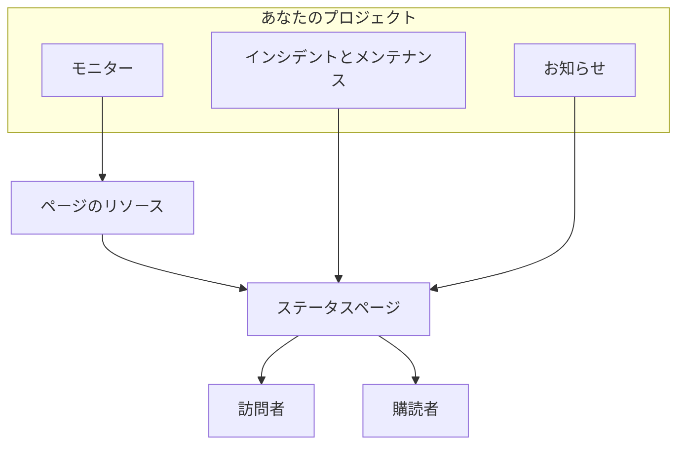

# ステータス ページ 概要

ステータスページは、監視しているすべてのものの公開された顔です。顧客が「問題は自分のところだけか」と問い合わせる代わりに開ける、1 つの URL です。公開すると決めたサービスの現在のステータス、対応中のインシデント、予定しているメンテナンス、上部に固定したいお知らせを表示します。

午前 2 時に何かが壊れたとき、サポート窓口が最初に案内するのがステータスページです。購読者への通知もここから送られるので、障害の最中ではなく、必要になる前に設定しておく価値があります。

:::cards
- [ステータスページを作成する](#ステータスページを作成する): 始めるのに必要なのは 2 つのフィールドだけで、それ以外は後から設定します。
- [表示内容を選ぶ](#ページに表示する内容を選ぶ): インシデント、エピソード、お知らせ、メンテナンス、稼働率を 1 枚のカードで。
- [見られる人を決める](#ページを見られる人を制限する): リンクを知っている全員、サインインした人のみ、またはパスワードを知っている全員。
- [ステータスページをアーカイブする](#ステータスページをアーカイブする): 削除せずにページをオフラインにします。
:::

## 仕組み

ステータスページは、上部バーの **製品** メニューの **ステータスページ** にあり、主要な製品の 1 つです。このページの内容はすべてステータスページごとのものです。プロジェクトはいくつでもステータスページを持てます。顧客向けの公開ページ、社内向けのプライベートページ、特定の市場向けの地域ごとのページなどです。

ページは、そこに置いたモニターをリソースとして表示します。インシデントと定期メンテナンスはそれらのモニターを通じてページに届き、お知らせはページに直接公開されます。訪問者はページを読み、購読者は選んだチャネルで変更のたびに通知を受け取ります。

## ひと目で

- **2 つのフィールドで作成。** 新しいステータスページが求めるのは **名前** と **説明** だけです。リソース、ブランディング、ドメインは後から設定します。
- **リソースは訪問者が見るものです。** ページの各行は **ステータスページのリソース** です。独自の表示名、ツールチップ、稼働率の設定を持つモニター（またはモニターグループ）です。グループは長いページをセクションに分け、入れ子にできます。
- **初日からプレビュー URL。** すべてのステータスページにプレビューリンクがあるので、カスタムドメインがなくても確認できます。
- **訪問者向けのルートは設定次第です。** インシデント、エピソード、お知らせ、予定されたイベントは、 **ステータスページに表示する内容**（**詳細設定** の中）のトグルがオンの間だけ表示され、購読ページは **購読者ページを表示** がオンの間だけ表示されます。
- **見られる人は 1 つの選択です。** リンクを知っている全員、サインインした人のみ（プライベートユーザー、SAML または OIDC の SSO）、パスワードを知っている全員のいずれかを、ページの **アクセス** 画面で選びます。 **その他の設定** には任意の IP 許可リストがあります。
- **購読者には自動で通知されます。** メール、SMS、Slack、Microsoft Teams、Webhook の購読者がページをフォローでき、各チャネルにはそれぞれのトグルがあります。

## キー用語

| 用語 | 意味 |
| --- | --- |
| **ステータスページ** | 独自のブランディング、ドメイン、リソース、購読者を持つ 1 つの公開（またはプライベート）ページです。モデル `StatusPage`。 |
| **リソース** | 訪問者が見る 1 行です。表示名と稼働率の設定付きでページに表示されるモニターまたはモニターグループです。 |
| **グループ** | リソースを含む名前付きのセクションです。グループはグループの中に入れ子にでき、各レベルはその下にあるすべてのステータスをまとめます。 |
| **お知らせ** | 1 つ以上のステータスページに公開するメッセージで、開始時刻と任意の終了時刻があります。 |
| **購読者** | メール、SMS、Slack、Microsoft Teams、または Webhook でページをフォローする人（または仕組み）です。 |
| **カスタムドメイン** | 自分が所有するドメイン `status.example.com` を CNAME レコードでページに向けたものです。OneUptime がその SSL 証明書を無料で発行し、更新します。 |
| **プライベートユーザー** | プライベートなステータスページにサインインできるアカウントです。OneUptime プロジェクトのユーザーとは別です。 |

## ステータスページを作成する

:::steps
### 作成フォームを開く

**ステータスページ → すべてのステータスページ** を開き、 **ステータスページを作成** をクリックします。

### ページに名前を付ける

**新しいステータスページを作成** ウィンドウで **名前**（必須、2 文字以上）と、必要なら **説明** を入力し、 **ステータスページを作成** をクリックします。

これがフォームのすべてです。戻った一覧には **名前**、**説明**、**ラベル**、**所有者** が表示され、 **ステータスページ ID**、**名前**、**説明** で絞り込めます。

### 新しいページを開く

新しいページを開くと **概要** 画面が表示されます。ここには 2 枚のカードがあります。ページ本体へのリンクがある **ステータスページのプレビュー URL** と、設定したばかりの名前、説明、ラベルを編集できる **ステータスページの詳細** です。プロジェクトにステータスページのカスタムフィールドがある場合は、その後に **カスタムフィールド** カードが続きます。
:::

API または Terraform で作成したページにも、以下の設定と同じプランが適用されます。OneUptime Cloud では、プランに含まれない設定（たとえばプライベート、非表示のリスト、カスタムの HTML・CSS・JavaScript、メールレポート、SMS・Slack・Microsoft Teams・Webhook の購読者、IP 許可リスト）をオンにしてページを作成すると `402 Payment Required` で拒否され、メッセージにプランが示されます。各設定のプランは、以下でその設定の横に示しています。このフォームのように既定のままの設定は、どのプランでも動作します。

次に、おおよそ役に立つ順に:

- ページに何かを表示するためにリソースを追加します。 [ステータス ページのリソースとグループ](/docs/status-pages/resources-and-groups) を参照してください。
- ページタイトル、ファビコン、ロゴ、カバー画像を設定し、カスタムドメインを接続します。 [ステータス ページのブランディングとドメイン](/docs/status-pages/branding-and-domains) を参照してください。
- 購読できるチャネルを決めます。 [購読者とお知らせ](/docs/status-pages/subscribers) を参照してください。
- ページに表示される内容を **詳細設定** で調整します。

## どこに何があるか

ステータスページを開くと、そのページ自身の左側メニューは 9 つのセクションに分かれています。このドキュメントのこの部分の残りを読むときの地図として使ってください。

| セクション | 内容 |
| --- | --- |
| **基本** | **概要**、**お知らせ**、**所有者**。 |
| **リソース** | 1 つの **リソース** 画面（左にグループ、右に選択したグループのモニター）と **モニタールール**。 |
| **購読者** | **メール購読者**、**SMS 購読者**、**Slack 購読者**、**MS Teams 購読者**、**Webhook 購読者**、**購読者設定**。 |
| **通知ログ** | **通知ログ**: 購読者に送信されたもの。 |
| **ブランディング** | **ブランディング**（ロゴ、タイトル、ファビコン、リンク、フッター、色、言語を 1 ページで）、**カスタムドメイン**、**HTML、CSS、JavaScript**。 |
| **セキュリティ** | **アクセス**（ページを見られる人）、**プライベートユーザー**、**SSO**、**OIDC**、**SCIM**。 |
| **AI** | **MCP**。 |
| **開発者** | **Terraform**、**API**、**AI アシスタント**: コードとしてのページ。 |
| **詳細** | **埋め込みステータス**、**レポート**、**カスタムフィールド**、**詳細設定**、**監査ログ**、**ステータスページを削除**。 |

最初に開いているのは、ページが表示するものである **基本** と **リソース** だけです。ほかのセクションはすべて、OneUptime のどのメニューでもあまり使わないセクションと同じように、折りたたまれた状態で始まります。セクションのタイトルをクリックすると、そのページが表示されます。 **詳細設定** や **メール購読者** のように、セクションのページを開いているときは、そのセクションが自動的に開きます。

探し始める前に知っておくとよい、名前の癖が 2 つあります。

- **リソース** という項目は、プロジェクトでモニターグループが有効な場合にのみ **リソース** という名前です。それ以外の場合は **モニター** という名前です。どちらの場合も同じ画面です。
- グループ専用のページはありません。グループとリソースは統合され、古いルート `/groups` は今ではリソース画面にリダイレクトされます。

特定のページの外では、 **ステータスページ** セクション自体が **すべてのステータスページ** を一覧表示し、 **その他** セクションに **お知らせ** があります。折りたたまれた **設定** セクションには **お知らせテンプレート**、**購読者テンプレート**、**カスタムフィールド**、**所有者ルール**、**ラベルルール** があり、これらはプロジェクト全体に適用され、すべてのステータスページで共有されます。折りたたまれた **詳細** セクションには **アーカイブ済み** があります。これはオフラインにしたステータスページです（[ステータスページをアーカイブする](#ステータスページをアーカイブする) を参照）。

**ラベルルール** と **所有者ルール** は、新しいステータスページにラベルを付け、所有者を割り当てます。ルールには 2 つのステップがあり（ステータスページが満たす必要がある条件である **一致**、次にルールが追加するものである **ラベル** または **所有者**）、その **名前** は選んだ内容から入力されます。新しいルールは少なくとも 1 つのラベルまたは所有者を追加する必要があります。編集時にこれが強制されることはなく、何も追加しない古いルールは一覧で **何も追加しない** と表示されます。 [ラベルルールと所有者ルール](/docs/configuration/label-and-owner-rules) を参照してください。

## 訪問者が見るもの

公開ページは独立したアプリケーションで、少数のルートがあります。

- `/`: **概要**。
- `/incidents` と `/incidents/:id`: インシデントの一覧と個々のインシデント。
- `/announcements` と `/announcements/:id`。
- `/scheduled-events` と `/scheduled-events/:id`。
- `/subscribe/email`、`/subscribe/sms`、`/subscribe/slack`、`/subscribe/microsoft-teams`、`/subscribe/webhooks`。
- `/confirm-subscription/:id`、`/update-subscription/:id`、`/unsubscribe/:token`: 購読者が受け取るメッセージ内のリンク。
- `/rss`: フィード。
- `/login`、`/sso`、`/master-password`: プライベートページでのみ意味があります。

上部のナビゲーションバーには常に **概要** が表示され、それ以外はオンの場合にのみ表示されます。 **インシデント**、**お知らせ**、**予定されたイベント** にはそれぞれのトグルが必要で、 **購読する** には **購読者ページを表示** と、少なくとも 1 つのオンの購読チャネルの両方が必要です。プライベートページには **ログアウト** 項目もあります。

個々のインシデント、エピソード、お知らせ、予定されたイベントは、履歴の期間にかかわらず、ページが一覧に表示する場合にのみ開きます。プライベートなインシデントやエピソード、ステータスページで非表示のもの、ステータスページで非表示の予定されたイベント、後で表示するよう予定されたお知らせは、リンクからも見つかりません。

### 概要ページ

概要は、ほとんどの訪問者が見るページです。上から順に次のものを表示します。

1. **進行中のお知らせ**: 開始時刻が過ぎ、終了時刻がまだ来ていないお知らせ。
2. **全体のステータスバナー**: すべてのリソースが影響を受けているか、一部だけかをまとめる 1 行。
3. **全体の稼働率**（オンにした場合）: すべてのリソースが稼働している間、全体のステータスバナーの末尾に表示されます。既定ではオフです。
4. **リソースグループ**: それぞれのリソース、その現在のステータス、稼働率の履歴バーを含みます。
5. **進行中のインシデント**（進行中のエピソードを含む）。
6. **予定されたメンテナンスイベント**。

コンテンツのない新しく作成したページは空の状態を表示し、ダッシュボードからリソースを追加するよう促します。これが **リソース** 画面に移動する合図です。

訪問者が見る概要は最大 15 秒前のもので、ページから取り除いたものは 1 秒以内に消えます。ステータスページで非表示にした、プライベートにした、ほかのページに限定した、または削除したインシデント、エピソード、予定されたイベント、終了、延期、または削除したお知らせ、削除した公開メモ、ページから取り除いたか削除したリソース、グループ、モニターです。新しいタイトルなどのそのほかの変更は、その 15 秒以内に反映されます。

インシデントをこのページに載せるもの、外すものについては、 [インシデントの状態と重大度](/docs/incidents/states-and-severities) を参照してください。

## ページに表示する内容を選ぶ

訪問者が見るものは 1 枚のカードで設定します。 **ステータスページ → 対象のページ → 詳細 → 詳細設定** の **ステータスページに表示する内容** です。ページが表示できる各リストの行があり、その後に **稼働率履歴**（全体の稼働率と、ダウンタイムとしてカウントするステータスを含む）と「Powered by OneUptime」の行が続きます。編集ボタンはありません。トグルは切り替えた時点で、日数はボックスから離れるか Enter を押した時点で、リストからの選択は選んだ時点で保存されます。

- **インシデントを表示**（`showIncidentsOnStatusPage`）: 既定でオンです。その下の **過去 … 日間を表示**（`showIncidentHistoryInDays`、既定は 14）はインシデント一覧をどこまでさかのぼるかを設定し、 **インシデントラベルを表示**（`showIncidentLabelsOnStatusPage`）は既定でオフです。
- **このページに限定されたインシデントのみ表示**（`onlyShowScopedIncidents`）: これもインシデントの行にあり、既定でオフです。オンにすると、ページは **次のステータスページに限定** でこのページに限定されたインシデントだけを表示し、購読者に通知します。どのページにも限定されていないインシデントは、モニター、Slack、Microsoft Teams、API、AI が自動で開いたものも含め、誰かがこのページを追加するまでこのページには届きません。どのインシデントがエピソードをページに持ち込むかもこれで決まるため、 **インシデントを表示** がオフでも使用できます。モニターを共有しながら異なる対象者に向けたページについては、 [対象者ごとのステータス ページ](/docs/status-pages/one-status-page-per-audience) を参照してください。
- **エピソードを表示**（`showEpisodesOnStatusPage`）: 既定でオンで、 **過去 … 日間を表示**（`showEpisodeHistoryInDays`、既定は 14）と **エピソードラベルを表示**（`showEpisodeLabelsOnStatusPage`、既定でオフ）があります。エピソードは独自のエンドポイントを持つ独自のモデルで、インシデントのビューではありません。
- **お知らせを表示**（`showAnnouncementsOnStatusPage`）: 既定でオンで、 **過去 … 日間を表示**（`showAnnouncementHistoryInDays`、既定は 14）があります。
- **定期メンテナンスイベントを表示**（`showScheduledMaintenanceEventsOnStatusPage`）: 既定でオンで、 **過去 … 日間を表示**（`showScheduledEventHistoryInDays`、既定は 14）と **イベントラベルを表示**（`showScheduledEventLabelsOnStatusPage`、既定でオフ）があります。
- **稼働率履歴**: ページの稼働率に関するすべてを 1 行で:
  - **過去 … 日間を表示**（`showUptimeHistoryInDays`）は、各リソースの横にある稼働率バーの長さです。既定は 90 で、1 から 90 の間である必要があります。リソースやグループの **稼働率を表示** と **ステータス履歴チャートを表示** のオプションはすべてこの数値を読み取り、全体の稼働率も同様です。
  - **全体の稼働率を表示**（`showOverallUptimePercentOnStatusPage`）: 既定でオフです。オンにすると、すべてが稼働している間、全体のステータスバナーの末尾にページ全体の稼働率（リソースとグループの平均）が表示されます。オンの間は **精度**（`overallUptimePercentPrecision`）で表示する小数点以下の桁数を選びます: `99%`、`99.9%`、`99.99%`（既定）、`99.999%`。各リソースと各グループには独自の精度があります。
  - **ダウンタイムとしてカウント**（`downtimeMonitorStatuses`）: その時間がページ上のすべての稼働率（各リソース、各グループ、全体）に不利にカウントされるモニターステータスです。各ステータスはそれぞれの色のラベルです。一覧から追加するか **×** で削除すると、変更はすぐに保存されます。新しいステータスページは、プロジェクトの稼働中でないすべてのステータスで始まります。少なくとも 1 つのステータスは常に残ります。ステータスがないとページ上のすべての稼働率が 100% になってしまうため、最後の 1 つは削除できません。
- **「Powered By OneUptime」ブランディングを表示**: 既定でオンなので、訪問者向けのフッターには「Powered by OneUptime」と表示されます。オフにすると行が非表示になります。列はこれを逆の意味で `hidePoweredByOneUptimeBranding` として保存します。

**オフにしたリスト** は、ナビゲーションバーの項目がある場合はそれとともにページから消えます。その公開エンドポイントはリクエストを拒否し、ページの購読者にはその種類のイベントが通知されません。その行には自分のトグルだけが表示されます。非表示のリストがどこまでさかのぼるか、ラベルを表示するかは、何も変えません。

**プラン。** OneUptime Cloud では、プランで変更できない設定の横に、必要なプランが表示されます。4 つのリストのトグル、3 つのラベルのトグル、エピソードの履歴には **Growth** が必要です。全体の稼働率の表示と「Powered by OneUptime」の行の非表示には **Scale** が必要です。そのほかの履歴の期間、 **稼働率履歴**、**精度**、**ダウンタイムとしてカウント**、**このページに限定されたインシデントのみ表示** はどのプランでも変更でき、それぞれ個別に保存されます。全体の稼働率がすでにオンのページは、どのプランでもその精度を変更できます。設定を新しいページと同じ状態に戻すこと（リストを再び表示する、ラベルや全体の稼働率を非表示にする、「Powered by OneUptime」の行を表示する、エピソードの履歴を 14 日に戻す）はどのプランでも動作するので、試用期間中に変更したものがプランの不足でそのまま残ることはありません。トグルは、まだ元に戻せることと、再び変更するにはどのプランが必要かを示します。

ページに **購読する** 項目を表示するかどうか（**購読者ページを表示**、`showSubscriberPageOnStatusPage`、既定でオン）と、訪問者が購読できるチャネルは、この画面では設定しません。どちらも **購読者 → 購読者設定** の **チャネル** カードにあります（[購読チャネル](/docs/status-pages/subscribers#購読チャネル) を参照）。

カードの下には、ステータスページ自身の設定を、再びインポートできるファイルにダウンロードする **ステータスページを JSON としてエクスポート** と、 **Archive status page**（[ステータスページをアーカイブする](#ステータスページをアーカイブする) を参照）があります。全体の稼働率とダウンタイムのステータスは、以前はここでそれぞれ **編集** ボタンの後ろにある 2 枚の独立したカードでしたが、今はカードの行です。

**色の場所。** 稼働率バーの色はここにはありません。 **デフォルトのバーの色** とバーの色のルールは、 **ステータスページ → 対象のページ → ブランディング → ブランディング** の **その他の設定** にあります。テーマやブランドカラーの設定はどこにもありません。これらのコントロールを超えるものはすべて **カスタム CSS** で行います。

## 公開する前にプレビューする

各ステータスページの **概要** 画面には、ページへの直接リンクがある **ステータスページのプレビュー URL** カードがあります。リソースを追加している間や、カスタムドメインがまだない間に使ってください。

内部的には、すべての公開ルートに `/status-page/{statusPageId}/...` のプレビュー用の対があります。プレビューの概要、プレビューのインシデント一覧、プレビューの購読ページなどです。そのため、ダッシュボードのプレビューから取った URL やスクリーンショットは、カスタムドメインを接続した後に顧客が見るものとは一致しません。ランブックやメールに貼り付けるリンクは確認してください。

## ページを見られる人を制限する

すべてのステータスページが一般向けというわけではありません。ページを見られる人は 1 つの選択で、 **ステータスページ → 対象のページ → セキュリティ → アクセス** の最初のカード **このステータスページを見られる人** で決めます。

- **リンクを知っている全員**: ページは公開されます。新しいステータスページはすべてここから始まります。
- **サインインした人のみ**: 訪問者は `/login` に移動し、プライベートユーザーとして、または SSO や OIDC のプロバイダー（下記参照）でサインインします。選択肢の下では、ページに設定されたサインイン（プライベートユーザーの数と、SSO と OIDC がオンかどうか、それぞれの画面へのリンク付き）がカードに一覧表示され、これが選択されている間は、まだ誰もサインインできない場合に警告します。
- **パスワードを知っている全員**: 訪問者は `/master-password` に移動し、あなたが共有したパスワードでページのロックを解除します。アカウントは誰にも必要ありません。これを選ぶと、ページにパスワードがない場合は同じダイアログでパスワードを求められます。すでにある場合は、そのまま使うか、新しいものを入力できます。その後は、選択肢の下の **パスワードを変更** で置き換えます。パスワードはハッシュとして保存され、再表示できません。古いパスワードを入力した人は、最大 7 日間ページを見続けられます。

選択肢を選ぶと、訪問者にとって何が変わるかを示す確認が求められ、すぐに保存されます。編集ボタンはありません。

**画像。** ページが表示するもの（公開メモ、お知らせ、説明）に含まれる画像は、推測できない長い独自のアドレスで開き、サインインなしで機能するため、購読者へのメールにも表示できます。ページ自体は引き続きサインインまたはパスワードを求めます。

**保存されるもの。** この選択は 3 つの列で、API と Terraform は以前と同じように読み書きします: `isPublicStatusPage`、`enableMasterPassword`、`masterPassword`。訪問者がパスワードを求められるのは、公開されておらず、 `enableMasterPassword` がオンでパスワードが設定されたページだけです。トグルがオンでもパスワードのないプライベートページは、サインインページです。 **リンクを知っている全員** を選ぶと `enableMasterPassword` もオフになります。公開ページがパスワードを求めることはないためです。 **アクセス** 画面は、選択によって変わる列だけを書き込みます。

**プラン。** OneUptime Cloud では、ページをプライベートにするには **Growth** プランが必要です。下位のプランでは、2 つのプライベートな選択肢に必要なプランが表示され、選択できません。再び公開にする（**リンクを知っている全員**）のはどのプランでも動作するので、試用期間の終了後や下位のプランへの変更後にプライベートのまま残ったページはいつでも再公開できます。ダイアログには、再びプライベートにするには **Growth** が必要であることが示されます。 **サインインした人のみ** から **パスワードを知っている全員** への変更は、 **パスワードを変更** と同様にどのプランでも動作します。

### プライベートユーザー

サインインできる人は **ステータスページ → 対象のページ → セキュリティ → プライベートユーザー** で追加します。 **一括追加** アクションがあり、メールアドレスの一覧を貼り付けると、それぞれに招待メールが届きます。プライベートユーザーには、OneUptime プロジェクトのアカウントとは別に、パスワードを忘れた場合とリセットのための独自の流れがあります。

**プライベートユーザーとパスワードは合算されません。** **パスワードを知っている全員** が選択されている間、プライベートユーザーはサインインできず（彼らもパスワードを入力します）、 **プライベートユーザー** 画面には、 **アクセス** に戻るリンクとともにそのことが表示されます。

### SSO と OIDC

ID プロバイダーに接続されたプライベートページでは、 **ステータスページ → 対象のページ → セキュリティ → SSO** で SAML を設定します。サインイン URL、発行者、x509 証明書を入力し、署名とダイジェストの方式は **その他の項目** で入力します。 **ステータスページ → 対象のページ → セキュリティ → OIDC** では OpenID Connect を設定します。発行者、クライアント ID、シークレットを入力し、ディスカバリー URL、スコープ、クレーム名は **その他の項目** で入力します。 **SCIM** は IdP からプライベートユーザーを自動でプロビジョニングします。OneUptime Cloud では、3 つとも Scale プラン以上が必要です。セルフホストのインストールでは、SSO と OIDC はすべてのエディションに含まれ、SCIM には [エンタープライズ版](/docs/self-hosted/enterprise) が必要です。

ステータスページの SSO または OIDC プロバイダーをオフにするか削除すると、そのプロバイダーでサインインしたプライベートユーザーはサインアウトされます。セッションは次のリクエストで終了し、プロバイダーを再びオンにしても戻りません。再度そのプロバイダーでサインインします。新しい証明書やクライアントシークレット、ほかの URL、新しい名前では、全員がサインインしたままです。SSO を必須にしているページでは、最後のプロバイダーをオフにすると、プロバイダーを再びオンにするか **ログインに SSO を必須にする** をオフにするまで、誰もサインインできなくなります。別のプロバイダーに切り替えるには、古いものをオフにする前に新しいものを設定してテストしてください。

プロバイダーの下にある **SSO 設定** カードには **ログインに SSO を必須にする** トグル（`requireSsoForLogin`、既定でオフ）があり、切り替えた時点で保存されます。オンにすると、最初に確認が求められます。それ以降、プライベートユーザーはメールとパスワードでサインインできなくなり、SSO または OIDC プロバイダーが通した人だけがページを見られるためです。オンにする前に、その画面のリンクで SSO をテストしてください。これは **サインインした人のみ** が選択されている間だけ意味を持ち、 **アクセス** 画面ではその選択の下に **SSO 必須** として表示されます。オンの間は、メールとパスワードでサインインしたプライベートユーザーも次のリクエストでサインアウトされます。数えられるのは、SSO または OIDC プロバイダーが開始したセッションだけです。OneUptime Cloud では、オンにするには **Scale** プランが必要で、オフにするのはどのプランでも動作します。Scale の試用期間の終了後や下位のプランへの変更後も SSO を必須にしたままのページは、誰かがオフにするまで必須のままです。その **SSO** と **OIDC** のページでは、プランの案内の下にそのためのトグルが表示されます。

### IP 許可リスト

**アクセス** の **その他の設定** にある **IP 許可リスト** セクション（`ipWhitelist` 列）は、ページを既知のネットワークに限定します。ページの対象者にかかわらず適用され、ほかのアドレスからの訪問者は、パスワードやプライベートユーザーのアカウントがあっても拒否されます。1 行に 1 つずつ、IPv4 または IPv6 のアドレス、または `10.0.0.0/8` のような IPv4 の範囲を入力します。どちらでもない行は保存時に拒否されます。すべてのアドレスを許可するには空のままにします。リストが有効な間は、折りたたまれた **その他の設定** の見出しに **IP 許可リスト** とそのエントリ数が表示されます。OneUptime Cloud では、変更するには **Scale** プランが必要で、空にするのはどのプランでも動作します。

## 埋め込みバッジと RSS フィード

ページ自体以外の場所でステータスを表示する 2 つの方法です。

**埋め込みステータスバッジ。** **ステータスページ → 対象のページ → 詳細 → 埋め込みステータス** で **埋め込みステータスバッジを有効化**（`enableEmbeddedOverallStatus`、既定でオフ）をオンにし、 **セキュリティトークン** カードの **トークンを再生成** をクリックしてバッジにトークン（`embeddedOverallStatusToken`）を与えます。バッジは `/api/status-page/badge/<status-page-id>?token=<token>` から配信され、画面ではコピー用のスニペットとともに **バッジのプレビュー** に表示されるので、現在の全体のステータスをドキュメント、アプリのフッター、マーケティングページに載せられます。

**RSS フィード。** すべてのステータスページは `/rss` を配信します。 **ブランディング** で設定した **ページタイトル**（なければページの名前）を使った「{ページタイトル} Updates」というタイトルのフィードで、項目は `Incident: `、`Announcement: `、`Scheduled Maintenance: ` で始まります。メールで購読するより、更新をフィードリーダーやチャットボットに取り込みたい人に便利です。

データを自分で取得したい場合、ステータスページは概要、インシデント、定期メンテナンスイベント、お知らせ、エピソードの公開読み取りエンドポイントに基づいています。 [公開 API](/docs/status-pages/public-api) を参照してください。

## ステータスページをアーカイブする

ステータスページをアーカイブすると、削除せずにオフラインにできます。アーカイブされたステータスページは:

- **オフラインになります。** その URL、カスタムドメイン、埋め込みバッジ、公開 API、MCP サーバーは、ページが存在しないかのように応答する（「Status Page not found」）ため、訪問者はアーカイブされたページと、存在したことのないページを区別できません。ダッシュボードのプレビューリンクも機能しなくなります。
- **購読者に何も送信しません。** インシデント、エピソード、メンテナンス、お知らせの通知も、レポートも、購読の確認も送信されません。誰も購読できません。
- **ステータスページの一覧から消えます。** **ステータスページ → 詳細 → アーカイブ済み** にあります。
- **すべてを保持します。** リソース、グループ、ブランディング、ドメイン、プライベートユーザー、購読者は保持されるため、アーカイブを解除するとページは元どおりオンラインに戻ります。

ステータスページをアーカイブするには、ページを開いて **詳細 → 詳細設定 → Archive status page** に移動します。複数をアーカイブするには、 **ステータスページ** 一覧で選択して **アーカイブ** を選びます。元に戻すには、 **ステータスページ → 詳細 → アーカイブ済み** を開いて選択し、 **アーカイブ解除** を選ぶか、ページを開いてページ上部のバナーにある **アーカイブ解除** をクリックします。

## 次のステップ

:::cards
- [ステータス ページのリソースとグループ](/docs/status-pages/resources-and-groups): モニターをページに置き、セクションに整理します。
- [ステータス ページのブランディングとドメイン](/docs/status-pages/branding-and-domains): ロゴと色、そして独自ドメインでのページ。
- [購読者とお知らせ](/docs/status-pages/subscribers): 5 つの購読チャネルとお知らせの投稿。
- [対象者ごとのステータス ページ](/docs/status-pages/one-status-page-per-audience): 顧客、拠点、地域ごとのページと、各インシデントを知らせるページ。
:::
