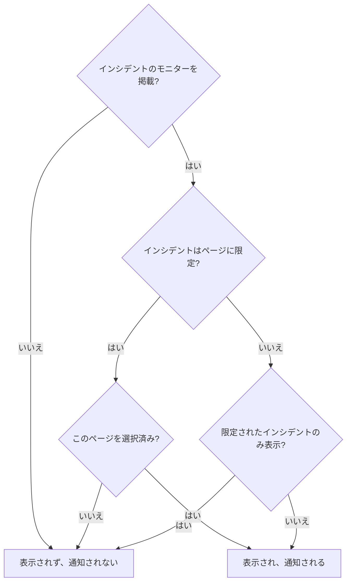

# 対象者ごとのステータス ページ

必要な知らせは人によって違います。顧客はほかの顧客の障害について聞きたくありませんし、ある拠点のスタッフは、別の拠点のネットワークが落ちるたびにメールを受け取りたくはありません。OneUptime では、対象者の単位はステータスページです。ページごとに独自の購読者、独自のブランディング、独自の公開範囲があります。そこで、対象者ごとに専用のページを用意し、インシデントごとにどのページに知らせるかを決めます。

以前は、共有のインフラがこれを難しくしていました。インシデントはモニターを通じてステータスページに届くので、10 の拠点ページで共有するモニターは、2 拠点に影響した障害を 10 拠点すべてに知らせていました。回避策は、拠点の組み合わせごとにページかモニターを用意することだけでした。このページでは、これを解決する設定を説明します。

- インシデントの **次のステータスページに限定**。選んだページにだけ表示し、通知します。
- ステータスページの **このページに限定されたインシデントのみ表示**。まだ誰も範囲を決めていないインシデントは、誰かが決めるまで、これらのどのページにも届きません。モニター、Slack、Microsoft Teams、API、AI が自分で起こすインシデントも同様です。
- インシデントの作成をどのページに知らせたかの記録。後から追加したページには 1 回だけ知らせ、ほかのページには二度と知らせません。
- インシデントを宣言する前や公開メモを投稿する前に、誰に知らされるかを示す **通知先** の概要と、各ページの購読者が受け取るものを示す **プレビュー**。

:::cards
- [設定する](#対象者ごとのページを設定する): 対象者ごとのページと、範囲の決まっていないインシデントをそこから遠ざけるスイッチ。
- [インシデントを限定する](#インシデントをステータスページに限定する): 宣言するとき、または後からページを選びます。
- [ページを追加・除外する](#ステータスページの追加と除外): 追加したページに誰が知らされるか、ページを外すと何が取り消されるか。
- [各メッセージに含まれるもの](#各メッセージに含まれるもの): すべてのページが受け取る値と、それが各対象者に伝えること。
:::

## 使いどころ

- **マネージドサービスプロバイダー**。顧客ごとにステータスページがあり、顧客が共有するモニターを使っている場合。
- **拠点、工場、地域を持つ組織**。それぞれに知らせるべきスタッフがいる場合。
- **社内 IT**。部門や建物ごとにページがある場合。

対象者が自分で選ぶことで十分なら、ページは 1 つで足りるかもしれません。購読者に関心のあるリソースを選ばせましょう（[購読者とお知らせ](/docs/status-pages/subscribers) を参照）。インシデントごとに対象者に代わって選ぶ場合や、ある対象者に別の対象者のインシデントを一切見せてはならない場合は、対象者ごとのページを使います。

## インシデントがステータスページに届く仕組み

インシデントはモニターを通じてステータスページに届きます。ページのリソースの 1 つがインシデントのモニターの 1 つであるとき（直接、またはページ上のモニターグループを通じて）、ページはインシデントを表示し、その購読者に通知します。これを絞り込む設定が 2 つあります。

- インシデントの **次のステータスページに限定**（`statusPages`）。空のままにすると、これまでどおり、インシデントはそのモニターを掲載しているすべてのページに届きます。ページを選ぶと、モニターを掲載しているページの **うち**、選んだページにだけ届きます。
- ステータスページの **このページに限定されたインシデントのみ表示**（`onlyShowScopedIncidents`、既定でオフ）。オンにすると、特定のステータスページに限定されていないインシデントを、ページは表示せず、誰にも通知しません。



インシデントのモニターの 1 つを掲載しているページでは、次のようになります。

| インシデントの状態 | **このページに限定されたインシデントのみ表示** がオフのページ | オンのページ |
| --- | --- | --- |
| どのステータスページにも限定されていない | 表示され、通知される | 表示されず、通知されない |
| ステータスページに限定され、このページが選ばれている | 表示され、通知される | 表示され、通知される |
| ステータスページに限定されているが、このページではない | 表示されず、通知されない | 表示されず、通知されない |

インシデントのモニターをどれも掲載していないページは、何を選んでもそれを表示せず、モニターのないインシデントはステータスページの購読者に一切通知しません。その上で通常のルールも適用されます。インシデントは **ステータスページに表示** がオンでプライベートでないこと、ページは **インシデントを表示** がオンであることが必要で、一部のリソースやイベントタイプだけを選んだ購読者は、選んだものだけを受け取ります。

インシデントがどのページに届くかで決まるものは、すべて同じルールに従います。

- 公開ステータスページのインシデント一覧、概要、インシデント自身のページ、そしてステータスページの [公開 API](/docs/status-pages/public-api)。
- インシデントの作成、状態の変更、公開メモ、ポストモーテムで送られるメール、SMS、Slack、Microsoft Teams、Webhook のメッセージ。
- メールで送られるステータスページのレポートのインシデント件数。ページが表示するインシデントだけを数えます。

インシデントエピソードは、そのインシデントの少なくとも 1 つがページに届くとき、そのページに届きます。エピソードの通知はそのインシデントが届くすべてのページに送られ、どのインシデントも届かないステータスページでは、エピソードのページは見つかりません。プライベートなインシデントはどのページにも届かないので、エピソードをページに載せることはなく、プライベートなエピソードはどのページにも表示されません。

## 対象者ごとのページを設定する

:::steps
### 対象者ごとにステータスページを作成する

対象者ごとに 1 つのページを作成します。たとえば `Site 01` から `Site 10` です。対象者が社内なら、ページをプライベートにします（[ページを見られる人を制限する](/docs/status-pages/index#ページを見られる人を制限する) を参照）。プライベートなページの購読者も、すべてのメッセージに付いているリンクから、サインインせずに購読を解除できます（[購読の管理と解除](/docs/status-pages/subscribers#購読の管理と解除) を参照）。 `Region East` のようなラベルを付けておくと、選択欄でそのラベルの付いたすべてのページを 1 クリックで追加できます。

### 共有モニターを各ページに載せる

共有モニターをリソースとして各ページに追加します（[ステータス ページのリソースとグループ](/docs/status-pages/resources-and-groups) を参照）。 **リソース → モニタールール** のルールを使えば、モニターのラベルからこれを自動で行えます。

### 「このページに限定されたインシデントのみ表示」をオンにする

これらの各ページでオンにします。 **ステータスページ → 対象のページ → 詳細 → 詳細設定** の **ステータスページに表示する内容** カードで、 **インシデントを表示** の下にあり、切り替えた時点で保存されます。それ以降は、誰かが選ばない限り、拠点のページには何も届きません。

### 各対象者の購読者を追加する

スタッフには **メール購読者** の **一括追加** を使い、 `site03-all@` のようなメーリングリストより各人のアドレスを優先してください。リストの誰でも、リストの全員の購読を解除できてしまうためです。追加した購読者が購読を解除すると、ページの所有者と、その購読者を追加した人にメールが届きます（[共有アドレスとメーリングリスト](/docs/status-pages/subscribers#共有アドレスとメーリングリスト) を参照）。

### 対応者がステータスページを読めるようにする

選択欄に表示されるのは本人が読めるステータスページだけで、インシデントのロールではステータスページを読めません。対応者には、インシデントのロールに加えて **Status Page Viewer** ロールを付与してください。特定のラベルの付いたページに限定することもできます。これがないと、選択欄は空になります。

### 各メッセージの内容を決める

**インシデント → 設定 → カスタムフィールド** で、チームが毎回答えるインシデントのカスタムフィールドを定義します。たとえば `Impact`（ドロップダウン）、 `Expected Resolution`（日時）、 `Acknowledgement`（はい/いいえのスイッチ）です。尋ねて一覧表示したい **順序** にドラッグし、宣言フォームで尋ねるように **作成時に表示** を、回答が必須のものには **作成時に必須** を、どの対象者が読んでもよいものには **購読者への通知に含める** をオンにします。それらは、すべてのページの既定のメールに入ります。 [カスタムフィールド](/docs/incidents/settings#カスタムフィールド) を参照してください。

### 各ページのメールをブランド化する（任意）

**Scale** プランでは、各ページに **カスタム SMTP 設定** を設定し、インシデントのイベント用のカスタムテンプレートを紐付けます。テンプレートでは `{{incident.customFields.<key>}}` で任意のフィールドを配置できます。テンプレートを書いている間、その下の **ライブプレビュー** が、サンプルの値で埋めた状態を表示します。 [カスタムテンプレートに必要なもの](/docs/status-pages/subscribers#カスタムテンプレートに必要なもの) を参照し、 `{{affectedStatusPages}}` を使う前に [各メッセージに含まれるもの](#各メッセージに含まれるもの) も確認してください。

### ページを選んだインシデントテンプレートを保存する（任意）

`Region East outage` テンプレートに、東部の拠点ページと、カスタムフィールドの既定の回答を持たせられます。

### 最初の障害の前に各ページのメールを確認する

共有モニターと 2 つの拠点ページを選んで **インシデントを宣言** を始め、送信前の概要で **はい** の横の **プレビュー** を開きます。各ページの購読者が受け取るメールと、使われるテンプレートとその理由が表示されます。 **自分にテスト送信** は、自分の受信トレイに 1 通送ります。インシデントを宣言するまで、ほかの誰にも何も送られないので、終わったら送信せずにフォームを離れてください。 [通知される人](#通知される人) を参照してください。
:::

## インシデントをステータスページに限定する

### 宣言するとき

**インシデント → すべてのインシデント → インシデントを宣言** の **影響を受けるリソース** ステップでは、モニターとその他のリソースの後の **その他の項目** に **次のステータスページに限定** があります。プレースホルダーの **モニターを掲載しているすべてのステータスページ** が、空のままにした場合の意味です。ページを名前で選ぶか、選択欄の **ラベル** タブを開いてラベルを選び、そのラベルの付いたすべてのページを追加します。

フォームは次の場合に警告します。

- 選んだページがインシデントのモニターをどれも掲載していないか、モニターがまったく添付されていない場合。インシデントはそのページに表示されず、その購読者にも通知されません。
- 同じステップのモニターのすぐ下にある **変更後のモニターステータス** も設定した場合。 [モニターのステータスは共有される](#モニターのステータスは共有される) を参照してください。
- **インシデントの詳細** ステップの **その他の項目** にある **プライベートインシデント** にもチェックを入れた場合。プライベートなインシデントは、選んだページを含むすべてのステータスページで非表示になります。

**影響を受けるリソース** のすぐ後の **詳細** ステップでは、 **作成時に表示** が付いたインシデントのカスタムフィールドを尋ねます（[インシデントの宣言](/docs/incidents/declaring-incidents) を参照）。その回答は、インシデントが届くすべてのページに送られます。カスタムフィールドの値は、ステータスページではなくインシデントに属します。

**テンプレートから作成** は、テンプレートからこのフィールドを埋めます。テンプレートのページは、作成時にはその **影響を受けるリソース** ステップで、その後はその **ステータスページの範囲** カード（**インシデント → 設定 → インシデントテンプレート**）で設定します。テンプレートのほかのフィールドと同様に、自分で設定した一覧が優先されます。テンプレートのページは、ステータスページを読めない対応者に対しても埋められます。テンプレートを設定した人が、そこから宣言するすべての人のために選んだものだからです。

### 通知される人

**影響を受けるリソース** ステップの **その他の項目** で、選択欄のすぐ下にある **ステータスページの購読者に通知** の下と、送信前の概要で、フォームはインシデントが誰に届くかを表示します。

> 通知先:
>
> - Site 03 (最大 メール 41 名)
> - Site 07 (最大 メール 18 名)

その下の **通知されないページ:** には、モニターを掲載していても知らされないページとその理由が一覧表示されます。インシデントの限定先のページではない、そのページに限定されたインシデントのみを表示するページである、またはインシデントを表示しないページである、のいずれかです。

誰にも知らされない場合、概要には何も表示されません。インシデントにモニターがない、どのステータスページもそれを掲載していない、ページにまだ購読者がいない、 **ステータスページの購読者に通知** がオフ、またはインシデントがプライベートの場合です。警告するのはステータスページの範囲が理由の場合だけで、除外されるページを名前で示します。インシデントが限定されておらず、モニターを掲載しているページが限定されたインシデントのみを表示する場合、ほかのページに限定されている場合、または限定先のページがそのモニターをどれも掲載していない場合です。概要では、 **ステータスページの購読者に通知** はほかのすべてのボックスと同じく **はい** または **いいえ** と表示され、 **はい** の横に **プレビュー** があります。ボックスがオフ、インシデントがプライベート、またはモニターが添付されていない間は表示されません。

インシデントの **公開メモ** ページでメモを書くときにも、その時点のインシデントについて、 **ステータスページの購読者に通知** の下に同じ概要が表示されます。そこでは、インシデントがステータスページで非表示の場合にもそのことを示します。その場合は何も送られないためです。

件数は「最大」です。各ページの確認済みで購読を解除していない購読者を、チャネルごとに数えたもので、一部のリソースやイベントタイプだけを選んだ購読者には、このメッセージが届かない場合があります。読めないページの名前は表示されません。それらは「アクセス権のないステータスページがほかに … 件」として数えられます。

概要の **はい** の横とメモのチェックボックスの横にある **プレビュー** は、購読者が受け取るものを表示します。ページを選ぶと、その購読者が受け取るとおりのメールが件名とともに表示され、使われるテンプレートとその理由も表示されます。たとえば、ページに **カスタム SMTP 設定** がないため、ページのカスタムテンプレートは使われない、などです。 **自分にテスト送信** は、そのページのメールを自分のアカウントのメールアドレスに送り、ほかの誰にも送りません。読めないページは数えられますが、プレビューはされません。 [送信前にメールをプレビューする](/docs/status-pages/subscribers#送信前にメールをプレビューする) を参照してください。

### 宣言した後

インシデントを開き、 **詳細 → 設定** に移動します。 **ステータスページの範囲** カードにはインシデントの限定先のページが一覧表示され、 **ステータスページの範囲を編集** で変更できます。インシデントの **概要** には同じ一覧が **ステータスページの範囲** として読み取り専用で表示され、 **設定で変更** リンクがあります。

**インシデント → すべてのインシデント** では、 **ステータスページ** フィルターで、選んだページに限定されたインシデント、またはどのページにも限定されていないインシデントを見つけられます。

### API で

`statusPages` はステータスページ ID の一覧で、 `POST /api/incident` とインシデントの更新、そしてインシデントテンプレートで使います。すべてのページはインシデントのプロジェクトに属している必要があり、別のプロジェクトのページは拒否されます。追加するページは、選択欄と同じく自分が読めるページである必要もあり、そうでなければリクエストは拒否されます。インシデントやテンプレートがすでに持っているページは、読めるかどうかにかかわらず保持され、読めるインシデントテンプレートのページは、インシデントを宣言するときに選べます。ここからさらに 2 つの列が決まり、どちらも自分で設定するものではありません。

- `isScopedToStatusPages` は `statusPages` から算出されます。これに送った値は無視されます。
- `statusPagesNotifiedOnCreation` は、インシデントの作成を知らされたページの記録です。 [ステータスページの追加](#ステータスページの追加) を参照してください。

何も送らずにインシデントが誰に届くかを確認するには、対象者のエンドポイントを呼び出します。

```bash
curl -X POST https://oneuptime.com/api/incident/subscriber-audience \
  -H "apikey: $ONEUPTIME_API_KEY" \
  -H "Content-Type: application/json" \
  -d '{
    "monitorIds": ["<monitor-id>"],
    "statusPageIds": ["<status-page-id>"]
  }'
```

既存のインシデントについては、代わりに `{"incidentId": "<incident-id>"}` を送ります。応答には、通知される各ページとチャネルごとの件数（`email`、`sms`、`slack`、`microsoftTeams`、`webhook`）、除外されるページとその理由、呼び出し元が読めないページの数を示す `hiddenStatusPageCount` が含まれます。アドレスが返されることはありません。

## まだ誰も範囲を決めていないインシデント

モニターの条件、Slack、Microsoft Teams、API、AI はどれもインシデントを自分で起こせますが、共有モニターの障害がどの拠点に影響するかは、どれも知りません。そうしたインシデントはどのページにも限定されていないので、モニターを掲載しているすべてのページが 1 分ほどでそれを表示し、その購読者に通知します。購読者に一度送ったメールは取り消せません。

これを止めるのが **このページに限定されたインシデントのみ表示** です。これがオンのページは、範囲の決まっていないインシデントをすべて無視します。インシデントは起こされ、オンコールポリシーは対応者を呼び出し、所有者にも知らされますが、これらのページには何も届きません。その後、対応者が誰に影響するかを見極め、インシデントの **設定** タブでそのページを追加し、 **新しく追加したページにインシデント作成の通知を送信** にチェックを入れます。それらの購読者には 1 分ほどで知らされます。

## ステータスページの追加と除外

### ステータスページの追加

ページの購読者がインシデントの作成を知らされるのは 1 回です。そのため、 **ステータスページの範囲** カードでページを追加すると、編集フォームに、既定でチェックの入った **新しく追加したページにインシデント作成の通知を送信** が表示されます。

- チェックを入れると、インシデントの「作成」の通知がもう一度キューに入り、まだ知らされていないページにだけ送られます。インシデントは知らされたページの記録を保持しているので、ほかのページに 2 回届くことはありません。
- チェックを外すと、追加したページはインシデントを表示し始め、以降のすべてを知らされますが、作成されたことは知らされません。

チェックボックスが表示されるのは、チェックを入れると何かが送られる場合だけです。追加するページの少なくとも 1 つがまだ知らされておらず、インシデントが **ステータスページの購読者に通知** をオンにして宣言され、ステータスページに表示されていて、プライベートでない場合です。いくつかのケースは自動で処理されます。

- **通知がまだキューにあるか、ちょうど送信中。** キューにある送信は送信時にページを読み取り、実行中の送信は終了時にもう一度ページを読み取って、その間に追加されたページに知らせます。そのためチェックボックスはなく、追加したページにはどちらにしても知らされます。（その送信が失敗した場合、その間に追加されたページは、その **再試行** の送信先に含まれます。）
- **追加するページがすべてすでに知らされている。** たとえば、外してから再び追加したページや、すべての拠点に届いた後で 2 拠点に絞り込んだインシデントです。誰にも再び知らせないので、チェックボックスはありません。
- **インシデントが一度も案内されていない。** **このインシデントが作成されたことを購読者に通知** なしで公開されたか、モニターなしで宣言された場合、誰にも知らされていません。チェックを入れると、追加したページにだけ知らせ、すでに限定先だったページには知らせません。
- **インシデントがこの機能のリリース前に宣言された。** その「作成」の通知は、モニターを掲載していたすべてのページに送られており、それらのページの記録はありません。ページを追加しても再び送られないので、チェックボックスは表示されません。
- **インシデントが非表示。** 非表示の間は何も送られません。 **ステータスページに表示** を再びオンにすると、 **インシデント設定** カードが、範囲内でまだ知らされていないページ（非表示の間に追加したページなど）に対して **このインシデントが作成されたことを購読者に通知** を表示します。

後から追加したページには、それ以降に起きること（その後の公開メモ、状態の変更、ポストモーテム）が知らされます。追加される前に送られたメモや状態の変更は送られません。追いつく必要がある場合は、公開メモを投稿してください。

同じ記録により、失敗した「作成」の通知の **再試行** は、止まったところから再開します。すでに知らされたページはスキップされます。ページが知らされたと数えられるのは、そのすべての購読者にメッセージが送られたときだけです。メッセージが失敗したページや、送信が途中で止まったページには、改めて全体が送られます。記録は各ページの完了時に書き込まれるので、中断された送信でもこれが成り立ちます。記録はページごとで、購読者ごとではありません。送信が途中で止まったページで、すでにメッセージを受け取った購読者は 2 回目を受け取ります。

代わりに最初からやり直すには（テンプレートや SMTP の設定を修正した後など）、 **再試行** の確認で **すでに届いたページも含めて、すべてのステータスページにもう一度送信する** にチェックを入れます。ボタンは **すべてのページに再送信** に変わり、記録は空になり、インシデントが現在届くすべてのページに改めて送られます。全体が送られた通知の後は、インシデントの **概要** の **購読者通知ステータス** に **再送信** があり、同じことを行います。どちらの確認も今届くページを一覧表示するか、誰にも届かないことを伝えます。通常の **再試行** の確認は、すでに届いたページをスキップするので、それらを再送しないページとして一覧表示します。スキップされた通知や、まだキューにあるか送信中の通知には、どちらも表示されず、インシデントを編集できない人にも表示されません。

API では、 `statusPages` を変更する更新とともに `"miscDataProps": {"notifyAddedStatusPagesOfIncidentCreated": true}` を送ります。 `subscriberNotificationStatusOnIncidentCreated` を自分で `Pending` に戻すと、これまでどおり、インシデントが届くすべてのページに「作成」の通知が再送されます。記録もあわせて空になります。失敗の後は、代わりに失敗した送信が止まったところから再開します。失敗の後もすべてのページに送るには、その更新に `"miscDataProps": {"resendIncidentCreatedToAllStatusPages": true}` を加えます。このリクエストは、スキップされた通知や、キューにあるか送信中の通知に対しては拒否されます。

`shouldStatusPageSubscribersBeNotifiedOnIncidentCreated` を書き込むことは、これらには含まれません。これはインシデントの宣言時に選ばれ、その後はどのプロジェクトのロールも API で変更できません。システムとして書き込むワークフローと、インスタンスのマスター管理者は変更できますが、新しい値が保存されるだけです。インシデント全体をコピーするワークフローのように変更せずに書き戻しても何も再送されず、後からオンにしても、インシデントがそれなしで宣言された「作成」の通知は送られません。その通知が送られる前にオフにすると、通知はスキップされます。

### ステータスページの除外

ページを外しても、何も取り消されません。ページはインシデントの表示をやめ、その購読者にはそれ以降、解決したことさえ知らされません。インシデントについてすでに知らされたページを外すと、編集フォームが警告し、締めくくりの公開メモを提案します。ページがまだ一覧にある間にそのメモを先に投稿し、それからページを外してください。

一覧全体を空にするのは、ページを外すのとは違います。その場合、インシデントはまったく限定されなくなります。限定されたインシデントのみを表示するページを除き、モニターを掲載しているすべてのページに再び表示され、通知します。フォームはこれについても警告します。

### 選んだステータスページが削除されたとき

ステータスページを削除すると、それに限定されていたすべてのインシデントからそのページが外されます。選んだページがすべて削除されたインシデントは、限定されたままで、限定先が空になります。モニターを掲載しているすべてのページに表示されるのではなく、すべてのステータスページで非表示になります。 **ステータスページの範囲** カードにそのことが表示されます。再び表示するには、ほかのページを選ぶか、一覧を空にします。

インシデントテンプレートも同じように動作します。ページがすべて削除されたテンプレートは限定されたままです。そこから [フォーム](/docs/forms/on-submit#インシデントテンプレート) やワークフローの **Create One Incident** ステップが宣言するインシデントはすべてのステータスページで非表示になり、テンプレートの **ステータスページの範囲** カードが警告し、 **インシデントを宣言** はページを選んでいない状態で始まって、インシデントの対象となるページを選ぶよう求めます。テンプレートでほかのページを選ぶか、一覧を空にして保存すると、そこから宣言するインシデントは限定されなくなります。

## 1 人に 1 通のメール

特定のステータスページに限定したインシデントでは、それらのページの複数で購読しているメールアドレスや電話番号は、ページごとではなく送信ごとに 1 通のメールまたは SMS を受け取ります。ページは名前順に処理されるので、その人が受け取るのは、最初のページのテンプレート、ブランディング、購読解除リンクです。

Webhook、Slack、Microsoft Teams のメッセージがまとめられることはありません。ペイロードには対象のステータスページの名前が入っており、ページごとに受け取る連携は、すべてのページを見る必要があるためです。

これは 1 回の送信の中だけで適用されます。 `Site 03` と `Site 05` で購読していて、 `Site 03` 経由で「作成」のメールを受け取った人は、後で `Site 05` が追加されると、もう一度受け取ります。どのページにも限定されていないインシデントは、これまでどおり購読ごとに 1 通のメッセージを送ります。

## 各メッセージに含まれるもの

インシデントが届くすべてのページは、同じ値を受け取ります。値はステータスページではなく、インシデントに属するためです。

- **既定のメッセージのカスタムフィールド。** **購読者への通知に含める** がオンのインシデントのカスタムフィールドは、すべてのページの作成、状態の変更、公開メモ、ポストモーテムのメッセージに、 **順序** どおりに一覧表示されます。メール、Slack、Microsoft Teams、Webhook が対象で、SMS は対象外です。Scale プランもカスタム SMTP も必要ありません。 [通知に含まれるインシデントのカスタムフィールド](/docs/status-pages/subscribers#通知に含まれるインシデントのカスタムフィールド) を参照してください。
- **更新。** カスタムフィールドを変更しただけでは、誰にも知らされません。次の公開メモや状態の変更が現在の値を伝えるので、 `Expected Resolution` が変わったことを拠点に伝えるには、フィールドを変更してから公開メモを投稿します。
- **メモのテンプレート。** メモのテンプレートを選ぶと、 `{{incident.title}}` や `{{incident.customFields.<key>}}` などのプレースホルダーがインシデントの現在の値で埋められ、投稿する前にメモを編集することもできます。 [メモのテンプレート](/docs/incidents/settings#メモテンプレート) を参照してください。
- **ほかの対象者の名前。** カスタムの購読者テンプレートの `{{affectedStatusPages}}` と、メモのテンプレートの `{{incident.affectedStatusPages}}` は、インシデントが届くページを一覧表示し、メッセージを受け取る全員がその一覧を読みます。 `Site 03` の購読者は、 `Site 07` も影響を受けていることを知ります。1 つの組織の拠点同士なら、それが望ましいこともあります。顧客同士なら、ある顧客に別の顧客のことを伝えてしまうので、それらのページが受け取るテンプレートとメモからは、どちらも外してください。

## 定期メンテナンスとの違い

定期メンテナンスイベントにも **ステータスページ** の一覧がありますが、動作が異なります。

- **定期メンテナンスは置き換えます。** イベントは、モニターを掲載しているかどうかにかかわらず、一覧にあるページにだけ表示されます。
- **インシデントは絞り込みます。** その一覧は、すでにモニターを掲載しているページの中から選ぶだけです。どれも掲載していないページを選んでも何も起きず、フォームがそのことを伝えます。先にそのページにモニターを載せてください。

これにより、誤って選んだページに、まったく別のことについてのインシデントが載るのを防げます。また、モニターのないインシデントは、いくつページを選んでも、どのステータスページにも届きません。

## モニターのステータスは共有される

モニターのステータスは 1 つで、そのモニターを掲載しているすべてのステータスページがそれを表示します。インシデントを限定しても、それは変わりません。インシデントが **変更後のモニターステータス** を設定するか、モニター自体がダウンすると、インシデントの限定先ではないページや、限定されたインシデントのみを表示するページを含め、そのモニターを掲載しているすべてのページでモニターが赤くなります。宣言フォームは、ステータスの変更と選んだページを組み合わせると警告します。

**拠点ごとに独自のステータスが必要なら、拠点ごとに手動モニターを用意します。** 拠点ごとに [手動モニター](/docs/monitor/manual-monitor) を作成し（たとえば `Site 03 network`）、その拠点のページにだけ掲載します。影響を受けた拠点の手動モニターをインシデントに添付し、ステータスを変えたい場合は **変更後のモニターステータス** を設定して、共有モニターは、それを見るべきページのために残しておきます。そうすると、インシデントはモニターを持つ拠点にだけ届き、ステータスの変更もそのページにだけ表示されます。

## 記録されるもの

- **インシデントのフィード。** 限定されたインシデントの「作成」のエントリには、限定先のページが一覧表示されます。一覧を変更するたびに、追加・削除されたページと、追加したページに「作成」の通知が送られるかどうかを示すエントリが追加されます。
- **購読者への各通知。** インシデントのフィードの **購読者通知送信済み** エントリには **詳細情報** パネルがあり、送信先の各ページについて、チャネルごとに送信・失敗したメッセージの件数と、メールが送られた件名が一覧表示されます。また、スキップしたページとその理由（すでに知らされている、またはインシデントを表示しない）、範囲から除外されたページ、メールと SMS がアドレスごとに 1 回送られたかどうかも一覧表示されます。送信でカスタムフィールドの値をメッセージに入れた場合、パネルの最後の **Custom fields sent** の下にそれらが表示されます。
- **通知のステータス。** 各通知のステータスメッセージには、ページごとに、各チャネルで送信・失敗したメッセージの件数が示され、失敗の後は **再試行** が何をするかも示されます。サーバーの再起動や応答停止で途中で中断された送信は、進行中のままにならず、 `Interrupted:` で始まるメッセージとともに失敗としてマークされます。 [送信内容を確認する](/docs/status-pages/subscribers#送信内容を確認する) を参照してください。
- 各ステータスページの **通知ログ** には、そのページが送ったすべてのメッセージが表示されます。

フィード自体については [インシデントのメモ、オーナー、フィード](/docs/incidents/notes-owners-and-feed) を参照してください。

## 権限

- **ステータスページを選ぶには、その読み取り権限が必要です。** ステータスページは、インシデントのロールではなくステータスページのロールで読み取られ、ステータスページはラベルで制限できます。対応者には **Status Page Viewer** を付与してください。必要ならラベルで限定できます。これがないと選択欄は空になり、API は、呼び出し元が読めないページを、インシデントでもインシデントテンプレートでも拒否します。
- **編集者が見られないページは保持されます。** インシデントのページの一部しか読めない編集者には、選択欄にそのページだけが表示され、保存しても、見られないページは保持されます。
- **インシデントの限定先のページは、インシデントの一部です。** モニターと同様に、インシデントを読める人は誰でも、それらのステータスページを読めるかどうかにかかわらず、 **ステータスページの範囲** カード、概要、インシデントのフィードでその名前を見られます。
- **送信が届いた先も、インシデントの一部です。** 通知が送られると、そのステータスメッセージとフィードの項目には、送信先のすべてのステータスページと、それぞれで送信・失敗したものが示され、インシデントを読める人は誰でも、それらのステータスページを読めるかどうかにかかわらず、それを見られます。本人が読めるページに限られるのは、送信前を確認する以下の概要とプレビューだけです。
- **対象者の概要** は、インシデントを宣言・編集できるロール、またはインシデントに公開メモを投稿できるロールが使えます。本人が読めるページだけを名前で示します。インシデントが通知するそのほかのページは「アクセス権のないステータスページがほかに … 件」として数えられ、アドレスが表示されることはありません。
- **プレビュー** は同じロールが使え、本人が読めるページだけを、10 分ごとに最大 60 回までプレビューします。概要と同様に、アドレスが表示されることはありません。 **自分にテスト送信** は、本人のアカウントのメールアドレスが確認済みになった後、そのアドレスにだけ、15 分ごとに最大 10 回まで送ります。
- **通知を再送する** には、「作成」の通知ではインシデントを編集する権限が、メモでは公開メモを編集する権限と、購読者に通知する公開メモを投稿する権限の両方が必要です。メモの編集を購読者に知らせる場合も同じです。その通知の送信中は、どれも受け付けられません。

## セルフホストのサーバーをアップグレードする

購読者への通知を送るワーカーが、インシデントを限定先のページにとどめています。この機能を含むバージョンへのアップグレードを展開している間、まだ以前のバージョンのワーカーは、取得した通知をこれまでどおりに送ります。つまり、限定されたインシデントのみを表示するページを含め、インシデントのモニターを掲載しているすべてのステータスページに送ります。そのため、誰かがインシデントをステータスページに限定したり、 **このページに限定されたインシデントのみ表示** をオンにしたりする前に、ワーカーのデプロイの展開を完了させるか、古いワーカーをゼロにスケールしてください。Helm では、 `migrate.hook: true` によって、新しいポッドが起動する前にデータベースのマイグレーションも実行されます。

## 次のステップ

:::cards
- [購読者とお知らせ](/docs/status-pages/subscribers): 購読者のチャネルと、各イベントで送られるもの。
- [インシデントの宣言](/docs/incidents/declaring-incidents): 宣言フォームをステップごとに。
- [インシデントの状態と重大度](/docs/incidents/states-and-severities): インシデントをステータスページから遠ざける、そのほかのもの。
- [手動モニター](/docs/monitor/manual-monitor): ステータスを自分で設定するモニター。
:::
