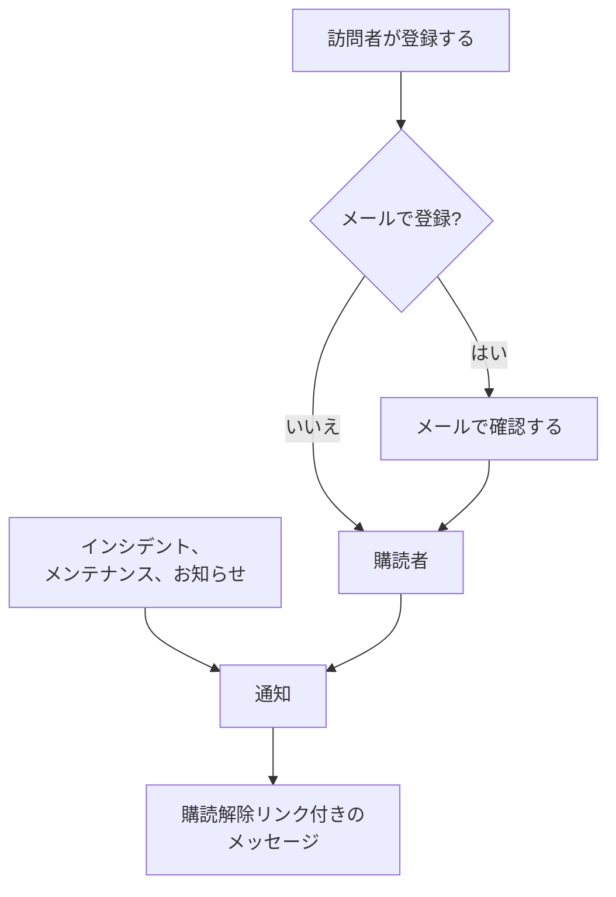

# 購読者とお知らせ

ステータスページは、人が見に行く場所です。購読者は、見に行かずに済ませたい人たちです。メールアドレス、電話番号、Slack の Webhook、または HTTP エンドポイントを一度渡してもらえば、その後は更新が向こうから届きます。

お知らせは、同じ仕事のもう半分です。モニターは、チェックアウトが 500 エラーを返していることを訪問者に伝えられますが、土曜日にデータベースを移行すること、外部のプロバイダーが不調であること、昨日読んだインシデントが完全に終わったことを伝えられるモニターはありません。お知らせは、チェックでは見えないすべてのことを伝える自由記述のチャネルで、同じ購読者リストに届きます。

このページでは両方を扱います。5 つの購読チャネルと訪問者の登録方法、購読者が何の通知を受けるか選べること、ダブルオプトインと購読解除の流れ、購読者が毎月受け取れるメールレポート、そしてお知らせの書き方、スケジュール、テンプレート化です。

:::cards
- [購読チャネル](#購読チャネル): 訪問者が登録できるチャネルと、登録するページ。
- [購読者に知らされること](#購読者に通知される内容): お知らせ、メンテナンス、インシデント、エピソード、そしてそれらの編集。
- [送信内容を確認する](#送信内容を確認する): 各通知のステータスと、再試行・再送信。
- [お知らせ](#お知らせ): 1 つ以上のステータスページにお知らせを投稿します。
:::

## 仕組み



各ステータスページはそれぞれの購読者を持ちます。訪問者はステータスページの **購読する** ページで登録し、メールアドレスは何かを受け取る前にリンクで確認されます。または、チームがダッシュボードで追加します。それ以降、ページに届くすべてのインシデント、定期メンテナンスイベント、お知らせがページの購読者に通知され、それぞれ登録したチャネルで届きます。すべてのメッセージには購読を解除するリンクが付いています。

## 購読チャネル

ステータスページは 5 つのチャネルに対応しています。これらと、訪問者が登録するページは 1 か所で切り替えます。 **ステータスページ → 対象のページ → 購読者 → 購読者設定** の **チャネル** カードです。各トグルは切り替えた時点で保存されます。

- **購読者ページを表示**（`showSubscriberPageOnStatusPage`）— 既定でオン。ステータスページのナビゲーションバーに **購読する** 項目を表示し、訪問者は以下のチャネルで登録します。
- **メール**（`enableEmailSubscribers`）— 既定でオン。それ以外はオンにするまでオフです。
- **SMS**（`enableSmsSubscribers`）— 既定でオフ。OneUptime Cloud では、ページに独自の **Twilio 設定** がない限り（[後述](#メールフッターカスタム-smtptwilio) を参照）、SMS は 1 通ごとにプロジェクトの SMS・通話残高から支払われます。オンにするには、 **プロジェクト設定 > 通知 > 通知設定** の **通知チャネル** カードで、プロジェクトの **SMS** もオンにする必要があります。これはプロジェクトのオーナー、 **Billing Admin**、または **Manage Billing** を持つユーザーが行えます。
- **Slack**（`enableSlackSubscribers`）— 既定でオフ。
- **Microsoft Teams**（`enableMicrosoftTeamsSubscribers`）— 既定でオフ。
- **Webhook**（`enableWebhookSubscribers`）— 既定でオフ。

トグルは、訪問者が自分で登録する方法を決めるもので、ステータスページはオフのチャネルでの登録を拒否します。通知を止めるものではありません。チームがダッシュボード、API、またはワークフローで追加した購読者は、どのチャネルがオンでも更新を受け取ります。

OneUptime Cloud では、プランに含まれないトグルの横にプラン名が表示されます。 **SMS** と **購読者ページを表示** には **Growth**、 **Slack**、**Microsoft Teams**、**Webhook** には **Scale** です。チャネルをオフにするのはどのプランでも動作するので、試用期間中にオンにしたチャネルはいつでも再びオフにできます。トグルの下にそのことが表示されます。

各チャネルには、ステータスページのサイドメニューの **購読者** の下に独自の一覧もあります。 **メール購読者**、**SMS 購読者**、**Slack 購読者**、**MS Teams 購読者**、**Webhook 購読者** です。ここで、誰が登録しているかを確認したり、手動で追加したり、特定の購読者について自分用の **メモ**（`internalNote`）を残したりします。チャネルがオフの間は、一覧の上部にそのことが表示され、そのすぐそばにチャネルのトグルがあるので、一覧を離れずにオンにできます。

**トグル 1 つでは足りません。** ステータスページのナビゲーションバーの **購読する** 項目は、 **購読者ページを表示** がオン *かつ* 少なくとも 1 つのチャネルがオンのときにだけ表示されます。 **メール** をオンにしても **購読者ページを表示** をオフのままにすると、訪問者はフォームにたどり着けません。

## 購読ページで訪問者が目にするもの

**購読する** ページには、オンのチャネルごとに 1 つのタブを持つサブメニューがあります。各タブは必要最小限のものだけを求めます。

| タブ | アドレス | 見出し | 求めるもの |
| --- | --- | --- | --- |
| **メール** | `/subscribe/email` | **メールで購読する** | **メールアドレス**。例は `subscriber@company.com`。 |
| **SMS** | `/subscribe/sms` | **SMSで購読する** | **電話番号**。例は `+11234567890`。 |
| **Slack** | `/subscribe/slack` | **Slackで購読する** | **Slackワークスペース名**（検証に使用）と **Slack 受信 Webhook URL**。例は `https://hooks.slack.com/services/...`。 |
| **MS Teams** | `/subscribe/microsoft-teams` | **Microsoft Teamsで購読する** | **Microsoft Teamsワークスペース名** と **Microsoft Teams 受信 Webhook URL**。例は `https://outlook.office.com/webhook/...`。 |
| **Webhooks** | `/subscribe/webhooks` | **Webhookで購読** | **Webhook URL**。例は `https://example.com/webhook`。ステータスページのイベントごとに、JSON の `POST` リクエストが送られます。 |

送信ボタンは **購読する** です。SMS、Slack、Microsoft Teams、Webhook での登録では *購読が正常に完了しました。* と表示されます。メールでの登録では、確認リンクを送信したこと、届かない場合は迷惑メールフォルダを確認するよう表示されます（[メールのダブルオプトイン](#メールのダブルオプトイン) を参照）。 **メール**、**SMS**、**Slack**、**MS Teams** のタブには **新規購読** / **既存の購読を管理** の切り替えもあり、すでに購読している人は古いメッセージを探さずに設定に戻れます。

## 購読者にリソースとイベントタイプを選ばせる

既定では、購読者はページのすべてを受け取ります。 **詳細な購読者設定** カードの 2 つのトグルでこれを変えられます。

- **購読者にリソースの選択を許可する**（`allowSubscribersToChooseResources`）— 既定でオフ。オンにすると、購読フォームに **すべてのリソースを購読する** トグルが加わります。これをオフにすると **購読するリソースを選択** が表示され、訪問者は個々のリソースを選べます。
- **購読者にイベントタイプの選択を許可する**（`allowSubscribersToChooseEventTypes`）— 既定でオフ。同じ形で、 **すべてのイベントタイプを購読する** トグルがあり、オフにするとその下に **購読するイベントタイプを選択** が表示されます。

どちらかがオンでも、購読フォームは 1 ページのままです。更新の送り先（メールアドレス、電話番号、ワークスペース、または Webhook）の下に **設定** があり、訪問者が何を受け取るかを示す 1 行に折りたたまれています。すべてのリソースとすべての種類のイベントがすでに選ばれているので、最初は「このステータスページのすべてのアップデートを受け取ります。」となり、すべてを望む訪問者は開かずに **購読する** を押します。それ以外の人は **設定** を開いてリソースやイベントタイプを絞り込みます。再び折りたたむと、行は選んだ内容に合わせて変わります（「選択したリソースのアップデートのみを受け取ります。」）。両方オフの場合は **設定** はなく、フォームは更新の送り先と **購読する** だけです。

**購読を更新** ページ（下記参照）では、同じ選択肢が開いた状態で表示されます。購読者がそこに行くのは、それを変えるためだからです。

イベントタイプは `Incident`、`Announcement`、`Scheduled Event` です。

**モニターグループは、そこに含まれるすべてのモニターを表します。** ページのリソースはモニターかモニターグループのどちらかで、モニターグループを選んだ購読者は、グループ内のどのモニターのインシデント、定期メンテナンスイベント（そのメモを含む）、お知らせについても、そのモニターを選んだのとまったく同じように通知を受けます。ステータスページもそのように表示します。ほかのリソースだけを選んだ人には通知されず、モニターとそれを含むグループの両方を選んだ人が受け取る通知は 2 件ではなく 1 件です。

選択は、購読者のレコードに **すべてのリソースを購読**（`isSubscribedToAllResources`、既定は true）、 **すべてのイベントの種類を購読**（`isSubscribedToAllEventTypes`、既定は true）、 **購読しているリソース**、 **購読しているイベントの種類** として記録されます。

**購読者は自分のページのリソースから選びます。** **購読しているリソース** には、誰が書き込んだかにかかわらず、購読者自身のステータスページのリソースが入ります。ページ上の訪問者、ダッシュボード上のチームメイト、API キー、またはワークフローです。訪問者はページが表示するものから選ぶので、モニターがアーカイブされていてページが非表示にしているリソースは選べません。別のステータスページのリソースや、ページが訪問者から隠しているリソースは、何にも一致しない ID と同様に、フィールドと ID を示す `400` で拒否されます。変更で確認されるのは追加するリソースだけなので、購読はすでに含んでいるリソース（選んだ後にモニターがアーカイブされたものなど）を保持します。購読者がイベントの通知を受けるのは、自分のページのリソースを通じてだけです。

向いているのは、複数の製品を扱うページです。API だけを使う顧客は、マーケティングサイトが不安定になるたびに通知を受けたくはありません。購読を完全に解除されてしまう前に、本人に一覧を絞り込んでもらいましょう。

同じカードには **購読者のタイムゾーン** もあります。

## メールのダブルオプトイン

メールの購読者は必ず確認します。メールアドレスで購読者が作成され、確認済みとして作成されていない場合、 **購読を確認済み**（`isSubscriptionConfirmed`）は `false` に強制され、6 桁の **購読確認トークン** が生成されます。その後、OneUptime は `{statusPageUrl}/confirm-subscription/{statusPageSubscriberId}?verification-token={token}` の形式の確認リンクをメールで送ります。訪問者は **購読を確認** ページに移動し、確認が完了すると *購読が正常に確認されました* と表示されます。

SMS、Slack、Microsoft Teams、Webhook の購読者はこれを省略します。 `isSubscriptionConfirmed` がすでに `true` の状態で作成されるためです。チームが **メール購読者** で追加するメールの購読者も同様で、そこでは **確認リンクを送信しない** が既定でオンです。オフにすると、そのアドレスは登録時と同じように確認を行います。

**未確認は沈黙を意味します。** 通知のために購読者を取得するクエリは、 `isUnsubscribed: false` と `isSubscriptionConfirmed: true` で絞り込みます。リンクをクリックしなかったメールアドレスは **メール購読者** の一覧に残ったまま、何も受け取りません。購読しているはずなのに何も届かないと言う人がいたら、まずその列を確認してください。

メールの確認をオフにするトグルはありません。ステータスページから登録するすべての人に無条件で適用されます。購読者ごとの別の列 **「購読しました」メッセージを送信**（`sendYouHaveSubscribedMessage`、既定は true）は、購読者の確認後に送られる「購読しました」メールを制御します。

## 購読の管理と解除

購読者が受け取るすべてのメッセージには、 `{statusPageUrl}/unsubscribe/{statusPageSubscriberId}-{token}` の形式の購読解除リンクが付いています。メールの末尾、SMS・Slack・Microsoft Teams のメッセージの本文、Webhook のペイロードの `unsubscribeUrl` です。トークンはその 1 件の購読に属するランダムな秘密の値なので、リンクはサインインなしで機能します。これは、ほかのすべてにサインインした訪問者が必要なプライベートなステータスページでも同じです。

唯一の例外は **公開** ステータスページからの SMS で、代わりに購読者の **購読を更新** リンクが付きます（下記参照）。そのページは公開ステータスページではサインインなしで機能し、リンクは 57 文字短くなります。SMS は 160 文字のセグメント単位で課金されるため、長いリンクでは既定のテキストのほとんどがもう 1 セグメント増えてしまいます。カスタム SMS テンプレートの `{{unsubscribeUrl}}` も同じルールに従います。プライベートなステータスページからの SMS には購読解除リンクが付きます。

SMS ログ（ステータスページとプロジェクトの設定にある **通知ログ** の **SMS** タブ）にはすべての SMS の本文が保存され、購読者を管理できる人より多くのプロジェクトメンバーが読めます。そのため、ログにはトークンを `[redacted]` に置き換えた購読解除リンクが表示されます。たとえば `{statusPageUrl}/unsubscribe/{statusPageSubscriberId}-[redacted]` です。機能するリンクを受け取るのは購読者本人の電話だけです。新しい購読者のトークンは、それを作成したリクエストへのレスポンスでさえ、API から返されることはありません。

**リンクを開いても何も変わりません。** ページには、ステータスページの名前とロゴ、そしてリンクが属する購読が表示されます。メールアドレスは全体、電話番号は下 4 桁以外を伏せた形、Slack や Microsoft Teams のワークスペース名、または Webhook のホストです。 *このステータスページからの通知の受信を停止しますか？* と尋ね、 **購読を解除** を押したときにだけ購読が解除されるので、メッセージ内のすべてのリンクを開くメールスキャナーやリンクプレビューが誰かの購読を解除することはありません。ページのそのほかのものは表示されず、カスタム JavaScript も実行されません。2 回確認しても、すでに解除された購読のリンクを開いても、解除済みであることが表示されるだけです。公開ステータスページでは、購読解除ページから購読者の **購読を更新** ページにもリンクしており、代わりに受け取る通知を選べます。

**購読を更新** ページ `{statusPageUrl}/update-subscription/{statusPageSubscriberId}` のタイトルは **購読を更新** で、そこで設定の更新や購読の解除ができることを訪問者に伝えます。内容は次のとおりです。

- ページが許可するリソースとイベントタイプの選択肢。
- すべてのリソースの購読解除として説明される **購読解除** トグル。これは **購読解除済み**（`isUnsubscribed`、既定は false）を書き込みます。
- **購読を更新** という送信ボタン。保存すると *変更が保存されました。* と表示されます。

プライベートなステータスページでは、ページのほかの部分と同様に、サインインした訪問者が必要です。リンクをなくした人は、 **購読する** ページの **既存の購読を管理** を使って **管理リンクを送信** を押します。リンクは購読そのもの（そのメールアドレス、電話番号、または Slack や Microsoft Teams のチャネル）に送られ、リクエスト内のアドレスに送られることはありません。また、購読が一致したかどうかにかかわらずページの応答は同じなので、誰が購読しているかを調べるのには使えません。そのメッセージは **購読を更新** ページにリンクし、カスタムテンプレートには `manageSubscriptionUrl` と `unsubscribeUrl` の両方のリンクを渡します。

これらを支えるエンドポイントは `POST .../subscribe/:statusPageId`、`POST .../manage-subscription/:statusPageId`、`POST .../get-subscription/:statusPageId/:subscriberId`、`PUT .../update-subscription/:statusPageId/:subscriberId`、そして `GET` と `POST .../unsubscribe/:statusPageId/:subscriberId/:token` です。購読解除の `GET` はリンクの説明だけを返します。 `POST` は、ワンクリック購読解除リクエストの `List-Unsubscribe=One-Click` 本文を含め、本文にかかわらず購読を解除します。どちらも、誤ったトークン、削除された購読者、別のステータスページの購読者に対して同じ応答を返すため、誰が購読しているかを調べるのには使えません。

購読解除は行を削除するのではなくフラグを切り替えるので、レコードは **購読解除済み** が設定された状態でチャネルの一覧に残ります。特定のアドレスがメールを受け取らなくなった理由を後で説明するときに役立ちます。誰が解除したか（リンクや **購読を更新** ページからの購読者、またはダッシュボードや API からのチームメイト）にかかわらず、 **購読解除日時**（`unsubscribedAt`）も記録します。各購読者一覧には **購読解除日時** の列とフィルターがあります。 **購読解除済み** を再びオフにすると、これは消去されます。OneUptime がこれを記録する前に解除された購読には日時がありません。

購読解除ページができる前に送られたメッセージのリンクも引き続き機能します。 **購読を更新** リンクは今もそのページを開きます。とても古いメッセージには `/api/status-page-subscriber/unsubscribe/{statusPageSubscriberId}` が含まれており、以前は開いた時点で購読を解除していました。今では何も変えません。購読解除ページに移動し、リンクが古いことと、最近のメッセージのリンクを使うよう伝えます。

### 共有アドレスとメーリングリスト

メールボックスを読める人は誰でも、その購読を解除できます。自分で登録したアドレスなら、それが本来の目的です。チームが追加したアドレス、たとえば `site03-all@` のような拠点のメーリングリストの場合は、読み手 1 人が次の障害の前にリストの全員をページから外せるということです。そのため:

- **できるだけ本人のアドレスで追加してください。** **一括追加** フォームとメール購読者のフォームでは、メールフィールドの説明でそのことを伝えています。
- **チームに知らされます。** チームが追加した購読者とは、ダッシュボード、API キー（REST API、Terraform、スクリプト）、またはワークフローで追加された購読者です。API はこれを **チームによって追加**（`isAddedByTeam`）として読み取ります。そうした購読者がリンクや **購読を更新** ページから購読を解除すると、ステータスページの所有者（所有者ユーザーと所有者チームのメンバー）それぞれに、その購読者を示し、ページの購読者一覧へのリンクを付けたメールが 1 通届きます。チームメイトが追加した場合は、追加したチームメイトにも届きます。所有者のいないページはそのチームメイトにだけメールを送るため、API キーやワークフローが所有者のいないページに追加した購読者は報告されません。ステータスページで自分で登録した人が報告されることはありません。OneUptime がこれを記録する前に API キーやワークフローが追加した購読者は、自分で登録した人と区別できないため、これも報告されません。
- **購読者一覧に表示されます。** 各一覧の上の通知に、チームが追加した購読者のうち過去 30 日以内に購読を解除した人が表示されます。

購読解除ページは、そうした購読の読み手に、確認する前に警告します。共有アドレスの場合、購読を解除すると受け取っている全員への通知が止まり、チームにも知らされます。

## 購読者に通知される内容

購読者は上記の 3 つのイベントタイプについて通知を受けますが、送信元ごとに独自のトグルがあるので、誤って何かが送られることはありません。

### お知らせの通知

お知らせ自体に **購読者に通知しますか？**（`shouldStatusPageSubscribersBeNotified`）があり、作成フォームでは **スケジュールと通知** の **ステータスページの購読者に通知** チェックボックスとして表示され、既定でオンです。購読者への通知はお知らせが表示され始めたときに 1 回だけなので、これはお知らせの作成時に決まり、編集では変えられません。後でこれを書き込むワークフローは値を保存するだけです。変更せずに書き戻してもお知らせが再送されることはなく、オンにしても送信されず、通知が送られる前にオフにすると通知はスキップされます。お知らせが **影響を受けるモニター** でモニターを指定している場合、通知はそれらのモニターに限定されます。購読者がリソースを選ぶページでは、それらのモニター、それらを含むモニターグループ、すべてのリソースの購読者に届きます。空のままにすると、すべての購読者に通知されます。それらのモニターを直接もグループ経由でも一覧に含まないステータスページでは、お知らせはそのページを読むすべての人に向けたものなので、そこでお知らせを受け取るすべての購読者に通知されます。

### 定期メンテナンスのイベント

定期メンテナンスイベントには購読者向けの独自の列があります。 **イベントの作成時に購読者に通知しますか？**、 **イベントが進行中に変わったときに購読者に通知しますか？**、 **イベントが終了に変わったときに購読者に通知しますか？** に加え、事前の警告用の **イベント前の購読者への通知** と **イベント前の次の購読者通知の日時** です。イベントの **ステータスページ** はどのページに表示されるかを決め、 **ステータスページに表示しますか？** は表示するかどうかそのものを決めます。

**定期メンテナンスイベントを作成** は、 **インシデントを宣言** と同じように 2 つのステップと確認で進みます。

1. **イベント** — **タイトル**、**説明**、**開始日時**、**終了日時**。新しいイベントは、手元の時計で次のちょうどの時刻に始まり、1 時間続きます。時刻が違うときだけ変更してください。 **開始日時** を動かすと **終了日時** も一緒に動くので期間の長さは保たれ、イベントは開始後に終了する必要があります。 **所有者** と **ラベル** は **その他の項目** にあります。
2. **影響を受けるリソース** — まず **モニター**、モニターを選ぶとそのすぐ下に **変更後のモニターステータス** が表示されます。モニターはイベントの開始時にそのステータスに変わり、終了時に稼働中に戻ります。次に **その他の影響を受けるリソース**: メンテナンスが影響するホスト、クラスター、コンテナホスト、データベース、IoT フリート、ネットワークサイト、サービスです。次に **これらのステータスページにイベントを表示**、そして **購読者への通知** で、何が起きるかを示す 1 行に折りたたまれています。既定では「イベントのステータスページの購読者に、予定時、開始時、終了時に通知されます。」となっています。開くと **イベントの予定作成時**、**イベントの開始時**、**イベントの終了時**、**イベント前のリマインダー** を変更でき、行はチェックした内容に合わせて変わり、確認ステップにも表示されます。

ホスト、Kubernetes・Proxmox・Ceph・Docker Swarm のクラスター、Docker や Podman のホスト、vCenter、ストレージアレイ、IoT フリート、データベース、サービス、ネットワークサイトの **定期メンテナンス** タブから **定期メンテナンスイベントを作成**（と **テンプレートから作成**）を開くと、同じフォームが **その他の影響を受けるリソース** でそのリソースを選んだ状態で開き、パンくずリストはそのタブに戻ります。インベントリ項目の **定期メンテナンス** タブでは、その項目が指すホスト、サービス、または Kubernetes クラスターが選ばれ、パンくずリストはそのリソースのタブを経由して戻ります。

入力が必要なのはタイトルだけです。ほかはすべて既定値があるので、 **次へ** は何も尋ねずにほかのステップを進み、最後の確認に **定期メンテナンスイベントを作成** があります。ステータスページを選ぶまで、誰にも通知されません。3 つの **イベントの…時** の設定はイベントの作成時に選ばれ、後で **イベントの予定作成時** を書き込むワークフローは値を保存するだけです。変更せずに書き戻すかオンにしても何も送信されず、「予定」の通知が送られる前にオフにすると、その通知はスキップされます。イベントの **メンテナンスの詳細** カードの **編集** ボタンは、タイトル、期間、ラベル（**イベント**）と、ステータスページとリマインダー（**ステータスページ**）を変更します。 **影響を受けるリソース** カードの **編集** ボタンはフォームと同じように尋ねます。 **モニター**、モニターがあれば **変更後のモニターステータス**、そして **その他の影響を受けるリソース** で、カードはモニターの下にステータスを表示します。イベントを編集できる人は、イベントが始まるまでモニターのステータスを変更できます。イベントが始まると（開始時刻に、または誰かが手動、Slack や Microsoft Teams、API で進行中の状態に移したとき）、そのモニターはその時点のステータスに変わり、実施中に追加されたモニターも同様です。 **Scheduled** から **Ongoing** と **Ended** の間に置いた独自の状態（"Verifying" など）に直接移すと、同じように開始されます。モニターは **Ongoing** と同じようにそのステータスに変わり、終了時に稼働中に戻ります。それ以降、ステータスは変更できません。カードの **編集** は「イベントが始まったため、これは変更できません。」とともに読み取り専用で表示し、API は "Change Monitor Status to can no longer be changed: this event has already started." で変更を拒否します。イベントがすでに持っているステータスを書き戻すことは引き続き受け付けられます。定期メンテナンスのテンプレート（**設定 → イベントテンプレート**）も同じステップを使い、先頭にテンプレート名、最後に繰り返しのスケジュールが付きます。テンプレートは、モニターを指定しているかどうかにかかわらず **変更後のモニターステータス** を尋ねます。そのステータスは、テンプレートからイベントを予定したときに選ばれたモニターにも適用されるためです。既存のテンプレートの **影響を受けるリソース** カードも同じように尋ね、テンプレートが選ぶステータスを表示します。何も選ばない場合は **モニターのステータスは変わりません。** と表示されます。テンプレートを編集できる人は、そこで変更できます。

**どのステータスページに?** イベントがモニターを指定すると、それらを表示しているステータスページが **これらのステータスページにイベントを表示** の下に提案されます。「影響を受けるモニターを表示しているステータスページ:」に続いて各ページの名前が表示されます。名前をクリックするとそのページを追加し、 **すべて追加** をクリックするとすべてを追加します。モニターの 1 つを直接またはモニターグループ経由で一覧に含むページが対象です。提案されるのは自分が見られるステータスページだけで、アーカイブ済みのページと定期メンテナンスイベントを表示しないページは除かれます。何かが自動で選ばれることはありません。選んだステータスページはイベントを表示し、既定の通知ではその購読者に知らせるので、それはあなたの選択のままです。イベントの **編集** の **ステータスページ** ステップと、定期メンテナンスのテンプレートのフォームも、イベントやテンプレートのモニターから同じように提案します。

**独自の状態。** イベントは **Ongoing** と、 **Ongoing** と **Ended** の間に置いたすべての独自の状態（たとえば "Verifying" のステップ）で進行中です。 **Ongoing** より前に置いた独自の状態はまだ始まっておらず、 **Ended** より後に置いたもの（"Reviewing"）は終わっています。イベントが進行中かどうかを問うものは、すべてこの 1 つのルールに従います。そうしたイベントは、ステータスページ（概要、イベント自身のページ、RSS フィード）で進行中として表示され、 **定期メンテナンス** と **ホーム** の **Ongoing** 一覧、そのメニューバッジ、 **ホーム** の **実施中のメンテナンス** タイルにも表示され、Microsoft Teams アプリは実施中のメンテナンスとして一覧表示します。モニターはメンテナンス中のままで、対象のネットワークサイトとテレメトリ系列は抑制されたままで、モニターの SLO バーンレートのアラートは保留されます。 **終了日時** になると進行中のイベントと同じように終了し、 **イベントの終了時** がオンなら購読者に通知されます。 **Ongoing** または "Verifying" から **Ended** より後に置いた独自の状態に直接移すと、 **Ended** と同じように終了します。モニターは稼働中に戻り、イベントのヘッダーに所要時間が表示されます。 **Ongoing** から "Verifying" へ、または **Ended** から "Reviewing" へ移しても、何かが再び始まったり終わったりすることはありません。状態の位置とは、 **定期メンテナンス → 設定** の **イベントの状態** ページの一覧での位置です。

**開始待ち、終了、完了。** 残りも同じ位置で決まります。イベントは **Scheduled** と、 **Scheduled** と **Ongoing** の間に置いたすべての独自の状態（たとえば "Confirmed" のステップ）で **開始日時** を待ちます。開始時刻になると、 **Scheduled** から始まるのと同じようにそこから始まります。 **Ongoing** に移り、モニターは **変更後のモニターステータス** に変わり、所有者に知らされ、 **イベントの開始時** がオンなら購読者にも知らされます。それまでは、今後のイベントの中に表示され（ステータスページの概要、予定されたイベントのページ、RSS フィード、そして誰かが Microsoft Teams アプリに定期メンテナンスを尋ねたとき）、イベント前のリマインダーも引き続き購読者に送られます。フィードとステータスページのタイムラインは、そうした状態を **Scheduled** と同じ時計付きで表示します。 **Scheduled** より前に置いた独自の状態（"Draft" や承認のステップ）もまだ始まっていませんが、人を待ちます。そこでは時刻になってもイベントが始まることはなく、今後のイベントとしても表示されません。イベントは **Ended**、 **Completed**、そして **Ended** より後に置いたすべての独自の状態で終わっており、イベントの **概要** はあらゆる場所でそれを終わったものとして扱います。ヘッダー、 **測定値** カード、表示するタイムラインです。 **Completed** と、それより後に置いたすべての独自の状態（"Archived"）では完了しています。これが、所有者へのリマインダー（**イベントが完了するまでリマインド**）を止めるもの、Slack と Microsoft Teams が **Mark as Complete** を拒否する理由、そしてフィードとステータスページのタイムラインが完了として示すものです。 **Ended**、または **Ended** と **Completed** の間の "Reviewing" では、終わっていますがまだ完了していません。

**ネットワークサイトは状態の変更のたびに追従します。** イベントが対象とするネットワークサイトは、イベントが進行中の間、その計画された停止を上位のサイトに対して数えなくなります。イベントの状態が変わるたびに、そのステータスは双方向ですぐに再計算されます。戻る場合も同様で、現在の状態のエントリが **状態タイムライン** から削除されたときなどがそうです。"Verifying" から **Scheduled** に戻ると、5 分ごとに安全網として実行される次の巡回を待たずに、すぐに抑制をやめます。

**編集でフィードに記録されること。** 編集すると、イベントの **定期メンテナンスのフィード** に **Scheduled Maintenance was updated.** というエントリが追加され（Slack と Microsoft Teams のチャネルにも投稿されます）、変更した各項目について 1 行ずつ記載されます。タイトル、 **開始日時**、 **終了日時**、説明、イベント前のリマインダー、イベントが影響するもの、 **変更後のモニターステータス**、表示されるステータスページ、ラベルで、それぞれ新しい値付きです。元のまま保存された値には行がないので、何も変えずに **メンテナンスの詳細** カードを保存した場合（毎回タイトル、期間、ラベル、ステータスページ、リマインダーを送信します）や、API クライアント、ワークフロー、Terraform がイベントをそのまま書き戻した場合は、エントリはまったく追加されません。時刻は、どう書かれていても同じ瞬間を指していれば同じとみなされ（タイムゾーンなしで書かれたものは保存時と同じく UTC です）、リマインダー、ステータスページ、影響を受けるリソース、ラベルは順序にかかわらず同じ集合とみなされます。すべてのリマインダー、ステータスページ、ラベルを外すと、それぞれ "No reminders before the event."、"Not shown on any status page."、"All labels removed." と記録され、モニター以外の最後の影響を受けるリソース（たとえば最後のホスト、クラスター、サービス）を外すと "No other affected resources." と記録されます。イベントのリマインダールールが再照合され、次のリマインダーまでの待ち時間がやり直されるのは、ラベルが変わったときか、 **リマインダーを送信** スイッチを切り替えたときだけです。 **イベントの予定中にリマインド** がオフのリマインダールール（**定期メンテナンス → ルール → リマインダールール**）は、最初のリマインダーをイベントの開始から数えるので、開始がまだ先のうちに **開始日時** を別の時刻に動かすと、そのリマインダーも一緒に動きます。イベントの予定中にリマインドするルールのリマインダーは、そのままの位置に残ります。モニターのフィードも、名前、説明、ラベルの編集を同じように記録します。

**イベントの予定作成時** をオフにしてイベントを作成すると（作成フォームの **影響を受けるリソース** ステップの **購読者への通知** の中）、そのイベントへの新しい公開メモは **ステータスページの購読者に通知** がオフの状態で始まり、チェックボックスの下に理由を説明する行が表示されます。これはイベントの **公開メモ** ページと、同じメモ作成画面を開く **定期メンテナンスのフィード** の **公開メモを追加** に適用されます。明示的な選択なしに投稿されたメモ（Slack や Microsoft Teams のメモ、ワークフロー、 `shouldStatusPageSubscribersBeNotifiedOnNoteCreated` を省いた API リクエスト）も、同じ **イベントの予定作成時** の設定に従います。明示的な `true` または `false` は常に維持されます。 **イベントの予定作成時** がオフにするのは、イベントの作成時に送られる案内だけです。リマインダー（作成フォームの **イベント前のリマインダー** で設定する **イベント前の購読者への通知**）と、 **イベントの開始時** と **イベントの終了時** で設定する通知は別の設定で、引き続き送られます。購読者がリマインダーや進行中の通知などですでにイベントを知っている場合は、チェックボックスをオンにしてメモについて知らせてください。

イベントの **概要** ページの上部のボタンから開く **定期メンテナンスを「`<state name>`」にする** ダイアログには、状態の変更とダイアログの **公開メモ**（**公開メモを追加** の下に折りたたまれています）の両方を対象とする **ステータスページの購読者に通知** チェックボックスが 1 つあります。 **イベントの予定作成時** をオンにして作成したイベントでは、これまでどおりオンで始まります。オフにして作成したイベントでは、同じ行を下に表示してオフで始まります。ただし、自動の状態変更が知らせる内容に合わせて、次の 2 つの場合はオンで始まります。

- イベントを進行中の状態に移すか、まだ始まっていない状態から **Ongoing** と **Ended** の間に置いた独自の状態に移し（開始する）、 **イベントの開始時** がオンの場合。
- イベントを終了または完了の状態に移すか、進行中の状態から **Ended** より後に置いた独自の状態に移し（終了する）、 **イベントの終了時** がオンの場合。

**状態の変更とともに送るメモが唯一のメッセージです。** そのダイアログ（または一括操作の **状態を変更**）で **ステータスページの購読者に通知** をオンにして **公開メモ** を書くと、購読者には状態の変更の別メッセージではなく、すべてのチャネルでそのメモが届きます。2 通ではなく 1 通です。状態の変更には **送信済み通知** と表示され、そのステータスメッセージにはメモで知らせたことが示されます。メモは状態の変更が保存されてから投稿されます。イベントのフィードと Slack・Microsoft Teams では変更の後に続き、保存されなかった状態の変更はメモを投稿せず、誰にも知らせません。空白だけのメモは投稿されず、購読者には状態の変更のメッセージが届きます。チェックボックスがオフなら、状態の変更もそのメモも誰にも知らせません。API では、メモは `POST /api/scheduled-maintenance-state-timeline` の `"miscDataProps": {"publicNote": "..."}` で状態の変更とともに送り、 `shouldStatusPageSubscribersBeNotified` が両方を決めます（省略すると状態の変更は通知し、そのメモは通知しません）。インシデントも同じように動作します。 [インシデントの状態と重大度](/docs/incidents/states-and-severities#状態の変更をステータスページの購読者に知らせる) を参照してください。

**メモは新しい状態を示します。** 唯一のメッセージであるため、状態の変更とともに送るメモは、状態の変更のメッセージと同じように、すべてのチャネルでイベントの現在の状態を伝えます。メールの件名は `[Ongoing Scheduled Maintenance] <title>` で詳細には **ステータス** 行が表示され、SMS は `Maintenance <title> on <status page> is Ongoing.` となり、Slack と Microsoft Teams のメッセージには `**Status:** Ongoing` の行が入り、Webhook の `ScheduledMaintenanceNoteCreated` ペイロードは `data` に `scheduledMaintenanceState` を含みます。単独で投稿したメモはこれまでどおりです。メモを投稿するには **Create Scheduled Maintenance Status Page Note** が必要です（組み込みの定期メンテナンスとプロジェクトのロールにはあります）。これがない人には **公開メモを追加** が表示されず、その人がメモ付きで送った状態の変更は拒否されるので、イベントは誰にも知らせずに状態が変わることなく、元の状態を保ちます。

イベントの **状態タイムライン** ページの手動フォームと、定期メンテナンス一覧の一括操作 **状態を変更** はこれらの設定を参照しません。その **ステータスページの購読者に通知** チェックボックスは常にオンで始まります。

テンプレートから作成したイベントは、ほかの購読者設定とともに **イベントの予定作成時** をテンプレートから引き継ぎます。 **テンプレートから作成** はテンプレートの値で作成フォームを埋め、 **設定 → イベントテンプレート** のテンプレートが予定した繰り返しのイベントもそれをコピーします。

### インシデント

`Incident` は 3 番目のイベントタイプです。そもそも何がインシデントをステータスページに載せるのか（どのリソースに影響し、どの状態で表示され続けるか）は [インシデントの状態と重大度](/docs/incidents/states-and-severities) で説明しています。購読者に通知せずに宣言したインシデントの公開メモは、 **ステータスページの購読者に通知** がオフで始まります。 [インシデントのメモ、オーナー、フィード](/docs/incidents/notes-owners-and-feed#公開メモを投稿する) を参照してください。

インシデントのメッセージ（作成、状態の変更、公開メモ、ポストモーテム）は、そのモニターの 1 つを一覧に含むすべてのステータスページの購読者に届きます。これを絞り込む設定が 2 つあります。インシデントの **次のステータスページに限定** は、それらの中から選んだページにインシデントを限定し、ステータスページの **このページに限定されたインシデントのみ表示** は、そのページに限定されていないインシデントをすべて遠ざけます。特定のページに限定したインシデントでは、複数のページで購読しているメールアドレスや電話番号は、ページごとではなく送信ごとに 1 通のメールまたは SMS を受け取ります。Webhook、Slack、Microsoft Teams のメッセージがまとめられることはありません。宣言フォームと **公開メモ** ページには、何かが送られる前に誰に通知されるかが表示されます。 [対象者ごとのステータス ページ](/docs/status-pages/one-status-page-per-audience) を参照してください。

#### ポストモーテム

購読者がインシデントのポストモーテムについて知らされるのは、公開されたとき、つまりステータスページが初めてそれを表示したときの 1 回です。ステータスページがポストモーテムを表示するのは、 **ステータスページに公開** がオンで、ポストモーテムにメモがあるときです。添付ファイルはメモとともに表示され、メモなしで表示されることはありません。そのため、書かれたメモに対して公開をオンにすると公開され、オンになっているポストモーテムのメモを書いても公開されます。同じフォームの **購読者に通知** は、そもそも知らせるかどうかを決めます。その後は次のとおりです。

- **もう一度保存しても誰にも知らされません。** **ポストモーテムのメモを編集** フォームは保存のたびにポストモーテム全体を送信し、API クライアント、Terraform、またはワークフローがインシデント全体を書き戻すこともあります。すでに公開されたものは新しい知らせではありません。
- **公開済みのポストモーテムを編集しても誰にも知らされません。** ステータスページは新しいメモをすぐに表示し、インシデントのフィードはそれを **Postmortem Note updated** として 1 回記録しますが、購読者にはすでに知らせています。メモの前後の空白は変更として数えません。
- **ステータスページから外しても誰にも知らされず、再び公開すると再び知らされます。** 購読者はそれが消えるのを見ているからです。公開済みのポストモーテムのメモを空にしても、ステータスページから外れます。
- **メモのないオンのポストモーテムは何も表示しないので**、メモが書かれるまで誰にも知らされません。
- **インシデントが非表示の間に公開したポストモーテムは、インシデントが表示されたときに送られます。** ステータスページがポストモーテムを表示するのは、表示しているインシデント（**ステータスページに表示** がオンで、プライベートでないもの）だけなので、インシデントが非表示の間は誰にも知らされず、通知のステータスは **未送信: インシデントがステータスページで非表示** になります。 **ステータスページに表示** をオンにすると 1 回送信され（プライベートなインシデントでは **プライベートインシデント** をオフにするのと合わせて）、インシデントの **設定** ページのスイッチは保存前にそのことを知らせます。インシデントを非表示にして再び表示しても、それ以上は何も送られず、ポストモーテムがすでに送信済みか公開されていないインシデントを表示しても、何も送られません。以前のリリースがこの方法でスキップしたポストモーテムは、アップグレード時にインシデントがまだ非表示だった場合は同じように送信されます。その後インシデントが表示されたものは、それ以降ステータスページが表示しているため、未送信のままです。
- **購読者に通知は、通知が送られるときに読み取られます。** これをオフにして公開したポストモーテムは案内されず、後でオンにしても、通知なしで公開された分の通知は送られません。

通知のステータスはインシデントの **ポストモーテム** ページにあり、失敗したものには **再試行** があります（[再試行と再送信](#再試行と再送信) を参照）。API では、書かれた `postmortemNote` に対して `showPostmortemOnStatusPage` を `true` として書き込むと、リクエストがインシデント全体（現在の通知のステータスを含む）を書き戻す場合でも公開され、非表示のインシデントを表示にする（`isVisibleOnStatusPage` を `true` として書き込み、プライベートなら `isPrivate` を `false` にする）と、それを待っているポストモーテムが送られます。 `subscriberNotificationStatusOnPostmortemPublished` を `Pending` として書き込むと再送信されます。すでに待機中または送信中の通知が 2 回キューに入ることはなく、通知の準備中に公開されたポストモーテムも 1 回だけ案内されます。AI が自動で作成するポストモーテムの下書きが、オンのポストモーテムに書き込まれることはないため、レビューされていない下書きが購読者に届くことはありません。

#### 送信前にメールをプレビューする

**プレビュー** は、プレビューする値の横にある小さなリンクです。 **新しいインシデントを宣言** の最後のステップの **ステータスページの購読者に通知** の下の **はい** の横と、公開メモを書いている間の **ステータスページの購読者に通知** チェックボックスの横にあります。これは **通知をプレビュー** を開き、各ステータスページの購読者が受け取るメールを、通知の送信に使われるのと同じコード、テンプレート、設定で組み立てて表示するので、見ているものがそのまま届きます。

- ステータスページを選ぶと、件名とチャネルごとの「最大」件数とともに、そのメールが表示されます。
- 使われるテンプレートとその理由を示す行があります。たとえば、ページに **カスタム SMTP 設定** がないため、ページのカスタムテンプレートは使われない、などです。
- 何も送られない場合（モニターがない、プライベートまたは非表示のインシデント、 **ステータスページの購読者に通知** がオフ、インシデントを表示するステータスページがない）は、メールの代わりにそのことを表示します。

プレビューされるのは見られるステータスページだけで、ほかは件数として数えられます。メールはスクリプトを実行しないサンドボックス化された枠で表示されます。購読解除リンクはサンプルです。各購読者のメールにはそれぞれのリンクが付くためです。

**自分にテスト送信** は、表示しているページのメールを、件名の先頭に `[Test]` を付けて自分のアカウントのメールアドレスに送ります。ページに **カスタム SMTP 設定** があればそれを経由します。ほかのアドレスに送ることはなく、アカウントのメールアドレスの確認が必要で、1 人あたり 15 分ごとに 10 通までテストメールを送れます。

#### 通知に含まれるインシデントのカスタムフィールド

**購読者への通知に含める** をオンにしたインシデントのカスタムフィールド（**インシデント → 設定 → カスタムフィールド**）は、インシデントのメッセージ（作成、状態の変更、公開メモの投稿・更新、ポストモーテム）とともに送られます。これはカスタムフィールドがあるすべてのプランで動作し、カスタムテンプレートもカスタム SMTP も必要ありません。

- **メール** は、詳細ボックスのインシデント自身の行の下に、フィールドの **順序** で一覧表示します。インシデントに値がないフィールドは省かれます。はい/いいえのフィールドは **はい** または **いいえ** と表示され、日付は選ばれた日（UTC−10:59 から UTC+13 までのどのタイムゾーンで選んだ日付でも、どこにいる受信者にも同じ日）、日時はステータスページの購読者のタイムゾーンで表示され、長文テキストは改行を保ち、リッチテキストはメモと同じリンクのルールで書式付きで表示されます。そのインライン画像は、それを含む最初のメッセージが送られるときに、送信先の人が見られるようになります。
- **Slack** と **Microsoft Teams** も同じように、1 行に 1 つずつ一覧表示します。
- **Webhook** のペイロードは、各フィールドの **テンプレート変数** をキーとして `data.customFields` に含めます: `{ "name": ..., "type": ..., "value": ... }`。値は保存されたままです（インシデントに値がなければ `null`）。フィールドの名前を変えてもキーは変わりません。
- **SMS** はこれらを省きます。テキストメッセージはセグメント単位で課金され、既定のメッセージはすでに 1 セグメントに近い長さです。カスタム SMS テンプレートでは `{{incident.customFields.<key>}}` で任意のフィールドを配置できます。
- **インシデントエピソード** の通知にはカスタムフィールドは含まれません。エピソードは、それぞれ独自の値を持つインシデントをまとめたものです。メンバーである各インシデント自身の通知には、そのフィールドが含まれます。

インシデントのフィードの **購読者通知送信済み** エントリには、各送信がメッセージに入れた値が **Custom fields sent** の下に一覧表示されます。購読者はたいていチームの外の人なので、この設定は購読者と共有しても安全なフィールドに限ってオンにしてください。

ステータスページのサイドメニューの **通知ログ** セクション（`{id}/notification-logs`）は、ページが実際に送ったものを確認したいときに見る場所です。

### インシデントエピソード

インシデントエピソードは、作成されたことを購読者に知らせたかどうかを `shouldStatusPageSubscribersBeNotifiedOnEpisodeCreated` に記録します。 **エピソードを作成** ボタンや **グループ化ルール** で作成されたエピソードではオンです。API リクエストでは、これを `false` にしてエピソードを作成できます。

これを `false` にして作成したエピソードでは、新しい公開メモは **ステータスページの購読者に通知** がオフで始まり、エピソードの **公開メモ** ページと、同じメモ作成画面を開く **エピソードフィード** の **公開メモを追加** で、その下に理由を説明する行が表示されます。それでもチェックを入れることはできます。明示的な選択なしに投稿されたメモ（Slack のメモ、ワークフロー、 `shouldStatusPageSubscribersBeNotifiedOnNoteCreated` を省いた API リクエスト）も同じ設定に従います。明示的な `true` または `false` は常に維持されます。数えられるのはこの設定だけです。インシデントとは異なり、エピソードをプライベートにしても、チェックボックスの初期状態は変わりません。

これは公開メモだけが対象です。エピソードの状態の変更（**確認**、**解決**、自動解決）は引き続き購読者に通知されます。エピソードの状態変更ダイアログにも、 **状態タイムライン** ページのフォームにも、 **ステータスページの購読者に通知** チェックボックスがないためです。

後の状態で作成したエピソード（**エピソードを作成** フォームの **初期状態**、または API で送った状態）は、作成の通知によって 1 回案内されます。最初の状態は、それがどの状態でも単独の状態の変更として送られることはなく、 `shouldStatusPageSubscribersBeNotifiedOnEpisodeCreated` を `false` にして作成したエピソードはそれをまったく案内しません。状態タイムラインの最初の行には、その通知がスキップされたことが理由とともに記録されます。

### 編集を購読者に知らせる

購読者がお知らせや公開メモについて知らされるのは、投稿されたときの 1 回だけです。その後の編集はステータスページが表示する内容を変えますが、その編集で求めない限り、誰にも知らせません。

お知らせの編集フォームと、インシデント、定期メンテナンスイベント、インシデントエピソードの公開メモの編集フォームには、 **この更新を購読者に通知** チェックボックスがあります。毎回オフで始まるので、誤字の修正は静かに済みます。新しいメンテナンスの期間、影響の見直し、顧客向けの更新の訂正など、変更が重要なときにチェックを入れてください。作成フォームにはこれはなく、作成フォームには独自の **ステータスページの購読者に通知** の選択があります。お知らせでは、 **お知らせ** ステップの説明のすぐ下にあります。

チェックを入れて保存すると、購読者には編集した内容が、新しい投稿ではなく更新として届きます。

- **メール** は独自のテンプレートを使います。たとえば件名 `[Announcement Updated] <title>` と見出し `Announcement Updated: <title>`、またはメモのメールの詳細ボックスの **Updated Note** です。
- **SMS**、**Slack**、**Microsoft Teams** は、お知らせやメモが更新されたことを伝えます。
- **Webhook** の購読者は、 `eventType` として `AnnouncementUpdated`、`IncidentNoteUpdated`、`ScheduledMaintenanceNoteUpdated`、または `EpisodeNoteUpdated` を受け取り、最新の内容は `data` に入ります。

更新は、元のものが今日届くのと同じ人々に届きます。同じチャネルのトグル、同じリソースとイベントタイプの設定、同じ表示のチェックです（非表示のインシデントや、 **お知らせを表示** がオフのページは引き続き何も送りません）。

意図的に何も送らず、その理由を記録するケースが 2 つあります。

- **元の通知がまだ送られていない。** お知らせやメモがまだ案内を待っている場合、その通知は送信時に項目を読み取り、すでに編集を含んでいるので、別の「更新」メッセージは人々を混乱させるだけです。元の通知がちょうど送信中の場合は、代わりに更新が待機し、元の送信が終わってから送られます。その送信は編集前に項目を読み取っているため、購読者には編集前のテキストが送られている可能性があります。
- **お知らせが後で表示するよう予定されている。** **お知らせの表示開始日時** が過ぎるまではどのステータスページにも表示されず、公開時に通知を受ける人は編集後の版を見ます。

編集した項目には、元のものの横に **更新通知ステータス** が同じ状態（**まもなく送信**、**送信済み通知**、**失敗** など）で表示されます。失敗した更新通知の **再試行** は更新を再送信し、元の「投稿」メッセージを送ることはありません。各ステータスページは、テンプレートのイベントタイプ **Subscriber Announcement Updated**、**Subscriber Incident Note Updated**、**Subscriber Scheduled Maintenance Note Updated**、**Subscriber Episode Note Updated** でこれらのメッセージをカスタマイズできます。カスタムテンプレートがなければ、組み込みの更新の文言が使われます。

API では、変更するフィールドの横の `miscDataProps` で選択を送ります。

```json
{
  "data": {
    "description": "The maintenance now starts on Sunday at 02:00 UTC."
  },
  "miscDataProps": {
    "notifySubscribersOfUpdate": true
  }
}
```

これを `PUT /api/status-page-announcement/<announcement-id>`（または `incident-public-note`、`scheduled-maintenance-public-note`、`incident-episode-public-note`）の本文にします。 `miscDataProps` を省くと、これまでどおり編集は静かに行われます。

## 送信内容を確認する

購読者への通知にはそれぞれ独自のステータスがあり、対象のものの横に表示されます。インシデントでは、インシデントの **概要** にある「作成」の通知、 **状態タイムライン** の各行、各公開メモ、 **ポストモーテム** です。定期メンテナンスイベントとお知らせも同じように表示し、インシデントエピソードは公開メモに表示します。ステータスをクリックすると、何が起きたかを示すメッセージを読めます。公開メモでは、ステータスが独自の文言のバッジとして表示されます。

| ステータス | 公開メモでの表示 | 意味 |
| --- | --- | --- |
| **まもなく送信** | **まもなく購読者に通知します** | キューに入っています。送信するジョブは 1 分ごとに実行されます。 |
| **送信中の通知** | **購読者に通知しています** | ジョブが購読者を順に処理しています。 |
| **送信済み通知** | **購読者に通知しました** | 送信されました。その意味は下記を参照してください。 |
| **失敗** | **通知に失敗しました** | すべての購読者には送られなかったか、送信が止まりました。メッセージは、何が送られたかと **再試行** が何をするかを示します。 |
| **通知をスキップしました。** | **購読者に通知されませんでした** | 送るべきものがありませんでした。たとえばインシデントがステータスページで非表示の場合です。メッセージに理由が示されます。 |

### 送信の数え方

インシデントとインシデントエピソードの通知（作成、状態の変更、公開メモの投稿・更新、ポストモーテム）は、メッセージごとに数えられます。

- **メッセージが送信済みと数えられる** のは、メールサーバーや SMS プロバイダーが受け取ったとき、または Slack、Microsoft Teams、Webhook のエンドポイントが応答したときです。「送信済み」は OneUptime から見える範囲です。メールサーバーが後でメールを差し戻すこともあります。
- **メッセージが失敗と数えられる** のは、拒否されたとき、送信でエラーになったとき、または 4 分以内に応答がないときです。1 件でも失敗すると通知は **失敗** になりますが、ほかの購読者には引き続き送られます。
- **すべての購読者に届きます。** ステータスページの購読者は最後の 1 人まで 10,000 人ずつ読み取られ、同時に 20 件のメッセージが送信されます。通知は開始から 20 分経つと新しいメッセージの送信を始めなくなります。それまでに届かなかったステータスページと購読者は未送信として一覧表示され、通知は **失敗** になります。
- **件数はステータスページごとに記録されます。** ステータスメッセージには、ステータスページごとに、各チャネルで送信・失敗したメッセージの件数が一覧表示されます。たとえば `Site 03: 41 email sent. Site 07: 16 email, 2 SMS sent; 2 email failed.` です。インシデントのフィードの **購読者通知送信済み** エントリには、各ページのメールが送られた件名とともに同じ件数が一覧表示されます。各ステータスページの **通知ログ** には、すべてのメッセージが表示されます。

定期メンテナンスとお知らせの通知は、まだこの方法では数えられません。メッセージは応答を待たずに送信元に渡されるので、 **送信済み通知** は渡されたことを意味し、1 回の送信で届くのは各ステータスページで最大 10,000 人の購読者です。

### 中断された送信

途中でサーバーが再起動したり応答しなくなったりした送信は終えることができず、ほかに決着をつけるものもありません。そのため、どの送信にも許される時間より長い 40 分が経っても **送信中の通知** のままの通知は **失敗** となり、 `Interrupted:` で始まり **再試行** が何をするかを示すメッセージが付きます。これは、定期メンテナンスとお知らせを含め、上記のすべての通知が対象です。このチェックは 5 分ごとに実行されます。

### 再試行と再送信

**再試行** は **失敗** した通知に表示されます。通知をキューに戻し、送信ジョブの次の実行（1 分以内）で再送信されます。インシデントでは、通知が送られた後の再送信も表示されます。公開メモの **通知を再送信** と、インシデントの **概要** にある「作成」の通知の **再送信** です。どちらも、チャネルごとの「最大」件数とともに今届くステータスページを一覧表示して、先に確認します。スキップされた通知や、まだキューにあるか送信中の通知には、どちらも表示されません。 [インシデントのメモ、オーナー、フィード](/docs/incidents/notes-owners-and-feed#公開メモが実際に購読者に届くとき) を参照してください。

再送信される通知は、送られる時点の状態で送られます。その時点で届くステータスページと、その時点の購読者です。インシデントでは、その後に範囲へ追加・削除されたページと、その後に購読・購読解除した人が反映されます。

**進捗は購読者ごとではなく、ステータスページごとに保持されます。**

- **インシデントの「作成」の通知** は、すべての購読者に送られた時点で各ステータスページを記録し、 **再試行** はそれらのページをスキップします。メッセージが失敗したページや、送信が途中で止まったページには最初から改めて送られるため、そのページですでに受け取った購読者は 2 回目を受け取ります。すべてのページに改めて送るには、 **すべてのページに再送信** を使います（[ステータスページの追加](/docs/status-pages/one-status-page-per-audience#ステータスページの追加) を参照）。
- **そのほかのすべての通知**（状態の変更、公開メモ、ポストモーテム、そしてエピソード、定期メンテナンスイベント、お知らせの通知）は、そうした記録を保持しません。 **再試行** は、すでに受け取った購読者を含め、すべてのステータスページに改めて送ります。

特定のステータスページに限定したインシデントでは、1 人に 1 通のメールまたは SMS というルールは各送信の中で適用されるので、それ自体が 1 回の送信である再試行は、最初の通知を受け取った人に届くことがあります。 [1 人に 1 通のメール](/docs/status-pages/one-status-page-per-audience#1-人に-1-通のメール) を参照してください。

## メールレポート

ステータスページは、スケジュールに従って購読者にレポートをメールで送れます。ページの各リソースについて、一定期間の稼働率、ダウンタイム、インシデントです。これは **ステータスページ → 対象のページ → 詳細 → レポート** の **メールレポート** カードで設定します。

- **メールレポートを送信** はレポートのオンとオフを切り替え、切り替えた時点で保存されます。どちらの場合も入力するものはありません。
- **初めてレポートをオンにすると**、ページにスケジュールが設定されます。次の月の 1 日から始まり、毎月 1 日の 09:00 に、それぞれ前の暦月全体を対象とするレポートです。11 月 1 日に送られるレポートは 10 月が対象です。09:00 はレポートのタイムゾーンの時刻で、変更しない限り UTC です。
- **レポートがオンの間**、カードには次のレポートが送られる日時とその対象期間、レポートの頻度、各レポートの対象、タイムゾーンが表示されます。 **スケジュールを編集** でこれらを 1 ページで変更します。 **頻度** と **最初のレポートの日時** で、以降のレポートはすべて、送る頻度に従って同じ時刻に続きます。 **その他の項目** には **レポートのタイムゾーン** と **報告期間** があります。前の暦の期間全体（週次レポートは月曜日から日曜日まで）か、レポートの送信時に終わる日数の移動期間です。次のレポートとその期間は、保存する前の編集中に計算されます。レポートがオンなのにカードに **まだスケジュールされていません** と表示される場合は、 **スケジュールを編集** でスケジュールを保存してください。それで次のレポートが送られる日時が計算されます。
- **レポートをオフにしても** スケジュールは保持されます。再びオンにすると、次の日付からまたそのスケジュールでレポートが送られるので、1 か月オフだったページが、見逃したレポートを送ることはありません。
- カードの下の **テストレポートを送信** は、指定したアドレスにレポートをメールで送るので、レポートがオンかどうかにかかわらず、購読者が受け取るものを確認できます。必要なものはレポートをオンにする場合と同じで、ページを編集する権限と、OneUptime Cloud では **Growth** プランです。

レポートはページのメールの購読者に届き、SMS、Slack、Microsoft Teams、Webhook の購読者には届きません。ページに **カスタム SMTP 設定** がある場合、ページに紐付けた **Subscriber Report** テンプレートが組み込みのメールを置き換えます（[通知テンプレートをカスタマイズする](#通知テンプレートをカスタマイズする) を参照）。OneUptime Cloud では、レポートをオンにするには **Growth** 以上のプランが必要で、下位のプランではスイッチの横にプラン名が表示されます。オフにするのはどのプランでも動作するので、試用期間中にレポートを送るように設定されたままのページもいつでも止められます。スイッチの下にそのことが表示され、レポートを再びオンにするには **Growth** が必要です。

**API または Terraform では**、 `reportStartDateTime` や `reportRecurringInterval` なしで `isReportEnabled` をオンにすると、何もスケジュールされていないままレポートがオンになるのではなく、ページに同じ既定のスケジュールが設定されます。一緒に送ったスケジュールは保持され、ページがすでに持っているスケジュールも保持されます。 `reportStartDateTime` なしで `reportRecurringInterval` を送ると、最初のレポートはその間隔の次の期間の初めの 09:00 に送られます。日次なら翌日、週次なら次の月曜日、月次なら翌月の 1 日、年次なら 1 月 1 日です。毎時のスケジュールは次のちょうどの時刻から始まります。サーバーは次のレポートが送られる時刻 `sendNextReportBy` を計算し、読み取れない `reportStartDateTime` や `reportRecurringInterval` は拒否します。

## 通知テンプレートをカスタマイズする

**購読者設定** の **通知テンプレート** タブには、このステータスページが使うテンプレートが **テンプレート名**、**イベントタイプ**、**通知方法** の列とともに一覧表示されます。すべてに 1 つの決まったメッセージを受け入れるのではなく、イベントタイプごと、チャネルごとに文言を変えられます。

プロジェクト全体のテンプレートは、1 つ上の階層の **ステータスページ → 設定 → 購読者テンプレート** にあり、 **お知らせテンプレート** の隣です。

### カスタムテンプレートに必要なもの

OneUptime Cloud では、購読者向けの通知テンプレートは **Scale** プランの機能です。セルフホストのインストールにはプランの制限はありません。テンプレートが使われるのは、そのページの **通知テンプレート** タブでステータスページに紐付けた後だけで、2 つのチャネルでは、ページが自分のプロバイダー経由で送信することも必要です。

| チャネル | 紐付けたテンプレートが使われる条件 |
| --- | --- |
| **メール** | ページに **カスタム SMTP 設定** がある（[後述](#メールフッターカスタム-smtptwilio) を参照） |
| **SMS** | ページに **Twilio 設定** がある |
| **Slack** と **Microsoft Teams** | ほかに必要なものはない |

これらがない場合、ページは既定のメールまたは SMS を送ります。その理由で紐付けたメールまたは SMS のテンプレートが使えないときは、 **通知テンプレート** タブに **カスタムテンプレートには設定が必要です** と表示されます。カスタム SMTP と Twilio の設定には **Growth** 以上のプランが必要です。Webhook の購読者は常に標準の JSON ペイロードを受け取ります。

インシデントのカスタムフィールドをメッセージに入れるためには、これらは何も必要ありません。 **購読者への通知に含める** を付けたフィールドは、カスタムフィールドがあるすべてのプランで、既定のメール、Slack、Microsoft Teams、Webhook のメッセージに含まれます（[通知に含まれるインシデントのカスタムフィールド](#通知に含まれるインシデントのカスタムフィールド) を参照）。カスタムテンプレートは、自分のレイアウトの好きな場所にそれらを自分で配置するためのものです。

### インシデントの変数

インシデントの 5 つのイベントタイプ（**Subscriber Incident Created**、**Subscriber Incident State Changed**、**Subscriber Incident Note Created**、**Subscriber Incident Note Updated**、**Subscriber Incident Postmortem Published**）のテンプレートでは、独自の変数に加えて次のものを使えます。

| 変数 | 入る値 |
| --- | --- |
| `{{incidentLabels}}` | インシデントのラベル（カンマ区切り）。 |
| `{{affectedStatusPages}}` | インシデントが表示されるすべてのステータスページの名前（カンマ区切り）。 |
| `{{incident.customFields.<key>}}` | フィールドの **テンプレート変数** によるインシデントのカスタムフィールドの値。フィールドに **購読者への通知に含める** が付いているかどうかにかかわりません。 |

キーはフィールドの **テンプレート変数** で、フィールドの名前を変えても変わりません。テンプレートのフォームでは、プロジェクトのインシデントのカスタムフィールドが、それぞれの変数とともにテンプレート本文の下に一覧表示されます（[変数を挿入する](#変数を挿入する) を参照）。古い `{{customFields.<key>}}` で保存されたテンプレートも同じように埋められます。インシデントに値がないフィールドは空のままになります。メール本文では、通常のフィールドはほかの値と同様にエスケープされますが、リッチテキスト、長文テキスト、日時のフィールドは HTML として入ります。書式付きの Markdown、その改行、または購読者のタイムゾーンごとの行です。リッチテキストのフィールドのインライン画像は、送信先の人が見られるようになります。

**このうち 2 つは内部のデータです。** `{{affectedStatusPages}}` は、インシデントが届くすべての対象者の名前を示します。 [対象者ごとのステータス ページ](/docs/status-pages/one-status-page-per-audience) では、ある拠点の購読者がほかのどの拠点が影響を受けているかを知り、ある顧客がほかの顧客の名前を知ることになります。カスタムフィールドには、チーム向けのメモが入っていることもあります。購読者に見せてよいテンプレートにだけ配置してください。

**ラベルとカスタムフィールドを配置するには、インシデントへのアクセスが必要です。** `{{incidentLabels}}` と `{{incident.customFields.<key>}}` は、ステータスページが表示しないチームのインシデントのレコードを読み取ります。そのため、これらを配置するテンプレートを保存できるのは、すべてのインシデントとそのカスタムフィールドを読める人だけです。 **Project Owner**、**Project Admin**、**Project Member**、**Viewer**、または **Incident Admin**、**Incident Member**、**Incident Viewer** で、一部のラベルや自分が所有するインシデントへの制限がないことが条件です。 **Status Page Admin** と **Status Page Member** だけではテンプレートを書けますが、これらのプレースホルダーは追加できません。すでにそれらを含むテンプレートのほかの部分は引き続き編集できます。 `{{affectedStatusPages}}` には、テンプレート自体に必要なもの以上は何も要りません。

### メモのテンプレートでの状態

**Subscriber Incident Note Created** と **Subscriber Scheduled Maintenance Note Created** のテンプレートでは、 `{{incidentState}}` と `{{scheduledMaintenanceState}}` でイベントの状態を示せます。状態の変更とともに投稿されたメモでは、メッセージの送信時にイベントがさらに先に進んでいても、その変更による移行先の状態です。それ以外のメモでは、メッセージの送信時のイベントの状態です。 **Note Updated** のテンプレートは、更新の送信時のイベントの状態を受け取ります。独自の件名を持たないカスタムメールテンプレートは、状態の変更とともに投稿されたメモについては、状態の変更の件名 `[Incident Resolved] <title>` または `[Scheduled Maintenance Ongoing] <title>` を使います。

### 変数を挿入する

変数の名前を入力する必要はありません。テンプレート本文の下（とメールテンプレートの件名の下）では、 **テンプレート変数** がテンプレートのイベントで使えるすべての変数を、入る値とともに一覧表示します。ステータスページの変数、イベント自身の変数、そしてインシデントのイベントの場合はプロジェクトのインシデントのカスタムフィールドを名前で示します。開くまでは折りたたまれたままで、変数をクリックするとカーソルの位置に挿入されます。メールテンプレートの HTML エディターのツールバーには **変数を挿入** もあり、これらのどのフィールドでも `{{` と入力するとカーソルの下に一覧が開きます。続けて入力すると絞り込まれ、矢印キーで選んで Enter または Tab を押します。レポートのテンプレートでは、一覧の最後に、 `{{#each report.resources}}` の中の `{{this.resourceName}}` のような、ループが参照できるものが表示されます。テンプレート自身のページには、完全な **テンプレート変数のリファレンス** があります。

### テンプレート内の値

**メール** テンプレートの本文は HTML として送られるので、OneUptime がそこに入れる値はエスケープされます。タイトル、名前、重大度や状態、URL は含まれる文字のとおりに読まれ、その中のマークアップ（たとえば `<a href="...">` というタイトルのインシデント）は、リンクにならずにテキストとして表示されます。説明、メモ、ポストモーテム、 `{{resourcesAffected}}` はすでに HTML なので、そのまま入ります。テンプレート自身の HTML は書いたとおりに送られます。件名と SMS はテキストを書かれたとおりに表示するので、通常の値はすべてそのまま受け取り、説明、メモ、ポストモーテム、リッチテキストのフィールドはプレーンテキストとして受け取ります。Markdown の書式は取り除かれ、 `<b>`、`</p>`、`<!-- draft -->` などの HTML のタグやコメントも取り除かれます。 `p99 < 200 ms` のように、それらを始めない `<` は残ります。山かっこを残すには、テキストをインラインコードスパンに入れます。 `Map<String, Integer>` を 1 つずつのバッククォートで囲む形です。フェンスで囲んだコードブロックは省かれ、コメントの中のものもすべて省かれます。Slack や Microsoft Teams のメッセージは Markdown なので、購読者へのすべてのメッセージ（インシデント、インシデントエピソード、定期メンテナンスイベント、お知らせのメッセージ、そしてウェルカムメッセージとテストメッセージ）で、通常の値（タイトル、ステータスページの名前、重大度や状態、影響を受けるリソース、カスタムフィールドのテキスト）は、既定のメッセージでも独自のテンプレートでも Markdown 用にエスケープされます。含まれる文字のとおりに 1 行で読まれ、その中の角かっこ、 `<`、 `<!channel>` のようなメンションは、リンク、画像、通知にならずにテキストとして表示されます。説明とメモはすでに Markdown なので、そのまま入ります。

メールに届く Markdown（説明、メモ、お知らせ）のリンクと画像は、 `http`、`https`、`mailto` のアドレスの場合にだけ残ります（画像は `http` と `https`）。それ以外のリンクはテキストとして表示されます。

### ライブプレビュー

テンプレートを書いている間、テンプレート本文の下の **ライブプレビュー** が、各通知が実際の値で埋められるのと同じように、サンプルの値でテンプレートを埋めます。メールテンプレートは、サンドボックス化された枠の中でメールとして見えるとおりに表示され、HTML の値は HTML として、それ以外の値はすべてエスケープされて表示されます。ほかのチャネルは送信するテキストを表示します。テンプレートのイベントが提供しないプレースホルダーはプレビューの下に一覧表示され、書かれたとおりに送られます。レポートのテンプレートにはプレビューがありません。レポートの送信時に、レポート自身のデータで埋められるためです。

## メールフッター、カスタム SMTP、Twilio

**購読者設定** のほかの 3 枚のカードが、購読者へのメッセージがプロジェクトからどのように送り出されるかを制御します。

- **メールフッター設定** — **カスタムメールフッターテキストを有効化** と **購読者メール通知フッターテキスト** で、購読者へのメールに独自のフッターを付けます。
- **カスタム SMTP** — **カスタム SMTP 設定** で、購読者へのメールを既定のサーバーではなく自分のメールサーバー経由で送ります。
- **Twilio 設定** — **Twilio 設定** は、SMS の購読者に使う Twilio アカウントです。

メールの購読者がいるなら、カスタム SMTP は早めに設定する価値があります。自分のドメインから届くメールは、フィルターされる可能性がはるかに低く、午前 2 時にそれを読む顧客に信頼される可能性がはるかに高くなります。

## お知らせ

お知らせは、1 つ以上のステータスページに配信するプロジェクトレベルのレコード（`StatusPageAnnouncement` モデル）で、必要に応じて特定のモニターに限定でき、表示される期間があります。

**ステータスページ → その他 → お知らせ**、または個々のステータスページのサイドメニューの **お知らせ** から作成します。ステータスページから作成すると、そのページがすでに選ばれているので、求められるのはタイトルと説明だけです。 **次へ** が残りを進み、確認の **お知らせを作成** でページの **お知らせ** 一覧（途中でそのページの選択を外した場合はプロジェクトの一覧）に戻ります。作成フォームには 2 つのステップと確認があります。

1. **お知らせ** — **タイトル**（必須、2 文字以上）と **説明**（Markdown、必須。ステータスページで人々が読む本文です）。ステータスページでお知らせとともに提供するファイル用の **添付ファイル** は **その他の項目** にあります。
2. **ステータスページ** — 必須の複数選択である **これらのステータスページにお知らせを表示**（1 つのお知らせで複数のページを一度に対象にできます）と **影響を受けるモニター**。何も選ばなければ、すべての購読者に通知されます。モニターを選ぶと、それらを表示しているステータスページがステータスページの選択欄の下に提案されます（「影響を受けるモニターを表示しているステータスページ:」に続いて各ページの名前）。名前をクリックするとそのページを追加し、 **すべて追加** でもかまいません。何かが自動で選ばれることはありません。その下の **スケジュールと通知** は、何が起きるかを示す 1 行に折りたたまれています:「今すぐ表示され、終了するまで表示され続けます。 表示が始まると購読者に通知されます。」開くと、 **お知らせの表示開始日時**（既定は現在）、 **お知らせの表示終了日時**（空の場合は終了を設定するまで表示され続けます）、 **ステータスページの購読者に通知**（既定でオン）を変更できます。行は回答に合わせて変わります。終了は開始より後である必要があり、新しいお知らせではまだ先の時刻である必要があります。すでに終わったお知らせは表示されることがないためです。

確認ステップにも同じ行が表示されます。 **テンプレートから作成** はテンプレートからフォームを埋めます。ステータスページから作成した場合、テンプレート自身のステータスページはそのページと並んで保持されます。

お知らせ自身のページでは、同じ 2 つのステップで編集します。 **この更新を購読者に通知** は説明の下にあり（[編集を購読者に知らせる](#編集を購読者に知らせる) を参照）、 **スケジュール** には開始と終了があります。過ぎた終了を設定するのが、お知らせを取り下げる方法です。

訪問者は `/announcements` でお知らせを読みます。 **アクティブなお知らせ** と **過去のお知らせ** に分かれ、それぞれに **告知日時:** が付きます。現在公開中のお知らせは、概要ページの上部にも固定されます。表示するものがない場合、ページには *お知らせなし* と、まだ何も投稿されていないという注記が表示されます。

添付ファイルは、ステータスページ自体と同じ読み取りチェックの背後で `GET {statusPageCrudPath}/status-page-announcement/attachment/:statusPageId/:announcementId/:fileId` から配信されるので、プライベートなページの添付ファイルはプライベートなままです。

## お知らせのスケジュールの仕組み

**表示日時**（`showAnnouncementAt`）と **終了日時**（`endAnnouncementAt`）がすべてを左右しますが、概要ページとお知らせの一覧は異なる問いを立てるので、その違いで混乱しがちです。

- **概要ページ** は、 `showAnnouncementAt` が過去で、 `endAnnouncementAt` が未来か空のときにお知らせを表示します。
- **`/announcements` の一覧** は、 `showAnnouncementAt` がお知らせの履歴の期間（`showAnnouncementHistoryInDays`、既定は 14）に入るお知らせを表示し、クライアント側でアクティブと過去に分けます。

計画するときに考えておきたい 2 つの結果があります。

- **終了日のないお知らせは期限切れになりません。** **お知らせの表示終了日時** を空のままにすると、概要ページに無期限に固定されたままになります。期限のあるものには必ず終了日を設定してください。
- **古いがまだアクティブなお知らせが一覧から消えることがあります。** `showAnnouncementHistoryInDays` 日より前に始まったお知らせは、概要には残ったまま `/announcements` から外れます。長期にわたるお知らせがある場合は、履歴の期間を長くしてください。

**画像はお知らせに従います。** お知らせの説明内の画像は、 **お知らせの表示開始日時** 以降に誰でも開けるようになり、それより前には開けません。お知らせが後で表示するよう予定されている間は、お知らせ自体がダッシュボードにしか表示されないのと同じように、その画像もプロジェクトのメンバーしか開けません。表示が始まると、ステータスページでも購読者が受け取るメールでも、その画像は誰でも開けるようになります。終了後もそのままです。ステータスページは引き続き **過去のお知らせ** にそれを表示し、リンクも機能し続けるためです。お知らせを後の時刻に移すと、その時刻まで画像は再びプライベートになります。

お知らせを表示するかどうかは、 **詳細設定** の **ステータスページに表示する内容** カードで設定します。 **お知らせを表示**（`showAnnouncementsOnStatusPage`、既定は true）と、その下の **過去 … 日間を表示**（`showAnnouncementHistoryInDays`、既定は 14）です。 **お知らせを表示** がオフの場合、お知らせのエンドポイントはリクエストをそのまま拒否します。

## お知らせのテンプレート

同じ種類のお知らせ（毎月のメンテナンスの予告、繰り返し起こる外部サービスの劣化など）を何度も投稿するなら、あらかじめ用意しておきましょう。 **ステータスページ → 設定 → お知らせテンプレート** は `StatusPageAnnouncementTemplate` モデルを保存します。そのフォームは **テンプレート情報**（**テンプレート名**、**テンプレートの説明**）、次にお知らせ自身のステップである **お知らせ**（**タイトル**、**説明**）と **ステータスページ**（**これらのステータスページにお知らせを表示**、**影響を受けるモニター**、既定でオンの **ステータスページの購読者に通知**）を進むので、配信先と通知するかどうかの判断は毎回ではなく 1 回で済みます。テンプレートはスケジュールを持ちません。テンプレートから作ったお知らせは、 **スケジュールと通知** で変更しない限り、作成時に表示され始めます。

## Webhook 購読者と SSRF 対策

Webhook の購読者は、ステータスページのイベントごとに JSON の `POST` リクエストを受け取るので、ステータスページの更新をチャットボット、社内ダッシュボード、チケットのキューなどの自分のシステムに流し込む最も簡単な方法です。インシデントのペイロードには、 **購読者への通知に含める** を付けたインシデントのカスタムフィールドである `data.customFields` が含まれます（[通知に含まれるインシデントのカスタムフィールド](#通知に含まれるインシデントのカスタムフィールド) を参照）。

購読は公開ページでの公開の操作なので、OneUptime は送信先を保護します。

- 一般的な **Webhook URL** は受け付ける前に検証され、プライベート、ループバック、リンクローカル、クラウドのメタデータのアドレスは拒否されます。OneUptime のデプロイ自身のネットワーク内にあるものに購読を向けることはできません。
- **Slack 受信 Webhook URL** は `https://hooks.slack.com/services/` で始まる必要があります。
- **Microsoft Teams 受信 Webhook URL** は、 `office.com`、`office365.com`、`logic.azure.com`、`environment.api.powerplatform.com` のいずれか、またはそのサブドメインの `https` アドレスである必要があります。

登録時に Webhook の購読が拒否された場合は、まず内部の URL や形式の誤った URL ではないかを確認してください。

## 次のステップ

:::cards
- [ステータス ページ 概要](/docs/status-pages/index): ステータスページとは何か、どう組み立てられているか。
- [ステータス ページのリソースとグループ](/docs/status-pages/resources-and-groups): 購読者が選ぶモニターとグループ。
- [対象者ごとのステータス ページ](/docs/status-pages/one-status-page-per-audience): 購読者に知らせるべきページにインシデントを限定します。
- [ステータス ページのブランディングとドメイン](/docs/status-pages/branding-and-domains): メッセージのリンク先となるページの見た目。
:::
