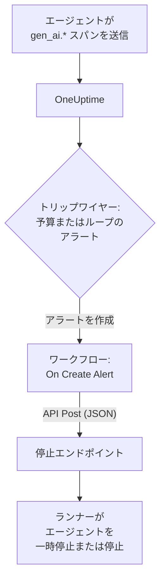

# AI エージェントのサーキットブレーカー

AI エージェントがクラッシュして失敗することはめったにありません。失敗するのは動き続けるときです。壊れたツールを再試行し、同じ手順を計画し直し、さらにサブエージェントを起動し、そのたびにトークンが課金されます。このページでは、OneUptime にすでにある部品でそのためのサーキットブレーカーを作ります。暴走したエージェントに気づくアラートと、それを止めるためにあなたが管理するエンドポイントを呼び出すワークフローです。

:::cards
- [トリップワイヤーを選ぶ](#トリップワイヤーを選ぶ): 支出に、または何度も呼び出されるひとつのツールにアラートを出します。
- [停止エンドポイントを作る](#停止エンドポイントを作る): エージェントを一時停止する小さなサービスです。
- [ワークフローを作る](#ワークフローを作る): 新しいアラートからエンドポイントの呼び出しまで。
- [ブレーカーをテストする](#ブレーカーをテストする): まず手動で作動させ、次に実際の条件で作動させます。
:::

## 仕組み



ブレーカーは、エージェントが直接または [ゲートウェイ経由](/docs/telemetry/ai-gateways) ですでに送っている OpenTelemetry を監視し、リクエストの経路の中ではなく横で動作します。モデルの各呼び出しには何も追加されず、プロバイダー、SDK、ゲートウェイを変えても壊れません。

その代償は速さです。暴走したエージェントを止めるのはミリ秒単位ではなく分単位です。ステップ数の上限とタイムアウトはエージェント自体に残し、それをすり抜けたものをブレーカーで捕まえてください。

| トリップワイヤー | 捕まえるもの | アラートまでの時間 |
| --- | --- | --- |
| メトリクスモニターによる予算アラート | 原因が何であれ増え続ける支出 | 最大 15 分、加えてモニター側で一分ほど |
| トレースモニターによるループアラート | 何度も呼び出される同じツール | 1〜5 分 |

## 始める前に

- エージェントが GenAI スパンを OneUptime に送っていること。[AI / LLM オブザーバビリティ](/docs/telemetry/ai-llm-observability) を参照してください。
- エージェントのランナーを一時停止または停止でき、OneUptime から到達できる HTTPS エンドポイント。[停止エンドポイントを作る](#停止エンドポイントを作る) で作成します。
- プロジェクトでモニターとワークフローを作成する権限。

## トリップワイヤーを選ぶ

どちらのトリップワイヤーも結末は同じです。モニターがアラートを作成し、新しいアラートがワークフローを開始します。両方を設定してもかまいません。ワークフローはどちらが作動したかを区別しません。

### 予算アラート

支出は暴走したエージェントの最も確かな兆候です。予算は 15 分ごとにその日の AI 支出を合計し、`oneuptime.llm.budget.spend.usd` と `oneuptime.llm.budget.percent.used` の 2 つのメトリクスとして公開します。どちらも `oneuptime.llm.budget.id` に予算の ID を持ちます。

:::steps
1. **製品 → AI / LLM → 予算** を開き、 **LLM のコスト予算を作成** をクリックします。 **1 日の予算（USD）** を設定し、 **サービス（任意）** でエージェントのサービスを選んで、予算がそのエージェントだけを監視するようにします。
2. 新しい予算の行メニューで **ID を表示** を選び、ID をコピーします。
3. `oneuptime.llm.budget.percent.used` に対する [メトリクス モニター](/docs/monitor/metrics-monitor) を作成し、属性 `oneuptime.llm.budget.id` をコピーした ID で絞り込み、 **時間範囲** を **過去 30 分** に設定します。
4. アラートを作成する条件 **Greater Than Or Equal To** `100` を追加し、エージェントの名前を含む **アラートタイトル** を付けます。たとえば `LLM budget exceeded: support-bot` です。このタイトルはワークフローとエンドポイントの両方が読み取ります。
:::

名前ではなく ID で絞り込んでください。予算の名前を変えるとその系列の名前も変わり、古い名前で絞り込んだモニターは何も言わずに一致しなくなります。時間範囲は 30 分のままにしてください。予算は 15 分ごとに 1 点しか公開しないため、それより短い範囲では 2 点のあいだに何も見つからず、アラートが開いては解決するのを繰り返します。

`80` に重大度の低い 2 つ目の条件を加えると、ブレーカーが `100` で作動する前に、アラートのオンコールポリシーを通じてまず人に警告が届きます。

### ループアラート

行き詰まったエージェントは見分けのつく痕跡を残します。同じツールのスパンが何度も何度も続くのです。正常な実行がひとつのツールを数分で何十回も呼ぶことはないので、件数を数えれば予算よりずっと早くループを捕まえられます。

:::steps
1. **モニター** を開き、 **モニターを作成** をクリックして、 **その他のモニターの種類** の下にある **トレース** を選びます。
2. **その他の項目** の下で、 **テレメトリサービスでフィルター** にエージェントのサービスを、 **属性でフィルター** にループしそうなツールと等しい `gen_ai.tool.name` を設定します。たとえば `search_web` です。インストルメンテーションがツールごとのスパンに名前を付けている場合は、代わりにその名前を **スパン名** に入れます。
3. **トレースの監視期間（時間）** を **過去 5 分** に設定します。
4. 正常な実行が 5 分間で決して届かない数、たとえば `50` を使って、 **Span Count** **Greater Than** の条件を追加し、 `Agent loop: support-bot` のようなタイトルでアラートを作成するようにします。
:::

**スパンステータスでフィルター** を **エラー** にして件数を低めにした 2 つ目のトレースモニターは、再試行の嵐を捕まえます。失敗し続けるツールと、それを試し続けるエージェントです。

## 停止エンドポイントを作る

ワークフローは、あなたが運用するエンドポイントに JSON 本文付きの `POST` を送ります。「停止」が何を意味するかはあなたが決めます。影響の小さいものから大きいものへ:

| 動作 | 効果 |
| --- | --- |
| 新しい作業を止める | ランナーはそのエージェントの新しい実行を開始しない |
| 実行をキャンセルする | そのエージェントの実行中の処理がキャンセルされる |
| プールを一時停止する | 誰かがブレーカーをリセットするまで、すべてのワーカーが処理を終えて止まる |

エージェントごとにブレーカーを作動させる、Express による最小限のエンドポイント:

```typescript title="circuit-breaker.ts"
import express from "express";

const app = express();
app.use(express.json());

const tripped = new Set<string>(); // agents whose breaker is open

app.post("/circuit-breaker", (req, res) => {
  if (req.headers["authorization"] !== `Bearer ${process.env.KILL_TOKEN}`) {
    return res.status(401).end();
  }

  const alertTitle: string = req.body.alertTitle ?? "";

  // "LLM budget exceeded: support-bot" -> "support-bot"
  const agent: string = alertTitle.split(": ").pop() ?? "unknown";

  tripped.add(agent); // your run loop checks this set
  abortActiveRuns(agent); // cancel that agent's runs in flight

  // Answer fast; do the slow cleanup in the background.
  return res.status(200).json({ tripped: agent });
});
```

次のルールに沿って作ってください。

- 作動を冪等にします。警告と超過、あるいは予算アラートとループアラートが同時に来ると、複数回作動することがあります。2 回目の作動では何も変わってはいけません。
- 1〜2 秒以内に応答し、後片付けはバックグラウンドで行います。ワークフローは 2xx の応答をすべて成功とみなします。
- シークレットを必須にします。エンドポイントを呼び出せる人なら誰でもエージェントを止められるため、ワークフローがシークレットのグローバル変数から送る bearer トークンを確認してください。
- リセットは手動で行います。作動したブレーカーは、誰かが実行を確認するまで作動したままです。 **製品 → AI / LLM → 会話** でエージェントの会話を開くと、何をしたかを読んだり再生したりできます。

リクエストは OneUptime から送られます。OneUptime Cloud では、エンドポイントにインターネットから到達できる必要があります。セルフホストのインストールでは、管理者が許可しない限りプライベートネットワークのアドレスは拒否されます。 [送信ネットワークアクセス](/docs/workflows/configuration#送信ネットワークアクセス) を参照してください。

## ワークフローを作る

まず、エンドポイントのトークンを、ワークフローが表示せずに使える場所に保存します。 **ワークフロー → グローバル変数** を開き、 **ワークフロー変数を作成** をクリックし、名前を `AGENT_KILL_TOKEN` にして、トークンを **コンテンツ** に入れ、 **シークレット** をオンにします。シークレットの値は実行ログとステップのトレースから取り除かれます。

:::steps
### ワークフローを作成する

**製品 → ワークフロー** を開き、 **ワークフローを作成** をクリックします。 **ゼロから作成** をクリックし、名前を `AI agent circuit breaker` にして、 **ワークフローを作成** をクリックします。ワークフローはオフの状態で **ビルダー** に開きます。

### トリガーを追加する

点線のブロック **このワークフローを開始するものを選択** をクリックし、 **トリガーを追加** パネルで **On Create Alert** を選びます。トリガーをクリックし、 **Select Fields** でタイトルと説明にチェックを入れて、 **保存** をクリックします。ブロックに表示される ID `alert-on-create-1` は、後続のブロックがこのブロックを参照するときに使います。

### タイトルを確認する

**コンポーネントを追加** をクリックして **If / Else** を選び、トリガーの **Success** の点をそこにつなぎます。 **Value to check** にはアラートのタイトル（ **{ }** をクリックして選びます）、 **Comparison** には **を含む**、 **Compare with** にはトリップワイヤーのタイトルに共通する書き出し、たとえば `LLM budget exceeded` を設定します。

### エンドポイントを呼び出す

**API Post (JSON)** を追加し、 **If / Else** の **Yes** の点をそこにつなぎます。 **URL** にはエンドポイント、たとえば `https://agents.example.com/circuit-breaker` を設定し、下のヘッダーと本文を入力します。

### 失敗を通知する

**Send Message to Slack** または **Send Email** を追加し、API ブロックの **Error** の点をそこにつなぎます。作動に失敗したブレーカーこそ、人が必ず見なければならないアラートです。

### オンにする

**ビルダー** の上部で **有効** をオンにします。
:::

API ブロックの **Request Headers**:

```json title="Request Headers"
{
  "Authorization": "Bearer {{global.variables.AGENT_KILL_TOKEN}}",
  "Content-Type": "application/json"
}
```

その **Request Body**:

```json title="Request Body"
{
  "source": "oneuptime-circuit-breaker",
  "alertId": "{{local.components.alert-on-create-1.returnValues.model._id}}",
  "alertTitle": "{{local.components.alert-on-create-1.returnValues.model.title}}",
  "alertDescription": "{{local.components.alert-on-create-1.returnValues.model.description}}"
}
```

複数のトリップワイヤーに反応させるには、すべてのタイトルを同じ書き出しにするか、 **No** の点から **If / Else** ブロックをさらにつなげます。キャンバスについては [ワークフローの作成](/docs/workflows/authoring) を、 `{{…}}` の参照については [変数](/docs/workflows/variables) を参照してください。

## ブレーカーをテストする

:::steps
1. 手動で作動させます。 **アラート** を開き、 **アラートを作成** をクリックして、タイトルが `LLM budget exceeded: test` のアラートを作成します。実行は **ワークフロー → ログ → 実行履歴** に表示され、エンドポイントにリクエストが届きます。
2. 実際の条件で作動させます。テスト用エージェントのサービスに、たとえば `0.01` USD のようなごく小さい上限の予算を作成し、予算モニターをそれに向けてエージェントを動かします。割合が 100 を超え、アラートが開き、ワークフローが実行され、ブレーカーが作動します。ループアラートの場合は、常に失敗するツールをテスト用エージェントに与えます。
3. 2 回作動させます。同じアラートをもう一度作成します。エンドポイントは何も変えずに 2 回目の作動を受け入れなければなりません。
:::

## ブレーカーの時間経過による動作

- ワークフローはアラートの作成時に実行されるため、トリップワイヤーはブレーカーを評価ごとではなくアラートごとに 1 回作動させます。
- 予算は UTC の 1 日を数えるため、割合は UTC の午前 0 時に 0 から数え直されます。そのとき予算アラートが解決し、次に支出が膨らんだ日には新しいアラートが開いて、ブレーカーが再び作動します。
- モニターは条件が満たされているあいだアラートを開いたままにします。 **アラートを自動解決** をオンにすると、条件が満たされなくなった時点でアラートが解決し、次の超過で新しいアラートが開きます。
- リセットは両側で人が判断します。OneUptime でアラートを解決し、ランナーでブレーカーをリセットします。
- プロジェクトの新しいアラートはすべてワークフローを開始します。ほかのアラートをブレーカーから遠ざけているのは **If / Else** です。省かないでください。

## トラブルシューティング

:::details ワークフローが実行されない
**ビルダー** の上部で **有効** がオンになっているか確認してください。ワークフローはオフの状態で作成されます。次に、ワークフローをオンにした後でアラートが作成されたか確認してください。トリガーが実行を開始するのは新しいアラートに対してだけです。
:::

:::details ワークフローは実行されるが、常に No の分岐に進む
タイトルが空か、一致していません。トリガーの **Select Fields** でチェックされていない項目は空で届くので、タイトルにチェックを入れてください。次に、アラートのタイトルを **Compare with** と比べてください。 **を含む** は、その文字列をそのまま見つけられなければなりません。
:::

:::details エンドポイントが 401 を返す
`Authorization` ヘッダーが、エンドポイントの期待するトークンと一致していません。 `{{global.variables.AGENT_KILL_TOKEN}}` の名前と、グローバル変数に保存した値を確認してください。シークレット変数の値は読み戻せないので、不安なときは **内容を更新** で入力し直してください。
:::

:::details 予算アラートが開いては解決するのを繰り返す
モニターの **時間範囲** が、予算の点と点の間隔である 15 分より短くなっています。 **過去 30 分** に設定してください。
:::

:::details リクエストがエンドポイントに届かない
**ワークフロー → ログ → 実行履歴** で実行を開き、 **API Post (JSON)** のステップを確認してください。リクエストが失敗した理由が表示されます。OneUptime Cloud では、エンドポイントにインターネットから到達できる必要があります。セルフホストのインストールでは、管理者が許可しない限りプライベートネットワークのアドレスは拒否されます。
:::

## 次のステップ

:::cards
- [AI / LLM オブザーバビリティ](/docs/telemetry/ai-llm-observability): 予算、コスト、ブレーカーが監視するスパン。
- [トレース モニター](/docs/monitor/traces-monitor): スパンのフィルターと条件の詳細。
- [ワークフロー](/docs/workflows/index): トリガー、コンポーネント、変数、実行。
- [AI ゲートウェイ](/docs/telemetry/ai-gateways): すべてのエージェントのモデル呼び出しをひとつのエクスポートで。
:::
